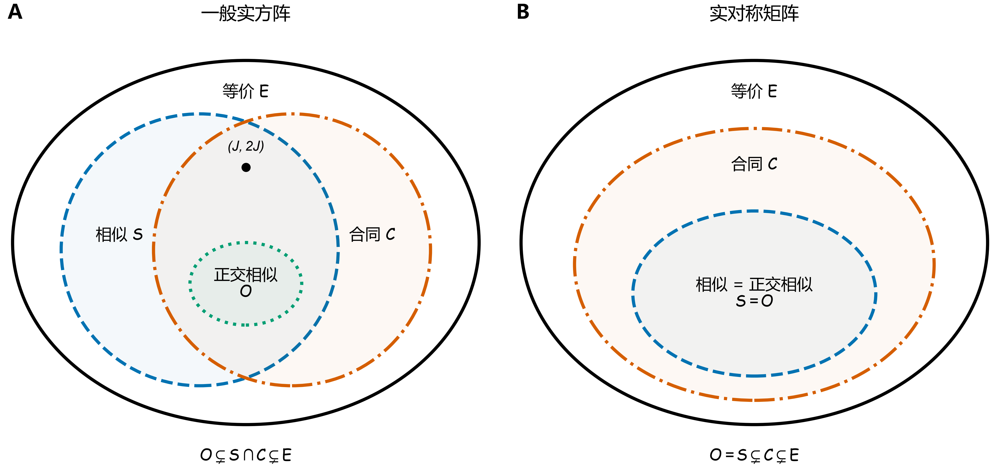

# 矩阵变换与不变量

本篇汇总矩阵变换的不变量、代表形式与包含关系。**不变量**在同一等价类上取值相同；**完全不变量**还足以判定所属等价类。数值不变量的保持与矩阵结构的保持分别比较，证明见文末链接。

[保持性对照](#comparison) · [完全不变量](#classification) · [包含关系图](#inclusions) · [证明与参考](#references)

## 1. 对象与记号 {#notation}

设 $\mathbb F=\mathbb R$ 或 $\mathbb C$，$A\in\mathbb F^{m\times n}$；讨论谱、迹、行列式与惯性时，另要求 $m=n$。转置与共轭转置沿用 [符号体系](./符号体系.md#notation) 的约定：

| 记号 | 含义 |
| --- | --- |
| $A^{\mathsf T}$、$A^{H}=\overline{A}^{\mathsf T}$ | 转置、共轭转置；实矩阵有 $A^{H}=A^{\mathsf T}$ |
| $r=\operatorname{rank}(A)$ | 秩 |
| $p_A(\lambda)=\det(\lambda I_n-A)$、$\sigma(A)$ | 特征多项式、谱（特征值的集合） |
| $\lambda_1,\dots,\lambda_n$ | 按代数重数列出的特征值 |
| $\sigma_1(A)\geq\cdots\geq\sigma_{\min(m,n)}(A)\geq0$ | 奇异值 |
| $\operatorname{In}(A)=(i_+(A),i_-(A),i_0(A))$ | Hermitian 矩阵的惯性（inertia）：正、负、零特征值的个数 |
| $\operatorname{sig}(A)=i_+(A)-i_-(A)$ | 本文采用的符号差（signature）记号 |

本库用 $A^{H}$ 表示共轭转置，$A^{*}$ 专指伴随矩阵（adjugate）。

惯性在本文限于 $A^{H}=A$；实数域上即 $A^{\mathsf T}=A$。各个数均计入重数，且

$$
i_+(A)+i_-(A)+i_0(A)=n,\qquad
\operatorname{rank}(A)=i_+(A)+i_-(A),\qquad
i_0(A)=\dim\ker(A).
$$

**谱不包含 Jordan 块结构**；即使特征值及其代数重数相同，也未必相似。

## 2. 常见变换 {#transformations}

下表先比较实数域上的四种关系；$P,R,S,C$ 均为相应阶数的可逆矩阵，$Q$ 为正交矩阵，$r=\operatorname{rank}(A)$。

| 关系 | 矩阵定义 | 变换含义 | 主要不变量 | 对角化 / 标准形 | 典型对象 |
| --- | --- | --- | --- | --- | --- |
| **等价** | $B=PAR$ | 左、右分别乘可逆矩阵，即可逆行变换与列变换 | 秩 $r$ | 秩标准形 $E_r=\begin{pmatrix}I_r&O\\O&O\end{pmatrix}$ | 同型矩阵，可为矩形矩阵 |
| **相似** | $B=S^{-1}AS$ | 同一线性算子在不同基下的矩阵 | $p_A(\lambda)$、特征值及重数、最小多项式、迹、行列式、秩、Jordan 块结构 | 可对角化时为 $\Lambda$；复数域上一般为 Jordan 标准形，实数域上可用有理标准形 | 同阶方阵 |
| **合同** | $B=C^{\mathsf T}AC$ | 双线性形式换基；实对称情形为二次型的可逆变量替换 | 秩；实对称情形还保持惯性 $(i_+,i_-,i_0)$ | 实对称矩阵可合同对角化，规范形为 $\operatorname{diag}(I_{i_+},-I_{i_-},O_{i_0})$ | 同阶实方阵，重点为实对称矩阵 / 二次型 |
| **正交相似** | $B=Q^{\mathsf T}AQ$，$Q^{\mathsf T}Q=I_n$ | 同一线性算子在不同标准正交基下的矩阵 | 相似不变量、奇异值、Frobenius 范数、谱范数；实对称情形还保持惯性 | 实对称矩阵可化为 $\operatorname{diag}(\lambda_1,\dots,\lambda_n)$；一般实方阵可化为实 Schur 形式 | 同阶实方阵，重点为实对称矩阵 |

实正规矩阵未必能实正交对角化；相应的复数域结论是**复正规矩阵可酉对角化**。复数域上的星合同、酉相似及其他变换见下文。

### 2.1 等价变换

存在可逆 $P\in\mathbb F^{m\times m}$、$R\in\mathbb F^{n\times n}$ 使 $B=PAR$ 时，称同型矩阵 $A,B$ **等价**。固定尺寸下，等价当且仅当秩相同。

代表形式为表中的**秩标准形** $E_r$；不称 Smith 标准形，后者通常用于主理想整环上的矩阵分类。

### 2.2 相似变换

存在可逆 $S\in\mathbb F^{n\times n}$ 使 $B=S^{-1}AS$ 时，称 $A,B$ **相似**，记 $A\sim B$。相似保持特征多项式 $p_B(\lambda)=p_A(\lambda)$ 及表中各项相似不变量。

**相似对角化：** $S^{-1}AS=\Lambda=\operatorname{diag}(\lambda_1,\dots,\lambda_n)$ 存在，当且仅当 $A$ 在所讨论域上有 $n$ 个线性无关的特征向量。一般复方阵的标准形是 Jordan 形；可对角化当且仅当所有 Jordan 块为 $1\times1$。

**相似保持实特征值的正、负、零计数，但不保证保持实对称 / Hermitian 结构。** 若两端均为 Hermitian 矩阵，则惯性相同；不要把结构可能改变理解为符号计数改变。

### 2.3 合同与星合同变换

存在可逆 $C$ 使 $B=C^{\mathsf T}AC$ 时，称二者**合同**；复数域中 $B=C^{H}AC$ 称为**星合同**。实合同保持实对称性，复星合同保持 Hermitian 性。

**Sylvester 惯性定理：** 实对称 / Hermitian 矩阵的合同 / 星合同保持惯性、符号差及定号性，但一般不保持特征值的数值。规范形为 $\operatorname{diag}(I_{i_+},-I_{i_-},O_{i_0})$；两个同阶矩阵在这一对象范围内合同 / 星合同，当且仅当惯性相同。

复数域上的普通合同 $C^{\mathsf T}AC$ 一般不保持 Hermitian 性或惯性；须与星合同区分。

### 2.4 正交相似与酉相似

取实正交 / 复酉矩阵 $Q$，令 $B=Q^{H}AQ$。由于 $Q^{-1}=Q^{H}$，该变换既是相似，又是实合同 / 复星合同；还保持奇异值、谱范数 $\lVert A\rVert_2$ 和 Frobenius 范数 $\lVert A\rVert_F$。

**对角化条件：** 实对称矩阵必可正交对角化；复矩阵可酉对角化当且仅当正规，即 $A^{H}A=AA^{H}$。实正规矩阵未必可实正交对角化。

**一般形式：** 复方阵可酉相似化为上三角 Schur 形式；实方阵可正交相似化为含 $1\times1$、$2\times2$ 对角块的实 Schur 形式。

### 2.5 正交等价与酉等价

存在正交 / 酉矩阵 $U\in\mathbb F^{m\times m}$、$V\in\mathbb F^{n\times n}$ 使 $B=U^{H}AV$ 时，称二者**正交 / 酉等价**；两侧换基独立，不同于正交 / 酉相似。

任意矩阵均可通过 SVD 化为矩形对角形 $\Sigma$，即 $U^{H}AV=\Sigma$。固定尺寸下，两个矩阵正交 / 酉等价当且仅当全部奇异值相同；秩及所有酉不变范数保持，特征值一般不保持。

### 2.6 转置

转置 $A\mapsto A^{\mathsf T}$ 保持秩与奇异值；方阵还满足 $A^{\mathsf T}\sim A$，故保持全部相似不变量。转置保持实对称 / Hermitian 结构及相应惯性。

共轭转置 $A\mapsto A^{H}$ 一般将特征值变为其共轭，须与普通转置区分。转置本身不另设分类标准形。

## 3. 保持性对照 {#comparison}

表中 $\checkmark$ 表示在该列的对象范围内均保持，$\times$ 表示一般不保证。合同一行在实数域指实合同，在复数域指星合同；“结构”指相应的实对称性或 Hermitian 性。**惯性列比较变换前后均为实对称 / Hermitian 矩阵的情形**；结构列另行判断是否保证输出仍属于这一类。

| 变换 | 秩 | 特征值及重数 | Jordan 结构 | 实对称 / Hermitian 结构 | 惯性（两端为 Hermitian） | 奇异值 | 迹 / 行列式 |
| --- | --- | --- | --- | --- | --- | --- | --- |
| 等价 $PAR$ | $\checkmark$ | $\times$ | $\times$ | $\times$ | $\times$ | $\times$ | $\times$ |
| 相似 $S^{-1}AS$ | $\checkmark$ | $\checkmark$ | $\checkmark$ | $\times$ | $\checkmark$ | $\times$ | $\checkmark$ |
| 实合同 / 复星合同 $C^{H}AC$ | $\checkmark$ | $\times$ | $\times$ | $\checkmark$ | $\checkmark$ | $\times$ | $\times$ |
| 正交 / 酉相似 $Q^{H}AQ$ | $\checkmark$ | $\checkmark$ | $\checkmark$ | $\checkmark$ | $\checkmark$ | $\checkmark$ | $\checkmark$ |
| 正交 / 酉等价 $U^{H}AV$ | $\checkmark$ | $\times$ | $\times$ | $\times$ | $\times$ | $\checkmark$ | $\times$ |
| 转置 $A^{\mathsf T}$ | $\checkmark$ | $\checkmark$ | $\checkmark$ | $\checkmark$ | $\checkmark$ | $\checkmark$ | $\checkmark$ |

惯性是特征值符号的计数，因此保持全部特征值必然保持这些计数。相似一行的惯性为 $\checkmark$、结构为 $\times$，分别表达数值保持与结构未必保持；不能据后一结论推断“相似改变特征值的符号计数”。

行列式的数值虽然一般改变，仍有以下精确关系（限方阵）：

$$
\begin{aligned}
\det(PAR)&=\det(P)\det(A)\det(R),\\
\det(C^{H}AC)&=\lvert\det(C)\rvert^2\det(A),\\
\det(U^{H}AV)&=\overline{\det(U)}\det(V)\det(A).
\end{aligned}
$$

因此实合同与复星合同保持实对称 / Hermitian 矩阵行列式的符号，正交 / 酉等价保持行列式的模；它们都不必保持行列式本身。

## 4. 完全不变量与代表形式 {#classification}

以下各行均在固定矩阵尺寸及所列对象范围内讨论。

| 等价关系 | 对象范围 | 完全不变量 | 代表形式 |
| --- | --- | --- | --- |
| 一般等价 | $\mathbb F^{m\times n}$ | 秩 $r$ | 秩标准形 $E_r$ |
| 相似 | 复方阵 | 特征值与 Jordan 块的大小、个数 | Jordan 标准形 |
| 实合同 / 复星合同 | 实对称 / Hermitian 矩阵 | 惯性 $\operatorname{In}(A)$ | $\operatorname{diag}(I_{i_+},-I_{i_-},O_{i_0})$ |
| 正交 / 酉等价 | $\mathbb F^{m\times n}$ | 全部奇异值 | SVD 的 $\Sigma$ |
| 酉相似 | 复正规矩阵 | 特征值及代数重数 | $\operatorname{diag}(\lambda_1,\dots,\lambda_n)$ |

Jordan 块的排列不影响相似类；在非代数闭域上，可使用有理标准形。一般矩阵的酉相似类不能仅由特征值决定，Schur 形式也不是唯一的分类标准形。[MIT：相似矩阵与 Jordan 形式](https://ocw.mit.edu/courses/18-06sc-linear-algebra-fall-2011/pages/positive-definite-matrices-and-applications/similar-matrices-and-jordan-form/)

## 5. 关系的包含 {#inclusions}

固定阶数 $n\geq2$，将关系视为有序矩阵对 $(A,B)$ 的集合，分别记等价、相似、实合同、正交相似关系为 $\mathcal E,\mathcal S,\mathcal C,\mathcal O$。集合包含 $\mathcal R_1\subseteq\mathcal R_2$ 表示“满足关系 $\mathcal R_1$ 必然满足关系 $\mathcal R_2$”。

**图 1.** A：一般实方阵对；B：实对称矩阵对。区域表示关系集合，面积不表示数量；限制对象范围后，各集合的包含关系随之改变。[矢量 PDF](./image/矩阵变换与不变量/relation-inclusions.pdf) · [SVG](./image/矩阵变换与不变量/relation-inclusions.svg) · [绘图脚本](./image/矩阵变换与不变量/make_relation_diagram.py)

1. **一般实方阵。** 相似与合同均蕴含等价，正交相似同时蕴含相似与合同：

   $$
   \mathcal S\subsetneq\mathcal E,\qquad
   \mathcal C\subsetneq\mathcal E,\qquad
   \mathcal O\subsetneq\mathcal S\cap\mathcal C.
   $$

   相似与合同互不蕴含；“既相似又合同”不必“正交相似”。图中的 $(J,2J)$ 为反例，$J=\begin{pmatrix}0&1\\0&0\end{pmatrix}$。

2. **实对称矩阵。** 有以下关系：

   $$
   \boxed{\text{正交相似}\iff\text{相似}\implies\text{合同}\implies\text{等价}},
   \qquad \mathcal O=\mathcal S\subsetneq\mathcal C\subsetneq\mathcal E.
   $$

   反向一般不成立：$I_n$ 与 $2I_n$ 合同而不相似；$I_n$ 与 $\operatorname{diag}(-1,I_{n-1})$ 等价而不合同。这里“存在正交换基”不表示原来给定的相似变换矩阵必须正交。

对 Hermitian 矩阵，将“正交相似、实合同”分别换为“酉相似、星合同”，第二条推导关系仍成立。

## 6. 适用条件与反例 {#examples}

1. **同谱未必相似。** $I_2$ 与 $\begin{pmatrix}1&1\\0&1\end{pmatrix}$ 的特征值均为 $1,1$，但最小多项式分别是 $\lambda-1$ 与 $(\lambda-1)^2$，因此不相似。
2. **合同不必保持特征值。** 对 $A=\operatorname{diag}(1,-1)$、$C=\operatorname{diag}(2,3)$，有 $C^{\mathsf T}AC=\operatorname{diag}(4,-9)$；两者惯性均为 $(1,1,0)$，但特征值和奇异值改变。
3. **相似保持特征值符号，但不必保持二次型正定性。** 对 $A=\operatorname{diag}(1,2)$、$S=\begin{pmatrix}1&4\\0&1\end{pmatrix}$，有 $B=S^{-1}AS=\begin{pmatrix}1&-4\\0&2\end{pmatrix}$。两者特征值均为 $1,2$，但取 $x=(1,1)^{\mathsf T}$，有 $x^{\mathsf T}Bx=-1$。

第三例的二次型取决于 $B_s=(B+B^{\mathsf T})/2$，不是 $B$ 的特征值；相似不保证对称部分的惯性保持。

正交 / 酉相似保证结构保持，但给定相似变换的矩阵未必必须正交 / 酉；例如 $S=2I_n$ 总有 $S^{-1}AS=A$。

## 7. 证明与参考链接 {#references}

- 等价与秩：[矩阵：三种等价关系的对比](../02_矩阵与运算/矩阵.md#equivalence-relations)。
- 相似不变量与对角化：[相似矩阵](../07_矩阵分解/01_特征结构与标准形/01_特征值与对角化/02_相似矩阵.md)、[相似对角化与特征分解](../07_矩阵分解/01_特征结构与标准形/01_特征值与对角化/03_相似对角化与特征分解.md)；[MIT：相似矩阵与 Jordan 形式](https://ocw.mit.edu/courses/18-06sc-linear-algebra-fall-2011/pages/positive-definite-matrices-and-applications/similar-matrices-and-jordan-form/)。
- 正交对角化：[实对称矩阵与正交对角化](../07_矩阵分解/01_特征结构与标准形/02_正规与对称情形/02_实对称矩阵与正交对角化.md)。
- 惯性定理与规范形：[二次型的正定性与惯性定理](../08_二次型与合同/二次型的正定性与惯性定理.md#inertia)、[实对称矩阵的规范型](../08_二次型与合同/实对称矩阵的规范型.md#inertia)；[Higham, 2022](https://nhigham.com/2022/12/06/what-is-the-inertia-of-a-matrix/)。
- 复合同与星合同：Horn, R. A., & Sergeichuk, V. V. (2006). [Canonical forms for complex matrix congruence and *congruence](https://arxiv.org/html/0709.2473v1). *Linear Algebra and its Applications*, 416, 1010-1032.
- Schur 与 SVD：LAPACK [Schur 分解](https://www.netlib.org/lapack/lug/node50.html)；LAPACK95 [SVD](https://www.netlib.org/lapack95/lug95/node35.html)。
- 记号参考：[共轭转置记法](https://mathworld.wolfram.com/ConjugateTranspose.html)。

[返回本节索引](./README.md)
