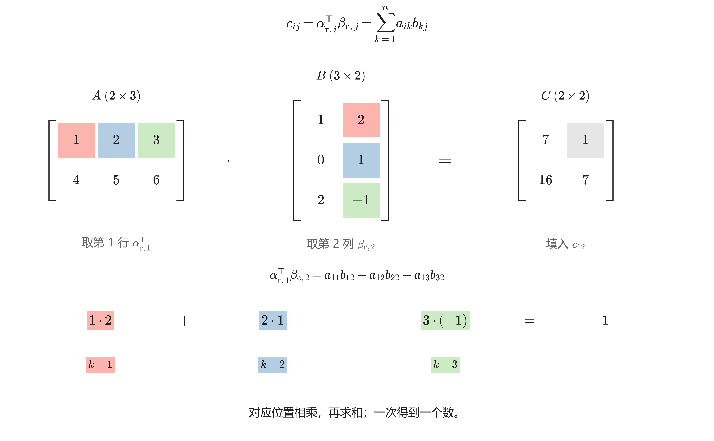
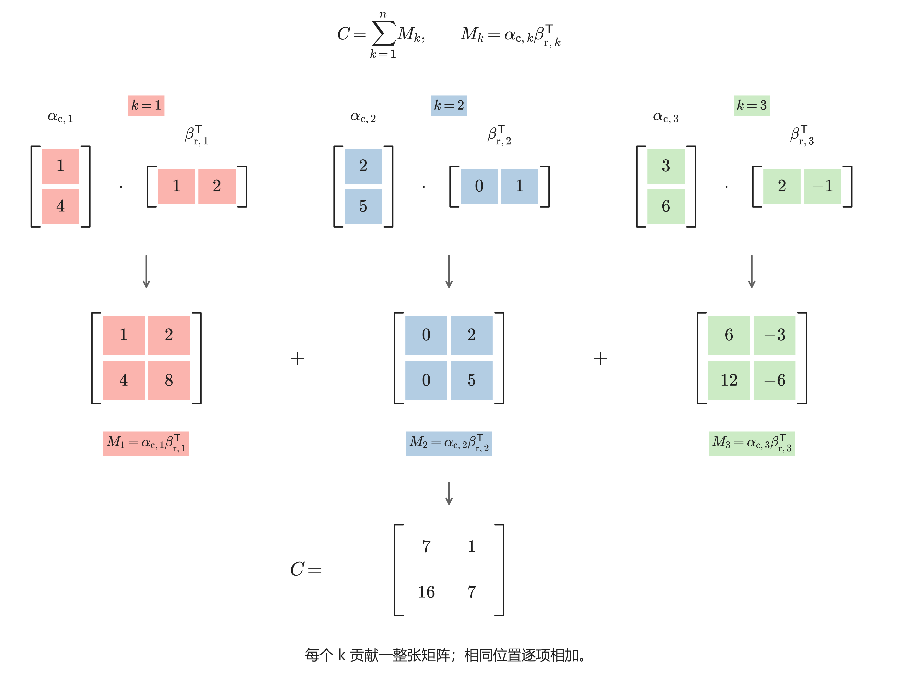
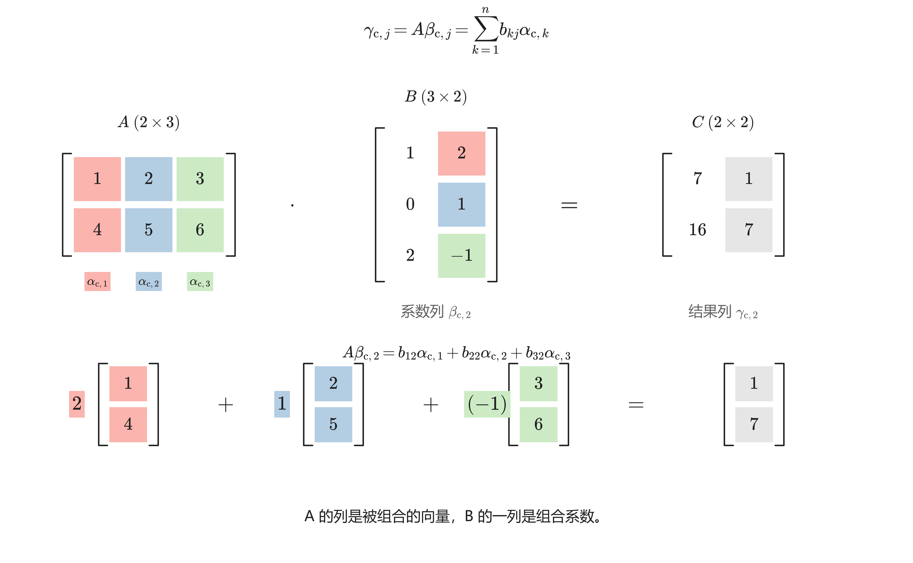
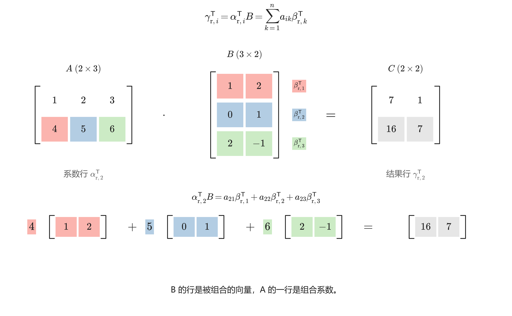

# 矩阵乘法的四种视角

矩阵乘法 $AB=C$ 可以按**一个元素、一个外积贡献、一整列、一整行**来理解。四种视角使用同一个乘法规则，只是每次关注的对象不同。

## 1. 统一符号与尺寸 {#notation}

遵循[符号体系](../00_总览/符号体系.md#notation)的字体、转置与元素下标规范，并在本文区分三个层次：**矩阵用 $A,B,C$，向量用 $\alpha,\beta,\gamma$，元素用 $a,b,c$。** 设

$$
A=(a_{ik})\in\mathbb F^{m\times n},\qquad
B=(b_{kj})\in\mathbb F^{n\times p},\qquad
C=(c_{ij})=AB\in\mathbb F^{m\times p}.
$$

其中 $\mathbb F$ 为 $\mathbb R$ 或 $\mathbb C$。固定 $i\in\{1,\dots,m\}$、$j\in\{1,\dots,p\}$；$k\in\{1,\dots,n\}$ 是求和指标。**$n$ 是相乘时对齐的维数，$p$ 是结果的列数，不用 $p$ 同时表示求和指标。**

### 1.1 用向量把矩阵拆开

**$\alpha$ 属于 $A$，$\beta$ 属于 $B$，$\gamma$ 属于 $C$；小下标 $\mathrm c$ 表示按列提取（column），$\mathrm r$ 表示按行提取（row）。不带转置的向量一律为列向量，带 $\mathsf T$ 的形式为行向量。**

$$
\begin{aligned}
\alpha_{\mathrm c,k}&=\begin{bmatrix}a_{1k}\\\vdots\\a_{mk}\end{bmatrix},
&\alpha_{\mathrm r,i}^{\mathsf T}&=\begin{bmatrix}a_{i1}&\cdots&a_{in}\end{bmatrix},\\
\beta_{\mathrm c,j}&=\begin{bmatrix}b_{1j}\\\vdots\\b_{nj}\end{bmatrix},
&\beta_{\mathrm r,k}^{\mathsf T}&=\begin{bmatrix}b_{k1}&\cdots&b_{kp}\end{bmatrix},\\
\gamma_{\mathrm c,j}&=\begin{bmatrix}c_{1j}\\\vdots\\c_{mj}\end{bmatrix},
&\gamma_{\mathrm r,i}^{\mathsf T}&=\begin{bmatrix}c_{i1}&\cdots&c_{ip}\end{bmatrix}.
\end{aligned}
$$

于是同一个矩阵可以横着按列拼，也可以竖着按行叠：

$$
A=\begin{bmatrix}\alpha_{\mathrm c,1}&\cdots&\alpha_{\mathrm c,n}\end{bmatrix}
=\begin{bmatrix}\alpha_{\mathrm r,1}^{\mathsf T}\\\vdots\\\alpha_{\mathrm r,m}^{\mathsf T}\end{bmatrix},
$$

$$
B=\begin{bmatrix}\beta_{\mathrm c,1}&\cdots&\beta_{\mathrm c,p}\end{bmatrix}
=\begin{bmatrix}\beta_{\mathrm r,1}^{\mathsf T}\\\vdots\\\beta_{\mathrm r,n}^{\mathsf T}\end{bmatrix}.
$$

| 记号 | 含义 | 尺寸 |
| --- | --- | --- |
| $a_{ik},b_{kj},c_{ij}$ | $A,B,C$ 的元素，均为标量 | $1\times1$ |
| $\alpha_{\mathrm c,k},\beta_{\mathrm c,j},\gamma_{\mathrm c,j}$ | $A,B,C$ 的对应列 | $m\times1$、$n\times1$、$m\times1$ |
| $\alpha_{\mathrm r,i}^{\mathsf T},\beta_{\mathrm r,k}^{\mathsf T},\gamma_{\mathrm r,i}^{\mathsf T}$ | $A,B,C$ 的对应行 | $1\times n$、$1\times p$、$1\times p$ |

这里 $\alpha_{\mathrm r,i}$ 是把 $A$ 的第 $i$ 行转成列后得到的向量，**不是 $A$ 的第 $i$ 列 $\alpha_{\mathrm c,i}$**。两者甚至可能长度不同，所以保留 $\mathrm r,\mathrm c$ 区分。

与本库其他笔记的切片记号对应：$\alpha_{\mathrm c,k}=a_{:k}$，$\alpha_{\mathrm r,i}^{\mathsf T}=a_{i:}$；$B,C$ 同理。

### 1.2 乘法的尺寸与顺序

从线性映射看，尺寸匹配对应

$$
\mathbb F^p\xrightarrow{\ T_B\ }\mathbb F^n
\xrightarrow{\ T_A\ }\mathbb F^m,\qquad
T_C=T_A\circ T_B.
$$

因此 $Cx=A(Bx)$：对列向量先作用 $B$，再作用 $A$。

### 1.3 贯穿全文的例子

$$
A=\begin{bmatrix}1&2&3\\4&5&6\end{bmatrix},\qquad
B=\begin{bmatrix}1&2\\0&1\\2&-1\end{bmatrix},\qquad
C=AB=\begin{bmatrix}7&1\\16&7\end{bmatrix}.
$$

这里 $(m,n,p)=(2,3,2)$。配图中的粉红色 `#fbb4ae`、浅蓝色 `#b3cde3`、浅绿色 `#ccebc5` 依次标记 $k=1,2,3$，以不透明色块标示对应项，数字与公式保持深色，并辅以位置、指标和文字；同一指标的乘法项在各图中保持同色。数学变量用斜体，数字、行列标记 $\mathrm r,\mathrm c$ 和转置 $\mathsf T$ 用直立体。

## 2. 内积视角：一行乘一列，得到一个元素 {#inner-product}

内积视角（inner-product view）直接给出矩阵乘法的代数定义：

$$
\boxed{c_{ij}=\alpha_{\mathrm r,i}^{\mathsf T}\beta_{\mathrm c,j}=\sum_{k=1}^{n}a_{ik}b_{kj}.}
$$

操作顺序是：**取 $A$ 的第 $i$ 行，取 $B$ 的第 $j$ 列；按相同的 $k$ 对齐，逐项相乘，再把乘积相加；结果填入 $C$ 的 $(i,j)$ 位置。**

$$
\begin{aligned}
\underbrace{\alpha_{\mathrm r,i}^{\mathsf T}}_{\text{取一行：}1\times n}
\underbrace{\beta_{\mathrm c,j}}_{\text{取一列：}n\times1}
&=\begin{bmatrix}a_{i1}&\cdots&a_{in}\end{bmatrix}
\begin{bmatrix}b_{1j}\\\vdots\\b_{nj}\end{bmatrix}\\
&=a_{i1}b_{1j}+\cdots+a_{in}b_{nj}\\
&=\underbrace{c_{ij}}_{\text{得到一个数}}.
\end{aligned}
$$

把所有行、列配对，乘法就写成一张“向量内积表”：

$$
C=
\begin{bmatrix}\alpha_{\mathrm r,1}^{\mathsf T}\\\vdots\\\alpha_{\mathrm r,m}^{\mathsf T}\end{bmatrix}
\begin{bmatrix}\beta_{\mathrm c,1}&\cdots&\beta_{\mathrm c,p}\end{bmatrix}
=\begin{bmatrix}
\alpha_{\mathrm r,1}^{\mathsf T}\beta_{\mathrm c,1}&\cdots&\alpha_{\mathrm r,1}^{\mathsf T}\beta_{\mathrm c,p}\\
\vdots&\ddots&\vdots\\
\alpha_{\mathrm r,m}^{\mathsf T}\beta_{\mathrm c,1}&\cdots&\alpha_{\mathrm r,m}^{\mathsf T}\beta_{\mathrm c,p}
\end{bmatrix}.
$$

图中计算的是

$$
\begin{aligned}
c_{12}&=\alpha_{\mathrm r,1}^{\mathsf T}\beta_{\mathrm c,2}\\
&=\begin{bmatrix}1&2&3\end{bmatrix}\begin{bmatrix}2\\1\\-1\end{bmatrix}\\
&=1\cdot2+2\cdot1+3\cdot(-1)=1.
\end{aligned}
$$

把 $i,j$ 遍历一遍，就得到全部 $mp$ 个元素。

### 2.1 “内积”一词的适用范围

在实数域上，$\alpha_{\mathrm r,i},\beta_{\mathrm c,j}\in\mathbb R^n$，故 $c_{ij}=\alpha_{\mathrm r,i}^{\mathsf T}\beta_{\mathrm c,j}=\langle\alpha_{\mathrm r,i},\beta_{\mathrm c,j}\rangle$，确实是通常的欧氏内积。

在复数域上，普通矩阵乘法仍然用 $\mathsf T$，**不自动取共轭**。若约定复内积对第一项取共轭、即用共轭转置 $H$，则

$$
c_{ij}=\alpha_{\mathrm r,i}^{\mathsf T}\beta_{\mathrm c,j}
=\langle\overline{\alpha_{\mathrm r,i}},\beta_{\mathrm c,j}\rangle.
$$

因此复数情形更准确地说是“行列配对”或双线性配对；不能直接把 $AB$ 改成带共轭的乘法。

### 2.2 典型作用：求元素、判断正交、构造 Gram 矩阵 {#inner-uses}

**（1）只计算关心的元素或解释加权打分。** 如果问题只问 $c_{ij}$，直接取 $\alpha_{\mathrm r,i}^{\mathsf T}$ 和 $\beta_{\mathrm c,j}$ 即可，无须算出整个 $C$。例如把 $\alpha_{\mathrm r,i}$ 看作第 $i$ 组权重、$\beta_{\mathrm c,j}$ 看作第 $j$ 个对象的特征，则

$$
c_{ij}=a_{i1}b_{1j}+\cdots+a_{in}b_{nj}
$$

就是“每个特征乘对应权重，再求和”的分数。**一个输出值依赖哪些输入项、各项权重是多少**，从这个视角最容易读出。

**（2）把零元素或零乘积翻译成正交关系。** 在实数域上，

$$
c_{ij}=0\iff\alpha_{\mathrm r,i}\perp\beta_{\mathrm c,j},\qquad
AB=O\iff\alpha_{\mathrm r,i}\perp\beta_{\mathrm c,j}\quad\text{对所有 }i,j.
$$

这适合判断“哪一行与哪一列互相抵消”，以及理解两个非零矩阵为什么仍可能乘出零矩阵。注意一个 $c_{ij}=0$ 只说明一对向量正交，不能推出整个乘积为零。

**（3）计算向量间的内积、长度与相似程度。** 对实矩阵 $A$，Gram 矩阵（Gram matrix）$G=A^{\mathsf T}A\in\mathbb R^{n\times n}$ 满足

$$
G_{k\ell}=\alpha_{\mathrm c,k}^{\mathsf T}\alpha_{\mathrm c,\ell},\qquad
G_{kk}=\lVert\alpha_{\mathrm c,k}\rVert_2^2,
\qquad 1\leq k,\ell\leq n.
$$

所以 $G$ 把 $A$ 各列的两两内积集中在一张表里。沿用本文例子，$G_{12}=(1,4)(2,5)^{\mathsf T}=22$。判断列向量是否正交、建立最小二乘中的正规方程，都可以从这张内积表理解；复数域的 Gram 矩阵应使用 $A^{H}A$。

## 3. 外积视角：一列乘一行，贡献一整张矩阵 {#outer-product}

外积视角（outer-product view）固定中间指标 $k$：取 $A$ 的第 $k$ 列与 $B$ 的第 $k$ 行，形成矩阵外积

$$
M_k=\alpha_{\mathrm c,k}\beta_{\mathrm r,k}^{\mathsf T}\in\mathbb F^{m\times p}.
$$

这里的外积（outer product）是列向量乘行向量，不是三维向量的叉积。尺寸为

$$
\underbrace{\alpha_{\mathrm c,k}}_{\text{取一列：}m\times1}
\underbrace{\beta_{\mathrm r,k}^{\mathsf T}}_{\text{取一行：}1\times p}
=\underbrace{M_k}_{m\times p},\qquad
(M_k)_{ij}=a_{ik}b_{kj}.
$$

**这一对列、行把所有位置的第 $k$ 项同时算出来；然后把 $n$ 张同尺寸的贡献矩阵逐元素叠加。**

$$
\boxed{C=\sum_{k=1}^{n}\alpha_{\mathrm c,k}\beta_{\mathrm r,k}^{\mathsf T}.}
$$

这个式子的计算流程是：

$$
\begin{aligned}
C
&=\begin{bmatrix}\alpha_{\mathrm c,1}&\cdots&\alpha_{\mathrm c,n}\end{bmatrix}
\begin{bmatrix}\beta_{\mathrm r,1}^{\mathsf T}\\\vdots\\\beta_{\mathrm r,n}^{\mathsf T}\end{bmatrix}\\
&=\alpha_{\mathrm c,1}\beta_{\mathrm r,1}^{\mathsf T}
+\cdots+\alpha_{\mathrm c,n}\beta_{\mathrm r,n}^{\mathsf T}\\
&=M_1+\cdots+M_n.
\end{aligned}
$$

其中每个外积把两个向量的元素两两相乘，而非相加：

$$
M_k=
\begin{bmatrix}a_{1k}\\\vdots\\a_{mk}\end{bmatrix}
\begin{bmatrix}b_{k1}&\cdots&b_{kp}\end{bmatrix}
=\begin{bmatrix}
a_{1k}b_{k1}&\cdots&a_{1k}b_{kp}\\
\vdots&\ddots&\vdots\\
a_{mk}b_{k1}&\cdots&a_{mk}b_{kp}
\end{bmatrix}.
$$

同一例子中，三个外积分别为

$$
M_1=\alpha_{\mathrm c,1}\beta_{\mathrm r,1}^{\mathsf T}
=\begin{bmatrix}1\\4\end{bmatrix}\begin{bmatrix}1&2\end{bmatrix}
=\begin{bmatrix}1&2\\4&8\end{bmatrix},
$$

$$
M_2=\alpha_{\mathrm c,2}\beta_{\mathrm r,2}^{\mathsf T}
=\begin{bmatrix}2\\5\end{bmatrix}\begin{bmatrix}0&1\end{bmatrix}
=\begin{bmatrix}0&2\\0&5\end{bmatrix},
$$

$$
M_3=\alpha_{\mathrm c,3}\beta_{\mathrm r,3}^{\mathsf T}
=\begin{bmatrix}3\\6\end{bmatrix}\begin{bmatrix}2&-1\end{bmatrix}
=\begin{bmatrix}6&-3\\12&-6\end{bmatrix}.
$$

所以

$$
C=M_1+M_2+M_3
=\begin{bmatrix}1+0+6&2+2-3\\4+0+12&8+5-6\end{bmatrix}
=\begin{bmatrix}7&1\\16&7\end{bmatrix}.
$$

取 $(i,j)$ 元即得 $\sum_{k=1}^{n}a_{ik}b_{kj}=c_{ij}$，所以这与代数定义等价。每个 $M_k$ 的列都是 $\alpha_{\mathrm c,k}$ 的倍数，故 $\operatorname{rank}(M_k)\leq1$；当两个因子均非零时才恰为秩 $1$。外积视角常用于理解低秩分解。

### 3.1 典型作用：低秩表示、局部更新、累加样本贡献 {#outer-uses}

**（1）把矩阵表示成少量简单贡献，理解低秩结构。** 若中间维数 $n$ 很小，则

$$
C=\sum_{k=1}^{n}\alpha_{\mathrm c,k}\beta_{\mathrm r,k}^{\mathsf T},
\qquad \operatorname{rank}(C)\leq n.
$$

每一项只需要保存两个向量。保存因子 $A,B$ 需要 $mn+np$ 个元素，直接保存 $C$ 需要 $mp$ 个元素；当 $mn+np<mp$ 时，因子表示更省空间。对任意 $x\in\mathbb F^p$，还可以直接计算

$$
Cx=\sum_{k=1}^{n}\alpha_{\mathrm c,k}
\bigl(\beta_{\mathrm r,k}^{\mathsf T}x\bigr).
$$

括号内先得到一个标量，再用它缩放 $\alpha_{\mathrm c,k}$；不必先形成完整的 $C$。这正是低秩分解能用于压缩与快速矩阵向量乘法的原因。

**（2）追踪一个向量变化对整张矩阵的影响。** 固定 $B$，只把 $A$ 的第 $k$ 列改为 $\alpha_{\mathrm c,k}+\delta\alpha_{\mathrm c,k}$，其中 $\delta\alpha_{\mathrm c,k}\in\mathbb F^m$ 为增量，则

$$
C_{\mathrm{new}}=C+\delta\alpha_{\mathrm c,k}\beta_{\mathrm r,k}^{\mathsf T}.
$$

整个结果只增加一个秩至多为 $1$ 的矩阵，而其他外积贡献都可复用。例如本文例子中，把 $A$ 第一列增加 $(1,0)^{\mathsf T}$，便有

$$
C_{\mathrm{new}}-C
=\begin{bmatrix}1\\0\end{bmatrix}\begin{bmatrix}1&2\end{bmatrix}
=\begin{bmatrix}1&2\\0&0\end{bmatrix}.
$$

因此遇到“增加一项贡献”“修改一个因子”或秩 $1$ 更新时，外积视角能直接给出变化量。

**（3）把总体矩阵拆成逐个样本的贡献。** 对实矩阵 $A$，

$$
AA^{\mathsf T}=\sum_{k=1}^{n}\alpha_{\mathrm c,k}\alpha_{\mathrm c,k}^{\mathsf T}.
$$

若每列代表一个样本，这说明每个样本贡献一张外积矩阵，最后累加得到总体矩阵。样本列已减去样本均值且 $n\geq2$ 时，$\frac{1}{n-1}AA^{\mathsf T}$ 就是样本协方差矩阵。这里外积回答的是**“每个样本贡献了什么”**，内积视角则回答总体矩阵的**“某个位置的值是多少”**。

## 4. 列向量视角：用 B 的一列作系数，组合 A 的各列 {#column-view}

列向量视角（column view）固定结果的列指标 $j$，一次计算一整列：

$$
\boxed{\gamma_{\mathrm c,j}=A\beta_{\mathrm c,j}=\sum_{k=1}^{n}b_{kj}\alpha_{\mathrm c,k}.}
$$

**被组合的是 $A$ 的列向量；系数来自 $B$ 的第 $j$ 列；结果是 $C$ 的第 $j$ 列。** 每个求和项都是 $m\times1$ 列向量。

$$
\begin{aligned}
\gamma_{\mathrm c,j}
&=A\beta_{\mathrm c,j}\\
&=\begin{bmatrix}\alpha_{\mathrm c,1}&\cdots&\alpha_{\mathrm c,n}\end{bmatrix}
\begin{bmatrix}b_{1j}\\\vdots\\b_{nj}\end{bmatrix}\\
&=b_{1j}\alpha_{\mathrm c,1}+\cdots+b_{nj}\alpha_{\mathrm c,n}.
\end{aligned}
$$

第二行把 $A$ 拆成列向量，把 $\beta_{\mathrm c,j}$ 拆成标量系数；第三行按系数缩放各列并相加。对全部 $j$ 重复这个过程：

$$
C=A\begin{bmatrix}\beta_{\mathrm c,1}&\cdots&\beta_{\mathrm c,p}\end{bmatrix}
=\begin{bmatrix}A\beta_{\mathrm c,1}&\cdots&A\beta_{\mathrm c,p}\end{bmatrix}
=\begin{bmatrix}\gamma_{\mathrm c,1}&\cdots&\gamma_{\mathrm c,p}\end{bmatrix}.
$$

例子中先取出系数向量 $\beta_{\mathrm c,1}=(1,0,2)^{\mathsf T}$、$\beta_{\mathrm c,2}=(2,1,-1)^{\mathsf T}$，再组合 $A$ 的三列：

$$
\gamma_{\mathrm c,1}=A\beta_{\mathrm c,1}
=1\alpha_{\mathrm c,1}+0\alpha_{\mathrm c,2}+2\alpha_{\mathrm c,3},
$$

$$
\gamma_{\mathrm c,2}=A\beta_{\mathrm c,2}
=2\alpha_{\mathrm c,1}+1\alpha_{\mathrm c,2}+(-1)\alpha_{\mathrm c,3}.
$$

把 $\alpha$ 代回具体列向量，得到

$$
\gamma_{\mathrm c,1}=1\begin{bmatrix}1\\4\end{bmatrix}
+0\begin{bmatrix}2\\5\end{bmatrix}
+2\begin{bmatrix}3\\6\end{bmatrix}
=\begin{bmatrix}7\\16\end{bmatrix},
$$

$$
\gamma_{\mathrm c,2}=2\begin{bmatrix}1\\4\end{bmatrix}
+1\begin{bmatrix}2\\5\end{bmatrix}
-1\begin{bmatrix}3\\6\end{bmatrix}
=\begin{bmatrix}1\\7\end{bmatrix}.
$$

看第 $i$ 个分量，仍然是 $\sum_{k=1}^{n}b_{kj}a_{ik}=c_{ij}$。因此

$$
\operatorname{Col}(AB)\subseteq\operatorname{Col}(A)\subseteq\mathbb F^m.
$$

这也是 $AB=C$ 可以按列拆成 $p$ 个线性方程组 $A\beta_{\mathrm c,j}=\gamma_{\mathrm c,j}$ 的原因。

### 4.1 典型作用：线性组合、批量映射、右乘列变换 {#column-uses}

**（1）解释张成与方程的可解性。** $\gamma_{\mathrm c,j}=A\beta_{\mathrm c,j}$ 的含义是：用 $\beta_{\mathrm c,j}$ 的元素作系数，把 $A$ 的各列组合成目标列。若 $A,C$ 已知、$B$ 未知，则

$$
AB=C\text{ 有解}
\iff\gamma_{\mathrm c,j}\in\operatorname{Col}(A)
\quad\text{对所有 }j.
$$

每一列分别求一组组合系数，拼起来就是 $B$。因此列向量视角适合回答“目标是否可达”“应怎样组合给定向量”“解为什么与列空间有关”。

**（2）对多个输入同时应用同一个线性映射。** 把 $B$ 的各列看成多个输入，$C$ 的各列就是对应输出：

$$
\beta_{\mathrm c,j}\xmapsto{\ T_A\ }A\beta_{\mathrm c,j}=\gamma_{\mathrm c,j}.
$$

同一例子中，$B$ 的第一列、第二列分别被 $A$ 映射为 $(7,16)^{\mathsf T}$、$(1,7)^{\mathsf T}$。这适合批量变换向量，也适合处理多个右端项的线性方程组；求解时可以复用 $A$ 的同一份分解。

**（3）理解右乘怎样重组列，以及基的更换。** $AB$ 的列是 $A$ 的列的线性组合，所以右乘一个专门设计的矩阵，就能交换、缩放或相加这些列。例如令

$$
E=\begin{bmatrix}1&t&0\\0&1&0\\0&0&1\end{bmatrix},\qquad t\in\mathbb F,
$$

对本文的 $A$，

$$
AE=\begin{bmatrix}
\alpha_{\mathrm c,1}&t\alpha_{\mathrm c,1}+\alpha_{\mathrm c,2}&\alpha_{\mathrm c,3}
\end{bmatrix}.
$$

即把第 $1$ 列的 $t$ 倍加到第 $2$ 列。类似地，若 $A$ 的列是一组基，并且右侧取 $p=n$ 的可逆矩阵 $B$，则 $AB$ 的列构成同一空间的另一组基；$B$ 的各列记录新基向量相对于原基的坐标。

## 5. 行向量视角：用 A 的一行作系数，组合 B 的各行 {#row-view}

行向量视角（row view）固定结果的行指标 $i$，一次计算一整行：

$$
\boxed{\gamma_{\mathrm r,i}^{\mathsf T}=\alpha_{\mathrm r,i}^{\mathsf T}B=\sum_{k=1}^{n}a_{ik}\beta_{\mathrm r,k}^{\mathsf T}.}
$$

**被组合的是 $B$ 的行向量；系数来自 $A$ 的第 $i$ 行；结果是 $C$ 的第 $i$ 行。** 每个求和项都是 $1\times p$ 行向量。

$$
\begin{aligned}
\gamma_{\mathrm r,i}^{\mathsf T}
&=\alpha_{\mathrm r,i}^{\mathsf T}B\\
&=\begin{bmatrix}a_{i1}&\cdots&a_{in}\end{bmatrix}
\begin{bmatrix}\beta_{\mathrm r,1}^{\mathsf T}\\\vdots\\\beta_{\mathrm r,n}^{\mathsf T}\end{bmatrix}\\
&=a_{i1}\beta_{\mathrm r,1}^{\mathsf T}+\cdots+a_{in}\beta_{\mathrm r,n}^{\mathsf T}.
\end{aligned}
$$

第二行把 $\alpha_{\mathrm r,i}^{\mathsf T}$ 拆成标量系数，把 $B$ 拆成行向量；第三行按系数缩放各行并相加。对全部 $i$ 重复这个过程：

$$
C=\begin{bmatrix}\alpha_{\mathrm r,1}^{\mathsf T}\\\vdots\\\alpha_{\mathrm r,m}^{\mathsf T}\end{bmatrix}B
=\begin{bmatrix}\alpha_{\mathrm r,1}^{\mathsf T}B\\\vdots\\\alpha_{\mathrm r,m}^{\mathsf T}B\end{bmatrix}
=\begin{bmatrix}\gamma_{\mathrm r,1}^{\mathsf T}\\\vdots\\\gamma_{\mathrm r,m}^{\mathsf T}\end{bmatrix}.
$$

例子中先取出系数行向量 $\alpha_{\mathrm r,1}^{\mathsf T}=(1,2,3)$、$\alpha_{\mathrm r,2}^{\mathsf T}=(4,5,6)$，再组合 $B$ 的三行：

$$
\gamma_{\mathrm r,1}^{\mathsf T}=\alpha_{\mathrm r,1}^{\mathsf T}B
=1\beta_{\mathrm r,1}^{\mathsf T}+2\beta_{\mathrm r,2}^{\mathsf T}+3\beta_{\mathrm r,3}^{\mathsf T},
$$

$$
\gamma_{\mathrm r,2}^{\mathsf T}=\alpha_{\mathrm r,2}^{\mathsf T}B
=4\beta_{\mathrm r,1}^{\mathsf T}+5\beta_{\mathrm r,2}^{\mathsf T}+6\beta_{\mathrm r,3}^{\mathsf T}.
$$

把 $\beta^{\mathsf T}$ 代回具体行向量，得到

$$
\gamma_{\mathrm r,1}^{\mathsf T}=1\begin{bmatrix}1&2\end{bmatrix}
+2\begin{bmatrix}0&1\end{bmatrix}
+3\begin{bmatrix}2&-1\end{bmatrix}
=\begin{bmatrix}7&1\end{bmatrix},
$$

$$
\gamma_{\mathrm r,2}^{\mathsf T}=4\begin{bmatrix}1&2\end{bmatrix}
+5\begin{bmatrix}0&1\end{bmatrix}
+6\begin{bmatrix}2&-1\end{bmatrix}
=\begin{bmatrix}16&7\end{bmatrix}.
$$

看第 $j$ 个分量，得到 $\sum_{k=1}^{n}a_{ik}b_{kj}=c_{ij}$。沿用本库把行空间记成转置后列向量张成的子空间的约定，便有

$$
\operatorname{Row}(AB)\subseteq\operatorname{Row}(B)\subseteq\mathbb F^p.
$$

这解释了左乘为什么会把右侧矩阵的行重新组合；初等矩阵左乘做行变换，是它的特殊情形。

### 5.1 典型作用：消元、组合方程、复合线性测量 {#row-uses}

**（1）直接解释左乘行变换与高斯消元。** 把左侧矩阵专门取为初等矩阵 $E$，$EB$ 的每一行就是 $B$ 各行的一种组合。例如令

$$
E=\begin{bmatrix}1&0&0\\t&1&0\\0&0&1\end{bmatrix},\qquad t\in\mathbb F,
$$

对本文的 $B$，

$$
EB=\begin{bmatrix}
\beta_{\mathrm r,1}^{\mathsf T}\\
t\beta_{\mathrm r,1}^{\mathsf T}+\beta_{\mathrm r,2}^{\mathsf T}\\
\beta_{\mathrm r,3}^{\mathsf T}
\end{bmatrix}.
$$

即把第 $1$ 行的 $t$ 倍加到第 $2$ 行。高斯消元就是连续采用这类行组合，选取适当系数消去指定位置的元素。

**（2）看懂方程或约束的线性组合，以及等价变换的条件。** 系数矩阵的一行对应一条方程。左乘会按左侧行向量给出的系数，将原方程组合成新方程；对增广矩阵一起左乘，右端也接受同样的组合。

可逆的 $E$ 允许通过 $E^{-1}$ 恢复全部原方程，故初等行变换保持解集，并且

$$
\operatorname{Row}(EB)=\operatorname{Row}(B).
$$

若左乘矩阵不可逆，通常只能得到原方程的某些线性组合，可能丢失约束；此时不能仅凭“做了行组合”就宣称新旧方程组等价。

**（3）把复合映射读成对输入的线性测量。** 对任意 $x\in\mathbb F^p$，先由 $B$ 产生中间量 $Bx$，再由 $A$ 的第 $i$ 行取它们的加权和。第 $i$ 个输出满足

$$
(Cx)_i
=\alpha_{\mathrm r,i}^{\mathsf T}(Bx)
=\bigl(\alpha_{\mathrm r,i}^{\mathsf T}B\bigr)x
=\gamma_{\mathrm r,i}^{\mathsf T}x.
$$

这说明 $\gamma_{\mathrm r,i}^{\mathsf T}$ 是把两步作用合并后，直接作用于原输入的一条线性测量规则。列视角逐个追踪输入向量的像，行视角逐个追踪输出值的测量规则。

## 6. 四种视角如何对应 {#comparison}

| 视角 | 固定什么 | 取出的对象 | 每次得到什么 | 核心公式 |
| --- | --- | --- | --- | --- |
| 内积 | $i,j$ | $\alpha_{\mathrm r,i}^{\mathsf T},\beta_{\mathrm c,j}$ | 一个标量 $c_{ij}$ | $c_{ij}=\alpha_{\mathrm r,i}^{\mathsf T}\beta_{\mathrm c,j}$ |
| 外积 | $k$ | $\alpha_{\mathrm c,k},\beta_{\mathrm r,k}^{\mathsf T}$ | 一张 $m\times p$ 贡献矩阵 $M_k$ | $C=\sum_{k=1}^{n}\alpha_{\mathrm c,k}\beta_{\mathrm r,k}^{\mathsf T}$ |
| 列向量 | $j$ | $A$ 的列；$\beta_{\mathrm c,j}$ 的元素 | 一整列 $\gamma_{\mathrm c,j}$ | $\gamma_{\mathrm c,j}=\sum_{k=1}^{n}b_{kj}\alpha_{\mathrm c,k}$ |
| 行向量 | $i$ | $B$ 的行；$\alpha_{\mathrm r,i}^{\mathsf T}$ 的元素 | 一整行 $\gamma_{\mathrm r,i}^{\mathsf T}$ | $\gamma_{\mathrm r,i}^{\mathsf T}=\sum_{k=1}^{n}a_{ik}\beta_{\mathrm r,k}^{\mathsf T}$ |

四种读法都围绕同一个三指标乘法项 $a_{ik}b_{kj}$：**内积把一个位置的全部 $k$ 项相加；外积先铺开某个 $k$ 对全部位置的贡献；列、行视角分别把同列、同行的元素合并成向量来计算。**

因此内积和外积的结果尺寸分别为 $(1\times n)(n\times1)=1\times1$ 与 $(m\times1)(1\times p)=m\times p$，不能互换。外积得到的 $M_k$ 也不是 $C$ 本身，必须对全部 $k$ 求和。

### 6.1 按问题选择视角

| 你关心的问题 | 优先采用的视角 | 典型作用 |
| --- | --- | --- |
| 某个 $c_{ij}$ 怎么算、什么时候为零？ | [内积](#inner-uses) | 求指定元素、判断正交、构造内积表 |
| 每个中间指标贡献什么、结果如何随一项变化？ | [外积](#outer-uses) | 低秩表示、秩 $1$ 更新、累加样本贡献 |
| 一组输入怎样被映射、目标列怎样被张成？ | [列向量](#column-uses) | 方程可解性、批量映射、右乘列变换与更换基 |
| 每个输出值如何组成、方程之间怎样重组？ | [行向量](#row-uses) | 高斯消元、组合约束、复合线性测量 |

进一步，由列、行视角同时得到

$$
\operatorname{rank}(AB)\leq
\min\{\operatorname{rank}(A),\operatorname{rank}(B)\}.
$$

相关内容：[矩阵乘法规则](./矩阵.md#multiplication)、[初等矩阵](./初等矩阵.md)、[矩阵左右乘对四个基本子空间的影响](../03_线性方程组与基本子空间/矩阵左右乘对四个基本子空间的影响.md)。

配图使用同目录下的 [make_figures.py](./image/矩阵乘法的四种视角/make_figures.py) 生成，采用 KaTeX 数学字体，提供 SVG、PDF 与 600 dpi PNG，输出宽度为 178 mm。[figure_formulas.json](./image/矩阵乘法的四种视角/figure_formulas.json) 保留图中实际公式，由 [verify_katex.cjs](./image/矩阵乘法的四种视角/verify_katex.cjs) 使用 KaTeX 严格解析校验。重新生成：`python "Math_Note/代数学/02_矩阵与运算/image/矩阵乘法的四种视角/make_figures.py"`（在工作空间根目录执行）。

[返回矩阵与运算索引](./README.md)
