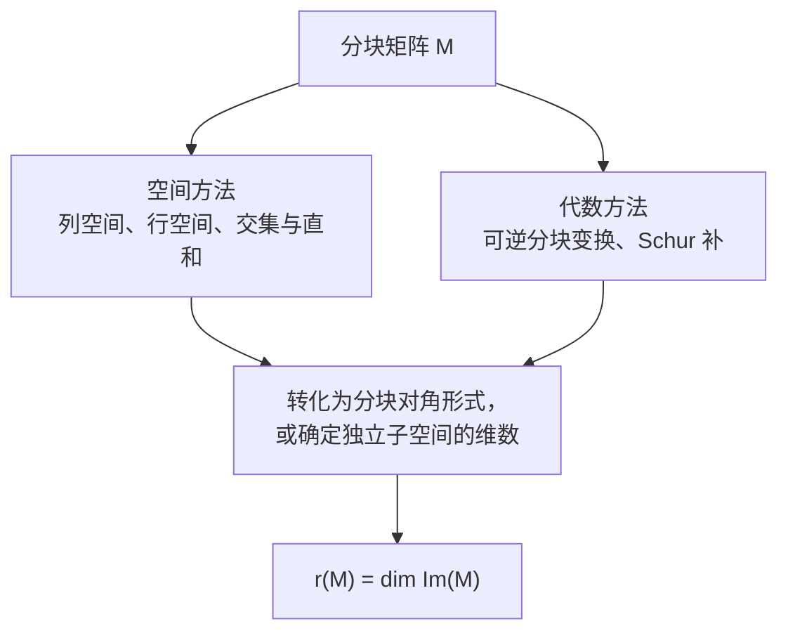

# 分块矩阵的秩：核心公式与性质

本节用 $r(A)$ 表示矩阵的秩，与 [秩的定义与计算](./秩的定义与计算.md) 中的 $\operatorname{rank}(A)$ 是同一记号。

## 1. 基本原理

设矩阵 $A\in\mathbb R^{m\times n}$，矩阵的秩定义为

$$
r(A)=\dim\operatorname{Col}(A)=\dim\operatorname{Row}(A).
$$

研究分块矩阵的秩，核心是：

1. **空间角度**：分析各分块的列空间或行空间是否重叠。
2. **代数角度**：通过初等行、列变换，将分块矩阵化为容易求秩的形式。

特别地，对可逆矩阵 $P,Q$，有

$$
r(PAQ)=r(A).
$$

这是分块矩阵求秩的基本依据。

## 2. 基本分块形式

设 $A,B$ 为尺寸适当的矩阵。

| 分块形式 | 秩的性质 |
| --- | --- |
| 水平拼接 $(A\ B)$ | $\max\{r(A),r(B)\}\le r(A\ B)\le r(A)+r(B)$ |
| 竖直拼接 $\begin{pmatrix}A\\B\end{pmatrix}$ | $\max\{r(A),r(B)\}\le r\begin{pmatrix}A\\B\end{pmatrix}\le r(A)+r(B)$ |
| 分块对角 $\begin{pmatrix}A&0\\0&B\end{pmatrix}$ | $r(A)+r(B)$ |
| 分块反对角 $\begin{pmatrix}0&A\\B&0\end{pmatrix}$ | $r(A)+r(B)$ |
| 分块上三角 $\begin{pmatrix}A&B\\0&D\end{pmatrix}$ | $r\ge r(A)+r(D)$ |
| 分块下三角 $\begin{pmatrix}A&0\\C&D\end{pmatrix}$ | $r\ge r(A)+r(D)$ |

### 2.1 水平拼接：列空间关系

$$
\operatorname{Col}(A\ B)=\operatorname{Col}(A)+\operatorname{Col}(B).
$$

根据子空间维数公式：

$$
r(A\ B)=r(A)+r(B)-\dim\bigl(\operatorname{Col}(A)\cap\operatorname{Col}(B)\bigr).
$$

因此，只有当两个列空间交集为 $\{0\}$ 时，秩才能直接相加。

### 2.2 竖直拼接：行空间关系

同理：

$$
r\begin{pmatrix}A\\B\end{pmatrix}=r(A)+r(B)-\dim\bigl(\operatorname{Row}(A)\cap\operatorname{Row}(B)\bigr).
$$

本质区别：水平拼接分析列空间，竖直拼接分析行空间。

### 2.3 分块对角矩阵

$$
M=\begin{pmatrix}A&0\\0&B\end{pmatrix}.
$$

两个分块所占据的坐标子空间互不重叠，构成直和，因此：

$$
r(M)=r(A)+r(B).
$$

这也是一般分块三角矩阵不一定满足秩相加的原因。

## 3. 分块三角矩阵的秩

考虑

$$
M=\begin{pmatrix}A&B\\0&D\end{pmatrix}.
$$

一般只有：

$$
r(A)+r(D)\le r(M)\le r(A)+r(B)+r(D).
$$

**注意**：分块三角矩阵的秩不一定等于对角分块秩之和。

例如：

$$
M=\begin{pmatrix}0&1\\0&0\end{pmatrix}.
$$

虽然 $r(A)=r(D)=0$，但是 $r(M)=1$。

进一步，有两个常用结论：

- 若 $A$ 为可逆方阵，则 $r(M)=r(A)+r(D)$。
- 若 $D$ 为可逆方阵，则 $r(M)=r(A)+r(D)$。

更一般地，即使 $A,D$ 不可逆，若

$$
B(\ker D)\subseteq \operatorname{Col}(A),
$$

也有 $r(M)=r(A)+r(D)$。

## 4. Schur 补：一般分块矩阵的重要公式

设

$$
M=\begin{pmatrix}A&B\\C&D\end{pmatrix}.
$$

### 4.1 当 $A$ 可逆

进行分块初等行变换：

$$
\begin{pmatrix}I&0\\-CA^{-1}&I\end{pmatrix}
\begin{pmatrix}A&B\\C&D\end{pmatrix}
=
\begin{pmatrix}A&B\\0&D-CA^{-1}B\end{pmatrix}.
$$

由于 $A$ 可逆，可以继续消去右上角分块，得到：

$$
r(M)=r(A)+r(D-CA^{-1}B).
$$

其中

$$
S=D-CA^{-1}B
$$

称为关于 $A$ 的 Schur 补。

### 4.2 当 $D$ 可逆

类似地：

$$
r(M)=r(D)+r(A-BD^{-1}C).
$$

两个公式是分块矩阵求秩最重要的化简工具之一。

## 5. 特殊对称分块矩阵

设 $A,B\in\mathbb R^{m\times n}$，考虑

$$
M=\begin{pmatrix}A&B\\B&A\end{pmatrix}.
$$

通过可逆分块行、列变换：

$$
\begin{pmatrix}I&I\\I&-I\end{pmatrix}
M
\begin{pmatrix}I&I\\I&-I\end{pmatrix}
=
\begin{pmatrix}2(A+B)&0\\0&2(A-B)\end{pmatrix}.
$$

所以：

$$
r\begin{pmatrix}A&B\\B&A\end{pmatrix}=r(A+B)+r(A-B).
$$

这是考试中常见的分块矩阵秩公式。

## 6. 一般分块矩阵的秩不等式

令

$$
M=\begin{pmatrix}A&B\\C&D\end{pmatrix}.
$$

则有基本估计：

$$
r(M)\ge r(A),r(B),r(C),r(D);
\qquad
r(M)\le r(A)+r(B)+r(C)+r(D).
$$

更精细地：

$$
r(M)\le r(A\ B)+r(C\ D);
\qquad
r(M)\le r\begin{pmatrix}A\\C\end{pmatrix}+r\begin{pmatrix}B\\D\end{pmatrix}.
$$

还有常用的分块秩不等式：

$$
r(M)+r(A)\ge r(A\ B)+r\begin{pmatrix}A\\C\end{pmatrix}.
$$

这一不等式在已知部分分块的秩、需要估计整个矩阵秩时很有用。

## 7. 相关的秩不等式

研究分块矩阵时，也经常结合以下性质：

**矩阵和的秩：**

$$
|r(A)-r(B)|\le r(A+B)\le r(A)+r(B).
$$

**矩阵乘积的秩：**

$$
r(A)+r(B)-n\le r(AB)\le \min\{r(A),r(B)\},
$$

其中 $A\in\mathbb R^{m\times n}$，$B\in\mathbb R^{n\times p}$。左侧即 Sylvester 秩不等式。

更多细节与证明见 [秩的常见不等式](./秩的常见不等式.md)。

## 8. 求秩的统一思路

其中的终点即秩的定义：

$$
r(M)=\dim\operatorname{Im}(M).
$$

**核心结论**：分块矩阵的秩并不是简单地计算每个分块的秩再相加，而是研究这些分块共同形成了多少个线性无关的方向。能够化为分块对角矩阵时，秩自然相加；不能化为分块对角矩阵时，则需要分析空间重叠关系或利用可逆变换进一步化简。

[返回本节索引](./README.md)
