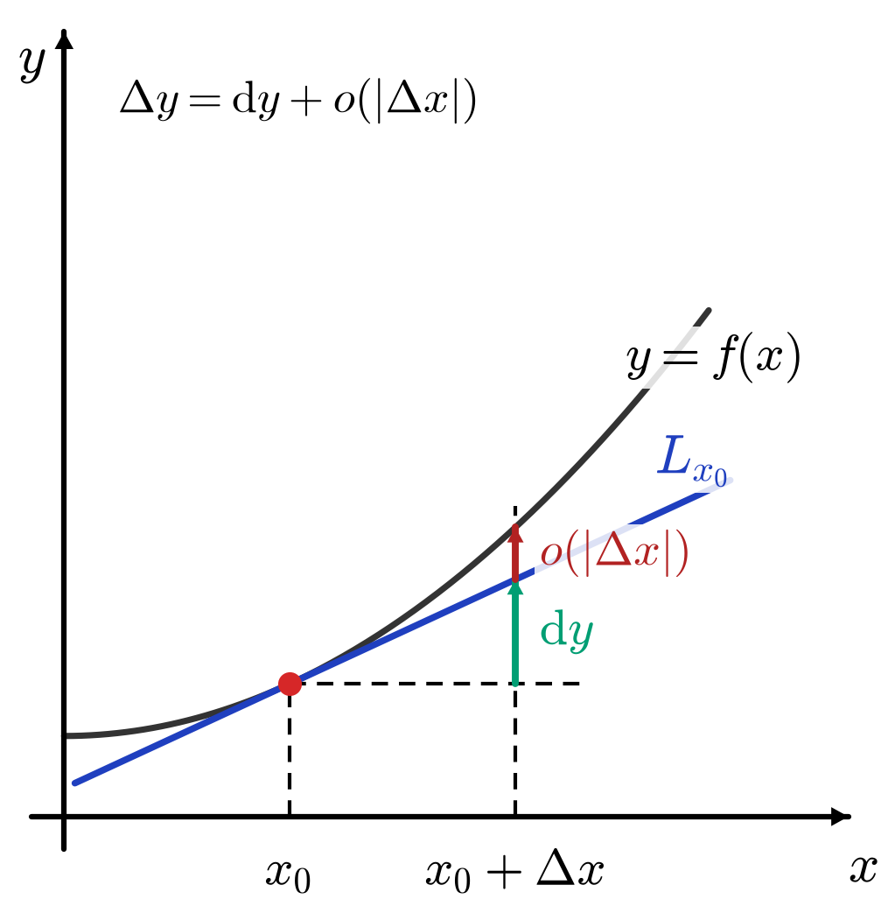
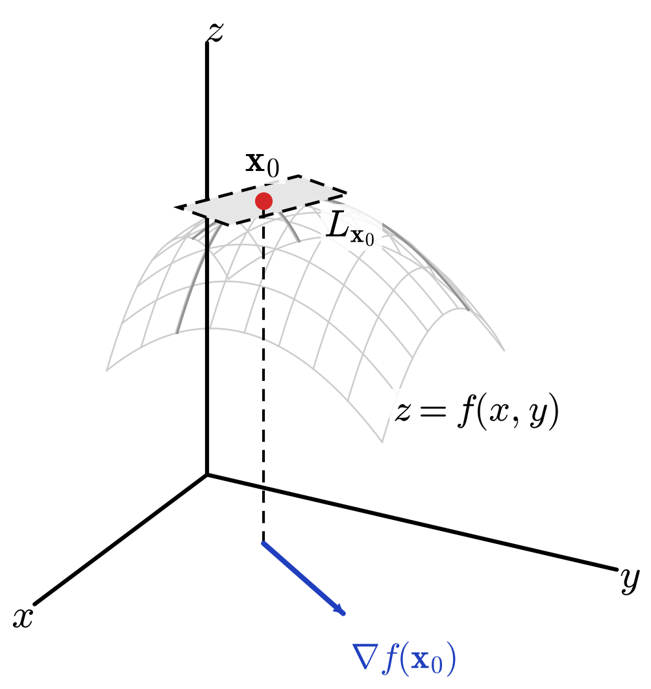
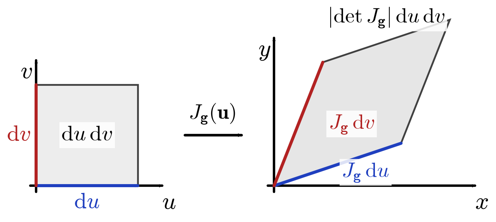

# 微分与局部线性映射

从切线、切平面到 Jacobian：导数的局部线性映射主线。

> **主线**：函数在一点附近能否用一个**线性映射**近似？这个线性映射在一元、多元标量与向量值函数中分别是什么？
>
> $$
> \text{导数}\ \longrightarrow\ \text{线性近似}\ \longrightarrow\ \text{微分}\ \longrightarrow\ \text{梯度 / Jacobian}\ \longrightarrow\ \text{切（超）平面}\ \longrightarrow\ \text{Hessian 与二阶近似}
> $$
>
> 正文只围绕这条主线展开；线性变换基础、二次型展开、特征值法、Sylvester 判据、张量写法等放到文末附录。

> **相邻笔记**：[多元微分学详解](../../02_多元微积分/02_多元微分学/02_微分与全微分/多元微分学详解.md) 展开偏导数、方向导数、梯度、散度与旋度的几何和物理解释；[多元微分学速查](../../02_多元微积分/02_多元微分学/02_微分与全微分/多元微分学速查.md) 汇总计算公式。

## 0 记号与约定

| 对象 | 记号 |
| --- | --- |
| 标量 | $x,\ y,\ h,\ f$ |
| 向量（一律取列向量） | $\mathbf x,\ \mathbf h,\ \mathbf u$ |
| 矩阵 | $A,\ J,\ H$ |
| 向量值函数 | $\mathbf f$ |

- 向量统一写作 $\mathbf x$，不使用 $\vec x$；标量函数写作 $f$，向量值函数写作 $\mathbf f$。
- **把导数当作映射，而不是一个数**。$Df(\mathbf x_0)$ 是一个**线性映射** $Df(\mathbf x_0):\mathbb R^n\to\mathbb R$，其作用记作 $\mathbf h\mapsto Df(\mathbf x_0)[\mathbf h]$：前者是“导数”这个映射，后者是它在增量 $\mathbf h$ 上的取值（一个实数）。
- 方括号写法 $Df(\mathbf x_0)[\mathbf h]$ 强调“线性映射作用于向量”，也避免与乘法混淆；在有限维中它与矩阵写法 $Df(\mathbf x_0)\mathbf h$ 完全同义（把 $Df(\mathbf x_0)$ 看作 $1\times n$ 矩阵，省略方括号）。下文两种写法混用，含义相同。
- $df$ 是与 $Df(\mathbf x_0)$ 对应的传统微分记号，二者在坐标表示下是同一个线性对象。
- 梯度取为**列向量**，因此标量函数的 Jacobian 是梯度的转置：$J_f=(\nabla f)^T$。
- 小 $o$ 记号：一元用 $o(\lvert\Delta x\rvert)$，多元用 $o(\lVert\Delta\mathbf x\rVert)$。
- 术语统一为：泰勒公式、拉格朗日余项、雅可比矩阵、Hessian 矩阵、Sylvester 判据。

增量记号同样统一。一元情形
$$
\Delta x=x-x_0,\qquad \Delta y=f(x_0+\Delta x)-f(x_0);
$$
多元情形
$$
\Delta\mathbf x=\mathbf x-\mathbf x_0,\qquad \Delta f=f(\mathbf x_0+\Delta\mathbf x)-f(\mathbf x_0).
$$
下文不再在同一公式链中混用 $d\mathbf x$ 与 $\Delta\mathbf x$：讨论 $Df(\mathbf x_0)$ 时用增量 $\mathbf h$，使用传统记号时用形式符号 $d\mathbf x$。

## 1 一元函数的线性近似

### 1.1 导数与变化率

设 $f$ 在包含 $x_0$ 的某开区间上有定义。若极限
$$
\lim_{h\to 0}\frac{f(x_0+h)-f(x_0)}{h}
$$
存在，则称 $f$ 在 $x_0$ 处**可导**，并把该极限记作
$$
f'(x_0)=\lim_{h\to 0}\frac{f(x_0+h)-f(x_0)}{h},
$$
它描述 $f$ 在 $x_0$ 处的局部变化率。（先有极限存在，才有记号 $f'(x_0)$。）

一元情形下，与 $f'(x_0)$ 对应的线性映射就是“乘以 $f'(x_0)$”：
$$
Df(x_0):\mathbb R\to\mathbb R,\qquad h\mapsto Df(x_0)[h]=f'(x_0)h .
$$
下文凡是出现 $Df$，都是指这种线性映射；$f'(x_0)$ 只是它的 $1\times1$ 矩阵表示。

### 1.2 函数增量与线性主部

令 $\Delta x=x-x_0$，函数的实际增量为
$$
\Delta y=f(x_0+\Delta x)-f(x_0).
$$
由导数定义可得
$$
\Delta y=f'(x_0)\Delta x+o(\lvert\Delta x\rvert),\qquad \Delta x\to 0,
$$
即增量被拆成两部分：
$$
\Delta y=\underbrace{f'(x_0)\Delta x}_{\text{线性主部}}+\underbrace{o(\lvert\Delta x\rvert)}_{\text{比 }\Delta x\text{ 更高阶的余项}}.
$$
$\Delta x$ 足够小时忽略余项，即得线性近似
$$
\Delta y\approx f'(x_0)\Delta x.
$$

### 1.3 微分

函数在 $x_0$ 处的**微分**就是一元情形的 $Df(x_0)$，即关于输入增量的一个线性映射
$$
df_{x_0}:\mathbb R\to\mathbb R,\qquad dx\mapsto df_{x_0}(dx)=f'(x_0)\,dx .
$$
对任意增量 $dx$，记 $dy:=df_{x_0}(dx)$，即
$$
dy=f'(x_0)\,dx .
$$
取 $dx=\Delta x$，则
$$
\Delta y=dy+o(\lvert\Delta x\rvert),
\qquad\text{即}\qquad
f(x_0+\Delta x)=f(x_0)+dy+o(\lvert\Delta x\rvert).
$$
$dy$ 是切线给出的线性增量，$o(\lvert\Delta x\rvert)$ 是线性近似的误差。一般地 $dy\ne\Delta y$。

下面三个量容易混淆，务必分清：

| 量 | 含义 |
| --- | --- |
| $\Delta y$ | 函数的实际增量 |
| $dy$ | 实际增量的线性主部 |
| $L_{x_0}(x)$ | 对函数值 $f(x)$ 的线性近似（一个函数） |

### 1.4 线性近似与切线

定义以 $x_0$ 为展开点的**线性近似函数**
$$
L_{x_0}(x):=f(x_0)+f'(x_0)(x-x_0),
$$
于是
$$
f(x)=L_{x_0}(x)+o(\lvert x-x_0\rvert),\qquad x\to x_0.
$$
几何上，$L_{x_0}$ 的图像
$$
y=f(x_0)+f'(x_0)(x-x_0)
$$
就是 $f$ 在 $x_0$ 处的**切线**：$L_{x_0}$ 是切线对应的函数，图像才是切线。$L_{x_0}$ 在整个实数轴上都有定义，但一般只在 $x_0$ 附近近似 $f$。

图中曲线 $y=f(x)$ 与其在 $x_0$ 处的切线 $L_{x_0}$（蓝）相切。$x_0+\Delta x$ 处的竖直方向被切成两段：绿段是线性主部 $\mathrm dy=f'(x_0)\Delta x$，红段是余项；两段之和正是真实增量 $\Delta y=f(x_0+\Delta x)-f(x_0)$，即 $\Delta y=\mathrm dy+o(\lvert\Delta x\rvert)$。黑虚线给出基准水平线与两条竖直辅助线。

> **例（一元线性近似）** 取 $f(x)=\sqrt{x}$，$x_0=4$。由 $f(4)=2$，$f'(x)=\dfrac{1}{2\sqrt{x}}$，$f'(4)=\dfrac14$，得
> $$
> \sqrt{4+h}\approx 2+\frac{h}{4}.
> $$
> 取 $h=0.1$：近似值 $2.025$，真值 $\sqrt{4.1}\approx 2.02485$，误差约 $1.5\times 10^{-4}$。

### 1.5 一元泰勒公式

要更精确地刻画局部行为，就引入高阶导数做多项式近似。

**拉格朗日余项**：设 $f$ 在包含 $x_0$ 与 $x$ 的区间上具有 $n+1$ 阶导数，记 $h=x-x_0$，则存在 $\xi$ 介于 $x_0$ 与 $x$ 之间，使得
$$
f(x)=\sum_{k=0}^{n}\frac{f^{(k)}(x_0)}{k!}h^k+\frac{f^{(n+1)}(\xi)}{(n+1)!}h^{n+1}.
$$
**皮亚诺余项**：若只关心 $x\to x_0$ 时的局部行为，则可写
$$
f(x)=\sum_{k=0}^{n}\frac{f^{(k)}(x_0)}{k!}h^k+o(\lvert h\rvert^{n}).
$$
去掉余项即得**泰勒多项式**
$$
T_n(x)=\sum_{k=0}^{n}\frac{f^{(k)}(x_0)}{k!}(x-x_0)^k.
$$
特别地 $n=1$ 时 $T_1=L_{x_0}$：**线性近似正是泰勒公式的一阶截断**。

两点提醒：

- 不能仅凭拉格朗日余项就无条件断言 $R_n(h)=O(\lvert h\rvert^{n+1})$：这需要 $f^{(n+1)}$ 在相应区间上**有界**（例如 $f\in C^{n+1}$）；只知道“$f$ 有 $n+1$ 阶导数”并不够。
- 拉格朗日中值定理
  $$
  f(b)-f(a)=f'(\xi)(b-a)
  $$
  与泰勒公式的一阶情形形式相近，但它描述的是**有限区间**上的增量表达，而泰勒公式描述的是**固定展开点附近**的局部多项式近似，两者使用场景不同。

## 2 多元标量函数的一阶微分

本节固定 $f:\mathbb R^n\to\mathbb R$、$\mathbf x_0\in\mathbb R^n$，记 $\mathbf h=\mathbf x-\mathbf x_0$，$\lVert\cdot\rVert$ 为欧氏范数。

### 2.1 偏导数

函数关于第 $i$ 个变量的**偏导数**定义为
$$
\frac{\partial f}{\partial x_i}(\mathbf x_0)
=\lim_{h\to 0}\frac{f(\mathbf x_0+h\mathbf e_i)-f(\mathbf x_0)}{h}
=\lim_{h\to 0}\frac{f(x_{01},\dots,x_{0i}+h,\dots,x_{0n})-f(\mathbf x_0)}{h},
$$
即 $f$ 沿第 $i$ 个坐标轴方向的变化率。

偏导数只描述沿坐标轴方向的变化。**偏导数存在并不能推出函数可微**，因而也不能保证整体增量能由这些偏导数的线性组合统一近似——这正是下面要额外施加的条件。

### 2.2 可微性（全微分的严格定义）

**定义**：若存在线性映射 $L:\mathbb R^n\to\mathbb R$，使得
$$
f(\mathbf x_0+\mathbf h)=f(\mathbf x_0)+L(\mathbf h)+o(\lVert\mathbf h\rVert),\qquad \mathbf h\to 0,
$$
则称 $f$ 在 $\mathbf x_0$ 处**可微**，并把该线性映射记作
$$
Df(\mathbf x_0):\mathbb R^n\to\mathbb R,\qquad \mathbf h\mapsto Df(\mathbf x_0)[\mathbf h]=L(\mathbf h).
$$
请把 $Df(\mathbf x_0)$（一个映射）与 $Df(\mathbf x_0)[\mathbf h]$（一个数）当作两个层次的对象来读。

- 关键在于余项必须**比 $\lVert\mathbf h\rVert$ 更高阶**；仅仅“余项趋于 $0$”不足以说明可微。
- 若 $f$ 在 $\mathbf x_0$ 处可微，则这样的线性映射 $L$ **唯一**，它就是 $f$ 在 $\mathbf x_0$ 处的最佳线性近似。

写成坐标形式，可微的等价刻画是
$$
\lim_{\mathbf h\to 0}\frac{f(\mathbf x_0+\mathbf h)-f(\mathbf x_0)-\sum_{i=1}^{n}\frac{\partial f}{\partial x_i}(\mathbf x_0)h_i}{\lVert\mathbf h\rVert}=0 .
$$
（若其中的偏导数不存在，可微性自然不成立。）

### 2.3 全微分与梯度

若 $f$ 在 $\mathbf x_0$ 处可微，则各偏导数存在，且 $Df(\mathbf x_0)$ 完全由偏导数决定：
$$
Df(\mathbf x_0)[\mathbf h]=\sum_{i=1}^{n}\frac{\partial f}{\partial x_i}(\mathbf x_0)h_i=\nabla f(\mathbf x_0)^T\mathbf h,
\qquad
\nabla f(\mathbf x_0)=\left(\frac{\partial f}{\partial x_1}(\mathbf x_0),\dots,\frac{\partial f}{\partial x_n}(\mathbf x_0)\right)^T.
$$
**传统微分记号**把同一个线性映射写作
$$
df(\mathbf x_0):\mathbb R^n\to\mathbb R,\qquad d\mathbf x\mapsto df(\mathbf x_0)[d\mathbf x]=\sum_{i=1}^{n}\frac{\partial f}{\partial x_i}(\mathbf x_0)\,dx_i=\nabla f(\mathbf x_0)\cdot d\mathbf x .
$$
它与 $Df(\mathbf x_0)[\mathbf h]$ 是同一个线性对象的两种写法：前者便于运算，后者更便于说明“导数是线性映射”。

注意 $Df(\mathbf x_0)[\mathbf h]=\nabla f(\mathbf x_0)^T\mathbf h$ 正是把映射作用写成矩阵乘法的结果，因而也可直接省略方括号写作 $Df(\mathbf x_0)\mathbf h$。

于是 $\Delta\mathbf x$ 很小时
$$
\Delta f=f(\mathbf x_0+\Delta\mathbf x)-f(\mathbf x_0)\approx\sum_{i=1}^{n}\frac{\partial f}{\partial x_i}(\mathbf x_0)\,\Delta x_i=\nabla f(\mathbf x_0)^T\Delta\mathbf x .
$$

### 2.4 方向导数

设 $\mathbf u$ 为单位向量，函数沿 $\mathbf u$ 方向的**方向导数**定义为
$$
D_{\mathbf u}f(\mathbf x_0):=\lim_{h\to 0}\frac{f(\mathbf x_0+h\mathbf u)-f(\mathbf x_0)}{h}.
$$
**若 $f$ 在 $\mathbf x_0$ 处可微**，则对任意单位向量 $\mathbf u$
$$
D_{\mathbf u}f(\mathbf x_0)=Df(\mathbf x_0)[\mathbf u]=\nabla f(\mathbf x_0)\cdot\mathbf u=\lVert\nabla f(\mathbf x_0)\rVert\cos\theta,
$$
其中 $\theta$ 是 $\nabla f(\mathbf x_0)$ 与 $\mathbf u$ 之间的夹角。注意这个等式**要求可微性**（或其它充分条件），仅“偏导数存在”不足以保证。

由此：当 $\nabla f(\mathbf x_0)\ne\mathbf 0$ 时，方向导数在 $\mathbf u$ 与 $\nabla f(\mathbf x_0)$ 同向时取得最大值 $\lVert\nabla f(\mathbf x_0)\rVert$，反向时取得最小值 $-\lVert\nabla f(\mathbf x_0)\rVert$；若 $\nabla f(\mathbf x_0)=\mathbf 0$，则所有方向的方向导数都为 $0$。这就是把 $\nabla f(\mathbf x_0)$ 称为**梯度**（最速上升方向）的原因。

### 2.5 切平面（切超平面）

由可微性定义，$f$ 在 $\mathbf x_0$ 处的**线性近似函数**为
$$
L_{\mathbf x_0}(\mathbf x)=f(\mathbf x_0)+Df(\mathbf x_0)[\mathbf x-\mathbf x_0]
=f(\mathbf x_0)+\nabla f(\mathbf x_0)^T(\mathbf x-\mathbf x_0)
=f(\mathbf x_0)+\sum_{i=1}^{n}\frac{\partial f}{\partial x_i}(\mathbf x_0)(x_i-x_{0i}).
$$
它的图像就是 $f$ 的图形在 $\mathbf x_0$ 处的**切超平面**：$n=1$ 时是切线，$n=2$ 时是切平面。这个线性函数在整个 $\mathbb R^n$ 上都有定义，但通常只在 $\mathbf x_0$ 附近近似 $f$。

图中曲面 $z=f(x,y)$（浅灰网格）与它在 $\mathbf x_0$ 处的切平面（灰底虚线框，为看清只画出一小块）相切于红点 $(\mathbf x_0,f(\mathbf x_0))$；曲面凹向下方，故切平面在相切点之外位于曲面**之上**。蓝色箭头是定义域 $\mathbb R^2$ 中的梯度 $\nabla f(\mathbf x_0)$，它决定切平面朝哪个方向倾斜、倾斜多少。黑色虚线是 $\mathbf x_0$ 到定义域平面的垂线。

> **例（多元标量函数与切平面）** 取 $f(x,y)=x^2+xy+y^2$，则
> $$
> \nabla f(x,y)=(2x+y,\ x+2y)^T,
> $$
> 在 $(1,1)$ 处 $f(1,1)=3$，$\nabla f(1,1)=(3,3)^T$，故切平面为
> $$
> L_{(1,1)}(x,y)=3+3(x-1)+3(y-1)=3x+3y-3.
> $$

## 3 多元标量函数的二阶微分

本节设 $f:\mathbb R^n\to\mathbb R$ 在 $\mathbf x_0$ 的某邻域内具有**连续的二阶偏导数**（即 $f\in C^2$）。

### 3.1 Hessian 矩阵

$f$ 在 $\mathbf x_0$ 处的二阶导数 $D^2f(\mathbf x_0)$ 是一个**双线性映射**，它在两个方向 $\mathbf h,\mathbf k$ 上的取值为
$$
D^2f(\mathbf x_0)[\mathbf h,\mathbf k]=\mathbf h^T H_f(\mathbf x_0)\mathbf k .
$$
取 $\mathbf h=\mathbf k$ 就得到二次型。传统记号把这一情形写作
$$
d^2f(\mathbf x_0)[d\mathbf x,d\mathbf x]=(d\mathbf x)^TH_f(\mathbf x_0)\,d\mathbf x,
$$
这里的 $d^2f$ 只是二阶导数的传统记号，并不意味着对 $dx_i$ 再求一次普通微分。（二重求和 $\sum_{i,j}\frac{\partial^2 f}{\partial x_i\partial x_j}(\mathbf x_0)h_ih_j$ 与矩阵乘法的对应关系见附录 A.2。）

其中 $H_f(\mathbf x_0)$ 是 **Hessian 矩阵**，即二阶偏导数排成的方阵：
$$
H_f(\mathbf x_0)=\left[\frac{\partial^2 f}{\partial x_i\partial x_j}(\mathbf x_0)\right]_{i,j=1}^{n}
=\begin{pmatrix}
\frac{\partial^2 f}{\partial x_1^2} & \frac{\partial^2 f}{\partial x_1 \partial x_2} & \cdots & \frac{\partial^2 f}{\partial x_1 \partial x_n} \\
\frac{\partial^2 f}{\partial x_2 \partial x_1} & \frac{\partial^2 f}{\partial x_2^2} & \cdots & \frac{\partial^2 f}{\partial x_2 \partial x_n} \\
\vdots & \vdots & \ddots & \vdots \\
\frac{\partial^2 f}{\partial x_n \partial x_1} & \frac{\partial^2 f}{\partial x_n \partial x_2} & \cdots & \frac{\partial^2 f}{\partial x_n^2}
\end{pmatrix},
$$
也记作 $H$ 或 $\nabla^2f$。

**对称性**：若 $f\in C^2$，则由 Schwarz 定理
$$
\frac{\partial^2 f}{\partial x_i\partial x_j}=\frac{\partial^2 f}{\partial x_j\partial x_i},
$$
因而 $H_f(\mathbf x_0)$ 是**对称矩阵**，可以正交对角化——这正是用特征值判断二次型符号的依据（见附录 A.3）。

二阶导数给出二次型，于是多元函数的极值问题化为**二次型的符号问题**：极值判别 → Hessian 的定号性 → 特征值法（附录 A.3）或 Sylvester 判据（附录 A.4）。

### 3.2 二阶泰勒公式

设 $f\in C^2$，记 $\mathbf h=\mathbf x-\mathbf x_0$，则二阶泰勒公式为
$$
f(\mathbf x_0+\mathbf h)=f(\mathbf x_0)+Df(\mathbf x_0)[\mathbf h]+\frac12 D^2f(\mathbf x_0)[\mathbf h,\mathbf h]+o(\lVert\mathbf h\rVert^2),
$$
写成矩阵形式即
$$
f(\mathbf x_0+\mathbf h)=f(\mathbf x_0)+\nabla f(\mathbf x_0)^T\mathbf h+\frac12\mathbf h^T H_f(\mathbf x_0)\mathbf h+o(\lVert\mathbf h\rVert^2).
$$
含义：$f(\mathbf x_0)$ 是高度，$\nabla f(\mathbf x_0)^T\mathbf h$ 是一阶（切平面）贡献，$\frac12\mathbf h^TH_f(\mathbf x_0)\mathbf h$ 是二阶（曲率）贡献。

### 3.3 Hessian 与极值判别

二阶判别法**必须先在临界点进行**，即先要求
$$
\nabla f(\mathbf x_0)=\mathbf 0 .
$$
在临界点处，若 $f\in C^2$，则：

| $H_f(\mathbf x_0)$ 的定号性 | 结论 |
| --- | --- |
| 正定（特征值全为正） | 严格局部极小值 |
| 负定（特征值全为负） | 严格局部极大值 |
| 不定（特征值有正有负） | 鞍点，不是极值点 |
| 半正定或半负定 | 二阶判别法失效，需考察更高阶项或直接分析函数 |

“半定”确实不足以下结论：例如 $f(x,y)=x^2-y^4$ 在原点的 Hessian 为 $\operatorname{diag}(2,0)$，是半正定的，但沿 $y$ 轴有 $f(0,y)=-y^4<0$，故原点不是极小值点。

## 4 向量值函数的微分

设
$$
\mathbf f:\mathbb R^m\to\mathbb R^n,\qquad
\mathbf f(\mathbf x)=\begin{pmatrix}f_1(\mathbf x)\\ f_2(\mathbf x)\\ \vdots\\ f_n(\mathbf x)\end{pmatrix},
\qquad f_i:\mathbb R^m\to\mathbb R,
$$
其中每个分量 $f_i$ 都是标量函数。

**维度约定**（全章一致）：输入维度为 $m$，输出维度为 $n$；$\mathbf x,\mathbf h\in\mathbb R^m$，而 $\mathbf f(\mathbf x_0+\mathbf h)-\mathbf f(\mathbf x_0)\in\mathbb R^n$。

因此，研究向量值函数的微分，本质上就是同时研究 $n$ 个标量函数的微分（即第 2、3 章的内容）。

### 4.1 可微性与 Jacobian 矩阵

若存在线性映射 $L:\mathbb R^m\to\mathbb R^n$，使得
$$
\mathbf f(\mathbf x_0+\mathbf h)=\mathbf f(\mathbf x_0)+L(\mathbf h)+o(\lVert\mathbf h\rVert),\qquad \mathbf h\to 0,
$$
则称 $\mathbf f$ 在 $\mathbf x_0$ 处**可微**，并记 $D\mathbf f(\mathbf x_0)=L$。它的矩阵表示为
$$
D\mathbf f(\mathbf x_0)[\mathbf h]=J_{\mathbf f}(\mathbf x_0)\,\mathbf h,
$$
其中
$$
J_{\mathbf f}(\mathbf x)=\left[\frac{\partial f_i}{\partial x_j}(\mathbf x)\right]_{n\times m}
=\begin{pmatrix}
\frac{\partial f_1}{\partial x_1}(\mathbf x) & \cdots & \frac{\partial f_1}{\partial x_m}(\mathbf x)\\
\vdots & \ddots & \vdots\\
\frac{\partial f_n}{\partial x_1}(\mathbf x) & \cdots & \frac{\partial f_n}{\partial x_m}(\mathbf x)
\end{pmatrix}
$$
称为 $\mathbf f$ 在 $\mathbf x$ 处的**雅可比矩阵（Jacobian matrix）**：$n$ 行对应 $n$ 个分量，$m$ 列对应 $m$ 个输入变量，因此它正是线性映射 $D\mathbf f(\mathbf x_0)$ 的矩阵表示。也就是说
$$
D\mathbf f(\mathbf x_0):\mathbb R^m\to\mathbb R^n,\qquad \mathbf h\mapsto D\mathbf f(\mathbf x_0)[\mathbf h]=J_{\mathbf f}(\mathbf x_0)\,\mathbf h,
$$
右端省去了方括号，即把 $J_{\mathbf f}(\mathbf x_0)$ 当作矩阵直接作用于 $\mathbf h$。

**几个关系：**

- $n=1$ 时（退化为标量函数）$J_f=\left[\frac{\partial f}{\partial x_1},\dots,\frac{\partial f}{\partial x_m}\right]$。因本文约定梯度为列向量，故 $J_f=(\nabla f)^T$。
- 梯度是 Jacobian 的标量情形，Jacobian 是梯度的向量值情形：**Jacobian 是向量值函数的一阶导数矩阵**。
- Hessian 是梯度映射的 Jacobian：$H_f=J_{\nabla f}$。它描述梯度随输入变化的线性变化率，也就是函数的二阶局部变化。

### 4.2 向量值函数的线性近似

$\mathbf f$ 在 $\mathbf x_0$ 处的最佳线性近似由它的导数给出：
$$
\mathbf f(\mathbf x_0+\mathbf h)\approx\mathbf f(\mathbf x_0)+J_{\mathbf f}(\mathbf x_0)\,\mathbf h .
$$
也就是说，$\mathbf x$ 足够接近 $\mathbf x_0$ 时，$\mathbf f$ 的输出变化可以近似地由 $J_{\mathbf f}(\mathbf x_0)$ 线性地给出。

> **例（向量值函数与 Jacobian）** 取
> $$
> \mathbf f(x,y)=\begin{pmatrix}x^2+y\\ \sin(xy)\end{pmatrix},
> $$
> 则
> $$
> J_{\mathbf f}(x,y)=\begin{pmatrix}2x & 1\\ y\cos(xy) & x\cos(xy)\end{pmatrix},
> \qquad J_{\mathbf f}(1,0)=\begin{pmatrix}2&1\\0&1\end{pmatrix}.
> $$
> 而 $\mathbf f(1,0)=(1,0)^T$，故 $\mathbf f(1+h_1,\,h_2)\approx\mathbf f(1,0)+J_{\mathbf f}(1,0)\mathbf h=\begin{pmatrix}1\\0\end{pmatrix}+\begin{pmatrix}2h_1+h_2\\ h_2\end{pmatrix}$。

### 4.3 向量值函数的二阶泰勒展开

**若每个分量 $f_i$ 在 $\mathbf x_0$ 附近具有连续二阶偏导数**，则
$$
\mathbf f(\mathbf x_0+\mathbf h)=\mathbf f(\mathbf x_0)+J_{\mathbf f}(\mathbf x_0)\mathbf h
+\frac12\begin{pmatrix}\mathbf h^TH_{f_1}(\mathbf x_0)\mathbf h\\ \vdots\\ \mathbf h^TH_{f_n}(\mathbf x_0)\mathbf h\end{pmatrix}+o(\lVert\mathbf h\rVert^2).
$$
它只是把每个分量 $f_i$ 的标量二阶泰勒展开叠成一个列向量，因此没有任何新的机制；把全部分量的二阶偏导数收在一起的三阶张量写法见附录 A.5。

### 4.4 三种情形的对照

| 情形 | 一阶导数 | 二阶导数 |
| --- | --- | --- |
| $f:\mathbb R\to\mathbb R$ | $Df(x_0)[h]=f'(x_0)h$ | $D^2f(x_0)[h,h]=f''(x_0)h^2$ |
| $f:\mathbb R^n\to\mathbb R$ | $Df(\mathbf x_0)[\mathbf h]=\nabla f(\mathbf x_0)^T\mathbf h$ | $D^2f(\mathbf x_0)[\mathbf h,\mathbf h]=\mathbf h^TH_f(\mathbf x_0)\mathbf h$ |
| $\mathbf f:\mathbb R^m\to\mathbb R^n$ | $D\mathbf f(\mathbf x_0)[\mathbf h]=J_{\mathbf f}(\mathbf x_0)\mathbf h$ | $D^2\mathbf f(\mathbf x_0)[\mathbf h,\mathbf h]=\big(\mathbf h^TH_{f_i}(\mathbf x_0)\mathbf h\big)_{i=1}^{n}$ |

三种情形共用同一个主线：导数就是最佳局部线性近似，只是线性映射的矩阵形式依次为标量 $f'(x_0)$、行向量 $(\nabla f)^T$、矩阵 $J_{\mathbf f}$。表中 $Df(\mathbf x_0)[\mathbf h]$ 也可写作 $Df(\mathbf x_0)\mathbf h$：方括号与直接相乘是一回事。

## 5 微分的几何与应用

### 5.1 微分作为局部线性变换

前面几章可以统一成一句话：
$$
\text{导数}=\text{在一点处的最佳线性近似}.
$$
非线性映射 $\mathbf g$ 在 $\mathbf x_0$ 附近被它的导数替代，而该导数是一个线性映射
$$
D\mathbf g(\mathbf x_0):\mathbb R^n\to\mathbb R^n,\qquad \mathbf h\mapsto D\mathbf g(\mathbf x_0)[\mathbf h],
$$
于是
$$
\mathbf g(\mathbf x_0+\mathbf h)=\mathbf g(\mathbf x_0)+D\mathbf g(\mathbf x_0)[\mathbf h]+o(\lVert\mathbf h\rVert).
$$
在坐标下这个线性映射由 Jacobian 矩阵表示（线性变换与矩阵表示的基础见附录 A.1）。当 $\mathbf g:\mathbb R^n\to\mathbb R^n$ 时它是一个方阵，可以取行列式——这正是下面体积缩放与积分换元的来源。

### 5.2 Jacobian 行列式与体积缩放

设 $\mathbf g:U\subset\mathbb R^n\to\mathbb R^n$ 是 $C^1$ 映射。取 $\mathbf u$ 处的 $n$ 个很小的位移向量 $\delta\mathbf u_1,\dots,\delta\mathbf u_n$，它们张成一个微小的平行多面体。由局部线性化
$$
\delta\mathbf x_i\approx J_{\mathbf g}(\mathbf u)\,\delta\mathbf u_i,\qquad i=1,\dots,n,
$$
于是
$$
\begin{aligned}
\left\lvert\det[\delta\mathbf x_1,\dots,\delta\mathbf x_n]\right\rvert
&\approx\left\lvert\det\big(J_{\mathbf g}(\mathbf u)\,[\delta\mathbf u_1,\dots,\delta\mathbf u_n]\big)\right\rvert\\
&=\left\lvert\det J_{\mathbf g}(\mathbf u)\right\rvert\cdot\left\lvert\det[\delta\mathbf u_1,\dots,\delta\mathbf u_n]\right\rvert .
\end{aligned}
$$
即 $\lvert\det J_{\mathbf g}(\mathbf u)\rvert$ 是局部体积的缩放因子：$n=1$ 时是长度缩放因子，$n=2$ 时是面积缩放因子，一般 $n$ 时是体积缩放因子。

图中 $uv$ 平面上的小方块（左边，面积 $\mathrm du\,\mathrm dv$）经线性映射 $J_{\mathbf g}(\mathbf u)$ 映成 $xy$ 平面上的平行四边形（右边，灰底）：两条边分别被映成 $J_{\mathbf g}\mathrm du$（蓝）与 $J_{\mathbf g}\mathrm dv$（红），而面积被放大 $\lvert\det J_{\mathbf g}\rvert$ 倍。$n$ 维时同一句话读作“体积被放大 $\lvert\det J_{\mathbf g}\rvert$ 倍”。

### 5.3 多元积分的换元法

**条件**：设 $\mathbf g:U\to\Omega$ 是 $C^1$ 双射，且逆映射也满足相应条件（实用中常放宽为“在零测集外一一对应”）。此时对任意可积函数 $f$，
$$
\int_{\Omega}f(\mathbf x)\,d\mathbf x
=\int_{\mathbf g^{-1}(\Omega)}f(\mathbf g(\mathbf u))\,\left\lvert\det J_{\mathbf g}(\mathbf u)\right\rvert\,d\mathbf u .
$$
其中：

- $\Omega\subset\mathbb R^n$ 是原积分区域；
- $\mathbf g:U\subset\mathbb R^n\to\mathbb R^n$ 是满足上述条件的同维变换；
- $J_{\mathbf g}(\mathbf u)=\left[\frac{\partial g_i}{\partial u_j}(\mathbf u)\right]$ 是变换 $\mathbf g$ 在 $\mathbf u$ 处的 Jacobian 矩阵（一个方阵）；
- $\lvert\det J_{\mathbf g}(\mathbf u)\rvert$ 称为**雅可比因子**，即 5.2 中的局部体积缩放比例。

直观理解：把 $\mathbf u$ 空间分成许多小体积元 $d\mathbf u$，它们在 $\mathbf x$ 空间中的像近似为一个体积为 $\lvert\det J_{\mathbf g}\rvert\,d\mathbf u$ 的平行多面体；把这些小体积元上的函数值累加，即得上述公式。

## 附录

附录收录正文引用到的线性代数基础与进阶表述，不影响主线阅读。

### A.1 线性变换与矩阵表示

**定义**：映射 $T:V\to W$ 是**线性变换**，若对任意向量 $\mathbf u,\mathbf v$ 与标量 $c$ 有
$$
T(\mathbf u+\mathbf v)=T(\mathbf u)+T(\mathbf v),\qquad T(c\mathbf u)=cT(\mathbf u),
$$
等价地 $T(c_1\mathbf u+c_2\mathbf v)=c_1T(\mathbf u)+c_2T(\mathbf v)$。

**为什么由基的像唯一决定**：$\mathbb R^n$ 中任意向量都可写成基的线性组合，而线性变换保持线性组合，因此
$$
T\Big(\sum_{i=1}^{n}x_i\mathbf e_i\Big)=\sum_{i=1}^{n}x_iT(\mathbf e_i).
$$
**矩阵表示**：设 $T:\mathbb R^n\to\mathbb R^m$，$\{\mathbf e_1,\dots,\mathbf e_n\}$ 是标准基，令
$$
A=\big[\,T(\mathbf e_1)\ \ T(\mathbf e_2)\ \ \cdots\ \ T(\mathbf e_n)\,\big]
=\begin{pmatrix}
a_{11} & a_{12} & \cdots & a_{1n} \\
a_{21} & a_{22} & \cdots & a_{2n} \\
\vdots & \vdots & \ddots & \vdots \\
a_{m1} & a_{m2} & \cdots & a_{mn}
\end{pmatrix},
$$
即 $A$ 的第 $i$ 列就是 $T(\mathbf e_i)$。于是每个从 $\mathbb R^n$ 到 $\mathbb R^m$ 的线性变换都唯一对应一个 $m\times n$ 矩阵，且
$$
T(\mathbf x)=A\mathbf x .
$$
两条常用结论：

- $A[\mathbf v_1\ \mathbf v_2]=[A\mathbf v_1\ A\mathbf v_2]$：对列向量组整体作线性变换，等于对每一列分别作变换（矩阵乘法定义本身）。
- 对**同阶方阵** $A,B$：$\det(AB)=\det(A)\det(B)$，它反映体积缩放的复合效应。注意行列式只对方阵有定义：上面的 $T:\mathbb R^n\to\mathbb R^m$ 当 $m\ne n$ 时不能写行列式。

### A.2 二次型的矩阵表达

对 $n$ 阶矩阵 $A=(a_{ij})$ 与 $\mathbf x=(x_1,\dots,x_n)^T$，二次型可以写成矩阵乘积：
$$
\sum_{i=1}^{n}\sum_{j=1}^{n}a_{ij}x_ix_j=\mathbf x^TA\mathbf x .
$$
也就是说，“先对 $j$ 求和、再对 $i$ 求和”等价于“两个矩阵相乘后再作一次求和”。取 $a_{ij}=\frac{\partial^2 f}{\partial x_i\partial x_j}(\mathbf x_0)$（$f\in C^2$ 时该矩阵对称，即 $H_f(\mathbf x_0)$），就得到正文 3.1 中的二阶微分：
$$
D^2f(\mathbf x_0)[\mathbf h,\mathbf h]
=\sum_{i,j=1}^{n}\frac{\partial^2 f}{\partial x_i\partial x_j}(\mathbf x_0)h_ih_j
=\mathbf h^TH_f(\mathbf x_0)\mathbf h .
$$
（求和中的 $a_{ij}h_ih_j$ 与 $a_{ji}h_jh_i$ 是同一项，交叉项实际出现两次，这也是二次型矩阵总可以取成对称矩阵的原因。）

### A.3 特征值法

以下极值分类以 $f\in C^2$ 且 $\nabla f(\mathbf x_0)=0$ 为前提；非驻点不能仅凭 Hessian 的正负性判定极值。

$H_f(\mathbf x_0)$ 是对称矩阵，故存在正交矩阵 $P$（$P^TP=I$）使
$$
H_f(\mathbf x_0)=PDP^T,\qquad D=\operatorname{diag}(\lambda_1,\dots,\lambda_n).
$$
令 $\mathbf w=P^T\mathbf h$，则
$$
\mathbf h^TH_f(\mathbf x_0)\mathbf h=(P^T\mathbf h)^TD(P^T\mathbf h)=\mathbf w^TD\mathbf w=\sum_{i=1}^{n}\lambda_iw_i^2 .
$$
由于 $P$ 可逆，$\mathbf h\ne\mathbf 0\iff\mathbf w\ne\mathbf 0$，于是：

- 全部 $\lambda_i>0$：任意 $\mathbf h\ne\mathbf 0$ 都有 $\sum_i\lambda_iw_i^2>0$，$H_f$ 正定，$\mathbf x_0$ 为严格局部极小值；
- 全部 $\lambda_i<0$：$H_f$ 负定，$\mathbf x_0$ 为严格局部极大值；
- 有正有负：取 $\mathbf w$ 只在正特征值方向非零则和为正，只在负特征值方向非零则和为负，故 $H_f$ 不定，$\mathbf x_0$ 为鞍点；
- 出现零特征值：$\sum_i\lambda_iw_i^2$ 可以为零（沿零特征值方向）也可以不为零，二阶信息不足以定号。

### A.4 Sylvester 判据

对 $n$ 阶对称矩阵 $H=(h_{ij})$，其 $k$ 阶顺序主子式
$$
\Delta_k=\det\begin{pmatrix}
h_{11} & \cdots & h_{1k}\\
\vdots & \ddots & \vdots\\
h_{k1} & \cdots & h_{kk}
\end{pmatrix},\qquad k=1,2,\dots,n .
$$

- $H$ **正定** $\iff$ $\Delta_1>0,\ \Delta_2>0,\ \dots,\ \Delta_n>0$；
- $H$ **负定** $\iff$ $(-1)^k\Delta_k>0$，即 $\Delta_1<0,\ \Delta_2>0,\ \Delta_3<0,\dots$。

不满足上述条件时 $H$ 可能是半正定、半负定或不定，需要用特征值或其它手段进一步判断。半正定等价于所有特征值非负，也等价于所有主子式非负；仅要求“顺序主子式非负”并不足够，例如 $\operatorname{diag}(0,-1)$ 的顺序主子式均为零，却不是半正定。

### A.5 向量值函数二阶导数的张量写法

把所有分量的二阶偏导数收进一个三阶张量
$$
\mathcal H\in\mathbb R^{n\times m\times m},\qquad
\mathcal H_{i,j,k}=\frac{\partial^2 f_i}{\partial x_j\partial x_k}(\mathbf x_0),
$$
则正文 4.3 的二阶项可以紧凑地写成
$$
\big(\mathcal H[\mathbf h,\mathbf h]\big)_i=\sum_{j,k=1}^{m}\mathcal H_{i,j,k}\,h_jh_k,
$$
于是
$$
\mathbf f(\mathbf x_0+\mathbf h)=\mathbf f(\mathbf x_0)+J_{\mathbf f}(\mathbf x_0)\mathbf h+\frac12\mathcal H[\mathbf h,\mathbf h]+o(\lVert\mathbf h\rVert^2).
$$
这种写法在多维高阶展开与自动微分中很常见。

### A.6 更严格的可微性：Fréchet 导数

正文中的 $Df(\mathbf x_0)$ 就是 Fréchet 导数：它是满足
$$
\lim_{\lVert\mathbf h\rVert\to 0}\frac{\lVert f(\mathbf x_0+\mathbf h)-f(\mathbf x_0)-Df(\mathbf x_0)[\mathbf h]\rVert}{\lVert\mathbf h\rVert}=0
$$
的**唯一**有界线性映射。这个定义不依赖坐标，对任意赋范空间之间的映射都适用；在有限维情形下，它与正文“线性主部 + 高阶余项”的说法等价。当各偏导数连续（$f\in C^1$）时，$\mathbf x_0\mapsto Df(\mathbf x_0)$ 也连续；正文中出现的“若 $f$ 可微”“若 $f\in C^2$”等条件，正是为保证相应结论成立而设。
