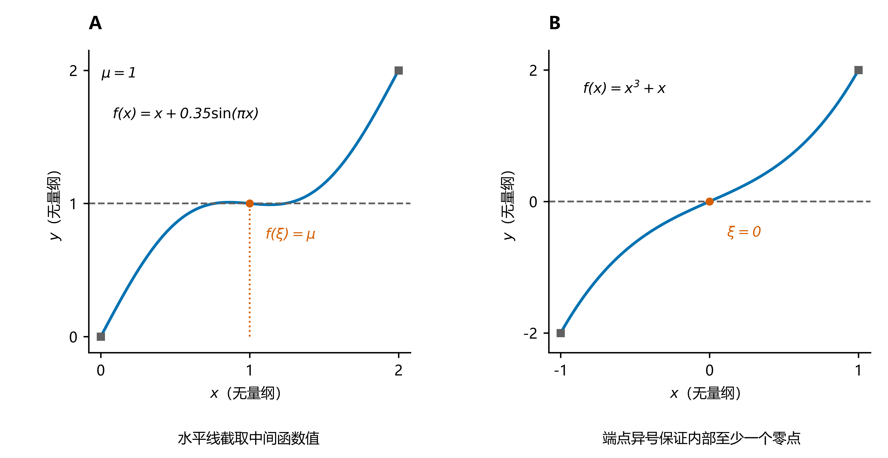
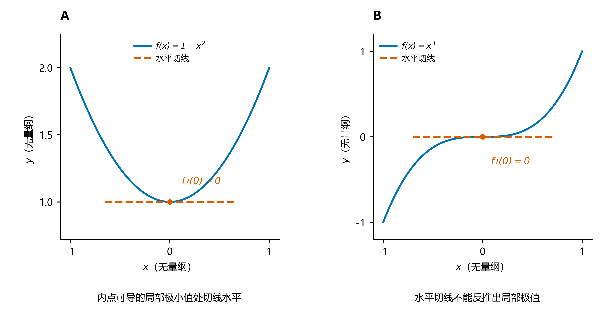
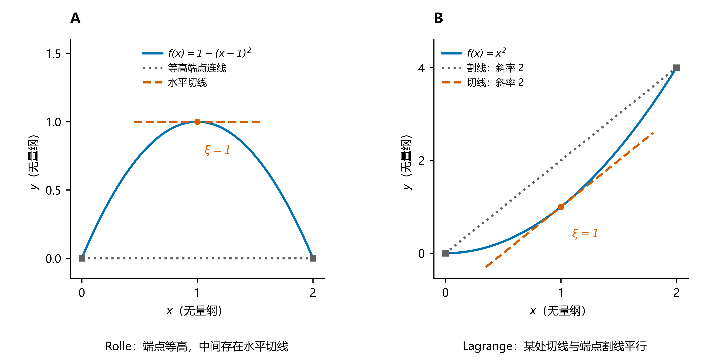
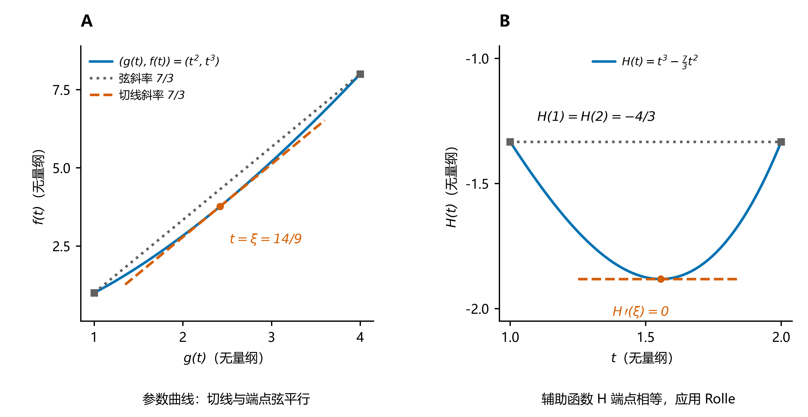
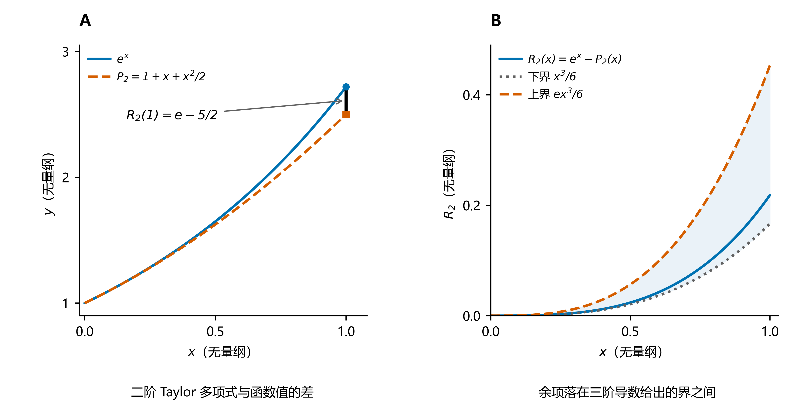
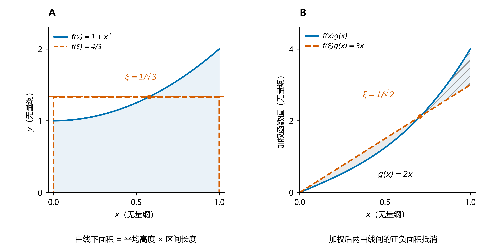
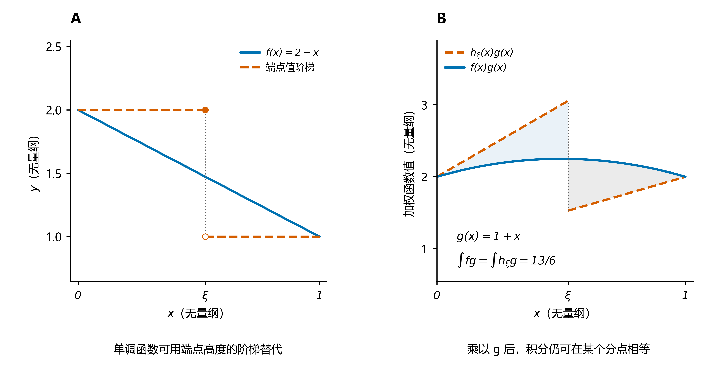
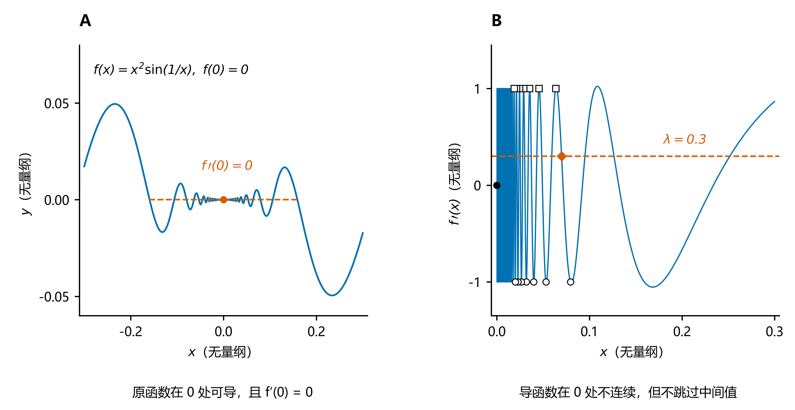

# 中值定理

配套八组几何图，分别解释取值、切线、余项与积分平均。图中坐标均无量纲；[配图目录与生成脚本](image/中值定理/README.md) 提供矢量 PDF、SVG 和 600 dpi PNG。

- [中值定理](#中值定理)
  - [一、引入](#一引入)
    - [1. 介值定理](#1-介值定理)
    - [2. 零点定理](#2-零点定理)
    - [3. 费马引理（费马定理）](#3-费马引理费马定理)
  - [二、微分中值定理](#二微分中值定理)
    - [1. Rolle 中值定理（罗尔定理）](#1-rolle-中值定理罗尔定理)
    - [2. Lagrange 中值定理（拉格朗日中值定理）](#2-lagrange-中值定理拉格朗日中值定理)
    - [3. Cauchy 中值定理（柯西中值定理）](#3-cauchy-中值定理柯西中值定理)
    - [4. Taylor 中值定理（泰勒中值定理）](#4-taylor-中值定理泰勒中值定理)
  - [三、积分中值定理](#三积分中值定理)
    - [1. 积分第一中值定理](#1-积分第一中值定理)
    - [2. 积分第一中值定理的推广形式](#2-积分第一中值定理的推广形式)
    - [3. 积分第二中值定理](#3-积分第二中值定理)
  - [四、相关的中值性质](#四相关的中值性质)
    - [1. 达布定理（Darboux theorem）](#1-达布定理darboux-theorem)
  - [五、总结](#五总结)

## 一、引入

### 1. 介值定理

   **条件：** 函数 \(f:[a,b]\to\mathbb R\) 在闭区间 \([a,b]\) 上连续，数 \(\mu\) 位于 \(f(a)\) 与 \(f(b)\) 之间，即

   \[
   \min\{f(a),f(b)\}\le \mu\le \max\{f(a),f(b)\},
   \]

   **定理内容：** 存在 \(\xi\in[a,b]\)，使得

   \[
   f(\xi)=\mu.
   \]

   若 \(\mu\) 严格位于 \(f(a)\) 与 \(f(b)\) 之间，则可取 \(\xi\in(a,b)\)。

   几何上，水平线 $y=\mu$ 必与连续曲线相交，见图 1A；定理保证存在性，不保证交点唯一。

### 2. 零点定理

   **条件：** 函数 \(f\) 在闭区间 \([a,b]\) 上连续，且

   \[
   f(a)f(b)<0.
   \]

   **定理内容：** 至少存在一点 \(\xi\in(a,b)\)，使得

   \[
   f(\xi)=0.
   \]

**图 1**：A 取 $f(x)=x+0.35\sin(\pi x)$，$x\in[0,2]$，水平线 $y=1$ 在 $\xi=1$ 处与曲线相交。B 取 $f(x)=x^3+x$，$x\in[-1,1]$，两端函数值异号，内部零点为 $\xi=0$。方形标记为端点，圆形标记为选定的中间点；两图使用不同的纵轴范围。

### 3. 费马引理（费马定理）

   **条件：** 函数 \(f\) 在点 \(x_0\) 的某邻域内有定义，并且：

   1. \(x_0\) 是该邻域的内点；
   2. \(f\) 在 \(x_0\) 处取得局部极大值或局部极小值；
   3. \(f\) 在 \(x_0\) 处可导。

   **定理内容：**

   \[
   f'(x_0)=0.
   \]

**图 2**：A 为 $f(x)=1+x^2$，在内点 $0$ 可导且取得局部极小值，故切线水平。B 为 $f(x)=x^3$，虽有 $f'(0)=0$，但 $0$ 不是极值点，说明费马引理的逆命题不成立。可导条件也不可省略，例如 $|x|$ 在 $0$ 处有极小值却不可导。

## 二、微分中值定理

### 1. Rolle 中值定理（罗尔定理）

   **条件：** 函数 \(f\) 满足：

   1. \(f\) 在 \([a,b]\) 上连续；
   2. \(f\) 在 \((a,b)\) 内可导；
   3. \(f(a)=f(b)\)。

   **定理内容：** 存在 \(\xi\in(a,b)\)，使得

   \[
   f'(\xi)=0.
   \]

   图 3A 用等高端点与内部水平切线展示该结论；中值点可以不唯一。

### 2. Lagrange 中值定理（拉格朗日中值定理）

   **条件：** 函数 \(f\) 满足：

   1. \(f\) 在 \([a,b]\) 上连续；
   2. \(f\) 在 \((a,b)\) 内可导。

   **定理内容：** 存在 \(\xi\in(a,b)\)，使得

   \[
   f'(\xi)=\frac{f(b)-f(a)}{b-a}.
   \]

   等价地，

   \[
   f(b)-f(a)=f'(\xi)(b-a).
   \]

**图 3**：A 取 $f(x)=1-(x-1)^2$，$[a,b]=[0,2]$，两端函数值均为 $0$，在 $\xi=1$ 处导数为零。B 取 $f(x)=x^2$，同一区间上的割线斜率为 $2$，在 $\xi=1$ 处的切线为 $y=2x-1$，与割线 $y=2x$ 平行。蓝色实线为函数，灰色点线连接端点，橙色虚线为中值点处切线。

### 3. Cauchy 中值定理（柯西中值定理）

   **条件：** 函数 \(f,g\) 满足：

   1. \(f,g\) 在 \([a,b]\) 上连续；
   2. \(f,g\) 在 \((a,b)\) 内可导。

   **定理内容：** 存在 \(\xi\in(a,b)\)，使得

   \[
   \bigl[f(b)-f(a)\bigr]g'(\xi)=
   \bigl[g(b)-g(a)\bigr]f'(\xi).
   \]

   若进一步满足

   \[
   g(b)\ne g(a),\qquad g'(\xi)\ne 0,
   \]

   则可写为

   \[
   \frac{f'(\xi)}{g'(\xi)}=
   \frac{f(b)-f(a)}{g(b)-g(a)}.
   \]

**图 4**：取 $f(t)=t^3$、$g(t)=t^2$，$t\in[1,2]$。A 以 $g(t)$ 为横坐标、$f(t)$ 为纵坐标，端点弦斜率为 $7/3$；在 $\xi=14/9$ 处，参数曲线切线斜率 $f'(\xi)/g'(\xi)=3\xi/2=7/3$。B 取辅助函数 $H(t)=f(t)-(7/3)g(t)$，其两端值同为 $-4/3$，且 $H'(\xi)=0$，将结论归结为 Rolle 定理。图中的比值解释使用了 $g'(t)\ne0$，一般情形应使用正文的交叉相乘式。

### 4. Taylor 中值定理（泰勒中值定理）

   **条件：** 设 \(n\ge 0\)，函数 \(f\) 在包含 \(a\) 与 \(x\) 的闭区间上具有 \(n\) 阶连续导数，并在相应开区间内具有 \(n+1\) 阶导数。

   **定理内容：** 存在位于 \(a\) 与 \(x\) 之间的点 \(\xi\)，使得

   \[
   f(x)=
   \sum_{k=0}^{n}
   \frac{f^{(k)}(a)}{k!}(x-a)^k
   +
   \frac{f^{(n+1)}(\xi)}{(n+1)!}(x-a)^{n+1}.
   \]

   其中

   \[
   R_n(x)=
   \frac{f^{(n+1)}(\xi)}{(n+1)!}(x-a)^{n+1}
   \]

   称为泰勒公式的**拉格朗日型余项**。

   等价地，若 \(f\) 在包含 \(a\) 与 \(x\) 的闭区间上具有 \(n-1\) 阶连续导数，并在相应开区间内具有 \(n\) 阶导数，则存在位于 \(a\) 与 \(x\) 之间的点 \(\xi\)，使得

   \[
   f(x)=
   \sum_{k=0}^{n-1}
   \frac{f^{(k)}(a)}{k!}(x-a)^k
   +
   \frac{f^{(n)}(\xi)}{n!}(x-a)^n.
   \]

**图 5**：取 $f(x)=e^x$、展开点 $a=0$、阶数 $n=2$，$0\le x\le1$。A 比较函数与 $P_2(x)=1+x+x^2/2$，右端竖线表示误差 $R_2(1)=e-5/2$。B 的实线为精确误差；由于 $1\le f^{(3)}(t)\le e$，有 $x^3/6\le R_2(x)\le ex^3/6$，阴影为确定性的余项界，不是统计误差带。余项中的中值点 $\xi$ 一般随 $x$ 改变。

## 三、积分中值定理

### 1. 积分第一中值定理

   **条件：** 函数 \(f\) 在闭区间 \([a,b]\) 上连续。

   **定理内容：** 存在 \(\xi\in[a,b]\)，使得

   \[
   \int_a^b f(x)\,\mathrm dx=f(\xi)(b-a).
   \]

   几何上，存在一个函数值作为矩形高度，使矩形面积等于曲线下的积分，见图 6A；函数可取负值时应理解为有符号面积。

### 2. 积分第一中值定理的推广形式

   **条件：** 函数 \(f\) 在闭区间 \([a,b]\) 上连续，函数 \(g\) 在 \([a,b]\) 上可积且不变号。

   **定理内容：** 存在 \(\xi\in[a,b]\)，使得

   \[
   \int_a^b f(x)g(x)\,\mathrm dx=
   f(\xi)\int_a^b g(x)\,\mathrm dx.
   \]

**图 6**：A 取 $f(x)=1+x^2$，$x\in[0,1]$，积分为 $4/3$；虚线矩形高 $f(\xi)=4/3$、宽 $1$，对应 $\xi=1/\sqrt3$。B 仍取该 $f$，令 $g(x)=2x\ge0$；有 $\int_0^1fg=3/2$、$\int_0^1g=1$，故 $f(\xi)=3/2$、$\xi=1/\sqrt2$。实线 $fg$ 与虚线 $f(\xi)g=3x$ 之间的两块阴影面积相等，分别用平涂和斜线区分。一般权重积分为零时不应相除，应保留原等式。

### 3. 积分第二中值定理

   **条件：** 函数 \(f\) 在闭区间 \([a,b]\) 上单调，函数 \(g\) 在 \([a,b]\) 上连续。

   **定理内容：** 存在 \(\xi\in[a,b]\)，使得

   \[
   \int_a^b f(x)g(x)\,\mathrm dx=
   f(a)\int_a^\xi g(x)\,\mathrm dx
   +
   f(b)\int_\xi^b g(x)\,\mathrm dx.
   \]

**图 7**：取单调递减函数 $f(x)=2-x$ 与 $g(x)=1+x$，$x\in[0,1]$。A 的虚线阶梯 $h_\xi$ 在 $[0,\xi]$ 取 $f(0)=2$，在 $(\xi,1]$ 取 $f(1)=1$。B 比较 $fg$ 与 $h_\xi g$；选 $\xi=\sqrt{7/3}-1$ 时，$\int_0^1fg=13/6=2\int_0^\xi g+\int_\xi^1g$，两块差值面积抵消。A 中未加权的面积不要求相等；定理保证加权积分相等。此例的 $g$ 为正，但积分第二中值定理不要求 $g$ 不变号。

## 四、相关的中值性质

### 1. 达布定理（Darboux theorem）

   **条件：** 函数 \(f\) 在区间 \(I\) 上可导，\(x_1,x_2\in I\) 且 \(x_1<x_2\)。数 \(\lambda\) 严格位于 \(f'(x_1)\) 与 \(f'(x_2)\) 之间。

   **定理内容：** 存在 \(\xi\in(x_1,x_2)\)，使得

   \[
   f'(\xi)=\lambda.
   \]

**图 8**：A 取 $f(x)=x^2\sin(1/x)$（$x\ne0$）、$f(0)=0$，由差商 $x\sin(1/x)\to0$ 得 $f'(0)=0$。B 对 $x>0$ 有 $f'(x)=2x\sin(1/x)-\cos(1/x)$；空心圆处 $x_n=1/(2\pi n)$ 的导数恒为 $-1$，空心方形处 $y_n=1/((2n+1)\pi)$ 的导数恒为 $1$，两列均趋于 $0$，故导函数在 $0$ 处不连续。水平虚线 $\lambda=0.3$ 与导函数相交，菱形标记其中一点，展示它仍不跳过中间值。图仅解析绘制有限振荡范围，靠近 $0$ 的振荡还有无穷多次，未将振荡曲线与孤立绘出的 $(0,f'(0))$ 强行连线。

## 五、总结

- 介值定理和零点定理刻画连续函数的取值性质。
- 费马引理刻画可导函数在内点取得局部极值时的必要条件。
- 微分中值定理用区间上的函数增量刻画某一点的导数。
- 积分中值定理用某一点的函数值刻画区间上的积分。
- 达布定理表明导函数具有介值性，即使导函数未必连续。

[配图说明与重现](image/中值定理/README.md) · [证明](中值定理_证明.md) · [例题](中值定理_例题.md)

