# 几何对象的位置关系

**统一思路**：先用向量组的秩判断方向自由度，再用相容性（增广秩）判断是否存在公共交集。

## 1 直线的位置关系

设

$$
L_0:\ \boldsymbol x=\boldsymbol p_0+t\boldsymbol d_0,\qquad
L_1:\ \boldsymbol x=\boldsymbol p_1+s\boldsymbol d_1
\quad(\boldsymbol d_0,\boldsymbol d_1\neq\boldsymbol 0),
$$

令
$$
r=\operatorname{rank}(\boldsymbol d_0,\boldsymbol d_1,\boldsymbol p_0-\boldsymbol p_1)
=\dim\operatorname{span}\{\boldsymbol d_0,\boldsymbol d_1,\boldsymbol p_0-\boldsymbol p_1\}.
$$

| $r$ | 位置关系 | 判据 |
| --- | --- | --- |
| 3 | 异面 | $(\boldsymbol p_0-\boldsymbol p_1)\cdot(\boldsymbol d_0\times\boldsymbol d_1)\neq0$ |
| 2 | 平行 | $\boldsymbol d_0\times\boldsymbol d_1=\boldsymbol 0$，$\boldsymbol p_0-\boldsymbol p_1\notin\operatorname{span}\{\boldsymbol d_0\}$ |
| 2 | 相交 | $\boldsymbol d_0\times\boldsymbol d_1\neq\boldsymbol 0$ |
| 1 | 重合 | $\boldsymbol d_0\times\boldsymbol d_1=\boldsymbol 0$，$\boldsymbol p_0-\boldsymbol p_1\in\operatorname{span}\{\boldsymbol d_0\}$ |

$r=2$ 即共面；相交时 $\boldsymbol p_0-\boldsymbol p_1=s_*\boldsymbol d_1-t_*\boldsymbol d_0$，不增加独立方向，秩仍为 2。

**作图约定**：蓝色实线 $L_0$，橙色虚线 $L_1$；圆点、方点为基点 $\boldsymbol p_0,\boldsymbol p_1$，粗箭头为方向向量 $\boldsymbol d_0,\boldsymbol d_1$，黑色点划线为 $\boldsymbol p_1\to\boldsymbol p_0$ 的位移向量。空间斜投影示意图，不用于读数。

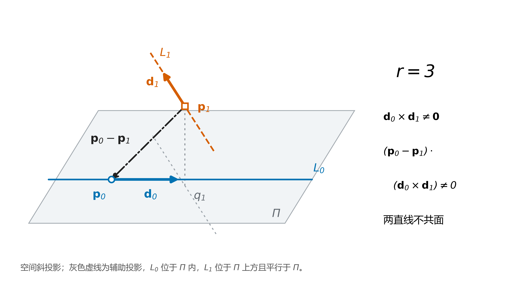
图 1｜$r=3$：$L_0\subset\Pi$，$L_1\parallel\Pi$ 且在 $\Pi$ 外，混合积非零。

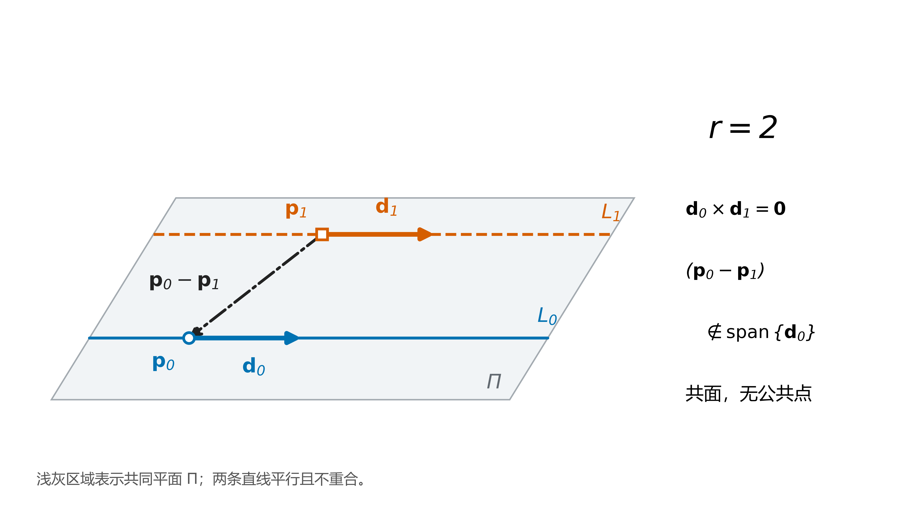
图 2｜$r=2$ 平行：方向向量平行，位移向量不沿直线方向。

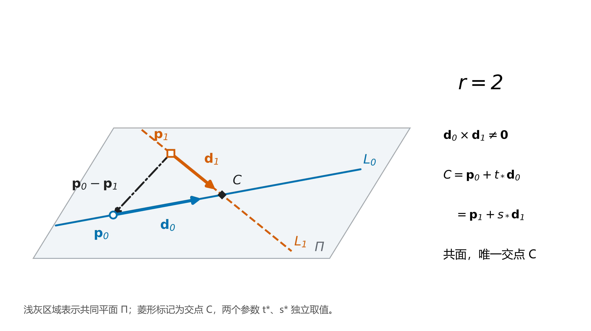
图 3｜$r=2$ 相交：菱形为唯一交点 $C$。

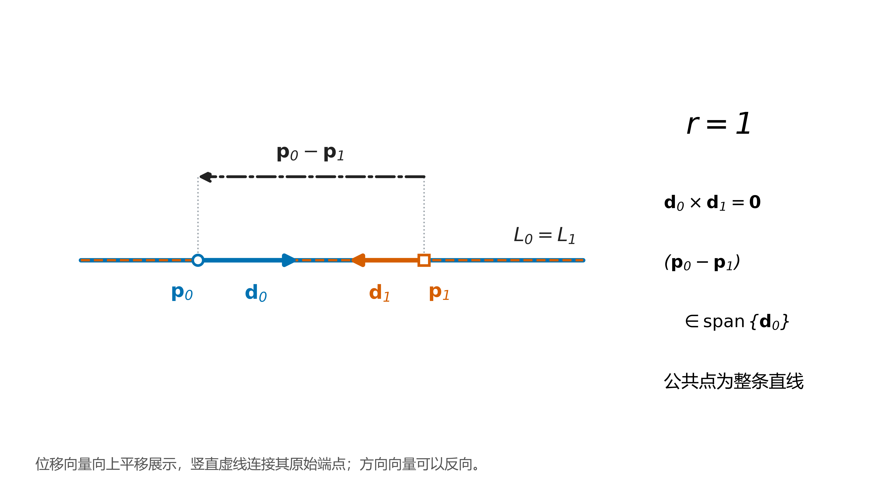
图 4｜$r=1$ 重合：$L_0=L_1$，基点可异、方向可反向；位移向量为避免重叠已平移画出。

## 2 平面的位置关系

设

$$
\Pi_i:\ \boldsymbol n_i\cdot(\boldsymbol x-\boldsymbol p_i)=0,\qquad
b_i=\boldsymbol n_i\cdot\boldsymbol p_i,\qquad i=1,2,3,
$$

则公共点满足 $A\boldsymbol x=\boldsymbol b$，其中 $A=(\boldsymbol n_1,\boldsymbol n_2,\boldsymbol n_3)^{\mathsf T}$，$\boldsymbol b=(b_1,b_2,b_3)^{\mathsf T}$。记

$$
r=\operatorname{rank}A=\dim\operatorname{span}\{\boldsymbol n_1,\boldsymbol n_2,\boldsymbol n_3\},
\qquad
r'=\operatorname{rank}(A\mid\boldsymbol b),
$$

位置关系由 $(r,r')$ 完全决定：

| $r$ | $r'$ | 解的情况 | 位置关系 |
| :--- | :--- | :--- | :--- |
| 1 | 1 | 无穷多解 | 三平面重合 |
| 1 | 2 | 无解 | 三平面两两平行且互异；或两平面重合，第三个平面与它们平行 |
| 2 | 2 | 无穷多解 | 三平面互异，交于一条直线；或两平面重合，第三个平面与它们相交 |
| 2 | 3 | 无解 | 两平面平行，第三个平面与二者分别相交；或三平面两两相交，三条交线互相平行且互异 |
| 3 | 3 | 唯一解 | 三平面交于一点 |

**作图约定**：蓝实线、橙虚线、绿点划线分别为 $\Pi_1,\Pi_2,\Pi_3$ 的边界；圆点、方点、三角点为基点，同色粗箭头为法向量（可反向、非单位）。空间正投影，平面透明显示。

### ① $r=3$：交于一点

$\boldsymbol n_1\cdot(\boldsymbol n_2\times\boldsymbol n_3)\neq0\Rightarrow r'=3$，有唯一解，记为 $C$：

$$
\Pi_1\cap\Pi_2\cap\Pi_3=\{C\}.
$$

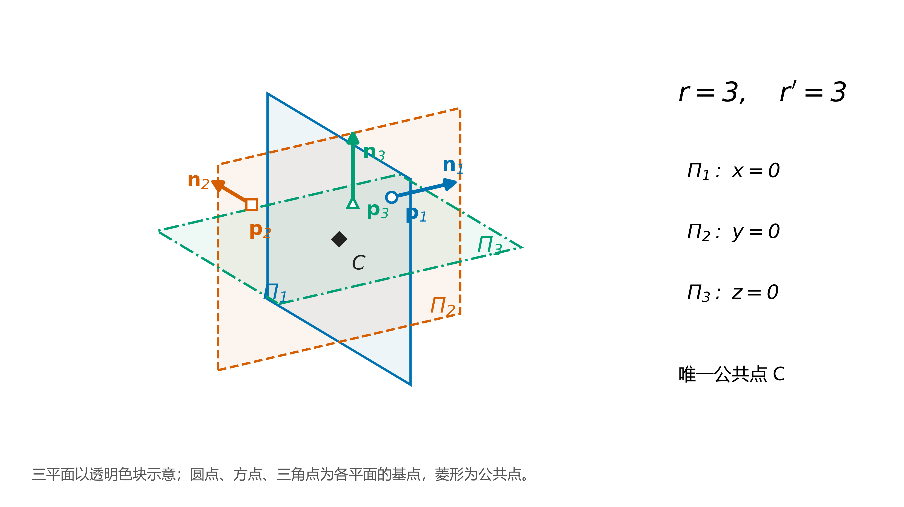
图 5｜例：$x=0,\ y=0,\ z=0$，$C=(0,0,0)$。

### ② $r=2$：法向量共面但不全平行

- $r'=2$：交于一条公共直线；
- $r'=3$：无公共点。

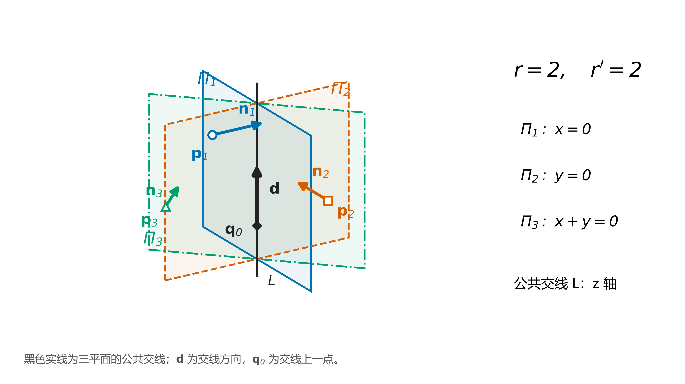
图 6｜例：$x=0,\ y=0,\ x+y=0$，公共交线为 $z$ 轴，方向 $\boldsymbol d$ 满足 $\boldsymbol n_i\cdot\boldsymbol d=0$。

无公共点的两种情形：

1. 两平面平行，第三个平面与它们相交（图 7：$x=-1,\ x=1,\ y=0$，得两条互异平行交线）；
2. 三平面两两相交，三条交线互相平行且互异（图 8：$x=0,\ y=0,\ x+y=1$，$r=2,\ r'=3$，交线为 $(0,0),(0,1),(1,0)$ 处沿 $z$ 的三条直线）。

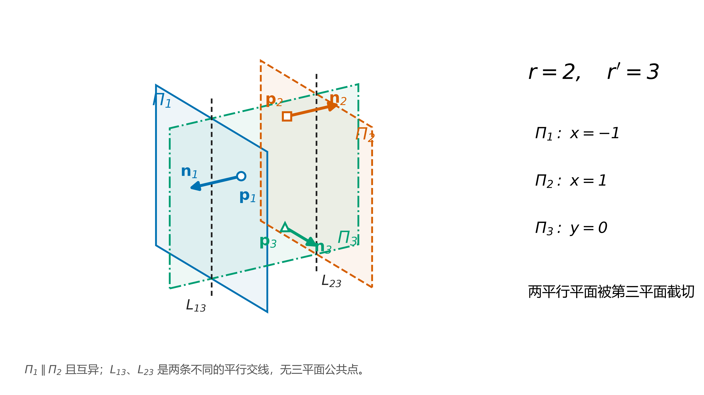
图 7｜$r=2,\ r'=3$，无公共点。

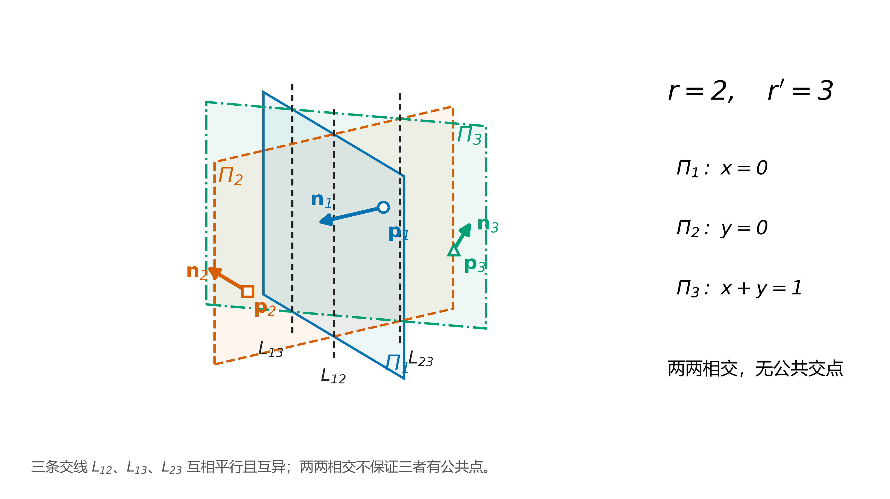
图 8｜“两两相交”推不出“有公共点”。

### ③ $r=1$：$\boldsymbol n_1\parallel\boldsymbol n_2\parallel\boldsymbol n_3$

三平面两两平行或重合：

- $r'=1$：三平面完全重合（图 9，如均为 $z=0$）；
- $r'=2$：存在互异的平行平面，公共交集为空。含“两平面重合＋第三平面平行”（图 10：$z=0,z=0,z=1.4$）与“三平面互异平行”（图 11：$z=-1,0,1$）。

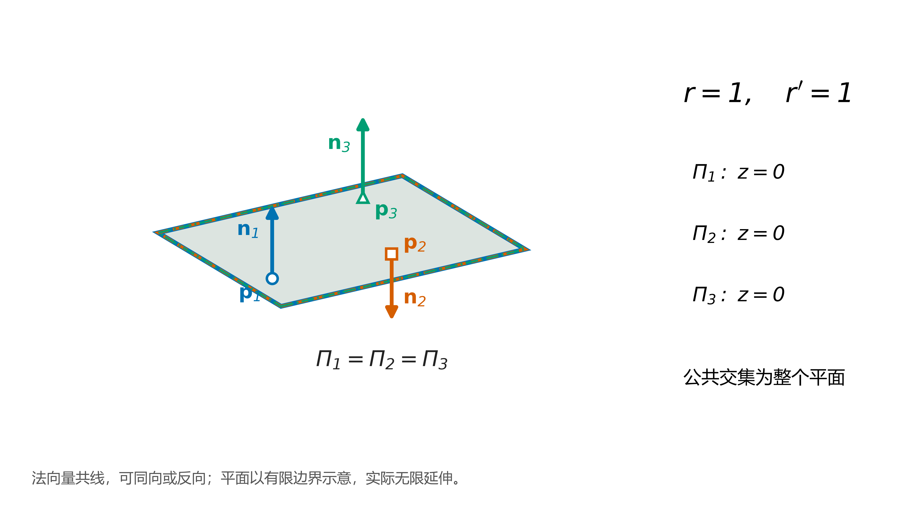
图 9｜$r=r'=1$，交集为整个平面。

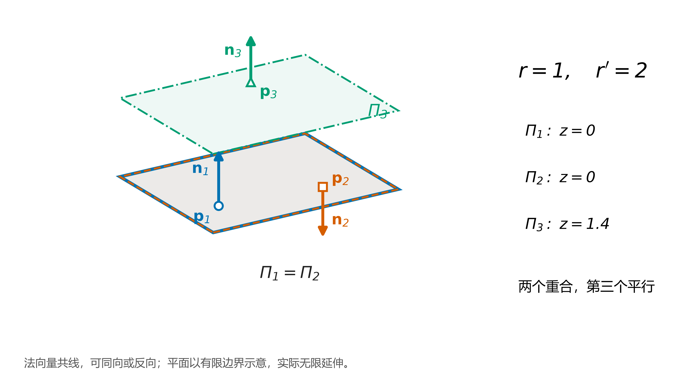
图 10｜$r=1,\ r'=2$，交集为空。

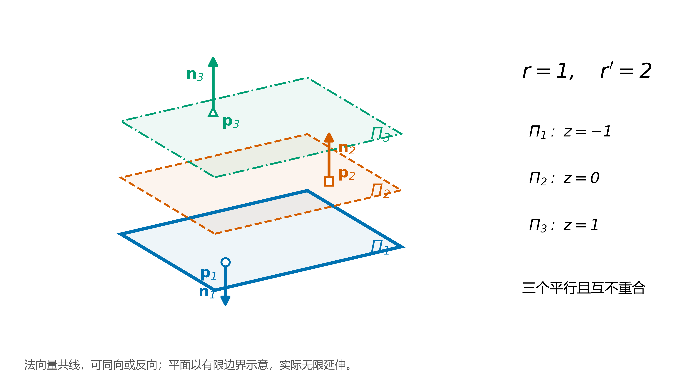
图 11｜$r=1,\ r'=2$，交集为空。

## 3 统一结论

| $r$ | $r'$ | 位置关系 |
| --- | --- | --- |
| 3 | 3 | 交于一点 |
| 2 | 2 | 交于一条直线 |
| 2 | 3 | 无公共点 |
| 1 | 1 | 三平面重合（交集为公共平面） |
| 1 | 2 | 三平面两两平行且不全重合 |

- $r$ 是独立约束个数，$r'$ 检验约束是否相容。
- $r=r'$ 时交集为仿射空间：$\dim(\Pi_1\cap\Pi_2\cap\Pi_3)=3-r$（$r=1,2,3$ 分别对应二维、一维、零维）。
- $r<r'$ 时约束矛盾，交集为空。

