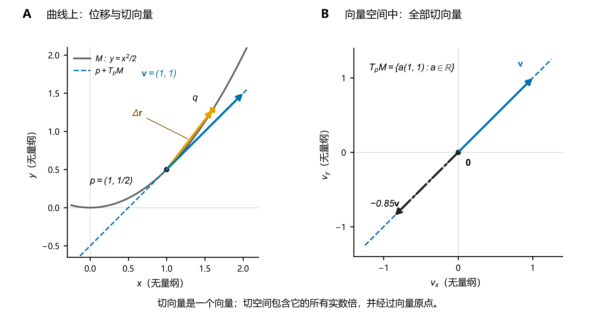
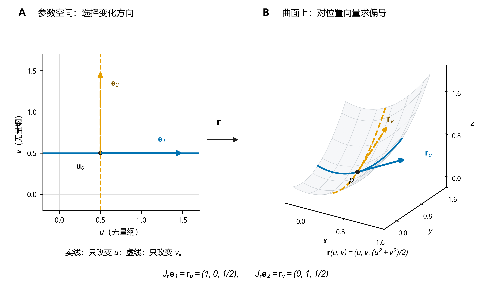
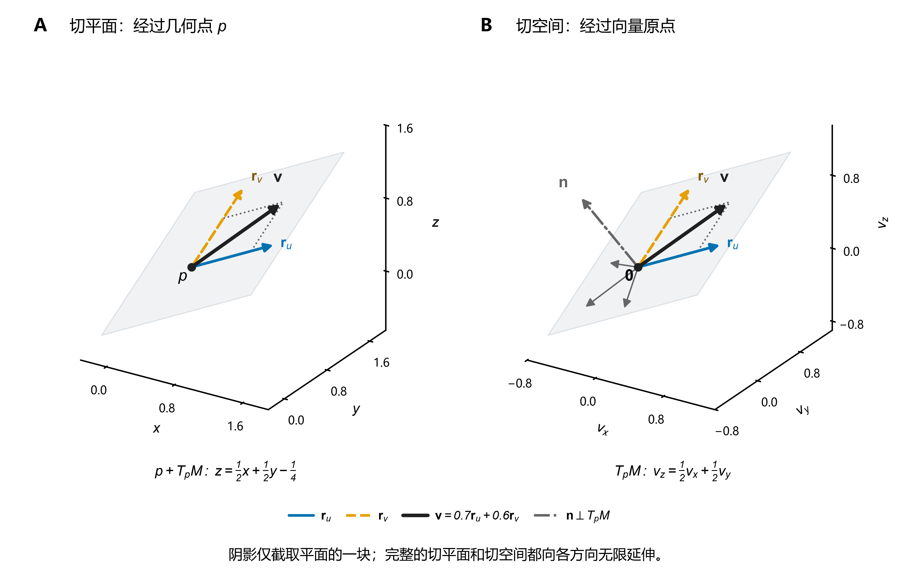

# 切向量与切空间

> **主线：实际位移 → 位置向量的一阶变化率 → 参数偏导给出的基本切向量 → 切空间 → Jacobian 的列空间与核空间。** 先观察“点如何移动”，再把移动方式写成映射，最后提炼为线性代数。

**贯穿全文的核心：** 无论几何对象最初写成显式方程、参数方程还是隐式约束，只要它在所考察点附近具有正则的局部参数化，就可以先构造位置向量 $\mathbf r$，再对各独立参数求偏导，得到生成切空间的基本切向量。这里“沿某个方向”指的是**参数变化所产生的运动方向**，不一定是环境空间中的某个坐标轴方向。对于隐式约束，也可以直接对约束求微分来确定切空间。

下面先从实际位移说明为什么要对位置向量求导，再逐步看清：从曲线到曲面、再到高维几何对象，改变的是独立参数的数量，切向量的构造原理始终相同。

**读图约定：** 本文配图中的坐标和参数均无量纲。箭头表示向量；曲线或平面的有限片段只用于展示局部结构。三维图采用正交投影，各坐标方向保持相同的数据单位尺度。

## 0. 基本定义：从位移出发

设几何对象上的一点沿某条允许路径移动，其位置向量为 $\mathbf r(t)$。当参数从 $t_0$ 变为 $t_0+\Delta t$ 时，实际位移为

$$
\boxed{\Delta\mathbf r=\mathbf r(t_0+\Delta t)-\mathbf r(t_0)}.
$$

位移 $\Delta\mathbf r$ 随 $\Delta t\to0$ 趋于零；为了捕捉这一瞬间的**运动方向及一阶变化率**，考虑位移与参数增量的比值：

$$
\boxed{\mathbf v=\lim_{\Delta t\to0}\frac{\Delta\mathbf r}{\Delta t}=\mathbf r'(t_0)}.
$$

这就是该路径在 $p=\mathbf r(t_0)$ 处的**切向量**。等价地，若路径可微，则

$$
\boxed{\Delta\mathbf r=\mathbf v\,\Delta t+o(|\Delta t|)}.
$$

这说明：在足够小的尺度下，实际位移由切向量给出的一阶线性部分近似。

- **切向量**：某条允许路径在该点的一阶位移变化率；它位于**环境空间**，其大小依赖参数变化速率。
- **切空间 $T_pM$**：经过 $p$ 的所有允许路径所产生的切向量的集合；对正则光滑几何对象，它是一个线性空间。
- **切线／切平面**：经过 $p$ 的几何对象，分别写成 $p+T_pM$（当切空间维数为 $1$／$2$）。切空间本身是经过原点的向量空间。

下面先研究只有**一个自由参数**的曲线，再推广到有**两个自由参数**的曲面。

## 1. 曲线：一个自由参数、一维切空间与方向性

### 1.1 显式曲线 $y=f(x)$

设函数 $f$ 在 $x_0$ 处可微。函数图像上的点为

$$
\mathbf r(x)=(x,f(x)),\qquad p=(x_0,f(x_0)).
$$

让 $x$ 发生微小变化 $\Delta x$，该点在**平面**内的实际位移是

$$
\boxed{
\Delta\mathbf r=
\begin{pmatrix}
\Delta x\\
f(x_0+\Delta x)-f(x_0)
\end{pmatrix}
}.
$$

除以 $\Delta x$ 并取极限：

$$
\begin{aligned}
\mathbf v_0
&=\lim_{\Delta x\to0}\frac{\Delta\mathbf r}{\Delta x}\\
&=\begin{pmatrix}1\\f'(x_0)\end{pmatrix}.
\end{aligned}
$$

因此

$$
\boxed{\mathbf v_0=(1,f'(x_0))}.
$$

**此时再引入映射语言：** 函数图像可看作参数化

$$
\boxed{\mathbf r:I\subseteq\mathbb R\longrightarrow\mathbb R^2,\qquad x\longmapsto(x,f(x))}.
$$

- $\mathbb R$ 是**参数空间**：只用一个独立变量 $x$ 就能确定图像上的点。
- $\mathbb R^2$ 是**环境空间**：图像以及切向量都位于二维平面内。
- $f'(x_0)$ 是标量**斜率**；$(1,f'(x_0))$ 才是平面中的**切向量**。

沿图像取任意速度 $a$ 改变参数 $x$，即 $x(s)=x_0+as$。由链式法则，该路径的切向量为 $a\mathbf v_0$。因此

$$
\boxed{T_pM=\operatorname{span}\{(1,f'(x_0))\},\qquad \dim T_pM=1}.
$$

对应的切线为 $p+t\mathbf v_0$，也就是熟悉的

$$
\boxed{y-y_0=f'(x_0)(x-x_0)}.
$$

**小例子：** 若 $f(x)=x^2$，取 $x_0=1$，则 $\Delta\mathbf r=(\Delta x,2\Delta x+(\Delta x)^2)$；除以 $\Delta x$ 再取极限，得到 $\mathbf v_0=(1,2)$。这正是斜率为 $2$ 的切线方向。

**图 1｜一个切向量与全部切向量。** 图中另取 $y=x^2/2$，在 $p=(1,1/2)$ 处有 $\mathbf v=(1,1)$。A：橙色箭头是从 $p$ 到 $q=(1.6,1.28)$ 的实际位移 $\Delta\mathbf r=(0.6,0.78)$，蓝色箭头是切向量 $\mathbf v$；两者的方向一般不同，但当参数增量趋于零时，位移除以参数增量趋于 $\mathbf v$。蓝色虚线是经过 $p$ 的切线 $p+T_pM$。B：把向量放到向量原点，所有 $a\mathbf v$ 组成一维切空间 $T_pM$；它同时包含正向、反向和零向量。

### 1.2 参数曲线 $\mathbf r(t)=(x(t),y(t))$

显式图像只是把 $x$ 选作参数的一种特殊情况。对于一般平面曲线，改用任意参数 $t$：

$$
\boxed{\mathbf r:I\subseteq\mathbb R\longrightarrow\mathbb R^2,\qquad t\longmapsto(x(t),y(t))}.
$$

参数变化 $\Delta t$，平面位移为

$$
\Delta\mathbf r=
\begin{pmatrix}
x(t_0+\Delta t)-x(t_0)\\
y(t_0+\Delta t)-y(t_0)
\end{pmatrix}.
$$

于是

$$
\boxed{\mathbf v_0=\lim_{\Delta t\to0}\frac{\Delta\mathbf r}{\Delta t}
=(x'(t_0),y'(t_0))}.
$$

只要 $\mathbf v_0\ne\mathbf0$（**正则点**），其所在局部曲线的切空间就是

$$
\boxed{T_pM=\{a\mathbf v_0:a\in\mathbb R\}=\operatorname{span}\{\mathbf v_0\},\quad\dim T_pM=1}.
$$

**从“一维切空间”到“有方向的切向量”：**

1. 一维切空间是一条**向量直线**，同时包含 $\mathbf v_0$ 和 $-\mathbf v_0$；它本身不区分正反。
2. 参数 $t$ **增加**时，路径沿 $\mathbf v_0$ 方向运动；参数 $t$ **减少**时，路径沿 $-\mathbf v_0$ 方向运动。
3. 因而**切线方向**（一维子空间）由曲线局部几何确定；**选定的正向**则由参数化的方向确定。

把长度因素去掉，便得到该参数化所确定的**单位切向量**：

$$
\boxed{\mathbf T(t_0)=\frac{\mathbf r'(t_0)}{\|\mathbf r'(t_0)\|}}.
$$

若重新参数化 $t=\varphi(s)$，且 $\varphi'(s_0)\ne0$，则

$$
\frac{d\mathbf r}{ds}=\mathbf r'(t)\varphi'(s).
$$

因此，$\varphi'>0$ 保持正向，$\varphi'<0$ 反转正向，但**切空间不变**。选取随参数增加的弧长 $\ell$ 时，还可写成

$$
\boxed{d\mathbf r=\mathbf T\,d\ell=\bigl(dx,dy\bigr)}.
$$

**维数上的结论：** 即使曲线处在 $\mathbb R^3$ 或更高维环境中，只要它是正则曲线，其切空间仍然是一维；环境空间决定切向量有多少个坐标，**自由参数个数决定局部切空间维数**。

## 2. 曲面：两个自由参数、二维切空间与法向量

### 2.1 显式曲面 $z=g(x,y)$

将曲面上的点写成位置向量

$$
\mathbf r(x,y)=(x,y,g(x,y)).
$$

先看实际位移。参数从 $(x_0,y_0)$ 变为 $(x_0+\Delta x,y_0+\Delta y)$ 时，

$$
\boxed{
\Delta\mathbf r=
\begin{pmatrix}
\Delta x\\\Delta y\\
g(x_0+\Delta x,y_0+\Delta y)-g(x_0,y_0)
\end{pmatrix}
}.
$$

若 $g$ 在该点可微，则

$$
\Delta g=g_x\Delta x+g_y\Delta y+o\!\left(\sqrt{\Delta x^2+\Delta y^2}\right).
$$

因此位移的一阶部分为

$$
\boxed{d\mathbf r=\underbrace{(1,0,g_x)}_{\mathbf r_x}\,dx+
\underbrace{(0,1,g_y)}_{\mathbf r_y}\,dy}.
$$

**再用映射语言表达：**

$$
\boxed{\mathbf r:U\subseteq\mathbb R^2\longrightarrow\mathbb R^3,\quad (x,y)\longmapsto(x,y,g(x,y))}.
$$

参数空间有两个独立方向。给定参数变化方向 $(a,b)$，其对应的空间切向量为

$$
\boxed{\mathbf v=a\mathbf r_x+b\mathbf r_y}.
$$

两个基本切向量线性无关，故

$$
\boxed{T_pM=\operatorname{span}\{\mathbf r_x,\mathbf r_y\},\qquad\dim T_pM=2}.
$$

三维空间中，两个独立切向量的**叉积**垂直于整个切平面，故可取法向量

$$
\boxed{\mathbf n=\mathbf r_x\times\mathbf r_y=(-g_x,-g_y,1)}.
$$

于是切平面（$p=(x_0,y_0,z_0)$）为

$$
\boxed{z-z_0=g_x(x_0,y_0)(x-x_0)+g_y(x_0,y_0)(y-y_0)}.
$$

### 2.2 隐式曲面 $F(x,y,z)=0$

现在不直接给出参数如何生成曲面，而是给定**约束**：

$$
M=\{(x,y,z)\in\mathbb R^3:F(x,y,z)=0\}.
$$

这里 $F:\mathbb R^3\to\mathbb R$ 输出的是**约束值**，并不是输出曲面上位置向量的参数映射，因而不能把 $F$ 的偏导直接当作基本切向量。设 $F$ 在 $p$ 附近连续可微，且 $\nabla F(p)\ne\mathbf0$，有两种处理方式：

- **先参数化，再求偏导：** 例如 $F_z(p)\ne0$ 时，隐函数定理保证局部可以写成 $z=g(x,y)$，于是取 $\mathbf r(x,y)=(x,y,g(x,y))$，按上一节求 $\mathbf r_x,\mathbf r_y$。
- **直接对约束求微分：** 不必显式解出参数化，而是求出所有满足一阶约束的切向量。下面采用这种方法。

设曲面上一点沿允许路径 $\mathbf r(t)=(x(t),y(t),z(t))$ 移动。因为始终在曲面上，必有

$$
F(\mathbf r(t))=0.
$$

对 $t$ 求导，得到

$$
F_xx'+F_yy'+F_zz'=0
\quad\Longleftrightarrow\quad
\boxed{\nabla F(p)\cdot\mathbf v=0}.
$$

含义很直接：**沿曲面发生的位移，不能在一阶上改变约束值；因此切向量必须与梯度正交。**

若 $\nabla F(p)\ne\mathbf0$（正则点），则

$$
\boxed{T_pM=\{\mathbf v\in\mathbb R^3:\nabla F(p)\cdot\mathbf v=0\}}
$$

是二维空间，梯度即为法向量：

$$
\boxed{\mathbf n=\nabla F(p),\qquad
\nabla F(p)\cdot(\mathbf x-p)=0\quad\text{（切平面）}}.
$$

**两种求法的一致性：** 将显式曲面写成 $F(x,y,z)=z-g(x,y)=0$，则

$$
\nabla F=(-g_x,-g_y,1)=\mathbf r_x\times\mathbf r_y.
$$

### 2.3 参数曲面 $\mathbf r(u,v)$

进一步解除显式图像 $z=g(x,y)$ 的限制，考虑

$$
\boxed{\mathbf r:U\subseteq\mathbb R^2\longrightarrow\mathbb R^3,
\quad(u,v)\longmapsto(x(u,v),y(u,v),z(u,v))}.
$$

当参数发生位移 $(\Delta u,\Delta v)$，空间位移为

$$
\Delta\mathbf r=\mathbf r(u_0+\Delta u,v_0+\Delta v)-\mathbf r(u_0,v_0).
$$

可微性意味着

$$
\boxed{\Delta\mathbf r=\mathbf r_u\Delta u+\mathbf r_v\Delta v
+o\!\left(\sqrt{\Delta u^2+\Delta v^2}\right)}.
$$

故任意参数方向 $(a,b)$ 对应的切向量为

$$
\boxed{\mathbf v=a\mathbf r_u+b\mathbf r_v}.
$$

若 $\mathbf r_u,\mathbf r_v$ 线性无关，则在该正则参数化的局部分支上

$$
\boxed{T_pM=\operatorname{span}\{\mathbf r_u,\mathbf r_v\},\qquad
\mathbf n=\mathbf r_u\times\mathbf r_v}.
$$

这里的法向量正反依赖参数顺序：交换 $u,v$ 会令叉积变号，但切平面不变。

**图 2｜偏导就是参数坐标曲线的切向量。** 取 $\mathbf r(u,v)=(u,v,(u^2+v^2)/2)$、$\mathbf u_0=(1/2,1/2)$，对应曲面点 $p=(1/2,1/2,1/4)$。A：蓝色实线固定 $v$、只改变 $u$；橙色虚线固定 $u$、只改变 $v$。B：这两条参数直线经过 $\mathbf r$ 映成曲面上的两条参数曲线，其在 $p$ 处的切向量分别为 $\mathbf r_u=(1,0,1/2)$ 和 $\mathbf r_v=(0,1,1/2)$，箭头均按实际向量长度绘制。**位置点由 $\mathbf r$ 映射，方向向量由它的微分 $J_{\mathbf r}$ 映射**；所以参数方向 $\mathbf e_1,\mathbf e_2$ 对应空间切向量 $\mathbf r_u,\mathbf r_v$，而不是空间坐标轴本身。

## 3. 一般化：任意维映射与隐式约束

### 3.1 参数化：Jacobian 的列空间

总结前面的规律：**位置向量对某个参数的偏导，就是固定其他参数、只改变这个参数时所产生的切向量；同时改变多个参数，则得到这些基本切向量的线性组合。**

设 $M\subseteq\mathbb R^n$ 在所考察点附近由连续可微的位置向量映射给出：

$$
\boxed{\mathbf r:U\subseteq\mathbb R^d\longrightarrow\mathbb R^n},\qquad
\mathbf r(u_1,\ldots,u_d)=\bigl(x_1(\mathbf u),\ldots,x_n(\mathbf u)\bigr),
$$

其中 $U$ 是开集，$p=\mathbf r(\mathbf u_0)$。这里统一使用 $\mathbf r$，强调一般参数映射输出的仍然是几何对象上点的位置向量。

**第一步：沿一个参数方向求偏导。** 设 $\mathbf e_i$ 是参数空间的第 $i$ 个标准基向量。固定其他参数，只让 $u_i$ 改变 $\Delta u_i$，实际位移为

$$
\Delta\mathbf r=\mathbf r(\mathbf u_0+\Delta u_i\mathbf e_i)-\mathbf r(\mathbf u_0).
$$

于是

$$
\boxed{
\mathbf r_{u_i}(\mathbf u_0)
=\frac{\partial\mathbf r}{\partial u_i}(\mathbf u_0)
=\lim_{\Delta u_i\to0}\frac{\mathbf r(\mathbf u_0+\Delta u_i\mathbf e_i)-\mathbf r(\mathbf u_0)}{\Delta u_i}
}.
$$

这就是参数坐标曲线 $s\mapsto\mathbf r(\mathbf u_0+s\mathbf e_i)$ 在 $s=0$ 处的切向量。**参数空间中的坐标方向，经位置映射后变成环境空间中的切向量**；例如 $\mathbf r_x=(1,0,g_x)$ 通常并不平行于空间中的 $x$ 轴。

**第二步：让所有参数同时变化。** 可微性给出一阶展开：

$$
\boxed{
\Delta\mathbf r
=\sum_{i=1}^d\mathbf r_{u_i}(\mathbf u_0)\,\Delta u_i+o(\|\Delta\mathbf u\|)
=J_{\mathbf r}(\mathbf u_0)\Delta\mathbf u+o(\|\Delta\mathbf u\|)
}.
$$

其中 $n\times d$ 的 Jacobian 矩阵正是把各基本切向量排成列：

$$
\boxed{J_{\mathbf r}(\mathbf u_0)=
\begin{bmatrix}\mathbf r_{u_1}(\mathbf u_0)&\cdots&\mathbf r_{u_d}(\mathbf u_0)\end{bmatrix}}.
$$

取任意参数路径 $\mathbf u(t)$，满足 $\mathbf u(0)=\mathbf u_0$、$\mathbf u'(0)=\mathbf h=(h_1,\ldots,h_d)$。由链式法则，其对应的切向量为

$$
\boxed{
\mathbf v=\left.\frac{d}{dt}\mathbf r(\mathbf u(t))\right|_{t=0}
=\sum_{i=1}^dh_i\mathbf r_{u_i}(\mathbf u_0)
=J_{\mathbf r}(\mathbf u_0)\mathbf h
}.
$$

特别地，对于曲面，取 $(u(t),v(t))=(u_0+at,v_0+bt)$，便得到 $\mathbf v=a\mathbf r_u+b\mathbf r_v$。偏导数选择参数空间的坐标方向，线性组合则允许任意参数运动方向。

**第三步：由基本切向量生成切空间。** 若参数化在该点满列秩，即

$$
\operatorname{rank}J_{\mathbf r}(\mathbf u_0)=d,
$$

那么这些基本切向量线性无关，构成其局部光滑分支在 $p$ 处切空间的一组基：

$$
\boxed{
T_pM=\operatorname{span}\left\{
\mathbf r_{u_1}(\mathbf u_0),\ldots,\mathbf r_{u_d}(\mathbf u_0)
\right\}
=\operatorname{Col}\bigl(J_{\mathbf r}(\mathbf u_0)\bigr),
\qquad\dim T_pM=d
}.
$$

这便是 **Jacobian 列空间的几何意义**。一维曲线只有一个基本切向量，二维曲面有两个，一般 $d$ 维正则参数化则有 $d$ 个；求法和本质完全一致。

### 3.2 隐式约束：Jacobian 的核空间

设几何对象由 $k$ 个连续可微约束给出：

$$
\boxed{M=\{\mathbf x\in\mathbb R^n:\mathbf G(\mathbf x)=\mathbf0\},\qquad
\mathbf G:\mathbb R^n\to\mathbb R^k}.
$$

沿任意允许路径 $\mathbf x(t)\in M$，恒有 $\mathbf G(\mathbf x(t))=\mathbf0$。对路径参数求导：

$$
\boxed{J_G(p)\mathbf v=\mathbf0}.
$$

因此，满足约束的一阶允许方向属于 $J_G$ 的核空间。当 $J_G(p)$ **满行秩 $k$** 时，正则水平集定理保证这些方向都可以作为切向量，故

$$
\boxed{T_pM=\ker J_G(p),\qquad\dim T_pM=n-k}.
$$

此外，Jacobian 的每一行对应一个约束梯度，因此

$$
\boxed{N_pM=\operatorname{Row}(J_G)=(T_pM)^\perp}
$$

其中 $N_pM$ 是**法空间**。在高维空间中，用行空间表示法空间，比依赖三维专用的叉积更普遍。

### 3.3 两种描述为什么统一

若同一个正则几何对象局部既由 $\mathbf x=\mathbf r(\mathbf u)$ 参数化，又满足 $\mathbf G(\mathbf x)=\mathbf0$，则

$$
\mathbf G(\mathbf r(\mathbf u))=\mathbf0.
$$

求导得

$$
\boxed{J_G(p)J_{\mathbf r}(\mathbf u_0)=0}
\quad\Longrightarrow\quad
\operatorname{Col}(J_{\mathbf r})\subseteq\ker J_G.
$$

若 $\operatorname{rank}J_{\mathbf r}=d$，且 $\operatorname{rank}J_G=n-d$，根据秩—零度定理，两空间维数均为 $d$，于是

$$
\boxed{T_pM=\operatorname{Col}(J_{\mathbf r})=\ker J_G},
\qquad
\boxed{N_pM=(T_pM)^\perp=\operatorname{Row}(J_G)}.
$$

**图 3｜两个基本切向量张成一个切空间。** 沿用图 2 的曲面与点 $p$。蓝色实线箭头、橙色虚线箭头分别为 $\mathbf r_u,\mathbf r_v$；黑色箭头为 $\mathbf v=0.7\mathbf r_u+0.6\mathbf r_v=(0.7,0.6,0.65)$，细点线补全分量相加的平行四边形。A：将这些向量的起点放在 $p$，得到过 $p$ 的切平面 $z=\tfrac12x+\tfrac12y-\tfrac14$。B：将起点移到向量原点，得到切空间 $v_z=\tfrac12v_x+\tfrac12v_y$；灰色短箭头示意其他切向量，灰色点划线箭头是法向量 $\mathbf n=(-1/2,-1/2,1)$。阴影只画出平面的一块，**完整切空间包含基本切向量的一切实系数组合**。

此例还可以直接核对两种求法：

$$
J_{\mathbf r}(\mathbf u_0)=
\begin{pmatrix}1&0\\0&1\\1/2&1/2\end{pmatrix},
\qquad F(x,y,z)=z-\frac{x^2+y^2}{2},
\qquad \nabla F(p)=\left(-\frac12,-\frac12,1\right).
$$

因此 $\operatorname{Col}(J_{\mathbf r})$ 与 $\ker DF(p)$ 都是图 3B 中的平面：前者从两个基本切向量生成它，后者通过 $\mathbf n\cdot\mathbf v=0$ 确定它。

### 3.4 正则性：什么时候不能直接套用

上述“切空间等于列空间／核空间”的等式都以相应正则条件为前提。**可微保证参数偏导是相应参数路径的切向量；满列秩才保证它们构成完整切空间的一组基。** 若参数偏导线性相关甚至为零，就需要检查参数化是否退化，或者几何对象本身是否存在奇异性。

例如 $\mathbf r(t)=(t^3,0)$ 描述的是整条 $x$ 轴，但 $\mathbf r'(0)=(0,0)$。零向量仍是切向量，却不能生成 $x$ 轴的一维切空间；改用 $\widetilde{\mathbf r}(s)=(s,0)$，便恢复基本切向量 $(1,0)$。这里退化的是参数化，几何对象本身并没有奇点。

同样，约束微分总能给出切向量必须满足的条件；若约束 Jacobian 不满行秩，则其核空间可能大于真实的切向量集合，不能直接认定为切空间。在自交处，还要区分所考察的局部分支。

---

## 最终总结

下表各切空间公式均在相应正则条件下成立，导数取在所考察的参数点或几何点。

| 对象 | 位置向量或约束映射 | 基本切向量或切向量条件 | 切空间 |
|---|---|---|---|
| 显式曲线 $y=f(x)$ | $\mathbf r(x)=(x,f(x))$ | $\mathbf r_x=(1,f')$ | $\operatorname{span}\{\mathbf r_x\}$，一维 |
| 参数曲线 | $\mathbf r(t)=(x_1(t),\ldots,x_n(t))$ | $\mathbf r_t=\mathbf r'(t)$ | $\operatorname{span}\{\mathbf r_t\}$，一维 |
| 显式曲面 $z=g(x,y)$ | $\mathbf r(x,y)=(x,y,g(x,y))$ | $\mathbf r_x=(1,0,g_x)$，$\mathbf r_y=(0,1,g_y)$ | $\operatorname{span}\{\mathbf r_x,\mathbf r_y\}$，二维 |
| 参数曲面 | $\mathbf r(u,v)=(x(u,v),y(u,v),z(u,v))$ | $\mathbf r_u,\mathbf r_v$ | $\operatorname{span}\{\mathbf r_u,\mathbf r_v\}$，二维 |
| 一般参数化 | $\mathbf r:U\subseteq\mathbb R^d\to\mathbb R^n$ | $\mathbf r_{u_1},\ldots,\mathbf r_{u_d}$ | $\operatorname{Col}(J_{\mathbf r})$，$d$ 维 |
| 隐式曲面 $F=0$ | $F:\mathbb R^3\to\mathbb R$（约束） | $\nabla F\cdot\mathbf v=0$ | $\ker DF$，二维 |
| 一般约束 $\mathbf G=0$ | $\mathbf G:\mathbb R^n\to\mathbb R^k$（约束） | $J_G\mathbf v=0$ | $\ker J_G$，$n-k$ 维 |

> **切向量的本质是位置向量沿允许参数变化方向的一阶变化率。** 对于具有正则局部参数化的几何对象，只需构造位置向量 $\mathbf r$，对各独立参数求偏导，即可获得生成切空间的基本切向量；任意切向量由这些基本切向量线性组合得到。

$$
\boxed{
\underbrace{\mathbf r(\mathbf u)}_{\text{位置向量}}
\quad\xrightarrow{\text{对参数求偏导}}\quad
\underbrace{\mathbf r_{u_1},\ldots,\mathbf r_{u_d}}_{\text{基本切向量}}
\quad\xrightarrow{\operatorname{span}}\quad
\underbrace{T_pM}_{\text{切空间}}
}
$$

参数化**生成**允许方向（Jacobian 列空间），隐式约束**筛选**允许方向（Jacobian 核空间）。从一维曲线到高维几何对象，只是独立参数的数量发生变化；切空间刻画全部允许方向，具体参数的增加方向则确定相应切向量的指向。

前置：[向量代数](向量代数.md)、[解析几何基础](解析几何基础：直线、平面、曲线与曲面.md)。后续：[多元微分学详解](../02_多元微分学/02_微分与全微分/多元微分学详解.md) 将切向量接到 Jacobian 与方向导数；[积分元素](../03_多元积分学/01_重积分/积分元素.md) 用切向量构造有向线元与面积元。

[配图代码与导出说明](image/切向量与切空间/README.md) · [返回几何与代数基础](README.md)
