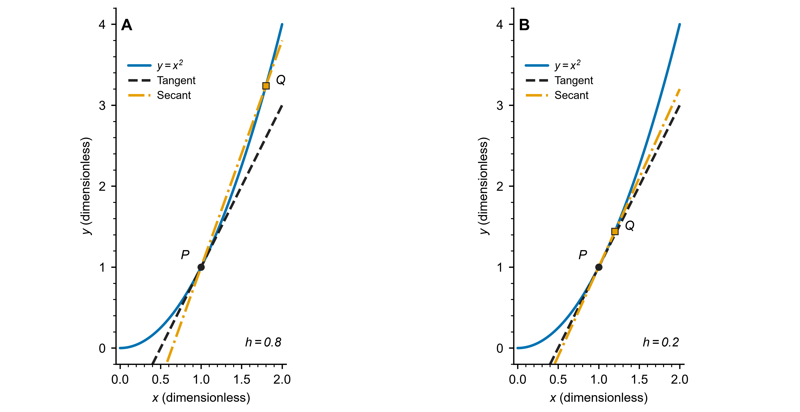
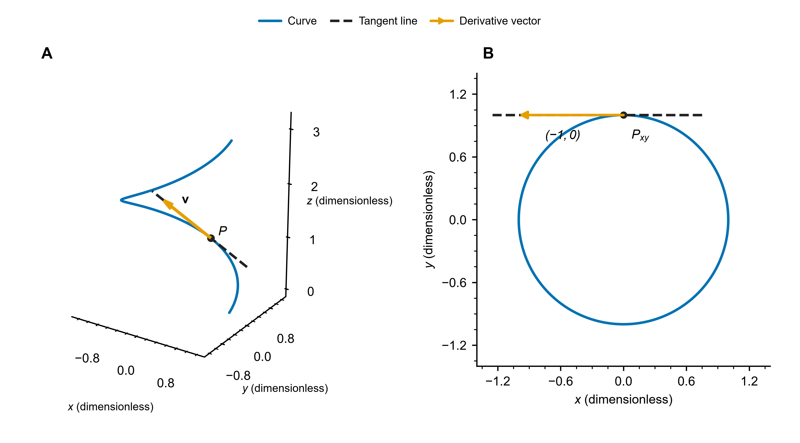
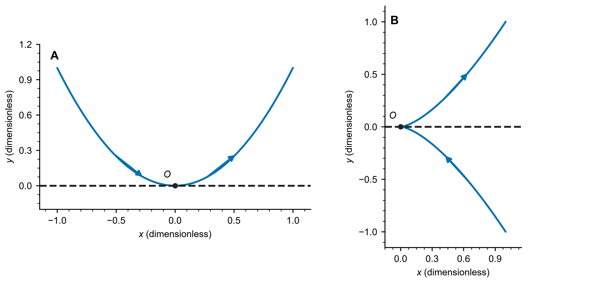

# 切向量与切线

> 平面曲线与空间曲线：从割线到导数，再到弧长参数化与曲线积分

从二维直角坐标系中的点与位置矢量出发，逐步理解割向量、切向量和切线，再推广到三维空间。

观察一条平面曲线，在曲线上固定一点 $P$，再取一个邻近点 $Q$。连接两点得到割线；让 $Q$ 沿曲线逐渐靠近 $P$，如果割线趋于一条确定的直线，这条直线就是曲线在 $P$ 处的切线。**切向量就是沿这条切线方向的非零向量。**

下面先用熟悉的点坐标和向量减法描述这个过程，再说明怎样通过导数算出切向量。

## 1. 从二维坐标中的点与位置矢量开始

### 1.1 点的位置与位置矢量

在二维直角坐标系中，设原点为 $O$，曲线 $C$ 上有两个点：

$$
P=(x_0,y_0),\qquad
Q=(x_0+\Delta x,\ y_0+\Delta y).
$$

$P$、$Q$ 表示两个点。由原点分别指向这两个点，得到它们的位置矢量：

$$
\mathbf r_P=\overrightarrow{OP}=(x_0,y_0),\qquad
\mathbf r_Q=\overrightarrow{OQ}=(x_0+\Delta x,\ y_0+\Delta y).
$$

点的坐标与对应位置矢量的分量相同，但含义不同：点说明“在哪里”，位置矢量说明“从原点向哪里、移动多少”。本文中“矢量”和“向量”含义相同。

### 1.2 两个位置矢量相减，得到割向量

从 $P$ 指向 $Q$ 的向量为

$$
\begin{aligned}
\overrightarrow{PQ}
&=\overrightarrow{OQ}-\overrightarrow{OP}\\
&=\mathbf r_Q-\mathbf r_P\\
&=(\Delta x,\Delta y).
\end{aligned}
$$

这就是**割向量**。它的起点在 $P$，终点在 $Q$，方向沿着连接两点的割线。

因此，这里最基本的关系是

$$
\boxed{\text{割向量}=\text{终点的位置矢量}-\text{起点的位置矢量}}.
$$

### 1.3 从割线的方向认识切线

固定 $P$，让 $Q$ 沿曲线靠近 $P$。如果割线的方向趋于确定的直线方向，就得到曲线在 $P$ 处的切线方向。

但此时还有一个问题：

$$
Q\to P\quad\Longrightarrow\quad
\overrightarrow{PQ}=(\Delta x,\Delta y)\to\mathbf0.
$$

**割向量的长度趋于零，不能直接把它的极限当成非零切向量。**需要在取极限前，适当地缩放割向量，保留方向信息。

先考虑 $\Delta x\ne0$ 的情况：

$$
\frac{\overrightarrow{PQ}}{\Delta x}
=\left(1,\frac{\Delta y}{\Delta x}\right).
$$

它与割向量平行，第一分量固定为 $1$，第二分量就是割线的斜率。接下来对 $y=f(x)$ 求极限，就能得到熟悉的导数。

这里先讨论切线的几何方向；向量乘负数时会反向，但仍沿同一条直线。关于两侧逼近时的定向差别，见第 8.2 节。

图 1：曲线为 $y=x^2$，固定 $P=(1,1)$，取 $Q=(1+h,(1+h)^2)$。A、B 分别取 $h=0.8$、$h=0.2$；蓝色实线为曲线，橙色点划线为割线，黑色虚线为切线。割线斜率为 $2+h$，趋于切线斜率 $2$。两面板坐标范围相同，坐标均无量纲。

## 2. 已知显式函数：从 $y=f(x)$ 得到切向量

### 2.1 函数值与函数图像有什么不同？

函数 $y=f(x)$ 表示：给定一个数 $x$，得到一个数 $f(x)$。例如，对 $f(x)=x^2$，输入 $x=1$，得到函数值 $1$。

把输入和输出合在一起，得到平面上的点 $(x,f(x))$。所有这样的点组成函数图像：

$$
\boxed{C=\{(x,f(x)):x\in D\}}.
$$

因此，研究切线的对象是平面上的图像 $C$；单独一个函数值 $f(x)$ 只是数，并不包含点的完整位置。

### 2.2 用位置矢量描述图像上的点

图像上点 $P=(x,f(x))$ 对应的位置矢量是

$$
\boxed{\mathbf r(x)=\overrightarrow{OP}=(x,f(x))}.
$$

这里的 $\mathbf r(x)$ 只是把点的两个坐标写成一个向量。随着 $x$ 改变，点沿图像移动，位置矢量也随之改变。

固定 $x_0$，取两点：

$$
\begin{aligned}
P&=(x_0,f(x_0)),\\
Q&=(x_0+\Delta x,\ f(x_0+\Delta x)).
\end{aligned}
$$

两点的位置矢量相减，得到

$$
\overrightarrow{PQ}
=\big(\Delta x,\ f(x_0+\Delta x)-f(x_0)\big).
$$

### 2.3 缩放割向量，再取极限

当 $\Delta x\ne0$ 时，

$$
\frac{\overrightarrow{PQ}}{\Delta x}
=\left(1,\frac{f(x_0+\Delta x)-f(x_0)}{\Delta x}\right).
$$

若 $f$ 在 $x_0$ 可微，则

$$
\begin{aligned}
\mathbf r'(x_0)
&=\lim_{\Delta x\to0}\frac{\overrightarrow{PQ}}{\Delta x}\\[4pt]
&=\lim_{\Delta x\to0}
\left(1,\frac{f(x_0+\Delta x)-f(x_0)}{\Delta x}\right)\\[4pt]
&=(1,f'(x_0)).
\end{aligned}
$$

所以曲线在 $P$ 处的一个切向量为

$$
\boxed{\mathbf v=(1,f'(x_0))}.
$$

注意区分：

- $f'(x_0)$ 是切线的斜率，是标量。
- $(1,f'(x_0))$ 是切线的方向向量，是二维向量。

第一分量恒为 $1$，所以这个切向量一定非零。

### 2.4 由切向量写出切线方程

经过点 $P$，沿切向量 $\mathbf v$ 前进或后退，就得到切线上的所有点。因此切线为

$$
\boxed{(x,y)=(x_0,f(x_0))+\lambda(1,f'(x_0)),\qquad\lambda\in\mathbb R}.
$$

其中 $\lambda$ 控制沿切线移动的距离倍数。写成分量形式：

$$
\begin{cases}
x=x_0+\lambda,\\
y=f(x_0)+\lambda f'(x_0).
\end{cases}
$$

由第一式得到 $\lambda=x-x_0$，代入第二式，就得到点斜式：

$$
\boxed{y-f(x_0)=f'(x_0)(x-x_0)}.
$$

例如，对 $y=x^2$，在 $P=(1,1)$ 处，切向量为 $(1,2)$，切线为 $y-1=2(x-1)$。

## 3. 再引入参数：点的两个坐标一起变化

### 3.1 为什么需要参数曲线？

在 $y=f(x)$ 中，选定 $x$ 后，$y$ 随之确定。但并非每条曲线都适合整体写成一个 $y=f(x)$；例如，圆上同一个横坐标可能对应两个不同的纵坐标。

一种自然的描述方法是：引入一个变量 $t$，让两个坐标都随它变化：

$$
x=x(t),\qquad y=y(t).
$$

例如，$x=\cos t$、$y=\sin t$ 描述单位圆。随着 $t$ 增大，点沿圆周移动。

这个用来标记曲线上点的变量 $t$ 就叫**参数**。它可以是时间，也可以只是一个方便描述位置的变量。

### 3.2 先写位置矢量，再写割向量

此时，曲线上点的位置矢量为

$$
\boxed{\mathbf r(t)=(x(t),y(t))}.
$$

固定 $t_0$，取

$$
\begin{aligned}
P&=(x(t_0),y(t_0)),\\
Q&=(x(t_0+\Delta t),y(t_0+\Delta t)).
\end{aligned}
$$

仍然用“终点的位置矢量减去起点的位置矢量”：

$$
\begin{aligned}
\overrightarrow{PQ}
&=\mathbf r(t_0+\Delta t)-\mathbf r(t_0)\\
&=\big(x(t_0+\Delta t)-x(t_0),\ y(t_0+\Delta t)-y(t_0)\big)\\
&=(\Delta x,\Delta y).
\end{aligned}
$$

### 3.3 除以参数增量，逐分量求导

这次两个坐标都由 $t$ 决定，因此除以 $\Delta t$：

$$
\frac{\overrightarrow{PQ}}{\Delta t}
=\left(\frac{\Delta x}{\Delta t},\frac{\Delta y}{\Delta t}\right).
$$

若两个分量函数在 $t_0$ 可微，取极限得到

$$
\begin{aligned}
\mathbf r'(t_0)
&=\lim_{\Delta t\to0}\frac{\overrightarrow{PQ}}{\Delta t}\\[4pt]
&=\left(
\lim_{\Delta t\to0}\frac{\Delta x}{\Delta t},
\lim_{\Delta t\to0}\frac{\Delta y}{\Delta t}
\right)\\[4pt]
&=(x'(t_0),y'(t_0)).
\end{aligned}
$$

因此，**当 $\mathbf r'(t_0)\ne\mathbf0$ 时**，

$$
\boxed{\mathbf v=\mathbf r'(t_0)=(x'(t_0),y'(t_0))}
$$

就是沿参数增大方向的非零切向量。如果 $t$ 表示时间，它同时是速度向量，两个分量分别表示横向、纵向的瞬时变化率。

### 3.4 切线方程与斜率

经过点 $P=\mathbf r(t_0)$、沿方向 $\mathbf r'(t_0)$ 的切线为

$$
\boxed{(x,y)=\mathbf r(t_0)+\lambda\mathbf r'(t_0)}.
$$

具体写成

$$
\begin{cases}
x=x(t_0)+\lambda x'(t_0),\\
y=y(t_0)+\lambda y'(t_0).
\end{cases}
$$

这里 $\lambda$ 是沿切线移动的参数，与沿原曲线移动的 $t$ 不同。

当 $x'(t_0)\ne0$ 时，切线斜率为

$$
\boxed{k=\frac{y'(t_0)}{x'(t_0)}}.
$$

若曲线在 $t_0$ 附近为 $C^1$（两个分量具有连续导数），则此时还可在局部把 $y$ 写成 $x$ 的函数，于是

$$
\left.\frac{dy}{dx}\right|_{t_0}=\frac{y'(t_0)}{x'(t_0)}.
$$

若 $x'(t_0)=0$ 而 $y'(t_0)\ne0$，切线就是竖直直线 $x=x(t_0)$。此时普通实数斜率不存在，切向量仍然存在。

例如，单位圆 $\mathbf r(t)=(\cos t,\sin t)$ 在 $t_0=0$ 处有

$$
\mathbf r(0)=(1,0),\qquad\mathbf r'(0)=(0,1),
$$

所以切线为 $x=1$。

## 4. 两种表示为什么本质相同？

### 4.1 显式函数把横坐标直接用作参数

现在回看 $y=f(x)$：它其实已经让两个坐标随同一个变量变化，只不过第一个坐标就是这个变量本身。

把这个变量改名为 $t$，便得到

$$
\mathbf r(t)=(t,f(t)),\qquad
\mathbf r'(t)=(1,f'(t)).
$$

所以显式函数图像是参数曲线的一种特殊情形。

| 比较 | 显式函数图像 | 一般平面参数曲线 |
| --- | --- | --- |
| 曲线表示 | $y=f(x)$ | $(x(t),y(t))$ |
| 用哪个变量确定点 | $x$ | $t$ |
| 位置矢量 | $(x,f(x))$ | $(x(t),y(t))$ |
| 切向量 | $(1,f'(x_0))$ | $(x'(t_0),y'(t_0))$ |
| 切线斜率 | $f'(x_0)$ | $y'(t_0)/x'(t_0)$，要求 $x'(t_0)\ne0$ |

一般参数曲线的导数还需非零，才能作为切线方向向量。

### 4.2 同一条曲线，切向量为什么可以不同？

同一条抛物线 $y=x^2$ 可以表示为

$$
\mathbf r_1(t)=(t,t^2),\qquad
\mathbf r_2(u)=(2u,4u^2).
$$

在同一点 $(1,1)$ 处，分别取 $t=1$、$u=1/2$，有

$$
\mathbf r_1'(1)=(1,2),\qquad
\mathbf r_2'\left(\frac12\right)=(2,4).
$$

两向量不相等，但平行，确定同一条切线。第二种表示中，参数增加同样的微小量，点的瞬时位移是一阶意义下的两倍，因此导数向量也是两倍。

如果改用 $\mathbf r_3(u)=(-u,u^2)$，在 $u=-1$ 时也经过 $(1,1)$，但导数为 $(-1,-2)$：它沿同一条切线，行进方向却相反。

因此，**切线方向由曲线的局部几何形状决定；导数向量的大小与定向还取决于参数怎样选取。**

### 4.3 用链式法则概括参数改变

设同一条曲线重新参数化为

$$
\widetilde{\mathbf r}(u)=\mathbf r(\varphi(u)),\qquad
\varphi(u_0)=t_0.
$$

由链式法则

$$
\boxed{
\widetilde{\mathbf r}'(u_0)
=\mathbf r'(t_0)\,\varphi'(u_0)
}.
$$

当原导数和 $\varphi'(u_0)$ 均非零时：

- $\varphi'(u_0)>0$：切向量同向，长度乘以 $\varphi'(u_0)$。
- $\varphi'(u_0)<0$：切向量反向，长度乘以 $|\varphi'(u_0)|$。
- 两者都确定同一条几何切线。

## 5. 三维空间曲线：同样的推导，增加一个分量

### 5.1 三维切向量与切线

设空间曲线为

$$
\mathbf r(t)=(x(t),y(t),z(t)).
$$

其割向量为

$$
\Delta\mathbf r=(\Delta x,\Delta y,\Delta z).
$$

逐分量取差商极限得到

$$
\boxed{
\mathbf v=\mathbf r'(t_0)
=(x'(t_0),y'(t_0),z'(t_0))
}.
$$

当 $\mathbf v\ne\mathbf0$ 时，三维切线的参数方程为

$$
\boxed{
\begin{cases}
x=x_0+\lambda x'(t_0),\\
y=y_0+\lambda y'(t_0),\\
z=z_0+\lambda z'(t_0),
\end{cases}
\quad\lambda\in\mathbb R
}
$$

其中 $(x_0,y_0,z_0)=\mathbf r(t_0)$。

若三个方向分量都非零，还可写成对称式

$$
\frac{x-x_0}{x'(t_0)}
=\frac{y-y_0}{y'(t_0)}
=\frac{z-z_0}{z'(t_0)}.
$$

若某个方向分量为零，应保留对应坐标为常数，使用参数方程，不能把零写在分母中。

### 5.2 以一个坐标为参数的空间曲线

二维的 $y=f(x)$ 可推广为

$$
y=f(x),\qquad z=g(x),
$$

即一个实参数决定两个函数值，形成空间曲线

$$
\mathbf r(x)=(x,f(x),g(x)).
$$

在 $f,g$ 可微处，

$$
\boxed{\mathbf r'(x_0)=(1,f'(x_0),g'(x_0))}.
$$

例如，$\mathbf r(x)=(x,x^2,x^3)$ 在 $x_0=1$ 处经过 $(1,1,1)$，切向量为 $(1,2,3)$，切线为

$$
(x,y,z)=(1,1,1)+\lambda(1,2,3).
$$

对一般 $C^1$ 空间曲线，若 $x'(t_0)\ne0$，同样可在局部用 $x$ 作参数，得到

$$
\frac{dy}{dx}=\frac{y'(t)}{x'(t)},\qquad
\frac{dz}{dx}=\frac{z'(t)}{x'(t)}.
$$

若 $x'(t_0)=0$，可尝试选取导数非零的 $y$ 或 $z$ 作为局部参数。空间中的方向需要三个分量共同描述，单独一个斜率通常不足以确定它。

### 5.3 完整例题：圆柱螺旋线

考虑无量纲坐标下的曲线

$$
\mathbf r(t)=\left(\cos t,\sin t,\frac t2\right).
$$

对参数求导：

$$
\mathbf r'(t)=\left(-\sin t,\cos t,\frac12\right),\qquad
\lVert \mathbf r'(t)\rVert=\frac{\sqrt5}{2}.
$$

取 $t_0=\pi/2$，有

$$
P=\left(0,1,\frac\pi4\right),\qquad
\mathbf v=\left(-1,0,\frac12\right).
$$

于是切线为

$$
\boxed{
(x,y,z)=\left(0,1,\frac\pi4\right)
+\lambda\left(-1,0,\frac12\right)
}.
$$

这条切线满足 $y=1$，但 $x,z$ 同时变化。只观察 $xy$ 平面的圆形投影，会丢失竖直方向的分量 $z'(t)=1/2$。

图 2：A 为 $0\le t\le2\pi$ 的圆柱螺旋线，圆点标出 $t_0=\pi/2$ 处的 $P$；虚线为切线，箭头为从 $P$ 出发的导数向量 $\mathbf v=(-1,0,1/2)$，箭头末端为 $P+\mathbf v$。B 为相同对象在 $xy$ 平面的投影，箭头变为 $(-1,0)$。坐标均无量纲，A 的三个坐标方向采用相同数据单位的显示尺度；面板间的物理缩放可不同。

### 5.4 空间曲线与曲面的区别

$z=f(x,y)$ 一般描述二维曲面，而非一维空间曲线。其参数化为

$$
\mathbf R(u,v)=(u,v,f(u,v)).
$$

在 $f$ 可微处有两条独立切向量

$$
\mathbf R_u=(1,0,f_x),\qquad
\mathbf R_v=(0,1,f_y),
$$

它们张成切平面。若曲面上另给一条曲线 $u=u(t),v=v(t)$，则由链式法则

$$
\frac{d}{dt}\mathbf R(u(t),v(t))
=\mathbf R_u\,u'(t)+\mathbf R_v\,v'(t).
$$

该导数非零时就是这条曲线的切向量，并且位于曲面的切平面内。因此，“推广到三维曲线”需要增加坐标分量，而“推广为二元函数图像”会使研究对象变成曲面。

## 6. 单位切向量、弧长与位置微分

### 6.1 单位切向量

对正则曲线（$\mathbf r$ 为 $C^1$ 且 $\mathbf r'(t)\ne\mathbf0$），沿 $t$ 增大方向的单位切向量为

$$
\boxed{\mathbf T(t)=\frac{\mathbf r'(t)}{\lVert \mathbf r'(t)\rVert}}.
$$

二维与三维的速率分别为

$$
\lVert \mathbf r'(t)\rVert
=\sqrt{x'(t)^2+y'(t)^2},
$$

$$
\lVert \mathbf r'(t)\rVert
=\sqrt{x'(t)^2+y'(t)^2+z'(t)^2}.
$$

### 6.2 用弧长作参数

固定起点参数 $a$，沿参数增大方向定义累计弧长

$$
s(t)=\int_a^t\lVert \mathbf r'(u)\rVert\,du,\qquad t\ge a.
$$

则

$$
\frac{ds}{dt}=\lVert \mathbf r'(t)\rVert>0,\qquad
\boxed{\frac{d\mathbf r}{ds}=\mathbf T}.
$$

位置微分为 $d\mathbf r=\mathbf r'(t)\,dt$。把导数向量拆成“单位方向乘以长度”，便有

$$
\begin{aligned}
d\mathbf r
&=\mathbf r'(t)\,dt\\
&=\frac{\mathbf r'(t)}{\lVert\mathbf r'(t)\rVert}
\,\lVert\mathbf r'(t)\rVert\,dt\\
&=\mathbf T\,ds.
\end{aligned}
$$

于是得到

$$
\boxed{
d\mathbf r=\mathbf r'(t)\,dt=\mathbf T\,ds
}.
$$

分量形式是

$$
d\mathbf r=(dx,dy)\quad\text{或}\quad d\mathbf r=(dx,dy,dz).
$$

**定向约定：**上式的 $s$ 与曲线选定正向一致，$ds=\lVert \mathbf r'(t)\rVert\,dt$ 是微分关系。若只表示任意微小位移对应的非负长度元素，则写成 $\lVert \mathbf r'(t)\rVert\,|dt|$；相应地，$\lVert d\mathbf r\rVert=|ds|$。曲线积分中的 $ds$ 通常表示非负弧长元素，沿正向参数化时直接使用速率乘参数测度即可。

还要区分有限增量 $\Delta\mathbf r$ 和微分 $d\mathbf r$：前者连接曲线上两点，是弦向量；后者属于切线方向，是增量的一阶线性部分。

对第 5.3 节的螺旋线，从 $t=0$ 起量弧长，

$$
s(t)=\frac{\sqrt5}{2}t,\qquad
\mathbf T(t)=\frac1{\sqrt5}(-2\sin t,2\cos t,1).
$$

### 6.3 与两类曲线积分的联系

对沿参数增大方向定向的曲线 $C$，设 $a\le t\le b$。标量函数的弧长积分为

$$
\int_C f\,ds
=\int_a^b f(\mathbf r(t))\,\lVert \mathbf r'(t)\rVert\,dt.
$$

向量场的有向曲线积分为

$$
\int_C\mathbf F\cdot d\mathbf r
=\int_C\mathbf F\cdot\mathbf T\,ds
=\int_a^b\mathbf F(\mathbf r(t))\cdot\mathbf r'(t)\,dt.
$$

反向行进时，非负弧长元素保持不变，单位切向量反向，所以第一类曲线积分不因反向而改变，第二类曲线积分改变符号。

### 6.4 从切向量到线元与面元

曲线积分与曲面积分中的 $ds$、$dS$ 并非另行规定的符号，它们的长度与方向都由切向量给出。

**曲线：一个切向量给出线元的方向。** 曲线 $\mathbf r(t)$ 的切向量经单位化得到 $\mathbf T$，于是

$$
d\mathbf r=\mathbf r'(t)\,dt=\mathbf T\,ds,\qquad
ds=\lVert\mathbf r'(t)\rVert\,dt .
$$

$ds$ 只承担长度，方向由 $\mathbf T$ 承担。第一类曲线积分使用无向的 $ds$；第二类曲线积分使用有向的 $d\mathbf r=\mathbf T\,ds$，所以同一曲线反向时只有第二类变号。完整讨论见 [曲线积分](../03_多元积分学/02_曲线积分/README.md)。

**曲面：两个切向量叉乘给出面元的方向。** 设曲面为 $\mathbf r(u,v)$。固定 $v$、让 $u$ 变化，得到一条参数曲线，其切向量为 $\mathbf r_u$；固定 $u$、让 $v$ 变化，得到另一条参数曲线，其切向量为 $\mathbf r_v$。两条切向量张成该点的切平面，参数小矩形被映射为以 $\mathbf r_u\,du$、$\mathbf r_v\,dv$ 为边的平行四边形，于是

$$
dS=\lVert\mathbf r_u\times\mathbf r_v\rVert\,du\,dv,\qquad
\mathbf n\,dS=(\mathbf r_u\times\mathbf r_v)\,du\,dv .
$$

叉积的模给出面积，叉积的方向（右手定则）给出法向。第一类曲面积分取模，第二类曲面积分保留方向；若 $\mathbf r_u\times\mathbf r_v=\mathbf 0$，两条切向量平行，参数化在该点退化，法向无法由一阶导数确定。完整讨论见 [曲面积分](../03_多元积分学/03_曲面积分/曲面积分：曲面累积与穿面通量.md)。

同一条主线继续升维：曲线的切向量给出长度元，曲面的两个独立切向量给出面积元，而三个切向量 $\mathbf r_u,\mathbf r_v,\mathbf r_w$ 的行列式给出体积元。

## 7. 导数为零时，不能直接判定没有切线

条件 $\mathbf r'(t_0)\ne\mathbf0$ 保证可以直接用一阶导数求切线；它并不是几何切线存在的必要条件。当 $\mathbf r'(t_0)=\mathbf0$ 时，需要进一步检查割线方向、曲线像集或更高阶项。

### 7.1 参数“停顿”，但几何曲线光滑

考虑

$$
\mathbf r(t)=(t^3,t^6).
$$

它的像集是抛物线 $y=x^2$，但

$$
\mathbf r'(0)=(0,0).
$$

对 $t\ne0$，割线斜率为

$$
\frac{t^6}{t^3}=t^3\longrightarrow0.
$$

所以原点的几何切线仍然是 $y=0$。零速度仅说明该参数化在此点不正则。

### 7.2 尖点也可能具有切线

考虑半立方抛物线

$$
\mathbf r(t)=(t^2,t^3),\qquad y^2=x^3.
$$

原点处导数同样为零，但割线斜率 $t^3/t^2=t\to0$，所以几何切线为 $y=0$。然而对 $t\ne0$，

$$
\mathbf T(t)=\frac{(2t,3t^2)}{\sqrt{4t^2+9t^4}},
$$

满足

$$
\lim_{t\to0^-}\mathbf T(t)=(-1,0),\qquad
\lim_{t\to0^+}\mathbf T(t)=(1,0).
$$

因此存在无向切线，并不保证沿原参数行进的单位切向量在该点能连续延拓。

图 3：A 为 $\mathbf r(t)=(t^3,t^6)$，$-1\le t\le1$；B 为 $\mathbf r(t)=(t^2,t^3)$，$-1\le t\le1$。两者原点处导数均为零，黑色虚线均为几何切线 $y=0$。箭头表示参数增大方向：A 从左向右穿过原点，B 沿下支趋向尖点，再沿上支离开。各面板采用等比例、无量纲坐标。

### 7.3 零导数也可能没有切线

定义

$$
\mathbf r(t)=
\begin{cases}
(t^2,t^2\sin(1/t)),&t\ne0,\\
(0,0),&t=0.
\end{cases}
$$

由于

$$
\frac{\mathbf r(t)-\mathbf r(0)}{t}
=(t,t\sin(1/t))\longrightarrow(0,0),
$$

可知 $\mathbf r'(0)=\mathbf0$。但割线斜率为 $\sin(1/t)$，随 $t\to0$ 持续振荡，取值为 $0$ 和 $1$ 的参数子列给出不同的极限直线，因此原点处没有唯一的几何切线。

在三维中给这些例子添上恒为零的第三分量，结论完全不变。

## 8. 再把这些概念统一起来

### 8.1 从点的位置到切线的推导主线

现在可以把前面的过程写在一起：

$$
\begin{aligned}
&\text{曲线上的点 }P=(x(t_0),y(t_0))\\
&\quad\downarrow\\
&\text{位置矢量 }\mathbf r(t)=(x(t),y(t))\\
&\quad\downarrow\\
&\text{割向量 }\Delta\mathbf r=\mathbf r(t_0+\Delta t)-\mathbf r(t_0)\\
&\quad\downarrow\\
&\text{差商极限 }\mathbf r'(t_0)=\lim_{\Delta t\to0}\frac{\Delta\mathbf r}{\Delta t}\\
&\quad\downarrow\\
&\text{非零切向量 }\mathbf v=\mathbf r'(t_0)\\
&\quad\downarrow\\
&\text{切线 }\mathbf X=\mathbf r(t_0)+\lambda\mathbf v.
\end{aligned}
$$

在这条主线中，$\mathbf r'(t_0)\ne\mathbf0$ 是用导数直接确定切线方向的条件；三维时只需在位置矢量中增加 $z(t)$ 分量。

### 8.2 进一步理解：局部近似与两侧方向

前面用割线逼近切线来理解几何方向。现在已经认识导数，还可以把可微性写成

$$
\mathbf r(t_0+h)=\mathbf r(t_0)+h\mathbf r'(t_0)+o(|h|).
$$

其中 $h$ 是参数的小增量，$o(|h|)$ 表示余项除以 $|h|$ 后趋于零。它说明：当 $h$ 足够小时，用切线上的点 $\mathbf r(t_0)+h\mathbf r'(t_0)$ 近似曲线上的邻点，其误差比 $|h|$ 更小。

还应区分无向的切线与有向的割向量。在导数非零时，令 $\Delta\mathbf r=\mathbf r(t_0+h)-\mathbf r(t_0)$，则

$$
\lim_{h\to0^+}\frac{\Delta\mathbf r}{\lVert\Delta\mathbf r\rVert}
=\mathbf T(t_0),\qquad
\lim_{h\to0^-}\frac{\Delta\mathbf r}{\lVert\Delta\mathbf r\rVert}
=-\mathbf T(t_0).
$$

从 $P$ 指向两侧邻点的割向量，其单位方向趋于相反的向量，但它们确定的是同一条无向切线。这也解释了开头为什么用“割线的方向”来引入切线。

### 8.3 二维与三维公式对照

| 对象 | 二维平面曲线 | 三维空间曲线 |
| --- | --- | --- |
| 位置向量 | $\mathbf r(t)=(x(t),y(t))$ | $\mathbf r(t)=(x(t),y(t),z(t))$ |
| 导数向量 | $\mathbf r'=(x',y')$ | $\mathbf r'=(x',y',z')$ |
| 速率 | $\sqrt{x'^2+y'^2}$ | $\sqrt{x'^2+y'^2+z'^2}$ |
| 以 $x$ 作参数 | $(x,f(x))$ | $(x,f(x),g(x))$ |
| 对应切向量 | $(1,f'(x))$ | $(1,f'(x),g'(x))$ |
| 切线 | $\mathbf X=\mathbf r(t_0)+\lambda\mathbf r'(t_0)$ | $\mathbf X=\mathbf r(t_0)+\lambda\mathbf r'(t_0)$ |
| 单位切向量 | $\mathbf T=\mathbf r'/\lVert \mathbf r'\rVert$ | $\mathbf T=\mathbf r'/\lVert \mathbf r'\rVert$ |
| 位置微分 | $d\mathbf r=(dx,dy)$ | $d\mathbf r=(dx,dy,dz)$ |

表中以导数确定切线、单位切向量的公式都要求相应导数非零；$d\mathbf r=\mathbf T\,ds$ 还需保持弧长参数与选定正向一致。

位置向量 $\mathbf r$ 确定点的位置；导数向量 $\mathbf r'$ 描述参数变化带来的瞬时变化；切线是经过该点、沿非零切向量延伸的仿射直线。若在自交点有多个参数值，应分别计算各参数分支的切线，不能默认该几何点只有一条切线。

配图代码与导出说明见 [配图说明](image/切向量与切线/README.md)。

## 相关笔记

- 空间曲线、曲面与切平面的整体框架：[解析几何基础：直线、平面、曲线与曲面](解析几何基础：直线、平面、曲线与曲面.md)
- 导数与局部线性近似：[微分](../../01_微积分/02_微分/README.md)
- 参数曲线与向量场积分：[曲线积分](../03_多元积分学/02_曲线积分/README.md)
- 两条切向量叉乘得到法向与面积元：[曲面积分](../03_多元积分学/03_曲面积分/曲面积分：曲面累积与穿面通量.md)
- 符号与公式速查：[微分与全微分](../02_多元微分学/02_微分与全微分/README.md)
