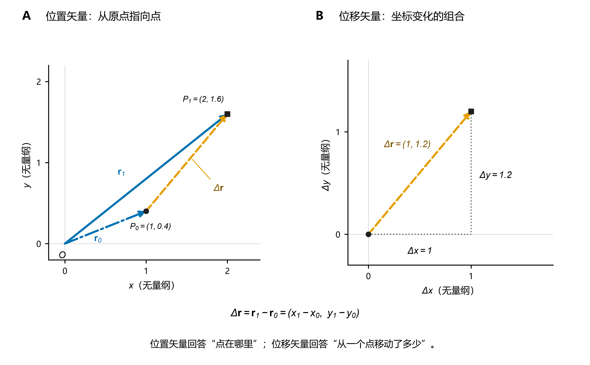
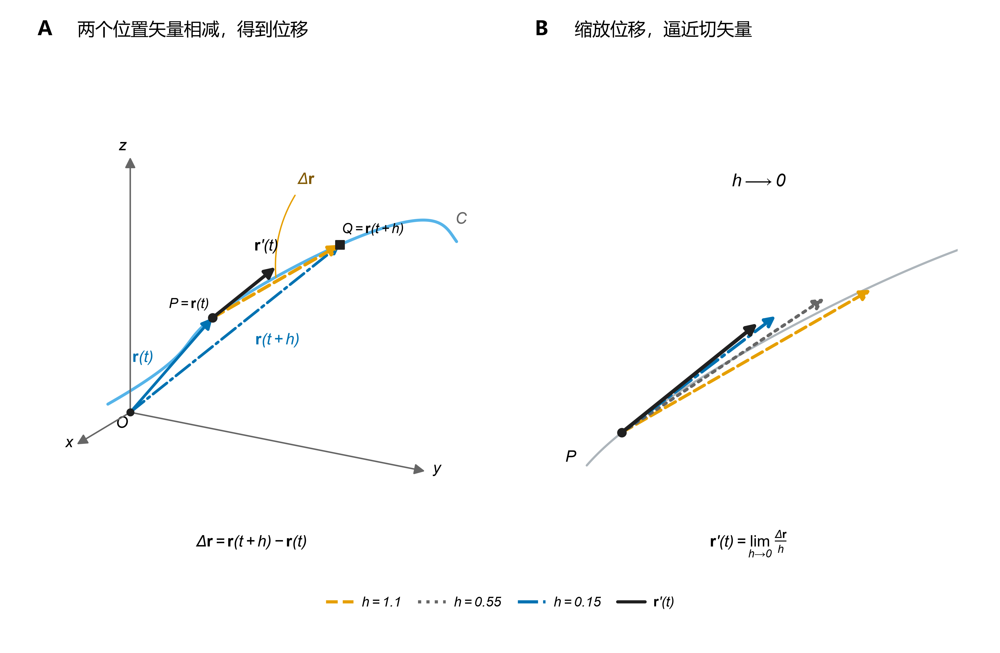
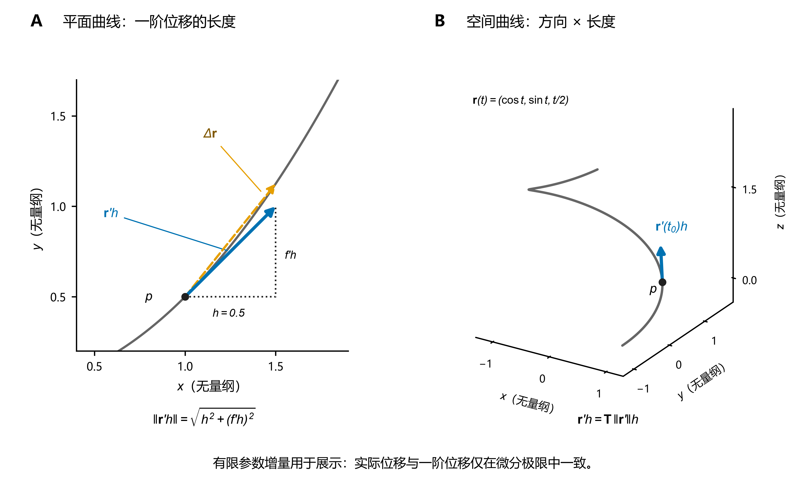
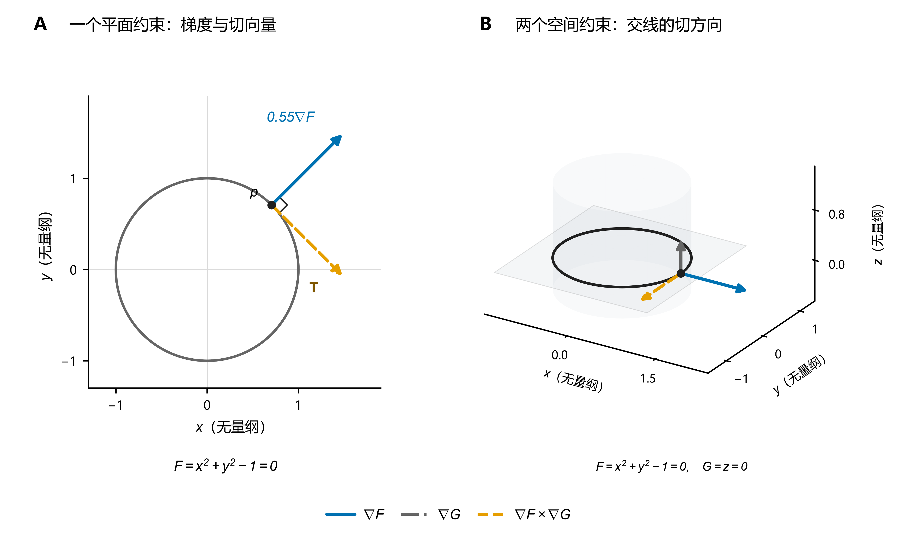
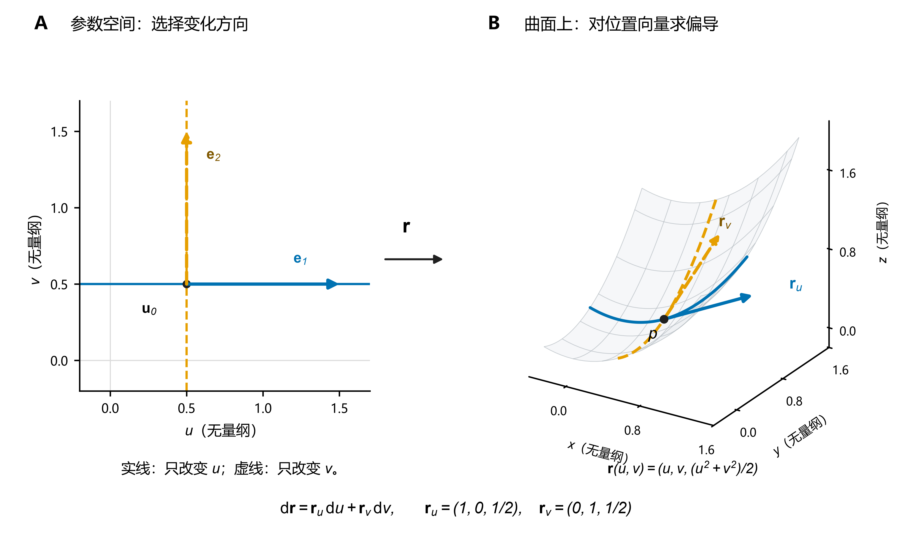
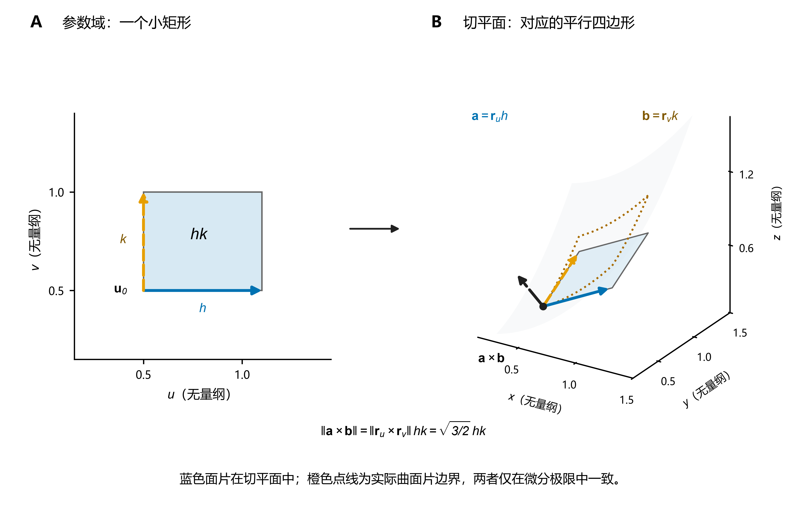
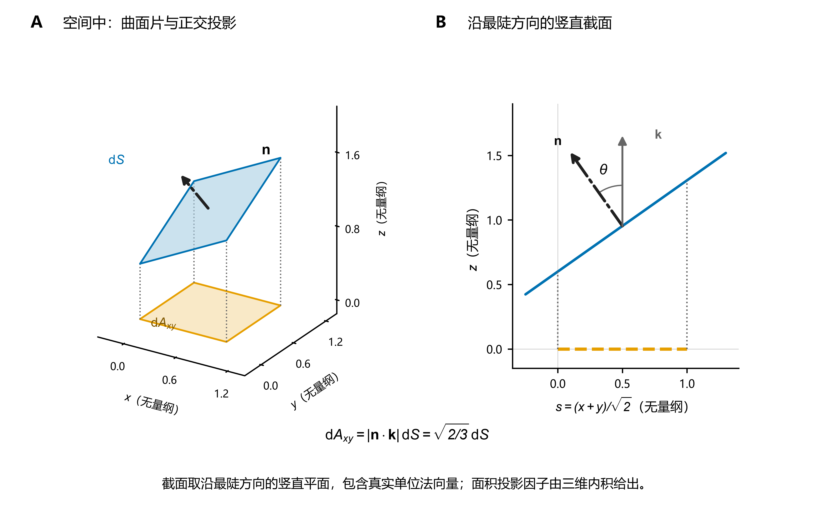

# 从位置矢量到切矢量、弧长元素与面积元素

本文依据 Jerrold E. Marsden、Anthony Tromba《Vector Calculus》第 6 版 §2.4、§4.2、§7.3–7.6 整理。

核心主线：

$$
\boxed{
\text{几何约束} \longrightarrow \text{位置矢量 }\mathbf r \longrightarrow \text{切矢量}
\longrightarrow
\begin{cases}
\text{弧长元素}\\
\text{法向量与面积元素}
\end{cases}
}
$$

这条主线本质上就是：先用位置矢量的微分描述几何对象上的局部位移，再由该位移构造出具有正确方向、大小和量纲的几何微元。

读图约定：配图均由解析公式生成，坐标与参数取无量纲数值；二维坐标等比例，三维图采用正交投影并保持各轴单位尺度一致。图中有限的直线、平面片段仅用于展示局部几何。

## 0. 统一符号规范

| 几何对象 | 几何量 | 统一符号 |
| ---- | ------ | ------------------------------------------------------- |
| 通用 | 位置矢量 | $\mathbf r$ |
| 曲线 | 切矢量 | $\mathbf r'(t)$ |
| 曲线 | 单位切矢量 | $\mathbf T=\mathbf r'/\|\mathbf r'\|$ |
| 曲线 | 标量弧长元素 | $\mathrm ds$ |
| 曲线 | 矢量弧长元素 | $\mathrm d\mathbf s=\mathrm d\mathbf r$ |
| 曲面 | 参数方向切矢量 | $\mathbf r_u,\mathbf r_v$ |
| 曲面 | 参数方向位移分量 | $\mathrm d\mathbf r_u=\mathbf r_u\,\mathrm du$ 等；不是全微分 |
| 曲面 | 法方向 | $\mathbf r_u\times\mathbf r_v$ 或 $\nabla F$ |
| 曲面 | 单位法向量 | $\mathbf n=(\mathbf r_u\times\mathbf r_v)/\|\mathbf r_u\times\mathbf r_v\|$ |
| 曲面 | 标量面积元素 | $\mathrm dS$ |
| 曲面 | 矢量面积元素 | $\mathrm d\mathbf S=\mathbf n\,\mathrm dS$ |

约定：

- 粗体代表矢量，非粗体代表标量。
- 小写 $s$ 表示弧长，大写 $S$ 表示面积。
- $\mathbf T,\mathbf n$ 为单位方向矢量，无量纲。
- $\mathrm d\mathbf s$ 是沿曲线的有向位移微元，与 $\mathrm d\mathbf r$ 等价。
- 曲面的单位法向量有正、反两个方向，具体取正还是取负由曲面取向决定。
- 切矢量直接用位置矢量对参数的导数表示：曲线写 $\mathbf r'(t)$，曲面写 $\mathbf r_u,\mathbf r_v$。部分教材用 $\tau$ 或 $\boldsymbol\tau$ 表示单位切矢量，本文不采用这套记号。
- 曲面法方向直接写叉积 $\mathbf r_u\times\mathbf r_v$ 或梯度 $\nabla F$，不引入中间符号；平面（含切平面）的法向量记 $\mathbf N$，见[解析几何基础](解析几何基础：直线、平面、曲线与曲面.md)。

原书部分章节对法向量的大小写并不完全统一，本文采用上述一致的笔记规范。

# 1. 位置矢量、几何约束与切矢量

## 1.1 位置矢量与微小位移

在 $\mathbb R^n$ 中，任意点 $P=(x_1,\ldots,x_n)$ 可以用位置矢量表示：

$$
\boxed{
\mathbf r=\overrightarrow{OP}=(x_1,\ldots,x_n)
}
$$

当点从 $P_0$ 移动到 $P_1$，其位移矢量为：

$$
\boxed{
\Delta\mathbf r=\mathbf r_1-\mathbf r_0
}
$$

在三维直角坐标系中：

$$
\Delta\mathbf r=(\Delta x,\Delta y,\Delta z)
$$

其微分形式为：

$$
\boxed{
\mathrm d\mathbf r=(\mathrm dx,\mathrm dy,\mathrm dz)
}
$$

位置矢量描述空间中的位置，而位置矢量的变化描述空间中的位移。

**图 1｜位置矢量与位移。** A：两个位置矢量都从原点 $O$ 出发；位移 $\Delta\mathbf r$ 则从 $P_0$ 指向 $P_1$，等于 $\mathbf r_1-\mathbf r_0$。B：将位移平移到原点，不改变它的方向和长度；水平、竖直分量分别为 $\Delta x$、$\Delta y$。

## 1.2 几何约束与切矢量

在自由空间中，点可以沿任意方向移动；但如果受到几何约束，其允许的位移方向就受到限制。

例如在二维中，点沿曲线 $y=f(x)$ 移动时，$y$ 必须随 $x$ 一起变化，因此：

$$
\mathrm dy=f'(x)\,\mathrm dx
$$

也就是说，$\mathrm dx$ 和 $\mathrm dy$ 不能任意搭配，而必须满足这个关系。这就限制了微小位移的方向，也就确定了曲线的切方向：

$$
\mathrm d\mathbf r=(\mathrm dx,\mathrm dy)=(1,f'(x))\,\mathrm dx
$$

同样，三维曲线 $\mathbf r(t)=(x(t),y(t),z(t))$ 的三个坐标都由同一个参数 $t$ 决定，因此：

$$
\mathrm d\mathbf r=(x'(t),y'(t),z'(t))\,\mathrm dt
$$

当参数从 $t$ 变为 $t+h$，两个位置矢量之差就是位移 $\Delta\mathbf r=\mathbf r(t+h)-\mathbf r(t)$。将位移除以 $h$，再令 $h\to0$，便得到切矢量：

$$
\boxed{
\mathbf r'(t)=\lim_{h\to0}\frac{\mathbf r(t+h)-\mathbf r(t)}{h},\qquad
\mathrm d\mathbf r=\mathbf r'(t)\,\mathrm dt
}
$$

在 $\mathbf r'(t)\neq\mathbf 0$ 处，这个极限向量沿曲线的切方向。

**图 2｜由位置矢量的变化得到切矢量。** A：从原点分别指向 $P,Q$ 的两个位置矢量相减，得到连接两点的位移 $\Delta\mathbf r$；黑色箭头为 $P$ 处的切矢量。B：将 $\Delta\mathbf r/h$ 的起点平移到 $P$，当 $h$ 逐渐减小时，它逼近差商的极限 $\mathbf r'(t)$。各向量均按真实分量作三维正交投影，没有单独归一化；有限位移本身趋于零，切矢量来自位移除以参数增量后的极限。

## 1.3 多参数形式与解析形式分类

若几何对象由 $k$ 个独立参数描述：

$$
\mathbf r=\mathbf r(u_1,\ldots,u_k)
$$

固定其余参数，只改变 $u_i$，得到该参数方向的切矢量：

$$
\boxed{\mathbf r_i=\frac{\partial\mathbf r}{\partial u_i}}
$$

因此：

$$
\boxed{
\mathrm d\mathbf r=\sum_{i=1}^{k}\frac{\partial\mathbf r}{\partial u_i}\,\mathrm du_i
}
$$

这说明：几何对象的局部切向位移可以由各独立参数方向的切矢量线性组合得到。

由此自然引出后续的分类：

| 对象 | 解析形式 | 切矢量/法向量的获取方法 |
| ----- | -------------------- | ----------------- |
| 平面曲线 | $y=f(x)$ | 位置矢量对 $x$ 求导 |
| 参数化曲线 | $\mathbf r(t)$ | 对 $t$ 求导 |
| 隐式曲线 | $F(x,y)=0$ | 利用约束微分与梯度正交 |
| 空间交线 | $F=0,\ G=0$ | 两个梯度的叉积确定切方向 |
| 显式曲面 | $z=g(x,y)$ | 对 $x,y$ 分别求偏导 |
| 参数化曲面 | $\mathbf r(u,v)$ | 对 $u,v$ 分别求偏导 |
| 隐式曲面 | $F(x,y,z)=0$ | 梯度给出法方向 |

无论采用何种解析形式，切矢量的本质都不变：它描述受约束的位置矢量沿某个独立参数方向的变化率。

后续分类只是为了找到更直接的计算方式。

# 2. 弧长：标量元素与矢量元素

原书 §4.2 Arc Length。

## 2.1 二维显式曲线 $y=f(x)$

### （1）位置矢量

考虑平面曲线：

$$
y=f(x)
$$

曲线上任意点 $P=(x,f(x))$，对应位置矢量：

$$
\boxed{\mathbf r(x)=(x,f(x))}
$$

### （2）由微小位移导出切矢量

当 $x$ 从 $x_0$ 变化到 $x_0+\Delta x$：

$$
\begin{aligned}
\Delta\mathbf r&=\mathbf r(x_0+\Delta x)-\mathbf r(x_0)\\
&=\begin{pmatrix}
\Delta x\\
f(x_0+\Delta x)-f(x_0)
\end{pmatrix}
\end{aligned}
$$

除以 $\Delta x$ 并取极限：

$$
\begin{aligned}
\mathbf r'(x_0)&=\lim_{\Delta x\to0}\frac{\Delta\mathbf r}{\Delta x}\\
&=(1,f'(x_0))
\end{aligned}
$$

因此：

$$
\boxed{\mathbf r'(x)=(1,f'(x))}
$$

它包含切方向和相对于参数 $x$ 的变化率。

### （3）导出标量弧长元素

当 $x$ 发生微小变化 $\mathrm dx$，位置矢量的微分为：

$$
\begin{aligned}
\mathrm d\mathbf r&=\mathbf r'(x)\,\mathrm dx\\
&=(1,f'(x))\,\mathrm dx\\
&=(\mathrm dx,f'(x)\mathrm dx)
\end{aligned}
$$

即：

$$
\boxed{\mathrm d\mathbf r=(\mathrm dx,\mathrm dy)}
$$

由于弧长是实际位移的长度，故：

$$
\begin{aligned}
\mathrm ds&=\|\mathrm d\mathbf r\|\\
&=\sqrt{(\mathrm dx)^2+(\mathrm dy)^2}
\end{aligned}
$$

沿 $x$ 增大方向取 $\mathrm dx>0$，得：

$$
\boxed{\mathrm ds=\sqrt{1+[f'(x)]^2}\,\mathrm dx}
$$

更一般地，长度微元对应 $\sqrt{1+[f'(x)]^2}\,|\mathrm dx|$。

### （4）导出矢量弧长元素

单位切矢量：

$$
\boxed{
\mathbf T=\frac{(1,f'(x))}{\sqrt{1+[f'(x)]^2}}
}
$$

因此：

$$
\begin{aligned}
\mathrm d\mathbf s&=\mathbf T\,\mathrm ds\\
&=\frac{(1,f'(x))}{\sqrt{1+[f'(x)]^2}}\sqrt{1+[f'(x)]^2}\,\mathrm dx
\end{aligned}
$$

得到：

$$
\boxed{\mathrm d\mathbf s=\mathrm d\mathbf r=(\mathrm dx,\mathrm dy)}
$$

由此，二维显式曲线的几何微元可统一为：

$$
\boxed{
\begin{aligned}
\mathbf r'&=(1,f')\\
\mathbf T&=\frac{(1,f')}{\sqrt{1+(f')^2}}\\
\mathrm ds&=\sqrt{1+(f')^2}\,\mathrm dx\\
\mathrm d\mathbf s&=(1,f')\,\mathrm dx
\end{aligned}
}
$$

## 2.2 三维参数化曲线

### （1）位置矢量

设空间曲线：

$$
\boxed{\mathbf r(t)=(x(t),y(t),z(t))}
$$

### （2）切矢量

根据第 1 章的原理：

$$
\boxed{
\mathbf r'(t)=(x'(t),y'(t),z'(t))
}
$$

### （3）矢量弧长元素

对位置矢量求微分：

$$
\begin{aligned}
\mathrm d\mathbf s&=\mathrm d\mathbf r\\
&=\mathbf r'(t)\,\mathrm dt\\
&=(x'(t),y'(t),z'(t))\,\mathrm dt
\end{aligned}
$$

由于：

$$
\mathrm dx=x'(t)\mathrm dt,\quad \mathrm dy=y'(t)\mathrm dt,\quad \mathrm dz=z'(t)\mathrm dt
$$

所以：

$$
\boxed{\mathrm d\mathbf s=(\mathrm dx,\mathrm dy,\mathrm dz)=\mathbf r'(t)\,\mathrm dt}
$$

### （4）标量弧长元素

标量弧长元素是有向位移微元的欧几里得长度：

$$
\begin{aligned}
\mathrm ds&=\|\mathrm d\mathbf s\|\\
&=\sqrt{(\mathrm dx)^2+(\mathrm dy)^2+(\mathrm dz)^2}\\
&=\|\mathbf r'(t)\|\,\mathrm dt
\end{aligned}
$$

最后一步取参数沿积分方向递增。

因此：

$$
\boxed{
\mathrm ds=\sqrt{[x'(t)]^2+[y'(t)]^2+[z'(t)]^2}\,\mathrm dt
}
$$

### （5）单位切矢量与两种弧长元素的关系

对切矢量归一化：

$$
\boxed{\mathbf T(t)=\frac{\mathbf r'(t)}{\|\mathbf r'(t)\|}}
$$

由于：

$$
\mathbf r'(t)=\|\mathbf r'(t)\|\mathbf T(t)
$$

所以：

$$
\begin{aligned}
\mathrm d\mathbf s&=\mathbf r'(t)\,\mathrm dt\\
&=\mathbf T(t)\|\mathbf r'(t)\|\,\mathrm dt\\
&=\mathbf T(t)\,\mathrm ds
\end{aligned}
$$

最终：

$$
\boxed{\mathrm d\mathbf s=\mathbf T\,\mathrm ds=(\mathrm dx,\mathrm dy,\mathrm dz)}
$$

这正是原书 §4.2 对矢量微元与标量弧长元素的定义关系。

**图 3｜由切向量构造弧长微元。** A：在 $y=x^2/2$、$x=1$ 处，取参数小增量 $h=0.5$，蓝色箭头 $\mathbf r'(1)h=(0.5,0.5)$ 是一阶位移，橙色虚线箭头为实际位移 $(0.5,0.625)$；直角三角形展示一阶位移长度的计算。这里 $h$ 为便于看清而取的有限增量。B：空间螺线 $\mathbf r(t)=(\cos t,\sin t,t/2)$ 上，蓝色箭头表示 $\mathbf r'(t_0)h=\mathbf T\|\mathbf r'(t_0)\|h$，其方向来自单位切向量，长度来自参数增量乘以变化率。

## 2.3 切矢量、单位切矢量与微元的量纲

这里必须区分三个概念：

$$
\underbrace{\mathbf r'(t)}_{\text{变化率}}\qquad
\underbrace{\mathbf T}_{\text{单位方向}}\qquad
\underbrace{\mathrm d\mathbf s}_{\text{实际微小位移}}
$$

以时间参数 $t$ 为例，设空间坐标的量纲为长度 $L$，时间量纲为 $T$。

| 几何量 | 表达式 | 量纲 |
| ------ | ---------------------------------- | --------- |
| 切矢量 | $\mathbf r'(t)$ | $L/T$ |
| 单位切矢量 | $\mathbf T$ | $1$ |
| 参数微元 | $\mathrm dt$ | $T$ |
| 标量弧长元素 | $\|\mathbf r'\|\,\mathrm dt$ | $L$ |
| 矢量弧长元素 | $\mathbf r'\,\mathrm dt$ | $L$ |

因此：

$$
\boxed{
\underbrace{\mathrm d\mathbf s}_{L}
=
\underbrace{\mathbf r'}_{L/T}
\underbrace{\mathrm dt}_{T}
}
$$

而：

$$
\boxed{
\underbrace{\mathrm d\mathbf s}_{L}
=
\underbrace{\mathbf T}_{1}
\underbrace{\mathrm ds}_{L}
}
$$

注意：

切矢量的模长并不是弧长元素，而是相对于参数的弧长变化率。只有乘上参数微元，才得到实际长度。

此外，弧长大小由欧几里得范数确定：

$$
\mathrm ds=\sqrt{(\mathrm dx)^2+(\mathrm dy)^2+(\mathrm dz)^2}
$$

这里要求三个坐标分量表达的是同一长度度量下的实际位移，而非任意不同量纲的数值。

## 2.4 隐式曲线与空间交线：如何求切方向

前面的推导都使用了显式或参数化形式。

对于隐式方程，核心仍然是沿约束允许的位移必须满足约束微分为零。

### （1）平面隐式曲线 $F(x,y)=0$

沿曲线的位移满足：

$$
F_x\,\mathrm dx+F_y\,\mathrm dy=0
$$

即：

$$
\nabla F\cdot\mathrm d\mathbf r=0
$$

因此，在 $\nabla F\neq0$ 的正则点，切方向平行于 $(F_y,-F_x)$：

$$
\boxed{\mathbf r'\parallel(F_y,-F_x)}
$$

其单位切方向为：

$$
\boxed{
\mathbf T=\pm\frac{(F_y,-F_x)}{\sqrt{F_x^2+F_y^2}}
}
$$

$(F_y,-F_x)$ 只给出切方向：$\mathbf r'$ 泛指沿曲线的某个参数化下的切矢量，换参数化会改变它的大小，但不改变方向。

计算弧长时，仍需要确定实际位移对应的参数关系。

### （2）空间交线 $F=0,\ G=0$

若两个曲面在交线上正则相交：

$$
\begin{cases}
F(x,y,z)=0\\
G(x,y,z)=0
\end{cases}
$$

沿交线的切矢量满足：

$$
\begin{cases}
\nabla F\cdot\mathbf r'=0\\
\nabla G\cdot\mathbf r'=0
\end{cases}
$$

因此：

$$
\boxed{\mathbf r'\parallel\nabla F\times\nabla G}
$$

可以选择：

$$
\boxed{
\mathbf T=\pm\frac{\nabla F\times\nabla G}{\|\nabla F\times\nabla G\|}
}
$$

条件是 $\nabla F\times\nabla G\neq0$。

但要获得实际弧长微元，仍然需要路径上的具体位移关系。

这说明：隐式约束可以直接给出切方向，但求几何微元时，还需要引入参数变化或坐标微小位移。

**图 4｜隐式方程如何确定切方向。** A：圆 $F=x^2+y^2-1=0$ 在 $p=(1/\sqrt2,1/\sqrt2)$ 处，梯度指向法方向，切向量与它正交；橙色箭头标注其单位切方向 $\mathbf T$。图中梯度与原长为 $2$ 的切向矢量都按 $0.55$ 缩放，只用于展示方向。B：圆柱 $F=x^2+y^2-1=0$ 与平面 $G=z=0$ 的交线为单位圆；在 $p=(1,0,0)$ 处，两个梯度的叉积 $(0,-2,0)$ 给出交线切方向。两条梯度箭头和叉积箭头统一乘以 $0.6$，实线、点划线、虚线分别区分三个向量。

# 3. 面积：切矢量、法向量与面积元素

原书 §7.3–7.4、§7.6。

曲线只有一个局部独立切方向，而三维空间中的正则曲面具有两个局部独立切方向。

两个切矢量张成切平面，其叉积给出法向量，叉积的模长则给出面积伸缩率。

## 3.1 显式曲面 $z=g(x,y)$

### （1）位置矢量

设曲面：

$$
\Sigma:\quad z=g(x,y),\qquad (x,y)\in D_{xy},\qquad g\in C^1
$$

$x,y$ 是两个独立参数，曲面上任意点对应位置矢量：

$$
\boxed{
\mathbf r(x,y)=
\begin{pmatrix}
x\\
y\\
g(x,y)
\end{pmatrix}
}
$$

### （2）两个参数方向的切矢量

固定 $y$，只让 $x$ 增加 $\Delta x$：

$$
\begin{aligned}
\Delta_x\mathbf r
&=\mathbf r(x+\Delta x,y)-\mathbf r(x,y)\\
&=\begin{pmatrix}
\Delta x\\
0\\
g(x+\Delta x,y)-g(x,y)
\end{pmatrix}
\end{aligned}
$$

除以参数增量并取极限，得到该方向的切矢量：

$$
\boxed{
\mathbf r_x=\lim_{\Delta x\to0}\frac{\Delta_x\mathbf r}{\Delta x}
=\begin{pmatrix}
1\\
0\\
g_x
\end{pmatrix}
}
$$

同理，固定 $x$、只改变 $y$：

$$
\boxed{
\mathbf r_y=\begin{pmatrix}0\\1\\g_y\end{pmatrix}
}
$$

$\mathbf r_x,\mathbf r_y$ 是位置矢量相对于参数的变化率（即 $\mathbf r_x=\partial\mathbf r/\partial x$，$\mathbf r_y=\partial\mathbf r/\partial y$），一般不是单位矢量。

因此沿 $x$ 参数方向的微小位移为：

$$
\boxed{\mathrm d\mathbf r_x=\mathbf r_x\,\mathrm dx}
$$

沿 $y$ 方向同理，$\mathrm d\mathbf r_y=\mathbf r_y\,\mathrm dy$。两者相加，得到曲面上的切向位移微元：

$$
\boxed{
\mathrm d\mathbf r=\mathrm d\mathbf r_x+\mathrm d\mathbf r_y
=\mathbf r_x\,\mathrm dx+\mathbf r_y\,\mathrm dy
}
$$

这里 $\mathrm d\mathbf r_x$ 只表示沿 $x$ 参数方向的位移分量，不是某个函数的全微分。乘积 $\mathbf r_x\,\mathrm dx$ 已经同时包含实际位移的方向与长度，参数微元负责把变化率换算成几何尺度。

**图 5｜对参数求偏导得到切矢量。** 取 $\mathbf r(u,v)=(u,v,(u^2+v^2)/2)$，在 $(u_0,v_0)=(1/2,1/2)$ 处，固定 $v$ 改变 $u$，得到 $\mathbf r_u=(1,0,1/2)$；固定 $u$ 改变 $v$，得到 $\mathbf r_v=(0,1,1/2)$。实线、虚线分别表示两条参数曲线及对应切矢量。

### （3）法向量与单位法向量

$\mathbf r_x,\mathbf r_y$ 张成切平面。叉积与两者都正交，因此给出法方向：

$$
\mathbf r_x\times\mathbf r_y=
\begin{vmatrix}
\mathbf i&\mathbf j&\mathbf k\\
1&0&g_x\\
0&1&g_y
\end{vmatrix}
=(-g_x,-g_y,1)
$$

其第三个分量为正，指向上侧。单位法向量取

$$
\boxed{
\mathbf n=\frac{\mathbf r_x\times\mathbf r_y}{\|\mathbf r_x\times\mathbf r_y\|}
=\frac{(-g_x,-g_y,1)}{\sqrt{1+g_x^2+g_y^2}}
}
$$

显式曲面的 $\mathbf r_x\times\mathbf r_y$ 恒不为零，因此不需要额外的正则性假设。若要求向下取向，整体取负号。

### （4）标量面积元素

两个参数方向的微小位移：

$$
\mathrm d\mathbf r_x=\mathbf r_x\,\mathrm dx,\qquad
\mathrm d\mathbf r_y=\mathbf r_y\,\mathrm dy
$$

在切平面中张成一个微小平行四边形，它一阶近似对应曲面上的一小块。由叉积的几何意义，其面积为：

$$
\begin{aligned}
\mathrm dS&=\|\mathrm d\mathbf r_x\times\mathrm d\mathbf r_y\|\\
&=\|(\mathbf r_x\,\mathrm dx)\times(\mathbf r_y\,\mathrm dy)\|\\
&=\|\mathbf r_x\times\mathbf r_y\|\,\mathrm dx\,\mathrm dy
\end{aligned}
$$

由于 $\mathbf r_x\,\mathrm dx$ 已包含实际位移的方向与长度，这里既不需要单位切矢量，也不需要额外的归一化。代入叉积的分量：

$$
\boxed{
\mathrm dS=\sqrt{1+g_x^2+g_y^2}\,\mathrm dx\,\mathrm dy
}
$$

这里 $\mathrm dx\,\mathrm dy$ 表示 $xOy$ 参数平面上的正面积微元。

而 $\|\mathbf r_x\times\mathbf r_y\|$ 表示映射到实际曲面后的局部面积伸缩率。

### （5）矢量面积元素与曲面积分

标量面积元素 $\mathrm dS$ 只有大小。

沿选定法方向赋予方向，归一化因子自动相消：

$$
\boxed{
\mathrm d\mathbf S=\mathbf n\,\mathrm dS
=\frac{\mathbf r_x\times\mathbf r_y}{\|\mathbf r_x\times\mathbf r_y\|}\|\mathbf r_x\times\mathbf r_y\|\,\mathrm dx\,\mathrm dy
=(\mathbf r_x\times\mathbf r_y)\,\mathrm dx\,\mathrm dy
}
$$

对向上取向代入叉积的分量：

$$
\boxed{
\mathrm d\mathbf S=(-g_x,-g_y,1)\,\mathrm dx\,\mathrm dy
}
$$

设 $\mathbf F=(P,Q,R)$，第二类曲面积分因此可以直接落到参数域：

$$
\begin{aligned}
\iint_\Sigma\mathbf F\cdot\mathrm d\mathbf S
&=\iint_\Sigma\mathbf F\cdot\mathbf n\,\mathrm dS\\
&=\iint_{D_{xy}}
\mathbf F(\mathbf r(x,y))\cdot\frac{\mathbf r_x\times\mathbf r_y}{\|\mathbf r_x\times\mathbf r_y\|}\,\|\mathbf r_x\times\mathbf r_y\|\,\mathrm dx\,\mathrm dy\\
&=\boxed{
\iint_{D_{xy}}\mathbf F(\mathbf r(x,y))\cdot(\mathbf r_x\times\mathbf r_y)\,\mathrm dx\,\mathrm dy
}
\end{aligned}
$$

展开叉积：

$$
\boxed{
\iint_\Sigma\mathbf F\cdot\mathrm d\mathbf S
=\iint_{D_{xy}}(-Pg_x-Qg_y+R)\,\mathrm dx\,\mathrm dy
}
$$

其中 $P,Q,R$ 都在 $(x,y,g(x,y))$ 处取值；法方向向下时整体变号。

与弧长元素的构造方式完全一致：

$$
\boxed{
\begin{aligned}
\mathrm d\mathbf s&=\mathbf T\,\mathrm ds\\
\mathrm d\mathbf S&=\mathbf n\,\mathrm dS
\end{aligned}
}
$$

### （6）面积微元的量纲

由于 $x,y,z$ 均表示实际空间长度，设其量纲为 $L$。

$$
[g_x]=[g_y]=\frac{L}{L}=1
$$

因此：

$$
[\mathbf r_x]=[\mathbf r_y]=1
$$

叉积的量纲：

$$
[\mathbf r_x\times\mathbf r_y]=1
$$

而：

$$
[\mathrm dx\,\mathrm dy]=L^2
$$

所以：

$$
\boxed{[\mathrm dS]=[\mathrm d\mathbf S]=L^2}
$$

叉积 $\mathbf r_x\times\mathbf r_y$ 本身并不等于实际的面积元素；只有乘上参数面积微元，才得到具有正确面积量纲的 $\mathrm d\mathbf S$。

## 3.2 一般参数化曲面

3.1 的显式曲面只是 $u=x,\ v=y$ 的特例，推导步骤完全相同，只需把 $x,y$ 换成 $u,v$。区别在于 $u,v$ 不一定具有长度量纲，参数微元 $\mathrm du\,\mathrm dv$ 与面积量纲 $L^2$ 不再相同。

### （1）位置矢量

设曲面 $\Sigma$ 由两个独立参数描述：

$$
\boxed{
\mathbf r(u,v)=(x(u,v),y(u,v),z(u,v)),\qquad (u,v)\in D_{uv}
}
$$

其中 $\mathbf r\in C^1$，并在正则点满足 $\mathbf r_u\times\mathbf r_v\neq\mathbf 0$。

### （2）两个参数方向的切矢量

固定 $v$，只让 $u$ 增加 $\Delta u$：

$$
\begin{aligned}
\Delta_u\mathbf r
&=\mathbf r(u+\Delta u,v)-\mathbf r(u,v)\\
&=\begin{pmatrix}
x(u+\Delta u,v)-x(u,v)\\
y(u+\Delta u,v)-y(u,v)\\
z(u+\Delta u,v)-z(u,v)
\end{pmatrix}
\end{aligned}
$$

除以参数增量并取极限：

$$
\boxed{
\mathbf r_u=\lim_{\Delta u\to0}\frac{\Delta_u\mathbf r}{\Delta u}
=\begin{pmatrix}x_u\\y_u\\z_u\end{pmatrix}
}
$$

同理，固定 $u$、只改变 $v$：

$$
\boxed{
\mathbf r_v=\begin{pmatrix}x_v\\y_v\\z_v\end{pmatrix}
}
$$

于是 $\mathrm d\mathbf r_u=\mathbf r_u\,\mathrm du$、$\mathrm d\mathbf r_v=\mathbf r_v\,\mathrm dv$，曲面上任意允许的切向位移为

$$
\boxed{
\mathrm d\mathbf r=\mathrm d\mathbf r_u+\mathrm d\mathbf r_v
=\mathbf r_u\,\mathrm du+\mathbf r_v\,\mathrm dv
}
$$

在正则点两条切矢量线性无关，能够张成切平面。

### （3）法向量与单位法向量

叉积与两个切矢量都正交，因此给出法方向：

$$
\mathbf r_u\times\mathbf r_v=
\begin{vmatrix}
\mathbf i&\mathbf j&\mathbf k\\
x_u&y_u&z_u\\
x_v&y_v&z_v
\end{vmatrix}
=\left(
y_uz_v-z_uy_v,\,
z_ux_v-x_uz_v,\,
x_uy_v-y_ux_v
\right)
$$

单位法向量取

$$
\boxed{
\mathbf n=\frac{\mathbf r_u\times\mathbf r_v}{\|\mathbf r_u\times\mathbf r_v\|}
}
$$

这里采用 $\mathbf r_u\times\mathbf r_v$ 的方向；需要相反取向时整体变号。

### （4）标量面积元素

参数域中，微小矩形的两个参数增量为：

$$
\mathrm du,\qquad\mathrm dv
$$

映射到曲面的切平面，两条微小位移为：

$$
\mathrm d\mathbf r_u=\mathbf r_u\,\mathrm du,\qquad
\mathrm d\mathbf r_v=\mathbf r_v\,\mathrm dv
$$

它们张成一个微小平行四边形，一阶近似曲面上的一小块。因此：

$$
\begin{aligned}
\mathrm dS&=\|\mathrm d\mathbf r_u\times\mathrm d\mathbf r_v\|\\
&=\|(\mathbf r_u\,\mathrm du)\times(\mathbf r_v\,\mathrm dv)\|\\
&=\|\mathbf r_u\times\mathbf r_v\|\,\mathrm du\,\mathrm dv
\end{aligned}
$$

得到：

$$
\boxed{
\mathrm dS=\|\mathbf r_u\times\mathbf r_v\|\,\mathrm du\,\mathrm dv
}
$$

展开分量：

$$
\boxed{
\mathrm dS=
\sqrt{
(y_uz_v-z_uy_v)^2+
(z_ux_v-x_uz_v)^2+
(x_uy_v-y_ux_v)^2
}\,\mathrm du\,\mathrm dv
}
$$

这就是原书 §7.4 Figure 7.4.1 利用切平面小平行四边形导出的面积公式。

**图 6｜参数面积如何变成曲面面积。** 取 $\mathbf r(u,v)=(u,v,(u^2+v^2)/2)$、$(u_0,v_0)=(1/2,1/2)$，在参数点取有限小增量 $h=0.6$、$k=0.5$。A：参数矩形面积为 $hk$。B：切平面中的邻边为 $\mathbf a=\mathbf r_u h$、$\mathbf b=\mathbf r_v k$，叉积 $\mathbf a\times\mathbf b=hk\,(\mathbf r_u\times\mathbf r_v)$ 的模长给出平行四边形面积，方向给出所选法方向。橙色点线围出实际曲面片的边界；曲面片面积仅在微分极限中由切平面面积给出。

### （5）矢量面积元素与曲面积分

沿选定法方向赋予方向，归一化因子自动相消：

$$
\boxed{
\mathrm d\mathbf S=\mathbf n\,\mathrm dS
=\frac{\mathbf r_u\times\mathbf r_v}{\|\mathbf r_u\times\mathbf r_v\|}\|\mathbf r_u\times\mathbf r_v\|\,\mathrm du\,\mathrm dv
=(\mathbf r_u\times\mathbf r_v)\,\mathrm du\,\mathrm dv
}
$$

设 $\mathbf F=(P,Q,R)$，第二类曲面积分因此可以直接落到参数域：

$$
\iint_\Sigma\mathbf F\cdot\mathrm d\mathbf S
=\iint_{D_{uv}}\mathbf F(\mathbf r(u,v))\cdot(\mathbf r_u\times\mathbf r_v)\,\mathrm du\,\mathrm dv
$$

展开叉积：

$$
\boxed{
\begin{aligned}
\iint_\Sigma\mathbf F\cdot\mathrm d\mathbf S
=\iint_{D_{uv}}\big[\,
&P(y_uz_v-z_uy_v)\\
+{}&Q(z_ux_v-x_uz_v)\\
+{}&R(x_uy_v-y_ux_v)\,\big]\,\mathrm du\,\mathrm dv
\end{aligned}
}
$$

其中 $P,Q,R$ 都在 $\mathbf r(u,v)$ 处取值；法方向相反时整体变号。

交换叉积顺序：

$$
\mathbf r_v\times\mathbf r_u=-(\mathbf r_u\times\mathbf r_v)
$$

它只改变矢量面积元素的方向，不改变标量面积元素的大小。

### （6）一般参数下的量纲

这里与显式曲面的重要区别是：$u,v$ 不一定具有长度量纲。

设：

$$
[\mathbf r]=L,\qquad [u]=U,\qquad [v]=V
$$

因此：

$$
[\mathbf r_u]=\frac{L}{U},\qquad [\mathbf r_v]=\frac{L}{V}
$$

叉积的量纲为：

$$
[\mathbf r_u\times\mathbf r_v]=\frac{L^2}{UV}
$$

乘上参数面积微元：

$$
\begin{aligned}
[\mathrm d\mathbf S]&=[\mathbf r_u\times\mathbf r_v]\,[\mathrm du]\,[\mathrm dv]\\
&=\frac{L^2}{UV}\cdot U\cdot V\\
&=L^2
\end{aligned}
$$

因此：

$$
\boxed{[\mathrm dS]=[\mathrm d\mathbf S]=L^2}
$$

可见，参数导数的叉积表示的是相对于参数域的面积变化率；它乘上 $\mathrm du\,\mathrm dv$ 之后，才成为实际曲面的微小面积。

## 3.3 隐式曲面 $F(x,y,z)=0$

### （1）由约束导出法向量

设：

$$
F(x,y,z)=0
$$

沿曲面的任意切向位移，都必须满足：

$$
\mathrm dF=F_x\,\mathrm dx+F_y\,\mathrm dy+F_z\,\mathrm dz=0
$$

写成内积：

$$
\boxed{\nabla F\cdot\mathrm d\mathbf r=0}
$$

所以，梯度与曲面的全部切方向正交。

因此梯度直接给出法方向：

$$
\boxed{\nabla F=(F_x,F_y,F_z)}
$$

在 $\nabla F\neq0$ 处，其单位法向量为：

$$
\boxed{
\mathbf n=\pm\frac{\nabla F}{\|\nabla F\|}
}
$$

梯度直接给出法方向，并不需要先求出显式参数化。

但面积微元仍需由局部参数化或投影关系确定。

### （2）由隐式约束导出面积元素

假设 $F_z\neq0$，根据隐函数定理，局部可将曲面表示为：

$$
z=g(x,y)
$$

由恒等式：

$$
F(x,y,g(x,y))=0
$$

分别对 $x,y$ 求偏导：

$$
F_x+F_zg_x=0,\qquad F_y+F_zg_y=0
$$

因此：

$$
g_x=-\frac{F_x}{F_z},\qquad g_y=-\frac{F_y}{F_z}
$$

代入显式曲面的面积公式：

$$
\begin{aligned}
\mathrm dS&=\sqrt{1+g_x^2+g_y^2}\,\mathrm dx\,\mathrm dy\\
&=\sqrt{1+\frac{F_x^2}{F_z^2}+\frac{F_y^2}{F_z^2}}\,\mathrm dx\,\mathrm dy
\end{aligned}
$$

得到：

$$
\boxed{
\mathrm dS=\frac{\|\nabla F\|}{|F_z|}\,\mathrm dx\,\mathrm dy
}
$$

这就是隐式曲面投影到 $xOy$ 平面后的标量面积元素。

### （3）矢量面积元素

如果选择与 $\nabla F$ 同向的法方向：

$$
\mathrm d\mathbf S=\mathbf n\,\mathrm dS
$$

则：

$$
\boxed{
\mathrm d\mathbf S=\frac{\nabla F}{|F_z|}\,\mathrm dx\,\mathrm dy
}
$$

如果选择与梯度相反的方向，则整体变号。

注意，这里使用的 $\nabla F$ 是未经归一化的法向量，其意义与参数化方法中使用 $\mathbf r_u\times\mathbf r_v$ 相同：都需要结合对应的面积缩放关系，才能构造实际面积微元。

## 3.4 面积元素的正交投影理解

原书 §7.5 还提供了与叉积法等价的几何解释。

设曲面一小块实际面积为 $\mathrm dS$，单位法向量为 $\mathbf n$。

其正交投影到 $xOy$ 平面上，投影面积为：

$$
\mathrm dA_{xy}=|\mathbf n\cdot\mathbf k|\,\mathrm dS
$$

其中：

$$
\mathbf k=(0,0,1)
$$

是 $z$ 轴正方向的单位矢量。

因此：

$$
\boxed{
\mathrm dS=\frac{\mathrm dA_{xy}}{|\mathbf n\cdot\mathbf k|}
}
$$

若曲面可以表示为 $z=g(x,y)$，则：

$$
\mathrm dA_{xy}=\mathrm dx\,\mathrm dy
$$

且：

$$
|\mathbf n\cdot\mathbf k|=\frac{1}{\sqrt{1+g_x^2+g_y^2}}
$$

所以：

$$
\boxed{
\mathrm dS=\sqrt{1+g_x^2+g_y^2}\,\mathrm dx\,\mathrm dy
}
$$

与叉积法完全一致。

进一步，若单位法向量为：

$$
\mathbf n=(n_x,n_y,n_z)
$$

那么在对应投影不退化的条件下：

$$
\boxed{
\mathrm dS=\frac{\mathrm dA_{xy}}{|n_z|}
=\frac{\mathrm dA_{yz}}{|n_x|}
=\frac{\mathrm dA_{zx}}{|n_y|}
}
$$

这里的 $\mathrm dA_{xy},\mathrm dA_{yz},\mathrm dA_{zx}$ 都表示无方向的正交投影面积。

叉积法计算的是两个切向微小位移张成的实际面积；正交投影法计算的是实际面积与投影面积之间的缩放关系。两者描述的是同一个几何量。

**图 7｜投影面积为何乘以余弦。** A：平面片 $z=x/2+y/2+0.6$ 沿竖直方向投影到 $xOy$ 平面，竖直点线连接对应顶点。B：沿最陡方向 $s=(x+y)/\sqrt2$ 取竖直截面，该截面包含单位法向量 $\mathbf n$ 与竖直单位向量 $\mathbf k$。此例 $\mathbf n=(-1/2,-1/2,1)/\sqrt{3/2}$，故 $\mathrm dA_{xy}=\sqrt{2/3}\,\mathrm dS$；夹角 $\theta$ 为法向量与竖直方向的真实夹角，投影因子为 $|\cos\theta|$。

# 4. 统一总结：切矢量、法向量与几何微元

## 4.1 曲线与曲面的对应关系

| 项目 | 曲线 | 曲面 |
| ----- | ------------------------ | ----------------------------- |
| 几何维数 | 1 | 2 |
| 参数 | $t$ | $u,v$ |
| 位置矢量 | $\mathbf r(t)$ | $\mathbf r(u,v)$ |
| 基本切矢量 | $\mathbf r'(t)$ | $\mathbf r_u,\mathbf r_v$ |
| 基本方向 | 切方向 | 法方向 |
| 单位方向 | $\mathbf T$ | $\mathbf n$ |
| 标量微元 | $\mathrm ds$ | $\mathrm dS$ |
| 矢量微元 | $\mathrm d\mathbf s$ | $\mathrm d\mathbf S$ |
| 几何量纲 | $L$ | $L^2$ |

## 4.2 两套完全对应的推导公式

曲线：单参数位置矢量 $\mathbf r(t)$

$$
\boxed{
\begin{aligned}
\text{切矢量}\quad&\mathbf r'(t)\\
\mathbf T&=\frac{\mathbf r'(t)}{\|\mathbf r'(t)\|}\\
\mathrm ds&=\|\mathbf r'(t)\|\,\mathrm dt\\
\mathrm d\mathbf s&=\mathbf r'(t)\,\mathrm dt=\mathbf T\,\mathrm ds
\end{aligned}
}
$$

曲面：双参数位置矢量 $\mathbf r(u,v)$

$$
\boxed{
\begin{aligned}
\text{切矢量}\quad&\mathbf r_u,\ \mathbf r_v\\
\mathbf n&=\frac{\mathbf r_u\times\mathbf r_v}{\|\mathbf r_u\times\mathbf r_v\|}\\
\mathrm dS&=\|\mathbf r_u\times\mathbf r_v\|\,\mathrm du\,\mathrm dv\\
\mathrm d\mathbf S&=\pm(\mathbf r_u\times\mathbf r_v)\,\mathrm du\,\mathrm dv
\end{aligned}
}
$$

以上取沿参数递增方向的正长度、正面积微元，以及叉积确定的曲面取向。

## 4.3 核心结论

第一，切矢量来自受约束的位置矢量求导。

$$
\boxed{\mathbf r_i=\frac{\partial\mathbf r}{\partial u_i}}
$$

不同的显式、参数式、隐式方程，只是寻找切方向与法方向的不同计算途径。

第二，几何微元必须由真实的微小位移构造。

曲线：

$$
\boxed{\mathrm d\mathbf s=\mathbf r'(t)\,\mathrm dt}
$$

曲面：

$$
\boxed{
\mathrm d\mathbf S=(\mathbf r_u\times\mathbf r_v)\,\mathrm du\,\mathrm dv
}
$$

其中的参数微元负责将变化率转换为实际几何尺度。

第三，单位矢量与标量微元分别描述方向和大小。

$$
\boxed{
\underbrace{\mathrm d\mathbf s}_{\text{矢量长度微元}}
=
\underbrace{\mathbf T}_{\text{切方向}}
\underbrace{\mathrm ds}_{\text{长度}}
}
$$

$$
\boxed{
\underbrace{\mathrm d\mathbf S}_{\text{矢量面积微元}}
=
\underbrace{\mathbf n}_{\text{法方向}}
\underbrace{\mathrm dS}_{\text{面积}}
}
$$

这两个公式就是整个笔记最重要的结论，也是后续理解第一类、第二类曲线积分与曲面积分的几何基础。

前置：[向量代数](向量代数.md)、[解析几何基础](解析几何基础：直线、平面、曲线与曲面.md)。后续：[积分元素](../03_多元积分学/01_重积分/积分元素.md)、[曲线积分](../03_多元积分学/02_曲线积分/曲线积分.md)、[曲面积分](../03_多元积分学/03_曲面积分/曲面积分：曲面累积与穿面通量.md)。

[配图代码与导出说明](image/切矢量、弧长元素与面积元素/README.md) · [返回几何与代数基础](README.md)
