# 多元微分学详解

偏导数、方向导数、全微分、梯度、散度与旋度的几何结构及物理含义。

> 前置：[解析几何](../../01_几何与代数基础/解析几何基础：直线、平面、曲线与曲面.md)、[向量代数](../../01_几何与代数基础/向量代数.md)。可微性的统一理论见 [微分与局部线性映射](../../../01_微积分/02_微分/微分与局部线性映射.md)；公式检索见 [多元微分学速查](多元微分学速查.md)。
> 本文采用欧氏空间、右手直角坐标系，向量取列向量，记法遵循 [符号规范](../符号规范.md)（向量用 $\mathbf F$、$\mathbf r$、$\mathbf n$、$\mathbf T$，算子用 $\nabla$，微元写 $\mathrm d\mathbf r$、$\mathrm ds$、$\mathrm dS$）。示例与配图均无量纲；[配图目录](image/多元微分学详解/README.md) 提供生成代码与矢量文件。

## 0. 输入空间、图像空间与等值集

对标量函数 $f:U\subset\mathbb R^n\to\mathbb R$，应区分三个对象：

| 对象 | 所在空间 | 适合研究的问题 |
| --- | --- | --- |
| 输入点与位移 $\mathbf x,\mathbf h$ | $\mathbb R^n$ | 方向、距离、梯度及方向导数 |
| 函数图像 $\Gamma_f=\{(\mathbf x,f(\mathbf x))\}$ | $\mathbb R^{n+1}$ | 输出随输入的变化、截线、切平面及线性近似 |
| 等值集 $f(\mathbf x)=c$ | 输入空间 $\mathbb R^n$ | 保持函数值不变的方向、法向及约束几何 |

二元函数 $f(x,y)$ 的输入空间是二维平面，图像是三维曲面 $z=f(x,y)$。三元函数 $g(x,y,z)$ 的输入空间是三维空间，图像须用四维表示；此时用三维等值面展示梯度，通常比强行描画整个图像更清晰。

**图像空间揭示“高度怎样变化”；输入空间揭示“沿哪个方向变化”。** 前者把输入与输出并列成坐标，但不将两者混为一体。对向量场 $\mathbf F:\mathbb R^3\to\mathbb R^3$，通常在输入空间的每个点附上一个向量箭头；该箭头图也不同于位于六维空间中的映射图像。

输入距离与输出量可以具有不同物理单位。因此“最陡”以给定的输入空间度量为基准，不能仅凭三维画面中线条的倾角判断。

下文以

$$
f(x,y)=x^2+2y^2,\qquad \mathbf a=(1,\tfrac12)^T,
\qquad A=(1,\tfrac12,\tfrac32)
$$

为二元主例。$\mathbf a$ 是输入点，$A$ 是对应图像点。

## 1. 偏导数：坐标方向与曲面截线

### 1.1 定义及三维图像

固定其余输入坐标，沿一个坐标方向求导：

$$
f_x(a,b)=\lim_{h\to0}\frac{f(a+h,b)-f(a,b)}h,
\qquad f_{x_i}(\mathbf a)=D_{\mathbf e_i}f(\mathbf a).
$$

在曲面 $z=f(x,y)$ 上，平面 $y=b$ 截出曲线 $(x,b,f(x,b))$；其切向量为 $(1,0,f_x)^T$。固定 $x=a$ 时，截线切向量为 $(0,1,f_y)^T$。因此偏导数是**输出高度相对于一个输入坐标的斜率**，并非空间曲线切向量的全部分量。

主例在 $\mathbf a$ 处有 $f_x=f_y=2$，两条截线分别为

$$
z=x^2+\tfrac12\quad(y=\tfrac12),\qquad
z=1+2y^2\quad(x=1).
$$

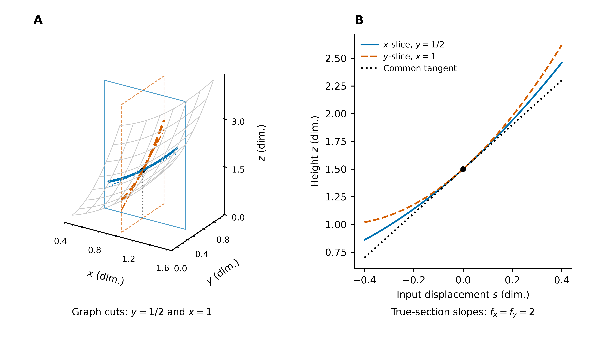

**图 1**：A 以竖直平面边框标明被固定的坐标，实线、虚线分别为两条曲面截线；细线为切线。B 将两条截线各自在其截面内按真实输入位移 $s$ 展开，斜率均为 $2$。三维画面的屏幕投影可能缩短水平距离，斜率应从 B 的坐标读取。

### 1.2 三元情形与高阶偏导

对 $g(x,y,z)$，$g_x$ 固定 $y,z$，$g_y$ 固定 $x,z$，$g_z$ 固定 $x,y$。例如

$$
g=x^2+2y^2+z^2,\qquad (g_x,g_y,g_z)=(2x,4y,2z).
$$

这里 $z$ 是输入坐标，函数输出应另记为 $w=g(x,y,z)$，避免与二元函数的图像高度混淆。本文约定 $f_{xy}=\partial_y(\partial_xf)$；$f\in C^2$ 时，$f_{xy}=f_{yx}$。

偏导选择的是**输入坐标**。对向量场 $\mathbf F=(P,Q,R)^T$，沿 $x$ 求偏导会得到整个输出向量的变化 $\partial_x\mathbf F=(P_x,Q_x,R_x)^T$，即 Jacobian 的第一列；并非只对第一个输出分量求导。

## 2. 方向导数：任意输入方向的截线斜率

### 2.1 从输入直线到空间截线

给定单位向量 $\mathbf u=(u_1,u_2)^T$，沿输入直线 $\mathbf a+s\mathbf u$ 定义双侧方向导数

$$
D_{\mathbf u}f(\mathbf a)=\lim_{s\to0}
\frac{f(\mathbf a+s\mathbf u)-f(\mathbf a)}s.
$$

在图像空间中，该直线上方的竖直平面截出

$$
\boldsymbol\gamma(s)=\big(a+su_1,b+su_2,f(\mathbf a+s\mathbf u)\big),
\qquad \boldsymbol\gamma'(0)=(u_1,u_2,D_{\mathbf u}f)^T.
$$

因为 $\|\mathbf u\|=1$，$s$ 是有向输入距离；方向导数是高度对输入距离的变化率，**不是高度对曲面弧长的变化率**。沿非单位向量 $\mathbf v$ 的参数导数须除以 $\|\mathbf v\|$，才得到每单位输入距离的方向导数。

主例取 $\mathbf u=(3/5,4/5)^T$，有

$$
f(\mathbf a+s\mathbf u)=\tfrac32+\tfrac{14}{5}s+\tfrac{41}{25}s^2,
\qquad D_{\mathbf u}f(\mathbf a)=\tfrac{14}{5}.
$$

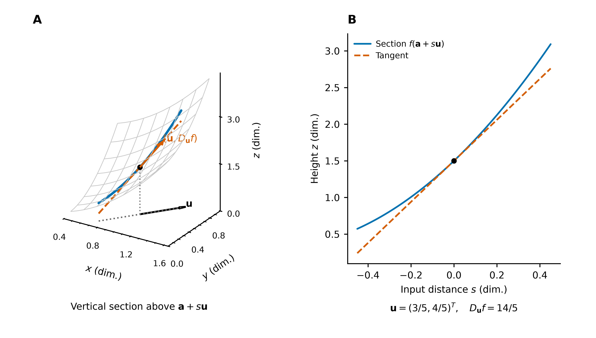

**图 2**：A 的底部虚线是输入路径，蓝色曲线是其图像，虚线切线的空间方向为 $(\mathbf u,D_{\mathbf u}f)$。B 用输入距离 $s$ 展开截面，直接显示斜率 $14/5$。坐标偏导正是 $\mathbf u=\mathbf i,\mathbf j$ 的特殊情形。

### 2.2 点积与标量投影

若 $f$ 在 $\mathbf a$ 可微，则

$$
f(\mathbf a+\mathbf h)-f(\mathbf a)
=\nabla f(\mathbf a)^T\mathbf h+o(\|\mathbf h\|).
$$

代入 $\mathbf h=s\mathbf u$ 并除以 $s$，得到

$$
\boxed{D_{\mathbf u}f=\nabla f\cdot\mathbf u
=\|\nabla f\|\cos\theta}.
$$

这就是向量代数中的**标量投影**：将梯度投影到所选单位方向。仅有偏导数存在时，不能直接使用此式。

## 3. 梯度、切平面与法向量

### 3.1 二元函数：梯度决定图像切平面的斜率

在直角坐标中，$\nabla f=(f_x,f_y)^T$ 属于二维输入空间。曲面参数表示

$$
\mathbf r(x,y)=(x,y,f(x,y))^T
$$

给出两个切向量及其叉积：

$$
\mathbf r_x=(1,0,f_x)^T,\qquad
\mathbf r_y=(0,1,f_y)^T,\qquad
\mathbf N=\mathbf r_x\times\mathbf r_y=(-f_x,-f_y,1)^T.
$$

由解析几何的点法式 $\mathbf N\cdot((x,y,z)-A)=0$，得到图像的切平面

$$
\boxed{z-f(a,b)=f_x(a,b)(x-a)+f_y(a,b)(y-b)}.
$$

主例的切平面为 $z-3/2=2(x-1)+2(y-1/2)$。**梯度是向量，切平面是经过图像点的仿射平面；给定该点后，梯度的两个分量确定切平面的两项斜率。** 梯度本身既不是该平面，也不是它的三维法向量。

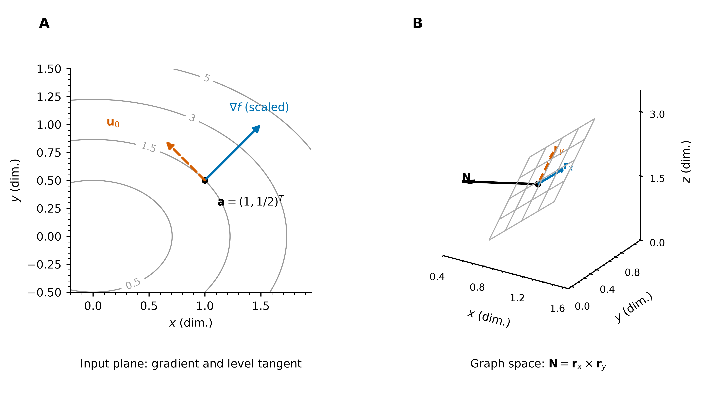

**图 3**：A 的梯度 $(2,2)^T$ 垂直于输入平面中的等值线。B 的 $\mathbf r_x,\mathbf r_y$ 张成图像切平面，$\mathbf N=(-2,-2,1)^T$ 与之正交。两幅图分别展示输入方向和图像的局部平面结构；箭长为标注所作的缩放。

### 3.2 等值集：梯度是输入空间中的法向

若可微曲线 $\mathbf c(t)$ 位于 $f(\mathbf x)=c$ 上，则链式法则给出

$$
0=\frac{\mathrm d}{\mathrm dt}f(\mathbf c(t))=\nabla f\cdot\mathbf c'(t).
$$

因此，在 $\nabla f\ne0$ 的正则点，梯度垂直于所有等值集切向量。由点积不等式，单位方向中的最大、最小变化率分别为 $\|\nabla f\|$、$-\|\nabla f\|$，对应方向 $\pm\nabla f/\|\nabla f\|$；与梯度垂直的方向一阶变化率为零。

### 3.3 三元函数：直接观察等值面的切平面

对三元标量函数 $g(x,y,z)$，梯度 $\nabla g=(g_x,g_y,g_z)^T$ 属于三维输入空间。等值面 $g=c$ 在正则点 $\mathbf a$ 的切平面为

$$
\boxed{\nabla g(\mathbf a)\cdot(\mathbf x-\mathbf a)=0}.
$$

取 $g=x^2+2y^2+z^2$、$\mathbf a=(1,1/2,1/2)^T$，则 $g(\mathbf a)=7/4$、$\nabla g(\mathbf a)=(2,2,1)^T$，切平面为 $2(x-1)+2(y-1/2)+(z-1/2)=0$。

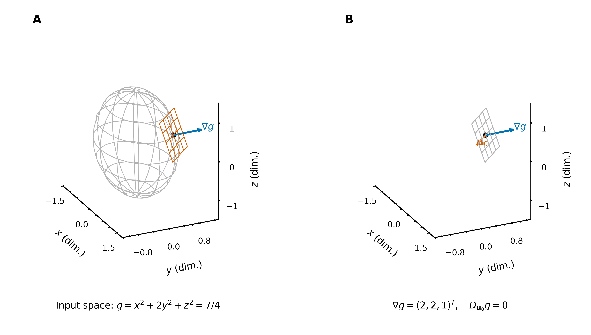

**图 4**：A 显示输入空间中的椭球等值面及其切平面；梯度是其法向。B 单独展示梯度与一个切向方向 $\mathbf u_0=(1,-1,0)^T/\sqrt2$，其方向导数为零。此处切平面属于三维等值面；三元函数的完整图像则位于四维空间。

同一点沿 $\mathbf u=(1,1,1)^T/\sqrt3$ 的方向导数为 $5/\sqrt3$；沿梯度单位方向 $(2,2,1)^T/3$ 则取得最大值 $3$。三元情形仍由输入空间中的点积投影统一计算。

若 $\nabla f=0$，各方向的一阶变化率均为零，但不能据此指定等值集法向或判定极值；后者见 [极值理论](../03_极值理论/README.md)。

## 4. 全微分：切平面上的增量相加

### 4.1 线性贡献与总增量

在可微点，定义

$$
\mathrm df=Df(\mathbf a)[\mathbf h]=\nabla f(\mathbf a)\cdot\mathbf h
=f_x(\mathbf a)h_x+f_y(\mathbf a)h_y.
$$

由位移分解 $\mathbf h=h_x\mathbf i+h_y\mathbf j$ 和点积的分配律，两个坐标方向的线性高度贡献相加。图像切平面上的对应位移为

$$
(h_x,h_y,\mathrm df)^T=h_x\mathbf r_x+h_y\mathbf r_y.
$$

所以在**同一切平面**上先沿 $x$ 方向、再沿 $y$ 方向移动，与沿合位移移动有相同升降量；这给出“分段登阶、累计高度”的几何解释。

原曲面上的实际总增量为

$$
\Delta f=f(\mathbf a+\mathbf h)-f(\mathbf a)=\mathrm df+o(\|\mathbf h\|).
$$

分步实际增量也能精确相加：

$$
\Delta f=[f(a+h_x,b)-f(a,b)]
+[f(a+h_x,b+h_y)-f(a+h_x,b)].
$$

但各段沿途斜率一般变化。全微分采用的是**起点处固定斜率**，因而是总增量的一阶近似；它与实际总增量应分开标记。

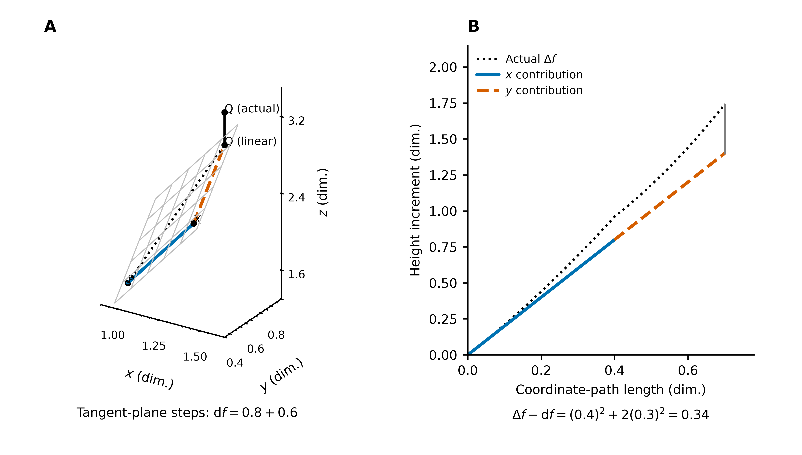

**图 5**：主例取 $\mathbf h=(0.4,0.3)^T$。A 的两段切平面路径分别升高 $0.8$、$0.6$，总和为 $\mathrm df=1.4$；实际曲面终点更高。B 对比分步线性高度与沿原曲面的实际高度：$\Delta f=1.74$，余量为 $h_x^2+2h_y^2=0.34$。横轴是先 $x$ 后 $y$ 的坐标路径长度，未将其混作合位移长度。

三元函数同理：$\mathrm dg=g_xh_x+g_yh_y+g_zh_z$。全微分是位移到标量的线性映射，梯度是通过内积表示该映射的向量；因此 $J_f=(\nabla f)^T$。

### 4.2 可微性不能由若干截线代替

邻域内一阶偏导存在且在该点连续，是该点可微的充分条件；所有方向导数存在则仍不足够。令

$$
q(x,y)=\begin{cases}\dfrac{x^2y}{x^4+y^2},&(x,y)\ne(0,0),\\0,&(x,y)=(0,0).\end{cases}
$$

对任意固定方向，$u_2\ne0$ 时

$$
\frac{q(tu_1,tu_2)}t=\frac{t u_1^2u_2}{t^2u_1^4+u_2^2}\to0;
$$

$u_2=0$ 时差商恒为零。但沿 $y=x^2$，$q(x,x^2)=1/2$，故原点甚至不连续。

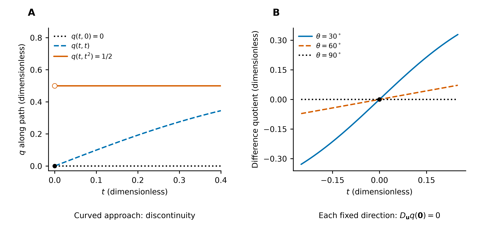

**图 6**：A 对比三条趋近路径的函数值，B 显示几个固定方向的差商。多元可微性要求同一个线性近似对所有小位移统一成立，而非逐条直线分别成立。

## 5. 散度：法向投影的局部差额

二维向量场写作 $\mathbf F_2(x,y)=(P(x,y),Q(x,y))^T$；三维向量场写作

$$
\mathbf F_3(x,y,z)=P(x,y,z)\mathbf i+Q(x,y,z)\mathbf j+R(x,y,z)\mathbf k.
$$

输入点决定向量的作用位置，$P,Q,R$ 是该点向量在三个坐标方向上的分量。散度描述这些分量在相邻位置的变化，而非向量本身的大小。

### 5.1 点积为何出现在通量中

对 $C^1$ 向量场 $\mathbf F=(P,Q,R)^T$，穿过有向面积元的通量为

$$
\mathrm d\Phi=\mathbf F\cdot\mathbf n\,\mathrm dS.
$$

点积提取法向分量；与面相切的分量不穿过该面。取边长为 $\Delta x,\Delta y,\Delta z$ 的小盒子，两个 $x$ 面的外法向分别为 $-\mathbf i,+\mathbf i$。其净通量的一阶主部为

$$
\Phi_x\approx(P_+-P_-)\Delta y\Delta z
\approx P_x\Delta x\Delta y\Delta z.
$$

对 $y,z$ 面同理。总净通量除以体积并令盒子缩小，得到

$$
\boxed{\nabla\cdot\mathbf F=P_x+Q_y+R_z
=\lim_{V\to\mathbf a}\frac1{|V|}\oiint_{\partial V}\mathbf F\cdot\mathbf n\,\mathrm dS}.
$$

此处极限取以 $\mathbf a$ 为中心、各边等比例缩小的盒子。加号来自三对面的净通量相加；$P_x$ 而非 $P_y$ 来自 $x$ 面的法向投影及两面间的 $x$ 位移。

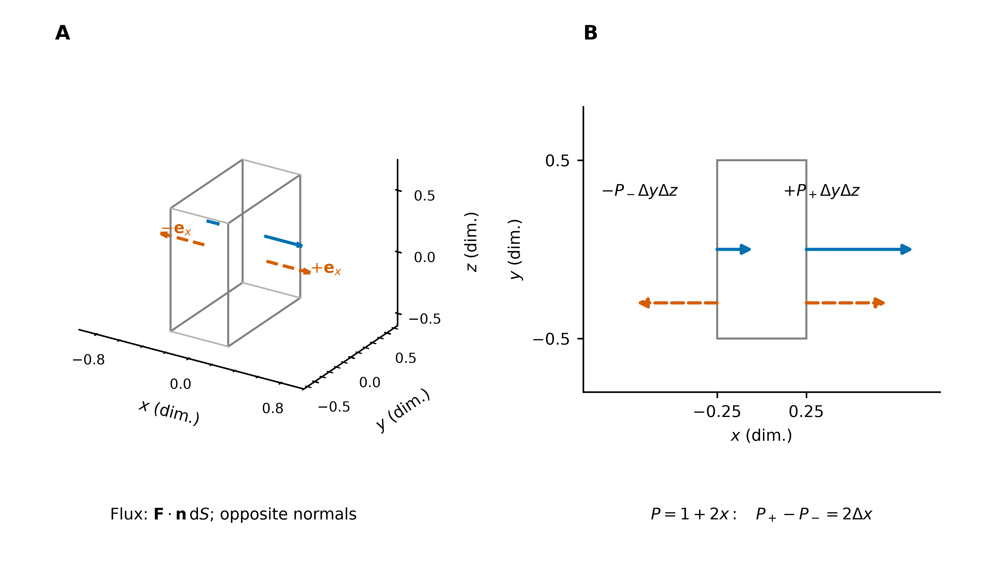

**图 7**：A 标出两个 $x$ 面的相反外法向；蓝色箭头示意同向但大小不同的 $P$ 分量。B 是 $xy$ 截面：左面贡献为负，右面贡献为正。即使两处场都向右，仍可因右侧流出较多而产生正散度。

### 5.2 向量代数表示及二维、三维例子

用标准正交基展开 $\mathbf F=\sum_jF_j\mathbf e_j$，有

$$
\nabla\cdot\mathbf F
=\sum_{i,j}(\mathbf e_i\cdot\mathbf e_j)\,\partial_iF_j
=\sum_i\partial_iF_i=\operatorname{tr}J_{\mathbf F}.
$$

这里 $\nabla$ 的分量是作用于场分量的微分算子；正交关系 $\mathbf e_i\cdot\mathbf e_j=\delta_{ij}$ 解释了为何只保留同方向分量。

具体地，

$$
J_{\mathbf F}=\begin{pmatrix}P_x&P_y&P_z\\Q_x&Q_y&Q_z\\R_x&R_y&R_z\end{pmatrix}.
$$

每列指定输入的变化方向，每行指定输出分量。散度取对角线之和：$P_x$ 比较两个 $x$ 面的法向分量，$Q_y,R_z$ 分别比较另两对面。非对角项改变的是相应面上的切向分量，不贡献该对面的首阶净通量。

例如 $\mathbf F_3=(2x,-y,3z)^T$ 的散度为 $2-1+3=4$。$x,z$ 方向扩张、$y$ 方向收缩，单位体积的净流出仍为 $4$；散度采用的是三个方向贡献的代数和。

| 场 | 二维散度 | 三维散度 | 局部结构 |
| --- | --- | --- | --- |
| $\mathbf F=\mathbf x$ | $2$ | $3$ | 均匀向外扩张 |
| $\mathbf F=-\mathbf x$ | $-2$ | $-3$ | 均匀向内收缩 |
| 常向量场 | $0$ | $0$ | 进出相抵 |

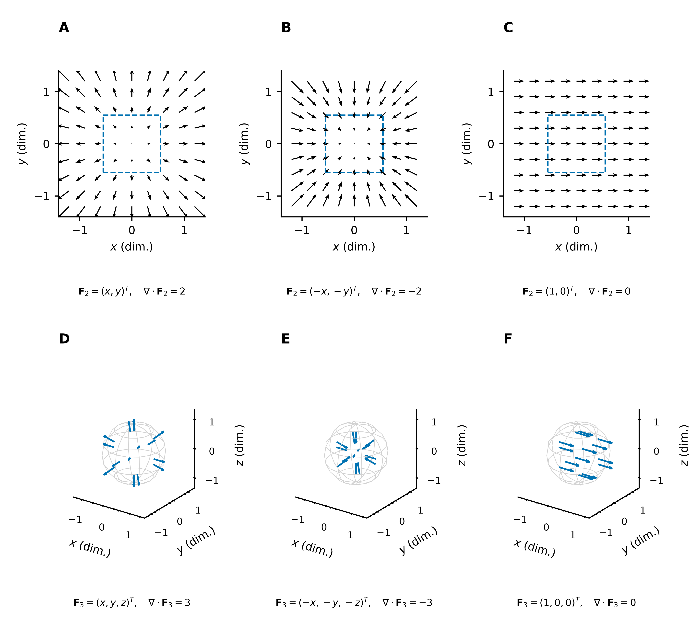

**图 8**：A–C 为二维场，D–F 为对应的三维场。径向场 $(x,y,z)^T$ 在每一点都有散度 $3$，其源结构分布于整个空间；均匀场 $(1,0,0)^T$ 虽穿过边界，进出仍相抵。下排灰色球面仅作空间定位参考，蓝色箭头表示场值；不能把三维净流出仅从一张平面截面判断。

### 5.3 二维场与三维场的平面截面

若将二维场延拓为 $\widetilde{\mathbf F}=(P(x,y),Q(x,y),0)^T$，则三维散度与二维散度均为 $P_x+Q_y$。但对一般三维场，只观察 $z=z_0$ 平面内的分量 $(P,Q)^T$，会遗漏 $R_z$。

例如三维场 $(x,y,z)^T$ 的散度为 $3$；其 $z=0$ 截面中的二维场 $(x,y)^T$ 的散度为 $2$。两式对应不同维度的区域和微元，不能互换。

### 5.4 速度场与质量通量

速度场 $\mathbf v$ 的散度单位为 s⁻¹，表示随流微元的相对体积变化率：

$$
\frac1{\delta V}\frac{\mathrm d}{\mathrm dt}\delta V=\nabla\cdot\mathbf v.
$$

质量通量则为 $\rho\mathbf v$。无源质量守恒为

$$
\partial_t\rho+\nabla\cdot(\rho\mathbf v)=0,
\qquad \frac{D\rho}{Dt}+\rho\nabla\cdot\mathbf v=0,
$$

其中 $D/Dt=\partial_t+\mathbf v\cdot\nabla$；第二式来自乘积法则 $\nabla\cdot(\rho\mathbf v)=\nabla\rho\cdot\mathbf v+\rho\nabla\cdot\mathbf v$。速度场膨胀可以由密度下降补偿，并不等于产生质量。

## 6. 旋度：切向投影与有向面积

### 6.1 小回路为何给出偏导之差

沿路径的环流元为 $\mathbf F\cdot \mathrm d\mathbf r$，点积提取沿行进方向的分量。在 $xy$ 平面取逆时针小矩形，记各边上分量的平均值为 $\bar P,\bar Q$，则

$$
\oint\mathbf F\cdot \mathrm d\mathbf r
=(\bar Q_{\rm right}-\bar Q_{\rm left})\Delta y
-(\bar P_{\rm top}-\bar P_{\rm bottom})\Delta x.
$$

除以面积并缩小矩形，得到 $Q_x-P_y$。负号来自上边沿 $-x$ 行进；它反映边界定向，而非额外约定。对三个坐标平面分别计算，得到

$$
\boxed{\nabla\times\mathbf F
=\begin{pmatrix}R_y-Q_z\\P_z-R_x\\Q_x-P_y\end{pmatrix}}.
$$

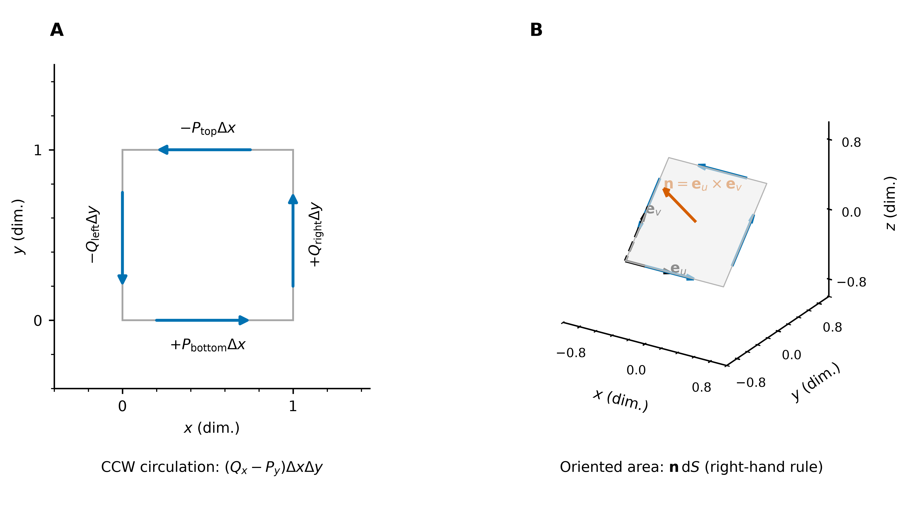

**图 9**：A 标明逆时针绕行时四条边的正负贡献。B 以两个正交切向方向 $\mathbf e_u,\mathbf e_v$ 张成斜置回路，叉积 $\mathbf n=\mathbf e_u\times\mathbf e_v$ 给出与回路相容的法向。

### 6.2 叉积、法向与旋度向量

标准基的叉积关系给出

$$
\nabla\times\mathbf F
=\sum_{i,j}\partial_iF_j\,(\mathbf e_i\times\mathbf e_j).
$$

同向叉积为零，交换次序会变号，所以旋度收集不同分量之间的**反对称变化**。例如 $\mathbf i\times\mathbf j=\mathbf k$、$\mathbf j\times\mathbf i=-\mathbf k$，合成 $z$ 分量 $Q_x-P_y$。常见行列式仅是这组展开的记忆形式。

三组叉积逐项给出

$$
\begin{aligned}
\mathbf j\times\mathbf k=\mathbf i,
\quad\mathbf k\times\mathbf j=-\mathbf i
&\quad\Longrightarrow\quad R_y-Q_z,\\
\mathbf k\times\mathbf i=\mathbf j,
\quad\mathbf i\times\mathbf k=-\mathbf j
&\quad\Longrightarrow\quad P_z-R_x,\\
\mathbf i\times\mathbf j=\mathbf k,
\quad\mathbf j\times\mathbf i=-\mathbf k
&\quad\Longrightarrow\quad Q_x-P_y.
\end{aligned}
$$

它们分别测量 $yz,zx,xy$ 平面上、以 $+x,+y,+z$ 为法向的小回路环流密度。旋度向量将三个朝向的信息合为一个对象；$\nabla$ 仍是算子，不能脱离对 $P,Q,R$ 的求导将其当作数值向量。

对单位法向 $\mathbf n$、在该点附近等比例缩小的平面回路，

$$
(\nabla\times\mathbf F)\cdot\mathbf n
=\lim_{|S|\to0}\frac1{|S|}\oint_{\partial S}\mathbf F\cdot \mathrm d\mathbf r.
$$

点积取旋度在所选法向上的分量，叉积确定面积方向。参数曲面的有向面积元 $\mathbf n\,\mathrm dS=(\mathbf r_u\times\mathbf r_v)\,\mathrm du\,\mathrm dv$，正是两种运算的结合。二维旋度常记为带符号标量 $Q_x-P_y$；三维旋度则用向量同时记录各朝向的环流密度。

对二维场的上述平面延拓，$\nabla\times\widetilde{\mathbf F}=(0,0,Q_x-P_y)^T$。一般三维场的平面内环流只测得旋度的该平面法向分量；其余分量须由其他朝向的回路确定。

### 6.3 旋转、剪切及角速度

绕单位轴 $\mathbf n$ 的刚体旋转速度为 $\mathbf v=\omega\mathbf n\times(\mathbf x-\mathbf a)$，有 $\nabla\times\mathbf v=2\omega\mathbf n$。特别地，绕 $z$ 轴时

$$
\mathbf v=(-\omega y,\omega x,0)^T,
\qquad \nabla\cdot\mathbf v=0,\quad
\nabla\times\mathbf v=(0,0,2\omega)^T.
$$

圆周环流 $2\pi\omega r^2$ 除以圆面积得到 $2\omega$。速度场的旋度称为涡量，局部刚体旋转部分的角速度为旋度的一半。

简单剪切 $\mathbf v=(\gamma y,0,0)^T$ 则有旋度 $(0,0,-\gamma)^T$：上下速度不同，微元发生剪切并有局部旋转，即使流线都是直线。

更一般的三维例子取 $\mathbf n=(1,1,1)^T/\sqrt3$、$\mathbf r=(x,y,z)^T$，

$$
\mathbf v=\mathbf n\times\mathbf r
=\frac1{\sqrt3}(z-y,x-z,y-x)^T,
\qquad \nabla\times\mathbf v=\frac2{\sqrt3}(1,1,1)^T=2\mathbf n.
$$

三个旋度分量均非零，实际旋转轴是斜向的 $\mathbf n$。再取 $\mathbf v=(-y,x,1/2)^T$，其旋度仍为 $2\mathbf k$；常数轴向输运使流线变为螺旋线，却不改变局部旋度。

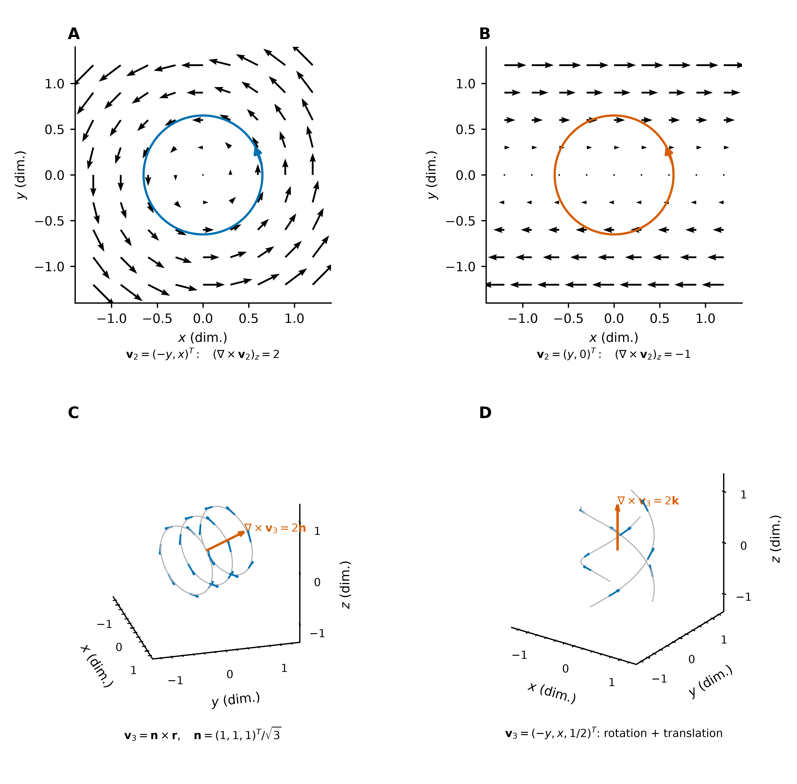

**图 10**：A、B 为二维旋转与剪切，两测试回路均逆时针定向。C 为绕斜轴 $\mathbf n$ 的三维旋转，D 为绕 $z$ 轴旋转叠加轴向平移。蓝色箭头是速度，灰线是流线，红色箭头是缩放后的旋度；旋度沿旋转轴，不沿流线切向。

对其他物理场，旋度仍表示环流密度，未必表示物体角速度。例如 Faraday 定律 $\nabla\times\mathbf E=-\partial_t\mathbf B$ 将电场环流与磁场的时间变化联系起来；“旋度的一半是角速度”专用于速度场的局部刚体旋转部分。

### 6.4 局部无旋与全局环流

穿孔平面上的场

$$
\mathbf F=\left(-\frac y{x^2+y^2},\frac x{x^2+y^2}\right)^T
$$

满足 $Q_x=P_y$，故各合法场点旋度为零；但绕原点的圆周环流为 $2\pi$。

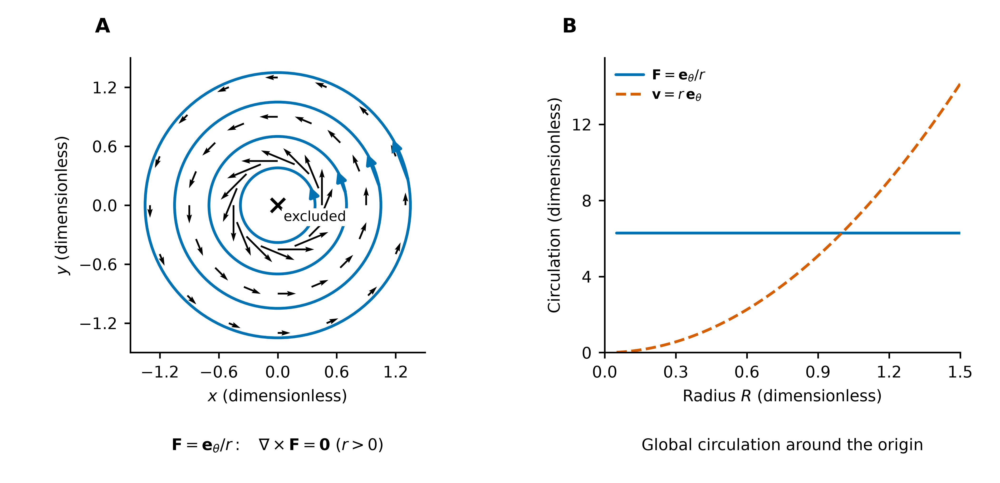

**图 11**：圆形流线与局部无旋可以并存。包围原点的回路不能用定义域内的完整圆盘跨接，因而不满足直接使用 Green 公式的条件；全局势函数的条件见 [保守场与势函数](../../03_多元积分学/05_场论与应用/保守场与势函数：路径无关的本质.md)。

## 7. Jacobian：膨胀、旋转与形变的统一表示

令 $A=J_{\mathbf F}(\mathbf a)$。局部场变化为 $\mathbf F(\mathbf a+\mathbf h)-\mathbf F(\mathbf a)=A\mathbf h+o(\|\mathbf h\|)$，其导数矩阵可分解为

$$
A=\frac{\operatorname{tr}A}{n}I
+\underbrace{\frac{A-A^T}{2}}_{W}
+\underbrace{\left(\frac{A+A^T}{2}-\frac{\operatorname{tr}A}{n}I\right)}_{S_0}.
$$

对速度场，三项分别为各向同性膨胀、局部刚体旋转、对称无迹形变。在三维中，$W\mathbf h=\tfrac12(\nabla\times\mathbf v)\times\mathbf h$；迹为散度，反对称部分对应旋度。

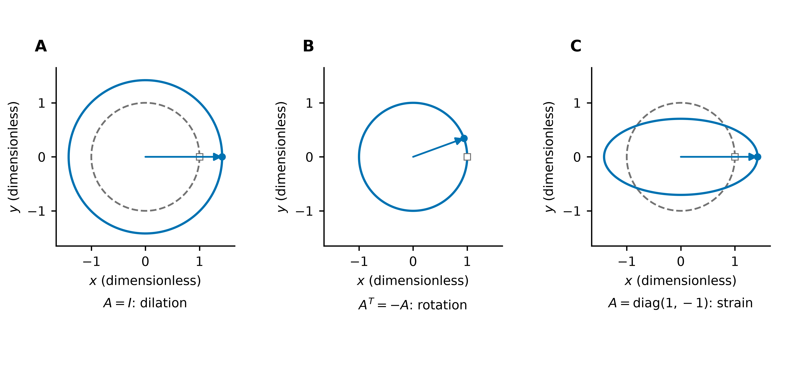

**图 12**：虚线单位圆在精确流映射 $e^{tA}$（$t=0.35$）下分别扩张、旋转、变为等面积椭圆。二维例子 $(x,-y)^T$ 同时无散、无旋，却有非零形变，说明散度与旋度未保留 Jacobian 的全部信息。

## 8. 物理联系与积分接口

### 8.1 梯度给出驱动方向，散度给出局部收支

温度梯度指向更热处。各向同性介质的 Fourier 定律为 $\mathbf q=-k\nabla T$，其中 $k>0$；$T$、$\nabla T$、$\mathbf q$ 的单位分别为 K、K/m、W/m²。静电场与保守力分别满足 $\mathbf E=-\nabla\phi$、$\mathbf F=-\nabla U$；数学势函数采用 $\mathbf F=\nabla f$ 时，需区别其符号约定。

对静止介质、常数密度与比热容，热量守恒为

$$
\rho_m c\,\partial_tT=-\nabla\cdot\mathbf q+s_Q
=k\Delta T+s_Q\quad(k\text{ 为常数}).
$$

因此梯度决定热流，散度衡量净热量流出，二者合成 Laplace 算子 $\Delta T=\nabla\cdot\nabla T$。各向异性材料以导热张量代替 $k$，热流未必与梯度共线。

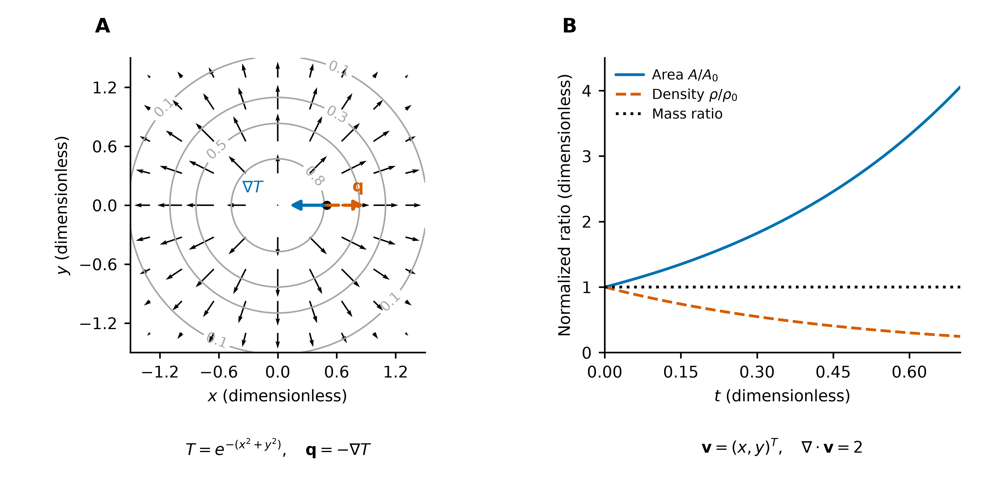

**图 13**：A 取 $T=e^{-(x^2+y^2)}$、$k=1$，梯度向内而热流向外；热流向外不保证其散度处处为正。B 的二维速度场 $(x,y)^T$ 使面积按 $e^{2t}$ 增长、均匀密度按 $e^{-2t}$ 下降，质量保持不变。

### 8.2 从局部微分到整体积分

| 局部信息 | 整体关系 | 几何意义 |
| --- | --- | --- |
| 梯度 | $\int_C\nabla f\cdot \mathrm d\mathbf r=f(B)-f(A)$ | 沿途变化累加为端点差 |
| 散度 | $\oiint_{\partial\Omega}\mathbf F\cdot\mathbf n\,\mathrm dS=\iiint_\Omega\nabla\cdot\mathbf F\,\mathrm dV$ | 内部净流出累加为外边界通量 |
| 旋度 | $\oint_{\partial S}\mathbf F\cdot \mathrm d\mathbf r=\iint_S(\nabla\times\mathbf F)\cdot\mathbf n\,\mathrm dS$ | 内部有向环流累加为边界环流 |

梯度公式要求 $f\in C^1$ 及分段光滑路径；后两式要求场在相应闭区域或曲面的邻域内为 $C^1$，几何边界分片光滑，并采用外法向或右手定向。完整条件见 [积分定理](../../03_多元积分学/04_三大积分定理/积分定理：从内部微分到边界积分.md)。

本文负责局部量的定义与分量来源。后续 [积分定理：从内部微分到边界积分](../../03_多元积分学/04_三大积分定理/积分定理：从内部微分到边界积分.md) 从区域、边界和定向出发，解释这些局部密度如何加权累积，以及内部边界为何相消。

### 8.3 几何微元与向量场的作用

微元的完整分类、参数展开与坐标变换统一见 [积分元素](../../03_多元积分学/01_重积分/积分元素.md)。这里仅保留与微分算子的接口。

$$
\mathrm d\mathbf r=(\mathrm dx,\mathrm dy,\mathrm dz)^T=\mathbf T\,\mathrm ds,\qquad
\mathrm d\mathbf S=(\mathrm dS_x,\mathrm dS_y,\mathrm dS_z)^T=\mathbf n\,\mathrm dS.
$$

前者沿路径切向，后者沿曲面法向。点积展开分别为

$$
\mathbf F\cdot \mathrm d\mathbf r=P\,\mathrm dx+Q\,\mathrm dy+R\,\mathrm dz,\qquad
\mathbf F\cdot \mathrm d\mathbf S=P\,\mathrm dS_x+Q\,\mathrm dS_y+R\,\mathrm dS_z.
$$

曲面参数化后，$(\mathrm dS_x,\mathrm dS_y,\mathrm dS_z)^T=(\mathbf r_u\times\mathbf r_v)\mathrm du\,\mathrm dv$，三个分量即有向投影 Jacobian。叉积构造有向面积，点积再取场的法向分量；这两步不是同一运算的替代写法。

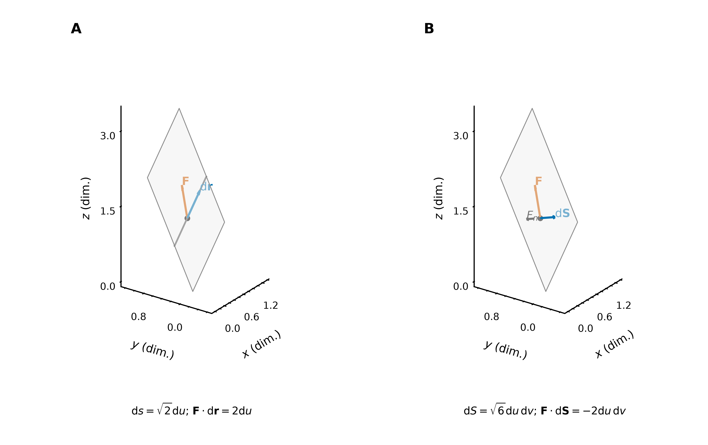

**图 14**：对 $\mathbf F=(1,1,1)^T$ 和参数片 $\mathbf r=(u,v,u+2v)^T$，固定 $v$ 的曲线上有 $\mathbf F\cdot \mathrm d\mathbf r=2\mathrm du$，而向上曲面通量为 $\mathbf F\cdot \mathrm d\mathbf S=-2\mathrm du\,\mathrm dv$。同一个点值可产生正切向作用与负法向通量，区别来自配对的几何微元。

梯度与有向线元配对，给出标量场的变化 $\mathrm df=\nabla f\cdot \mathrm d\mathbf r$。例如 $f=x+y+z$ 在上述曲面上满足 $\mathrm df=2\mathrm du+3\mathrm dv$。散度由原场穿过微体边界的通量除以体积得到；旋度由原场沿微片边界的环流除以面积得到其法向分量：

$$
\begin{aligned}
\text{散度：}\quad&\mathbf F\cdot \mathrm d\mathbf S
\quad\longleftrightarrow\quad(\nabla\cdot\mathbf F)\mathrm dV,\\
\text{旋度：}\quad&\mathbf F\cdot \mathrm d\mathbf r
\quad\longleftrightarrow\quad(\nabla\times\mathbf F)\cdot \mathrm d\mathbf S.
\end{aligned}
$$

这里左右两侧分别位于不同的边界与内部对象上；它们不是同一点微元的直接等式，而是在局部极限或相应积分定理下联系。右侧旋度通量的分量展开为

$$
(R_y-Q_z)\mathrm dS_x+(P_z-R_x)\mathrm dS_y+(Q_x-P_y)\mathrm dS_z.
$$

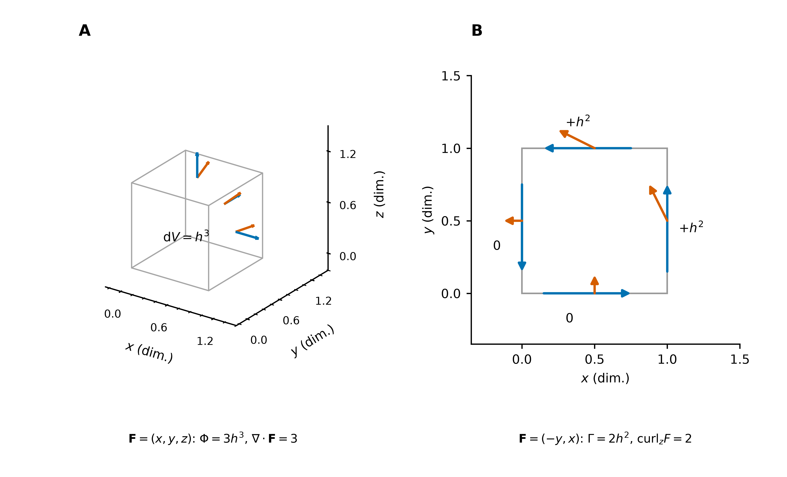

**图 15**：A 的三维小立方体累加各面的 $\mathbf F\cdot \mathrm d\mathbf S$；B 的二维小回路累加各边的 $\mathbf F\cdot \mathrm d\mathbf r$。分别除以体积、面积，得到散度与旋度的法向分量。详细微元展开见 [积分元素](../../03_多元积分学/01_重积分/积分元素.md)，整体定向条件见 [积分定理](../../03_多元积分学/04_三大积分定理/积分定理：从内部微分到边界积分.md)。

## 附：恒等式与坐标尺度

$C^2$ 条件下，混合偏导相消给出

$$
\nabla\times\nabla f=0,\qquad
\nabla\cdot(\nabla\times\mathbf F)=0,\qquad
\Delta f=\sum_i f_{x_ix_i}.
$$

本文分量公式采用直角坐标。极坐标下，弧长 $r\,\mathrm d\theta$ 与基向量随角度变化产生尺度因子；对正交单位基分量，在 $r>0$ 时

$$
\nabla f=f_r\mathbf e_r+\frac1r f_\theta\mathbf e_\theta,
$$

$$
\nabla\cdot\mathbf F=\frac1r\partial_r(rF_r)+\frac1r\partial_\theta F_\theta,
\qquad (\nabla\times\mathbf F)_z
=\frac1r\big[\partial_r(rF_\theta)-\partial_\theta F_r\big].
$$

不能仅将直角坐标公式中的 $x,y$ 换成 $r,\theta$。

[返回本节目录](README.md) · [公式速查](多元微分学速查.md) · [多元积分学速查](../../03_多元积分学/多元积分学速查.md)
