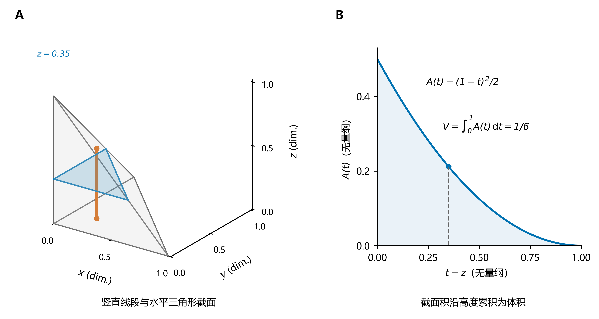
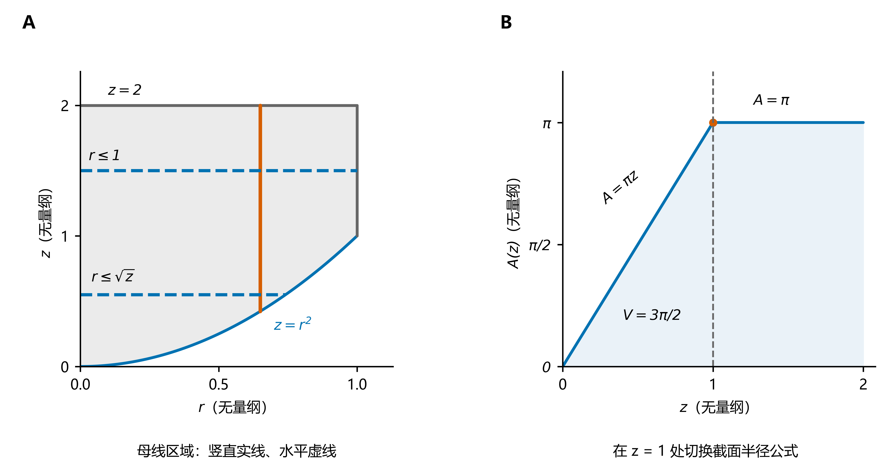
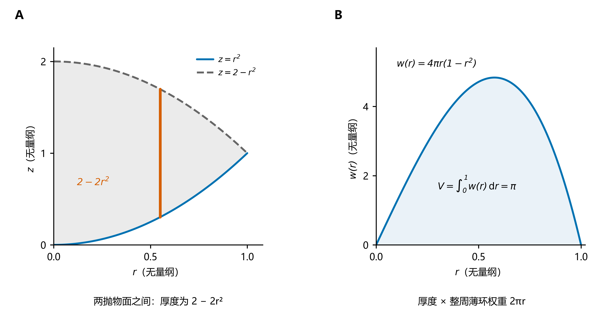
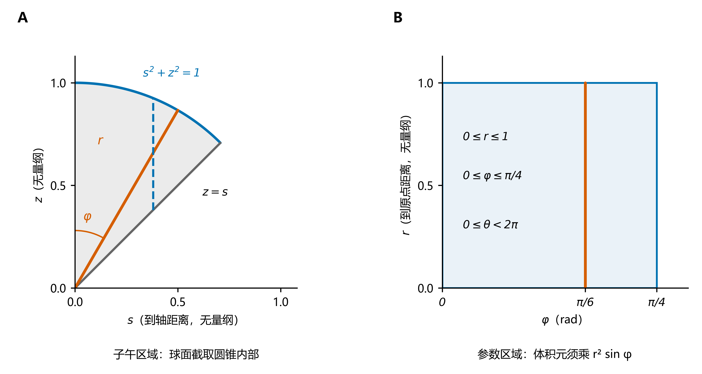

# 三重积分

从空间区域的描述出发，理解投影、截面、换序与坐标变换。

> **核心概念**：三重积分把空间中每一点的函数值按体积加权累积。计算的关键是把同一个立体准确地描述为一族线段、截面或坐标微块，再确定积分限。
>
> 前置：[重积分：区域、累次积分与换元](重积分：区域、累次积分与换元.md)、[积分元素](积分元素.md)。空间曲面的识别可查 [解析几何基础](../../01_几何与代数基础/解析几何基础：直线、平面、曲线与曲面.md)。

## 1. 定义、意义与基本性质

把有界空间区域 $\Omega$ 分割成小块 $\Omega_i$，其体积为 $\Delta V_i$，在每块中任取一点 $P_i=(\xi_i,\eta_i,\zeta_i)$。若极限

$$
\iiint_\Omega f(x,y,z)\,\mathrm dV
=\lim_{\max_i\operatorname{diam}(\Omega_i)\to0}
\sum_i f(P_i)\,\Delta V_i
$$

存在，且与分割及取样点无关，则称 $f$ 在 $\Omega$ 上可积。本文的通常情形是：$\Omega$ 有界、边界分片光滑，$f$ 在闭区域上连续；此时可积。分块后只在边界重叠，不会重复贡献体积。

| 取什么函数 | 得到什么量 | 量纲示例 |
| --- | --- | --- |
| $f=1$ | $V=\iiint_\Omega1\,\mathrm dV$，立体体积 | $\mathrm{m^3}$ |
| 体密度 $f=\rho\ge0$ | $M=\iiint_\Omega\rho\,\mathrm dV$，质量 | $\mathrm{kg}$ |
| 一般标量场 $f$ | 正、负贡献相抵后的体积加权累积 | $[f]\,\mathrm{m^3}$ |

$\mathrm dV$ 本身非负，不附带方向；积分的正负来自 $f$。二重积分 $\iint_D h\,\mathrm dA$ 在 $h\ge0$ 时也能给出体积，但其累积对象是平面底面上的高度；三重积分则直接在立体内部累积。

对可积函数，三重积分满足：

$$
\iiint_\Omega(af+bg)\,\mathrm dV
=a\iiint_\Omega f\,\mathrm dV+b\iiint_\Omega g\,\mathrm dV.
$$

区域可加性：若 $\Omega=\Omega_1\cup\Omega_2$，且两部分只在零体积的集合上重叠，则积分等于两部分积分之和。保序性给出

$$
f\le g\ \Longrightarrow\ \iiint_\Omega f\,\mathrm dV\le\iiint_\Omega g\,\mathrm dV,
\qquad
\left|\iiint_\Omega f\,\mathrm dV\right|\le\iiint_\Omega|f|\,\mathrm dV.
$$

若 $m\le f\le M$，则 $mV\le\iiint_\Omega f\,\mathrm dV\le MV$。这也是核验答案大小的简便方法。

## 2. 直角坐标：投影法与截面法

### 2.1 投影法：先沿一条线段积分

若固定 $(x,y)$ 后，立体中的竖直部分是一条线段，可写成

$$
\Omega=\{(x,y,z):(x,y)\in D_{xy},\ z_-(x,y)\le z\le z_+(x,y)\}.
$$

则

$$
\boxed{\iiint_\Omega f\,\mathrm dV
=\iint_{D_{xy}}\left[\int_{z_-(x,y)}^{z_+(x,y)}f(x,y,z)\,\mathrm dz\right]\mathrm dx\,\mathrm dy.}
$$

内层把每条竖直线段上的贡献积起来，外层再在投影区域上累积。特别地，$f=1$ 时内层就是厚度 $z_+-z_-$。

**确定积分限的顺序**：

1. 先选最内层变量，例如 $z$；固定其余两个变量，找出线段的下、上端点。
2. 求投影：$D_{xy}$ 由“至少存在一个 $z$ 使原来的全部约束成立”的 $(x,y)$ 构成。
3. 在投影内选二重积分的次序，例如 $a\le x\le b$、$g_1(x)\le y\le g_2(x)$。

于是

$$
\iiint_\Omega f\,\mathrm dV
=\int_a^b\int_{g_1(x)}^{g_2(x)}\int_{z_-(x,y)}^{z_+(x,y)}f\,\mathrm dz\,\mathrm dy\,\mathrm dx.
$$

投影不一定是边界曲面的交线内部。例如球的投影应由可行性条件求得。若一条直线与立体相交为多段，要把各段积分相加；若端点公式在投影的不同部分改变，要分区。

### 2.2 截面法：先在一个平面内积分

固定 $z=t$，定义截面

$$
D_t=\{(x,y):(x,y,t)\in\Omega\}.
$$

设立体的高度范围为 $a\le z\le b$，则

$$
\boxed{\iiint_\Omega f\,\mathrm dV
=\int_a^b\left[\iint_{D_t} f(x,y,t)\,\mathrm dx\,\mathrm dy\right]\mathrm dt.}
$$

若 $f=1$，记截面积 $A(t)=\iint_{D_t}1\,\mathrm dA$，便得到熟悉的 $V=\int_a^b A(t)\,\mathrm dt$。若 $f$ 随 $x,y$ 变化，须计算截面上的加权积分，不能直接用截面积代替。

### 例题 1：同一个四面体的两种切法

设 $\Omega=\{x,y,z\ge0:\ x+y+z\le1\}$。

**投影法**：$D_{xy}=\{x,y\ge0:\ x+y\le1\}$，$0\le z\le1-x-y$，所以

$$
V=\int_0^1\int_0^{1-x}\int_0^{1-x-y}1\,\mathrm dz\,\mathrm dy\,\mathrm dx
=\int_0^1\frac{(1-x)^2}{2}\,\mathrm dx=\frac16.
$$

**截面法**：固定 $z=t$，截面是直角边均为 $1-t$ 的三角形，故

$$
A(t)=\frac{(1-t)^2}{2},\qquad
V=\int_0^1\frac{(1-t)^2}{2}\,\mathrm dt=\frac16.
$$

**图 1**：A 给出单位四面体，橙色实线是在 $(x,y)=(0.2,0.25)$ 处的竖直线段，蓝色三角形是 $z=0.35$ 的水平截面；B 的曲线为精确截面积 $A(t)=(1-t)^2/2$，阴影面积为 $1/6$。空间轴等比例，坐标均无量纲。

## 3. 积分次序交换：重新描述同一立体

直角坐标中共有六种次序：$\mathrm dz\,\mathrm dy\,\mathrm dx$、$\mathrm dy\,\mathrm dz\,\mathrm dx$、$\mathrm dz\,\mathrm dx\,\mathrm dy$、$\mathrm dx\,\mathrm dz\,\mathrm dy$、$\mathrm dy\,\mathrm dx\,\mathrm dz$、$\mathrm dx\,\mathrm dy\,\mathrm dz$。写在最右边的微分对应最外层积分。

改换次序时，应先把原式恢复为区域不等式，再按新次序重新求积分限。**不能只调整微分符号而沿用原来的上下限。** 对三层累次积分：

- 最外层的上下限是常数。
- 中间层的上下限只可依赖最外层变量。
- 最内层的上下限可依赖两层外变量，不能含自身。

连续函数在本文的紧区域上满足 Fubini 定理；更一般地，绝对可积函数可以交换次序。非负可测函数适用 Tonelli 定理，积分值允许为 $+\infty$。涉及无界区域或奇点时，先核验条件，不能直接套用有界连续情形的结论。

### 例题 2：换序消去难求的内层原函数

$$
I=\int_0^1\int_x^1\int_0^1 e^{y^2}\,\mathrm dz\,\mathrm dy\,\mathrm dx.
$$

先沿 $z$ 积分后，会遇到没有初等原函数的 $e^{y^2}$。原区域为 $0\le x\le y\le1$、$0\le z\le1$；固定 $y$ 后，$xz$ 截面是宽 $y$、高 $1$ 的矩形，故

$$
\begin{aligned}
I&=\int_0^1\int_0^y\int_0^1 e^{y^2}\,\mathrm dz\,\mathrm dx\,\mathrm dy\\
&=\int_0^1 y e^{y^2}\,\mathrm dy=\frac{e-1}{2}.
\end{aligned}
$$

内两层产生因子 $y$，恰好配合 $e^{y^2}$。换序的价值在于得到便于计算的截面权重；合法换序并不保证一定能获得初等闭式。

### 例题 3：换序后为什么要分段

设

$$
\Omega=\{(x,y,z):x^2+y^2\le1,\quad x^2+y^2\le z\le2\}.
$$

沿 $z$ 积分时，上、下界统一；改为固定 $z$，有

$$
x^2+y^2\le\min(z,1),\qquad0\le z\le2.
$$

所以截面积在 $z=1$ 处改变表达式：

$$
A(z)=\begin{cases}\pi z,&0\le z\le1,\\\pi,&1\le z\le2.\end{cases}
\qquad
V=\int_0^1\pi z\,\mathrm dz+\int_1^2\pi\,\mathrm dz=\frac{3\pi}{2}.
$$

若统一写成 $x^2+y^2\le z$，会在 $z>1$ 时计入原柱面之外的体积。

**图 2**：A 为例题 3 的 $rz$ 母线区域 $0\le r\le1$、$r^2\le z\le2$；实线竖段对应投影法，虚线横段对应截面法。B 给出 $A(z)$，圆点标出切换高度 $z=1$。母线区域是二维示意，其面积不等于立体体积，绕轴累积时须带因子 $2\pi r$。

## 4. 柱坐标：把绕轴结构变成平面区域

采用

$$
x=r\cos\theta,\qquad y=r\sin\theta,\qquad z=z,
\qquad r\ge0.
$$

其中 $r=\sqrt{x^2+y^2}$ 是到 $z$ 轴的距离，$\theta$ 是 $xy$ 平面方位角。体积元来自两条径向、角向边和一条竖直边：

$$
\mathrm dV=(\mathrm dr)(r\,\mathrm d\theta)(\mathrm dz)=r\,\mathrm dr\,\mathrm d\theta\,\mathrm dz.
$$

因此对变换后的区域 $U$，

$$
\iiint_\Omega f\,\mathrm dV
=\iiint_U f(r\cos\theta,r\sin\theta,z)\,r\,\mathrm dr\,\mathrm d\theta\,\mathrm dz.
$$

此处用三重积分记号表达区域积分，实际化为累次积分时，微分顺序须与对应积分限一致。完整绕轴一周通常取 $0\le\theta<2\pi$；扇形区域由实际方位确定角限。轴线与接缝的退化发生在零体积集合上，不影响通常积分。

| 原边界 | 柱坐标形式 |
| --- | --- |
| $x^2+y^2=a^2$ | $r=a$ |
| $z=x^2+y^2$ | $z=r^2$ |
| $z=\sqrt{x^2+y^2}$ | $z=r$，上半圆锥 |
| $x^2+y^2+z^2=R^2$ | $r^2+z^2=R^2$ |

### 例题 4：两抛物面之间的体积与质心

设 $\Omega$ 夹在 $z=x^2+y^2$ 和 $z=2-x^2-y^2$ 之间。由下界不超过上界，得 $r^2\le2-r^2$，即 $0\le r\le1$。

$$
\begin{aligned}
V&=\int_0^{2\pi}\int_0^1\int_{r^2}^{2-r^2}r\,\mathrm dz\,\mathrm dr\,\mathrm d\theta\\
&=2\pi\int_0^1(2-2r^2)r\,\mathrm dr=\pi.
\end{aligned}
$$

均匀密度时，绕轴对称给出 $\bar x=\bar y=0$；关于 $z=1$ 对称给出 $\bar z=1$。也可直接验证一阶矩：

$$
\iiint_\Omega z\,\mathrm dV
=2\pi\int_0^1\frac{(2-r^2)^2-r^4}{2}\,r\,\mathrm dr=\pi,
\qquad\bar z=\frac{\pi}{V}=1.
$$

**图 3**：A 的两曲线为 $z=r^2$、$z=2-r^2$，竖直实线表示固定 $r$ 的厚度；B 为对整周方位角积分后的径向权重 $2\pi r[(2-r^2)-r^2]$，其曲线下方面积为 $\pi$。因子 $r$ 来自体积元，不能只积两曲线间的平面面积。

## 5. 球坐标：分开径向距离与方向

沿用 [积分元素](积分元素.md) 的角度约定：$r$ 为到原点的距离，$\theta$ 为方位角，$\varphi$ 自 $+z$ 轴量起。

$$
\boxed{x=r\sin\varphi\cos\theta,\quad
y=r\sin\varphi\sin\theta,\quad z=r\cos\varphi.}
$$

$$
r\ge0,\quad0\le\varphi\le\pi,\quad0\le\theta<2\pi,
\qquad
\boxed{\mathrm dV=r^2\sin\varphi\,\mathrm dr\,\mathrm d\varphi\,\mathrm d\theta.}
$$

**注意柱坐标与球坐标中的 $r$ 含义不同**：前者为到轴的距离，后者为到原点的距离；球坐标中的到轴距离是 $r\sin\varphi$。若与其他教材对照，先核对其极角、方位角的定义。

局部微块的三条正交边长依次为 $\mathrm dr$、$r\,\mathrm d\varphi$、$r\sin\varphi\,\mathrm d\theta$，相乘得到体积因子；严格推导见 [积分元素](积分元素.md)。

| 原边界或区域 | 球坐标描述 |
| --- | --- |
| 球 $x^2+y^2+z^2\le R^2$ | $0\le r\le R$ |
| 球壳 $a^2\le x^2+y^2+z^2\le b^2$ | $a\le r\le b$ |
| 上半空间 $z\ge0$ | $0\le\varphi\le\pi/2$ |
| 圆锥内部 $z\ge\sqrt{x^2+y^2}$ | $0\le\varphi\le\pi/4$ |
| 偏心球 $x^2+y^2+z^2\le2az$，$a>0$ | $0\le\varphi\le\pi/2$，$0\le r\le2a\cos\varphi$ |

最后一行说明：球面只有以原点为球心时，才对应常数径向上界。

### 例题 5：球内、圆锥上方的立体

$$
\Omega=\{x^2+y^2+z^2\le R^2,\quad z\ge\sqrt{x^2+y^2}\},\qquad R>0.
$$

球面限制 $0\le r\le R$，圆锥限制 $0\le\varphi\le\pi/4$，方位角遍历一周。因此

$$
\begin{aligned}
V&=\int_0^{2\pi}\int_0^{\pi/4}\int_0^R
r^2\sin\varphi\,\mathrm dr\,\mathrm d\varphi\,\mathrm d\theta\\
&=\frac{2\pi R^3}{3}\left(1-\frac1{\sqrt2}\right).
\end{aligned}
$$

若改用柱坐标，同一区域为

$$
0\le\theta<2\pi,\quad0\le r\le R/\sqrt2,\quad
r\le z\le\sqrt{R^2-r^2},
$$

其中 $r\le R/\sqrt2$ 由上下界相交求出；此处的 $r$ 已回到柱坐标含义。

**图 4**：取 $R=1$。A 的横轴 $s=\sqrt{x^2+y^2}$ 为到轴距离，纵轴为 $z$；灰色扇形是立体在非负 $s$ 半平面内的子午表示，径向实线固定 $\varphi=\pi/6$，竖直虚线表示柱坐标切片。B 为球坐标的 $(\varphi,r)$ 参数区域，转动一周后的权重为 $2\pi r^2\sin\varphi$；参数矩形面积不能直接当作体积。

### 例题 6：球上的径向积分与奇点判别

若 $f(x,y,z)=g(\sqrt{x^2+y^2+z^2})$，则在可积或非负情形下

$$
\iiint_{x^2+y^2+z^2\le R^2}g(r)\,\mathrm dV
=4\pi\int_0^R g(r)r^2\,\mathrm dr.
$$

例如

$$
\iiint_{x^2+y^2+z^2\le R^2}(x^2+y^2+z^2)\,\mathrm dV
=4\pi\int_0^R r^4\,\mathrm dr=\frac{4\pi R^5}{5}.
$$

对 $p\in\mathbb R$，考察原点处可能奇异的 $r^{-p}$，应先在球壳 $\varepsilon\le r\le R$ 上积分，再令 $\varepsilon\downarrow0$：

$$
\iiint_{0<r\le R}r^{-p}\,\mathrm dV
=4\pi\lim_{\varepsilon\downarrow0}\int_\varepsilon^R r^{2-p}\,\mathrm dr.
$$

故原点附近收敛当且仅当 $p<3$；此时值为 $4\pi R^{3-p}/(3-p)$。$p=3$ 对数发散，$p>3$ 幂次发散。不能因奇点只是一个点就忽略其附近的无穷累积。相应地，在 $r\ge1$ 的无界外部区域上，$r^{-p}$ 的积分收敛当且仅当 $p>3$。

## 6. 一般换元：Jacobian 是局部体积伸缩率

设 $T:(u,v,w)\mapsto(x,y,z)$ 在区域内部为一一的 $C^1$ 换元，且 $\det DT\ne0$，则

$$
\iiint_\Omega f(x,y,z)\,\mathrm dV
=\iiint_U f(T(u,v,w))\,
\left|\frac{\partial(x,y,z)}{\partial(u,v,w)}\right|\mathrm du\,\mathrm dv\,\mathrm dw.
$$

$$
\frac{\partial(x,y,z)}{\partial(u,v,w)}
=\det\begin{pmatrix}
x_u&x_v&x_w\\y_u&y_v&y_w\\z_u&z_v&z_w
\end{pmatrix}.
$$

绝对值保证体积非负。换元要同时完成三件事：替换被积函数、改写区域、乘上 Jacobian。合法的柱坐标、球坐标换元可在避开轴线、原点和接缝的分块上使用此公式。

### 例题 7：把椭球化为单位球

设 $a,b,c>0$，

$$
\Omega=\left\{\frac{x^2}{a^2}+\frac{y^2}{b^2}+\frac{z^2}{c^2}\le1\right\}.
$$

令 $x=au$、$y=bv$、$z=cw$，则 $U=\{u^2+v^2+w^2\le1\}$，$|\det DT|=abc$。因此

$$
V=abc\iiint_U1\,\mathrm du\,\mathrm dv\,\mathrm dw=\frac{4\pi abc}{3}.
$$

进一步，由单位球的坐标置换对称性，

$$
\iiint_U u^2\,\mathrm dV_u
=\frac13\iiint_U(u^2+v^2+w^2)\,\mathrm dV_u
=\frac{4\pi}{15}.
$$

若物体均匀密度为 $\rho_0$，则 $M=4\pi\rho_0abc/3$，绕 $z$ 轴的转动惯量为

$$
I_z=\rho_0abc\iiint_U(a^2u^2+b^2v^2)\,\mathrm dV_u
=\frac{M}{5}(a^2+b^2).
$$

## 7. 对称性与物理应用

### 7.1 先检查区域，再检查函数或密度

若 $\Omega$ 关于 $x=0$ 对称，且 $f(-x,y,z)=-f(x,y,z)$、$f$ 可积，则积分为零；若 $f$ 关于 $x$ 为偶函数，则积分等于 $x\ge0$ 半区域上积分的两倍。

若区域与被积函数都在坐标置换下不变，可交换对应坐标。例如在以原点为球心的球上，

$$
\iiint_\Omega x^2\,\mathrm dV=\iiint_\Omega y^2\,\mathrm dV=\iiint_\Omega z^2\,\mathrm dV
=\frac13\iiint_\Omega(x^2+y^2+z^2)\,\mathrm dV.
$$

“第一卦限乘八”需要区域关于三个坐标平面都对称，且被积函数对三个坐标分别为偶函数。只知道立体对称，不能对任意函数乘八；例如球上 $x$ 的积分为零，而第一卦限上的积分为正。

### 7.2 质量、质心、平均值与转动惯量

设 $\rho\ge0$，总质量 $M>0$，则

$$
M=\iiint_\Omega\rho\,\mathrm dV,\qquad
(\bar x,\bar y,\bar z)
=\frac1M\iiint_\Omega(x,y,z)\rho\,\mathrm dV.
$$

空间场的体积平均值为 $f_{\mathrm{avg}}=V^{-1}\iiint_\Omega f\,\mathrm dV$，其中 $V>0$；质量平均则应以 $\rho\,\mathrm dV$ 加权。几何对称推出质心位置时，密度也须满足对应对称性。

$$
I_x=\iiint_\Omega(y^2+z^2)\rho\,\mathrm dV,\quad
I_y=\iiint_\Omega(z^2+x^2)\rho\,\mathrm dV,\quad
I_z=\iiint_\Omega(x^2+y^2)\rho\,\mathrm dV.
$$

这里的距离是到转轴的垂直距离。绕任意直线 $\ell$ 时，统一写为 $I_\ell=\iiint_\Omega\operatorname{dist}(P,\ell)^2\rho(P)\,\mathrm dV$。

后续 [积分定理](../04_三大积分定理/积分定理：从内部微分到边界积分.md) 中的 Gauss 公式，将散度的三重积分与边界外向通量联系起来；应用前须满足场在整个闭区域邻域内的光滑性要求。

## 8. 方法选择与易错点

| 区域或函数特征 | 优先尝试 | 核对重点 |
| --- | --- | --- |
| 上、下边界容易写成 $z_\pm(x,y)$ | 投影法，先 $\mathrm dz$ | 投影可行性、是否要分区 |
| 固定一个变量后的截面简单 | 截面法 | 截面随高度是否改变类型 |
| 出现 $x^2+y^2$，或绕轴结构 | 柱坐标 | $r$ 是到轴距离，乘 $r$ |
| 球、球壳、圆锥、径向函数 | 球坐标 | 极角定义，乘 $r^2\sin\varphi$ |
| 椭球或斜平行六面体 | 线性换元 | 绝对行列式与新区域 |
| 内层原函数困难 | 换序或利用对称性 | 新的截面权重是否使积分更容易 |
| 无界区域或奇点 | 先分析收敛 | Fubini / Tonelli 条件 |

做题时可依次核对：**区域不等式 → 切片/坐标选择 → 完整积分限 → 被积函数与体积因子 → 计算与估计**。

- $\iiint_\Omega f\,\mathrm dV$ 对区域的依赖，与对函数的依赖同样重要；换序后可代入若干内部点检查是否仍在原区域。
- 球面是边界曲面，球体是三重积分的区域；求球面面积应使用 $\mathrm dS$，见 [曲面积分](../03_曲面积分/曲面积分：曲面累积与穿面通量.md)。
- 缩放立体所有长度为原来的 $\lambda>0$ 倍，体积变为 $\lambda^3$ 倍；均匀密度不变时，一阶矩为 $\lambda^4$ 倍，转动惯量为 $\lambda^5$ 倍。

## 9. 自测

1. 求 $\{x,y,z\ge0:x/a+y/b+z/c\le1\}$ 的体积，$a,b,c>0$。
2. 求 $\{x^2+y^2\le1,\ 0\le z\le1-x^2-y^2\}$ 的体积。
3. 求半径为 $R$ 的均匀实心球的 $I_z$，用总质量 $M$ 表示。
4. 判断 $\iiint_{0<x^2+y^2+z^2\le1}(x^2+y^2+z^2)^{-\alpha}\,\mathrm dV$ 何时收敛。

**答案与提示**：1. 缩放为单位四面体，$V=abc/6$。2. 柱坐标，$V=\pi/2$。3. 球对称给出 $I_z=\rho_0(2/3)(4\pi R^5/5)=2MR^2/5$。4. 径向奇性为 $r^{-2\alpha}$，故当且仅当 $\alpha<3/2$ 时收敛，值为 $4\pi/(3-2\alpha)$。

[配图与生成脚本](image/三重积分/README.md) · [多元积分学速查](../多元积分学速查.md) · [返回重积分](README.md)
