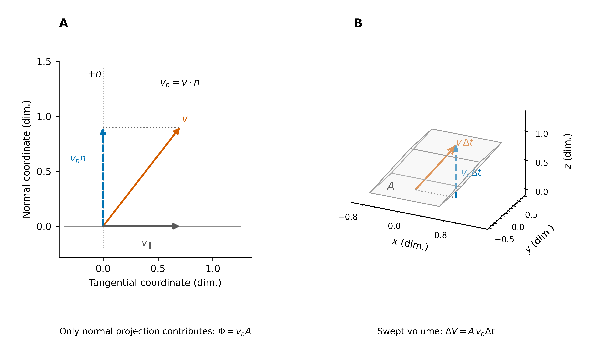
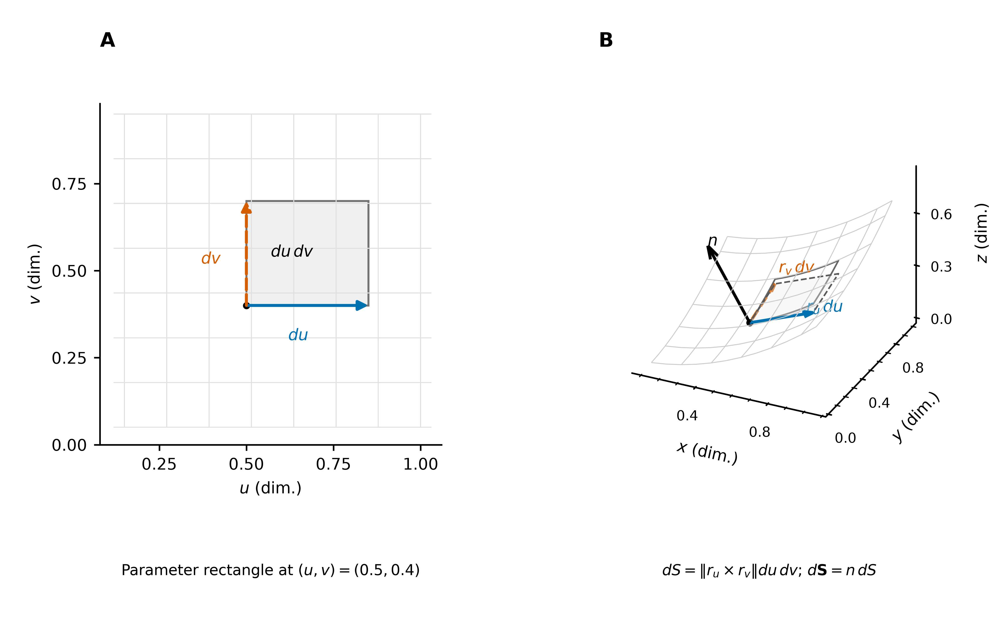
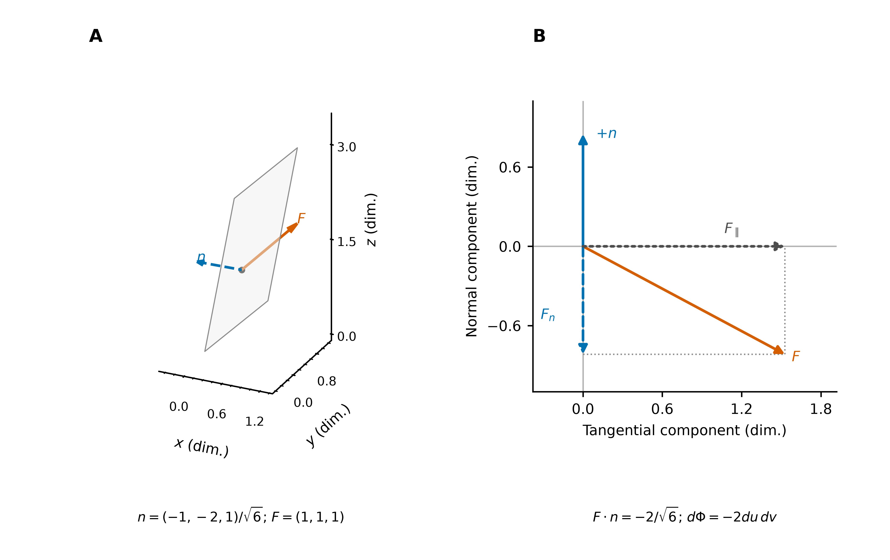

# 积分元素

从局部几何量到积分贡献：先确定长度、面积或体积，再根据问题保留切向或法向。

| 统一视角 | 标量积分元素 | 有向积分元素 |
| --- | --- | --- |
| 维度、坐标与局部线性映射 | 弧长 $ds$、面积 $dA,dS$、体积 $dV$ | 向量线元 $d\mathbf r$、向量面积元 $d\mathbf S$ |

> 微分算子的概念见 [多元微分学详解](../../02_多元微分学/02_微分与全微分/多元微分学详解.md)，整体边界关系见 [积分定理](../04_三大积分定理/积分定理：从内部微分到边界积分.md)。[配图与生成脚本](image/积分元素/README.md) 提供矢量 PDF、SVG 和高清 PNG。

## 1. 统一视角

### 1.1 积分元素与维度

积分通过分割、局部加权求和与取极限，将局部量累积为整体量。积分元素描述每个局部几何块的大小；有向积分元素进一步保留选定的取向。

| 对象自身的维数 | 几何对象 | 标量元素 | 常见有向元素 |
| --- | --- | --- | --- |
| 一维 | 平面或空间曲线 | 弧长 $ds$ | $d\mathbf r=\mathbf t\,ds$ |
| 二维 | 平面区域或空间曲面 | 面积 $dA$ 或 $dS$ | 在三维空间中为 $d\mathbf S=\mathbf n\,dS$ |
| 三维 | 空间区域 | 体积 $dV$ | 有向体积由标量混合积或三阶形式描述 |

对象的维数与所在空间的维数不同：空间曲线是一维对象，空间曲面是二维对象。体积元不会因为位于三维空间就成为三分量向量。本文主要讨论 $\mathbb R^2,\mathbb R^3$；一般维数中的有向元素不一定能表示为普通向量。

$ds,dA,dS,dV$ 是非负几何测度的微元；$\mathbf t,\mathbf n$ 分别为选定的单位切向量、单位法向量。反转取向使相应有向元素变号，几何大小与同一点的场值不变。

全文默认曲线、曲面分片 $C^1$，在正则片上满足 $\mathbf r'\ne0$ 或 $\mathbf r_u\times\mathbf r_v\ne0$。参数积分中的 $dt,du\,dv,du\,dv\,dw$ 作为正测度；沿路径的坐标微分 $dx,dy,dz$ 则可以带符号。

### 1.2 坐标系与参数化

坐标把参数网格映到实际空间。**几何量不依赖坐标选择，但微元的坐标表达与伸缩因子会改变**。例如，同一平面面积元在直角坐标中为 $dx\,dy$，在极坐标中为 $r\,dr\,d\theta$；参数矩形 $dr\,d\theta$ 本身并不是实际面积。

**图 1**：直角、极、柱、球坐标的空间视图。角坐标改变时，点沿圆周运动；同一角增量对应的实际长度取决于该圆的半径。

| 坐标系 | 到直角坐标的映射 | 参数及约定 |
| --- | --- | --- |
| 直角坐标 | $(x,y,z)$ | 三个固定的正交方向 |
| 极坐标 | $x=r\cos\theta,\ y=r\sin\theta$ | $r\ge0$，$\theta$ 为自 $+x$ 轴逆时针量起的方位角 |
| 柱坐标 | $x=r\cos\theta,\ y=r\sin\theta,\ z=z$ | $r$ 为到 $z$ 轴的距离 |
| 球坐标 | $x=r\sin\varphi\cos\theta,\ y=r\sin\varphi\sin\theta,\ z=r\cos\varphi$ | $r$ 为到原点的距离；$\varphi\in[0,\pi]$ 自 $+z$ 轴量起 |

方位角通常取 $\theta\in[0,2\pi)$。反算时，柱坐标径向量为 $\sqrt{x^2+y^2}$，球坐标径向量为 $\sqrt{x^2+y^2+z^2}$；方位角用 $\operatorname{atan2}(y,x)$ 判断象限，球坐标极角可写为 $\operatorname{atan2}(\sqrt{x^2+y^2},z)$。在轴线、原点或球面两极，相应角坐标可能无定义，所用坐标图也可能退化；这不意味着几何对象本身消失。

一般曲线写为 $\mathbf r(t)$，一般曲面写为 $\mathbf r(u,v)$。参数化的作用相同：用一维或二维参数网格描述几何对象，随后计算网格在空间中的实际伸缩。整体积分须检查覆盖次数；曲面分片参数化时，应避免重复计数。

### 1.3 几何方法与坐标变换

几何方法先构造切向线段、平行四边形和小盒子，再量出长度、面积或体积。坐标变换方法将参数化在一点附近线性化，系统地计算这些量。

设 $\mathbf x=\mathbf T(\mathbf u)$，$J=D\mathbf T$。局部有

$$
\mathbf T(\mathbf u+\Delta\mathbf u)-\mathbf T(\mathbf u)
=J(\mathbf u)\Delta\mathbf u+o(\|\Delta\mathbf u\|).
$$

$J$ 的列向量 $\mathbf b_i=\partial\mathbf T/\partial u_i$ 是各参数方向的切向量，不一定是单位向量。它们决定线性近似块的边及夹角。由内积得到度量矩阵

$$
G=J^{\mathsf T}J,\qquad g_{ij}=\mathbf b_i\cdot\mathbf b_j,
\qquad ds^2=d\mathbf u^{\mathsf T}G\,d\mathbf u.
$$

对于满列秩的 $n\times k$ 参数 Jacobian，$k$ 维大小的伸缩因子统一为 $\sqrt{\det(J^{\mathsf T}J)}$。正方形 Jacobian 的情形退化为 $|\det J|$；具体应用见第 2 节。

若坐标基两两正交，记尺度因子 $h_i=\|\mathbf b_i\|$，则沿单条坐标线的长度为 $h_i|du_i|$。常用坐标系的尺度因子如下：

| 坐标顺序 | 尺度因子 |
| --- | --- |
| $(x,y,z)$ | $(1,1,1)$ |
| $(r,\theta)$，极坐标 | $(1,r)$ |
| $(r,\theta,z)$，柱坐标 | $(1,r,1)$ |
| $(r,\theta,\varphi)$，球坐标 | $(1,r\sin\varphi,r)$ |

例如球坐标中，极角方向沿半径 $r$ 的经线，长度为 $r|d\varphi|$；方位角方向沿半径 $r\sin\varphi$ 的纬线，长度为 $r\sin\varphi|d\theta|$。

因此，两种方法的对应关系是：**参数方向给出切向边，内积确定长度与夹角，叉积确定面积及法向，混合积确定体积**。正交时可以直接相乘棱长；非正交时必须保留夹角。

微元公式给出精确的积分密度；用某点密度乘以有限参数步长估计曲边小块时，才产生近似误差。下文的几何图用有限箭长显示微元，不应将箭头与原曲线上的有限弧混同。

## 2. 标量积分元素

### 2.1 弧长元素 $ds$

**几何直观。** 在一点附近用切向线段近似曲线，弧长元素就是该线段的长度。直角坐标中由勾股定理得到；曲线坐标中，先把每个坐标增量换算为实际位移，再合成长度。

**图 2**：A 的直角坐标位移沿三条正交棱；B 的极坐标位移沿径向与圆周切向；C 的球坐标位移沿径向、经线与纬线切向。合成位移的长度均由正交分量的平方和给出；彩色棱同时标注坐标，灰度下可辨识。

| 坐标系 | 弧长的坐标表达 | 几何分量 |
| --- | --- | --- |
| 直角坐标 | $ds^2=dx^2+dy^2+dz^2$ | 三个固定正交方向；平面情形删去 $dz$ |
| 极坐标 | $ds^2=dr^2+r^2d\theta^2$ | 径向位移与半径为 $r$ 的圆周切向位移 |
| 柱坐标 | $ds^2=dr^2+r^2d\theta^2+dz^2$ | 极坐标的两项加轴向位移 |
| 球坐标 | $ds^2=dr^2+r^2d\varphi^2+r^2\sin^2\varphi\,d\theta^2$ | 径向、经线切向、纬线切向 |

**坐标变换。** 对参数递增的曲线 $\mathbf r(t)=(x(t),y(t),z(t))^T$，

$$
\boxed{ds=\|\mathbf r'(t)\|\,dt
=\sqrt{x'^2+y'^2+z'^2}\,dt}.
$$

若曲线先在坐标域写为 $\mathbf u=\mathbf q(t)$，则 $\mathbf r'=J\mathbf q'$，故

$$
ds=\sqrt{\mathbf q'^{\mathsf T}G\mathbf q'}\,dt.
$$

这说明上表的勾股关系来自正交坐标下的对角度量；一般非正交坐标中还会出现交叉项。

例如极坐标曲线 $r=r(\theta)$ 满足

$$
ds=\sqrt{r'(\theta)^2+r(\theta)^2}\,d\theta,\qquad
L=\int_{\theta_1}^{\theta_2}\sqrt{r'^2+r^2}\,d\theta.
$$

对标量线密度 $f$，第一类曲线积分为 $\int_C f\,ds=\int_a^b f(\mathbf r(t))\|\mathbf r'(t)\|\,dt$。反向走同一条曲线不改变此积分；若有意重复行走，则按实际行程累计。

### 2.2 面积元素 $dA,dS$

**几何直观。** 平面区域与空间曲面都是二维对象。两条切向边张成的平行四边形面积为“边长乘积 × 夹角的正弦”；正交时才可直接相乘边长。

极坐标小块近似为边长 $dr,r\,d\theta$ 的矩形；柱面小块的边长为 $R\,d\theta,dz$；球面小块的边长为 $R\,d\varphi,R\sin\varphi\,d\theta$。

**图 3**：A 为极坐标环形扇区及其切向矩形近似；B、C 分别为球面与柱面微块。几何因子来自实际弧长，不能把角增量本身当作长度。

一般参数曲面的小块由切平行四边形近似：

**图 4**：A 为参数域小矩形；B 的两条切向边为 $\mathbf r_u\,du,\mathbf r_v\,dv$；C 展示图像曲面向 $xy$ 平面的投影。曲面面积的伸缩由切平行四边形的面积决定。

**坐标变换。** 平面映射 $(u,v)\mapsto(x,y)$ 与空间参数曲面 $\mathbf r(u,v)$ 分别满足

$$
\boxed{dA=\left|\frac{\partial(x,y)}{\partial(u,v)}\right|du\,dv},
\qquad
\boxed{dS=\|\mathbf r_u\times\mathbf r_v\|\,du\,dv}.
$$

前者的二维行列式与后者的叉积模均为面积伸缩因子。例如极坐标映射的 Jacobian 为

$$
J_{\rm 极}=
\begin{pmatrix}\cos\theta&-r\sin\theta\\
\sin\theta&r\cos\theta\end{pmatrix},\qquad
\det J_{\rm 极}=r,
$$

因而 $dA=r\,dr\,d\theta$，与环形扇区的几何构造一致。对参数曲面，记第一基本形式的系数

$$
E=\mathbf r_u\cdot\mathbf r_u,\quad
F=\mathbf r_u\cdot\mathbf r_v,\quad
G_s=\mathbf r_v\cdot\mathbf r_v,
$$

则由拉格朗日恒等式得到

$$
\|\mathbf r_u\times\mathbf r_v\|
=\sqrt{EG_s-F^2}
=\sqrt{\det\bigl((D\mathbf r)^{\mathsf T}D\mathbf r\bigr)}.
$$

这里 $F$ 为标量系数，与后文的向量场 $\mathbf F$ 不同。

| 对象与参数 | 标量面积元 |
| --- | --- |
| 平面直角坐标 $(x,y)$ | $dA=dx\,dy$ |
| 平面极坐标 $(r,\theta)$ | $dA=r\,dr\,d\theta$ |
| 图像曲面 $z=g(x,y)$ | $dS=\sqrt{1+g_x^2+g_y^2}\,dx\,dy$ |
| 图像曲面 $x=g(y,z)$ | $dS=\sqrt{1+g_y^2+g_z^2}\,dy\,dz$ |
| 图像曲面 $y=g(x,z)$ | $dS=\sqrt{1+g_x^2+g_z^2}\,dx\,dz$ |
| 柱面 $r=R$，参数 $(\theta,z)$ | $dS=R\,d\theta\,dz$ |
| 球面 $r=R$，参数 $(\varphi,\theta)$ | $dS=R^2\sin\varphi\,d\varphi\,d\theta$ |

例如 $z=g(x,y)$ 的切向量为 $(1,0,g_x)^T,(0,1,g_y)^T$，叉积为 $(-g_x,-g_y,1)^T$，取模即得到上表。倾斜使实际面积大于水平投影面积。

极坐标有限小块的精确面积为
$\tfrac12[(r+\Delta r)^2-r^2]\Delta\theta
=r\Delta r\Delta\theta+\tfrac12(\Delta r)^2\Delta\theta$；
微元对应首项，后项比首项高一阶。球面微块的两条纬线边长度也略有不同，面积元使用当前点的切向尺度。

对标量面密度 $f$，第一类曲面积分为

$$
\iint_S f\,dS
=\iint_U f(\mathbf r(u,v))\|\mathbf r_u\times\mathbf r_v\|\,du\,dv.
$$

选相反法向不改变面积或第一类曲面积分；被积密度为负时，积分仍可为负。

### 2.3 体积元素 $dV$

**几何直观。** 三条局部坐标边张成平行六面体。正交时是长方体，体积为三条棱长的乘积；一般情形用底面积乘垂直高度。

**图 5**：A 为直角坐标长方体；B 为柱坐标扇形柱体；C 为球壳微块，其两面为球面、两面为圆锥面、两面为过轴半平面。三条局部棱长分别来自对应坐标方向的尺度因子。

对三条独立小边 $\mathbf a,\mathbf b,\mathbf c$，令
$\mathbf n=(\mathbf a\times\mathbf b)/\|\mathbf a\times\mathbf b\|$，则

$$
V=\underbrace{\|\mathbf a\times\mathbf b\|}_{\text{底面积}}\,
\underbrace{|\mathbf c\cdot\mathbf n|}_{\text{垂直高度}}
=|(\mathbf a\times\mathbf b)\cdot\mathbf c|.
$$

**图 6**：A 展示斜平行六面体；B 是第三条边与底面法向构成的截面。第三条边的平行分量不贡献高度。图取 $\mathbf a=(1.3,0,0)^T,\mathbf b=(0.4,1,0)^T,\mathbf c=(0.5,0.3,1.2)^T$，底面积 $1.3$、高度 $1.2$、体积 $1.56$。

**坐标变换。** 对正则 $C^1$ 映射 $\mathbf x=\mathbf T(u,v,w)$，三条切向边代入混合积，得到

$$
\boxed{dV=
\left|\mathbf T_u\cdot(\mathbf T_v\times\mathbf T_w)\right|du\,dv\,dw
=|\det J|\,du\,dv\,dw}.
$$

正交时 $|\det J|=h_uh_vh_w$。例如柱坐标与球坐标的 Jacobian 分别为

$$
J_{\rm 柱}=
\begin{pmatrix}
\cos\theta&-r\sin\theta&0\\
\sin\theta&r\cos\theta&0\\
0&0&1
\end{pmatrix},
$$

$$
J_{\rm 球}=
\begin{pmatrix}
\sin\varphi\cos\theta&-r\sin\varphi\sin\theta&r\cos\varphi\cos\theta\\
\sin\varphi\sin\theta&r\sin\varphi\cos\theta&r\cos\varphi\sin\theta\\
\cos\varphi&0&-r\sin\varphi
\end{pmatrix},
$$

其列顺序分别为 $(r,\theta,z)$ 与 $(r,\theta,\varphi)$。因此

| 坐标 | 有向 Jacobian 行列式 | 非负体积元 |
| --- | --- | --- |
| 直角坐标 | $1$ | $dx\,dy\,dz$ |
| 柱坐标 $(r,\theta,z)$ | $r$ | $r\,dr\,d\theta\,dz$ |
| 球坐标 $(r,\theta,\varphi)$ | $-r^2\sin\varphi$ | $r^2\sin\varphi\,dr\,d\theta\,d\varphi$ |

球坐标若改按 $(r,\varphi,\theta)$ 排列，行列式变为正；标量体积元始终使用绝对值。参数取向与普通累次积分的 Fubini 换序不同，后者本身不使体积变号。

有限柱坐标微块与球坐标微块的精确体积分别为

$$
V_{\rm 柱}=\tfrac12[(r+\Delta r)^2-r^2]\Delta\theta\Delta z,
$$

$$
V_{\rm 球}=\tfrac13[(r+\Delta r)^3-r^3]
[\cos\varphi-\cos(\varphi+\Delta\varphi)]\Delta\theta.
$$

若三条局部棱长均按 $h$ 缩小，则各体积主项为 $O(h^3)$，误差通常为 $O(h^4)$，相对误差为 $O(h)$。例如 $r=1,\varphi=0.8$，柱坐标取 $\Delta r=\Delta z=h,\Delta\theta=h/r$，球坐标取 $\Delta r=h,\Delta\varphi=h/r,\Delta\theta=h/(r\sin\varphi)$：

| 相对误差 $|V_{\rm exact}-V_0|/V_{\rm exact}$ | $h=0.02$ | $h=0.01$ | $h=0.005$ |
| --- | --- | --- | --- |
| 柱坐标微块 | $9.90\times10^{-3}$ | $4.98\times10^{-3}$ | $2.49\times10^{-3}$ |
| 球坐标微块 | $2.91\times10^{-2}$ | $1.47\times10^{-2}$ | $7.39\times10^{-3}$ |

误差随步长减半而约减半。对标量体密度 $f$，合法的一一换元给出
$\iiint_\Omega f\,dV=\iiint_U f(\mathbf T(\mathbf u))|\det J|\,d\mathbf u$。

至此，标量元素可统一为：一条边取长度，两条边取面积，三条边取体积；正交时分别使用尺度因子的平方和或乘积，非正交时使用度量、叉积或混合积。

## 3. 有向积分元素

### 3.1 向量线元 $d\mathbf r$

向量线元是**沿曲线切向的位移微元**：大小为弧长微元 $ds$，方向为选定的单位切向 $\mathbf T$。它的坐标为什么就是各方向的位移微元？可以从两个角度理解。

**① 给弧长加上方向。** 对沿取向递增的正则参数 $t$，$\mathbf T=\mathbf r'/\|\mathbf r'\|$，$ds=\|\mathbf r'\|\,dt$，于是

$$
\begin{aligned}
d\mathbf r
&=\mathbf T\,ds\\
&=\frac{\mathbf r'(t)}{\|\mathbf r'(t)\|}\,\|\mathbf r'(t)\|\,dt\\
&=\mathbf r'(t)\,dt.
\end{aligned}
$$

**② 看各坐标方向的投影。** 同一位移在 $x,y$ 方向的有符号投影分别是 $dx,dy$；将两分量首尾相接，就还原出原位移：

$$
\boxed{d\mathbf r=dx\,\mathbf e_x+dy\,\mathbf e_y=(dx,dy)^T}.
$$

**图 7**：A 用单位切向 $\mathbf T$ 指定方向、用 $ds$ 指定长度，得到 $d\mathbf r$；B 将同一线元正交投影到坐标方向，$dx\,\mathbf e_x$ 与 $dy\,\mathbf e_y$ 首尾相接合成 $d\mathbf r$。箭长仅为微元的放大示意。

因此，具体坐标形式只需逐分量求微分：

| 空间 | 参数曲线 | 向量线元 |
| --- | --- | --- |
| 二维 | $\mathbf r(t)=(x(t),y(t))^T$ | $d\mathbf r=(x'\,dt,y'\,dt)^T=(dx,dy)^T$ |
| 三维 | $\mathbf r(t)=(x(t),y(t),z(t))^T$ | $d\mathbf r=(x'\,dt,y'\,dt,z'\,dt)^T=(dx,dy,dz)^T$ |

反向时 $d\mathbf r$ 变号，$ds$ 不变；如何用线元构造积分，见[曲线积分](../02_曲线积分/曲线积分.md)。

### 3.2 向量面积元：法向投影与通量

**从物理定义到面积向量。** 设均匀速度 $\mathbf v$ 穿过固定平面片，片的面积为 $A$，指定单位法向为 $\mathbf n$。在时间 $\Delta t$ 内，穿过的有向体积为
$(\mathbf v\cdot\mathbf n)\Delta t\,A$；除以时间得到体积流率

$$
\Phi=(\mathbf v\cdot\mathbf n)A
=\mathbf v\cdot
\underbrace{(A\mathbf n)}_{\text{面积向量 }\mathbf A}.
$$

这就是“法向有符号投影 × 面积”。切向速度只使流体沿片移动，不产生穿过量；反向穿过则贡献为负。本文以 $S$ 表示曲面集合，以 $A$ 表示有限平面片的面积，避免二者混淆。

对一般向量场，写为

$$
\mathbf F:\Omega\subset\mathbb R^3\longrightarrow\mathbb R^3,\qquad
\mathbf F(x,y,z)=
\begin{pmatrix}P(x,y,z)\\Q(x,y,z)\\R(x,y,z)\end{pmatrix}.
$$

若 $\mathbf F=\mathbf v$，通量是体积流率；若 $\mathbf F=\rho\mathbf v$，通量是质量流率。抽象的向量场也可定义通量，但物理单位和意义由场本身决定。

**图 8**：A 在“速度—法向”平面中将速度分解为法向与切向分量；B 显示平面片在一个时间间隔内对应的斜棱柱，底面积为 $A$，法向高度为 $(\mathbf v\cdot\mathbf n)\Delta t$。沿流向的斜边长度不是用于计算体积的垂直高度。图为无量纲解析示意，流率单位在正文定义。

**局部化：分别确定法向与面积。** 对弯曲的定向曲面，各点法向和场值通常不同，不能用一个总面积向量代替逐点积分。将平面片公式用于各点的切平面：

$$
\boxed{d\mathbf S=\mathbf n\,dS,\qquad
d\Phi=(\mathbf F\cdot\mathbf n)dS=\mathbf F\cdot d\mathbf S},
\qquad
\Phi=\iint_S\mathbf F\cdot d\mathbf S.
$$

这里 $dS$ 是第 2 节定义的非负面积元，$\mathbf n$ 是所选侧的单位法向。反转法向使 $d\mathbf S$ 与通量变号，标量面积不变。

给定正则参数曲面 $\mathbf r(u,v)$，两条切向量 $\mathbf r_u,\mathbf r_v$ 张成切平面。取法向与其有序叉积同向，则

$$
\underbrace{\mathbf n=
\frac{\mathbf r_u\times\mathbf r_v}
{\|\mathbf r_u\times\mathbf r_v\|}}_{\text{方向}},
\qquad
\underbrace{dS=\|\mathbf r_u\times\mathbf r_v\|\,du\,dv}_{\text{大小}},
$$

$$
\boxed{d\mathbf S=
\frac{\mathbf r_u\times\mathbf r_v}{\|\mathbf r_u\times\mathbf r_v\|}
\|\mathbf r_u\times\mathbf r_v\|\,du\,dv
=(\mathbf r_u\times\mathbf r_v)\,du\,dv}.
$$

叉积先构造有向面积；随后与场点积才得到通量。若题设法向与叉积相反，整体加负号。已有 $\mathbf n\,dS$ 或叉积形式后，不应再次乘面积伸缩因子。

**图 9**：A 的参数矩形映到 B 的曲边片；B 在当前点画出切向边、切平行四边形与法向。例取 $z=0.4u^2+0.3v^2$，在 $(u,v)=(0.5,0.4)$ 处有 $\mathbf r_u=(1,0,0.4)^T$、$\mathbf r_v=(0,1,0.24)^T$，叉积为 $(-0.4,-0.24,1)^T$。叉积的模决定面积密度，归一化后才是单位法向；图中箭长为阅读缩放。

**坐标展开：三个有向投影。** 将叉积按分量展开：

$$
d\mathbf S=
\begin{pmatrix}
y_u z_v-y_v z_u\\
z_u x_v-z_v x_u\\
x_u y_v-x_v y_u
\end{pmatrix}du\,dv
=
\begin{pmatrix}
\dfrac{\partial(y,z)}{\partial(u,v)}\\[2pt]
\dfrac{\partial(z,x)}{\partial(u,v)}\\[2pt]
\dfrac{\partial(x,y)}{\partial(u,v)}
\end{pmatrix}du\,dv
=\begin{pmatrix}dS_x\\dS_y\\dS_z\end{pmatrix}.
$$

三个分量分别为 $yz,zx,xy$ 平面的有向投影面积元，例如 $dS_x=n_xdS$。它们属于同一个曲面片，符号由取向决定，绝对值才是对应投影的面积大小。

**图 10**：对 $\mathbf r(u,v)=(u,v,u+2v)^T$，叉积为 $(-1,-2,1)^T$。三个投影的有向面积依次为 $-du\,dv,-2du\,dv,+du\,dv$；B–D 按 $yz,zx,xy$ 坐标顺序绘制，前两幅沿参数边界走向为顺时针，后一幅为逆时针。实际面积元为 $\sqrt6\,du\,dv$，不会取负。

因此，与向量场的点积可完整写成

$$
\boxed{d\Phi=P\,dS_x+Q\,dS_y+R\,dS_z
=\left[
P\frac{\partial(y,z)}{\partial(u,v)}
+Q\frac{\partial(z,x)}{\partial(u,v)}
+R\frac{\partial(x,y)}{\partial(u,v)}
\right]du\,dv}.
$$

$P,Q,R$ 均在 $\mathbf r(u,v)$ 处取值。传统第二类曲面积分记号写为
$P\,dy\,dz+Q\,dz\,dx+R\,dx\,dy$，各项指相应的有向投影；不能按三个独立的无符号面积处理。

**常用曲面的具体微元。** 图像曲面可直接由两个坐标方向求叉积；坐标曲面可由相应单位法向乘标量面积元：

| 曲面及指定法向 | 单位法向 $\mathbf n$ | 向量面积元 $d\mathbf S$ |
| --- | --- | --- |
| $z=g(x,y)$，向上 | $\dfrac{(-g_x,-g_y,1)^T}{\sqrt{1+g_x^2+g_y^2}}$ | $(-g_x,-g_y,1)^Tdx\,dy$ |
| $x=g(y,z)$，朝 $+x$ | $\dfrac{(1,-g_y,-g_z)^T}{\sqrt{1+g_y^2+g_z^2}}$ | $(1,-g_y,-g_z)^Tdy\,dz$ |
| $y=g(x,z)$，朝 $+y$ | $\dfrac{(-g_x,1,-g_z)^T}{\sqrt{1+g_x^2+g_z^2}}$ | $(-g_x,1,-g_z)^Tdx\,dz$ |
| 柱面 $r=R$，向外 | $\mathbf e_r=(\cos\theta,\sin\theta,0)^T$ | $\mathbf e_rR\,d\theta\,dz$ |
| 球面 $r=R$，向外 | $\mathbf e_r=(\sin\varphi\cos\theta,\sin\varphi\sin\theta,\cos\varphi)^T$ | $\mathbf e_rR^2\sin\varphi\,d\varphi\,d\theta$ |

这里参数面积测度为正，指定法向由向量系数体现。柱面按 $(\theta,z)$ 顺序求叉积向外；球面按 $(\varphi,\theta)$ 顺序向外，交换顺序后向内。

**图 11**：A 的 $\mathbf r_\theta\times\mathbf r_z$ 与 B 的 $\mathbf r_\varphi\times\mathbf r_\theta$ 均沿径向向外。蓝色实线、红色虚线表示有序的两个切向，黑箭头为外法向。交换切向顺序改变取向，不改变面积。

一般正交坐标的坐标面 $u_i=\mathrm{const}$ 上，指定法向为 $\pm\mathbf e_i$ 时，
$d\mathbf S=\pm\mathbf e_i h_jh_k\,du_j\,du_k$，
通量微元为 $\pm F_i h_jh_k\,du_j\,du_k$。若用叉积构造，须另外核对坐标基的取向。

**完整算例：从场、法向、面积到通量。** 取向上参数片
$\mathbf r(u,v)=(u,v,u+2v)^T$，$0\le u,v\le1$，以及常向量场 $\mathbf F=(1,1,1)^T$。分别求得

$$
\mathbf n=\frac{(-1,-2,1)^T}{\sqrt6},\quad
dS=\sqrt6\,du\,dv,\quad
\mathbf F\cdot\mathbf n=-\frac2{\sqrt6}.
$$

故

$$
d\Phi=
\underbrace{\left(-\frac2{\sqrt6}\right)}_{\text{法向有符号分量}}
\underbrace{\sqrt6\,du\,dv}_{\text{面积}}
=-2\,du\,dv,\qquad
\Phi=\int_0^1\int_0^1(-2)\,du\,dv=-2.
$$

同一结果可直接由 $\mathbf F\cdot(\mathbf r_u\times\mathbf r_v)$ 得到。场的法向投影与指定法向相反，因此通量为负。

**图 12**：A 在同一点画出倾斜面、原场与向上法向；B 在法向和场的切向分量张成的平面中作真实正交分解。蓝色正向为 $\mathbf n$，原场的法向分量沿反向，标量分量为 $-2/\sqrt6$。切向分量虽非零，却不贡献通量；B 中各向量使用同一尺度。

第一类曲面积分给出面积 $\iint_S1\,dS=\sqrt6$，与通量 $-2$ 不同。若改为 $\mathbf F=(0,0,1)^T$，通量为 $1$，等于水平投影面积；若改为 $\mathbf F=(x,y,z)^T$，在该平面上场处处切向，通量为 $0$。反转法向仅使这些通量变号。

**微分形式与积分定理。** 以上 $d\mathbf S$ 是向量面积元的微分记号。严格的标量二形式写为

$$
\omega_{\mathbf F}
=P\,dy\wedge dz+Q\,dz\wedge dx+R\,dx\wedge dy.
$$

楔积满足 $dy\wedge dz=-dz\wedge dy$。在参数曲面上，

$$
\mathbf r^*(dy\wedge dz)
=(y_u z_v-y_v z_u)\,du\wedge dv,
$$

其余两项同理，故 $\iint_S\omega_{\mathbf F}=\iint_S\mathbf F\cdot d\mathbf S$，两种语言给出相同的通量。这里的反对称性来自取向；普通无符号测度 $du\,dv$ 的积分换序不变号。叉积、楔积与矩阵形式的张量外积 $\mathbf a\mathbf b^{\mathsf T}$ 是不同运算。

实际计算时，曲面通量完整代入为

$$
\iint_S\mathbf F\cdot d\mathbf S
=\iint_U\mathbf F(\mathbf r(u,v))
\cdot(\mathbf r_u\times\mathbf r_v)\,du\,dv.
$$

两类曲线、曲面积分的区别可集中对照：

| 积分 | 几何微元 | 参数化后的局部贡献 |
| --- | --- | --- |
| 第一类曲线积分 | 标量 $ds$ | $f(\mathbf r)\|\mathbf r'\|\,dt$ |
| 第二类曲线积分 | 向量 $d\mathbf r$ | $\mathbf F(\mathbf r)\cdot\mathbf r'\,dt$ |
| 第一类曲面积分 | 标量 $dS$ | $f(\mathbf r)\|\mathbf r_u\times\mathbf r_v\|\,du\,dv$ |
| 第二类曲面积分 | 向量 $d\mathbf S$ | $\mathbf F(\mathbf r)\cdot(\mathbf r_u\times\mathbf r_v)\,du\,dv$ |

表中结果均为标量。向量场也可对 $ds$ 或 $dS$ 逐分量积分，结果为向量；$\int_C\mathbf F\times d\mathbf r$ 同样是另一种向量值积分。这些运算不等同于通常的功积分或通量积分，须由所求物理量决定。

最后，散度与旋度使用这些微元建立局部与整体的联系：

$$
\oiint_{\partial\Omega}\mathbf F\cdot d\mathbf S
=\iiint_\Omega(\nabla\cdot\mathbf F)\,dV,
\qquad
\oint_{\partial S}\mathbf F\cdot d\mathbf r
=\iint_S(\nabla\times\mathbf F)\cdot d\mathbf S.
$$

前式累积原场的向外通量，后式累积旋度场的法向分量；二者分别对应净源强与边界环流。它们是满足光滑性与定向条件后的积分关系，不是边界微元和内部微元的逐点等式。局部极限与分量推导见 [多元微分学详解](../../02_多元微分学/02_微分与全微分/多元微分学详解.md)，区域、边界、定向及定理条件见 [积分定理](../04_三大积分定理/积分定理：从内部微分到边界积分.md)。

计算应用：[重积分](重积分：区域、累次积分与换元.md) 使用面积、体积权重；[曲线积分](../02_曲线积分/曲线积分.md) 使用弧长或有向位移；[曲面积分](../03_曲面积分/曲面积分：曲面累积与穿面通量.md) 使用面积或有向面积。

[返回重积分目录](README.md) · [多元微分学详解](../../02_多元微分学/02_微分与全微分/多元微分学详解.md) · [积分定理](../04_三大积分定理/README.md)
