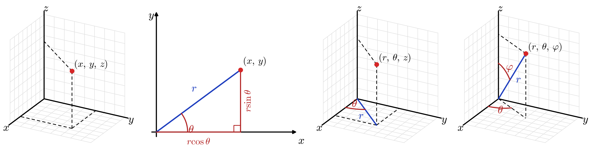
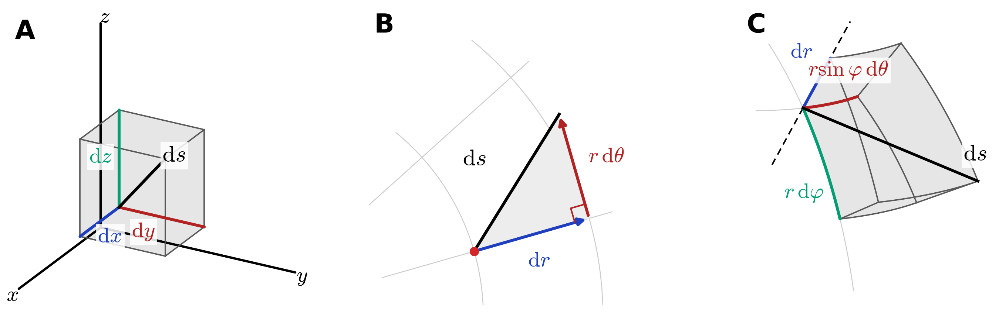
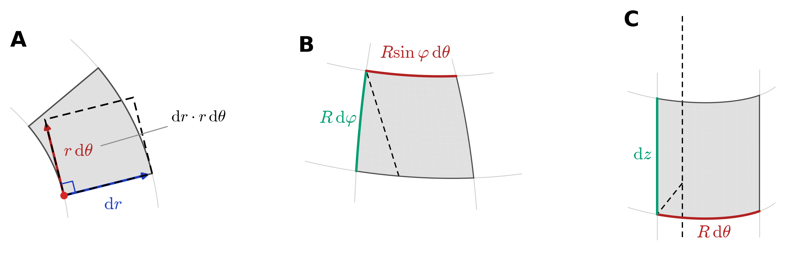
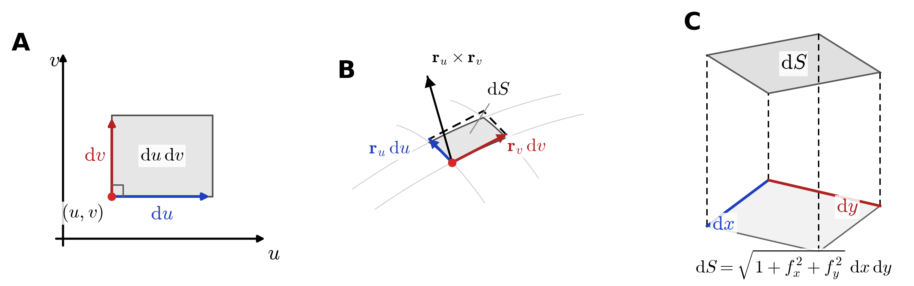
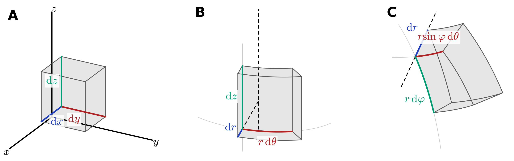
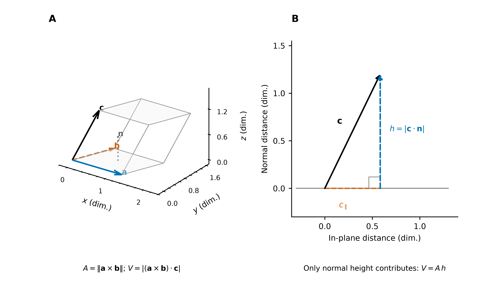
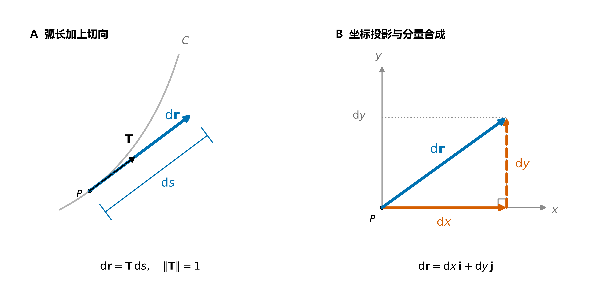
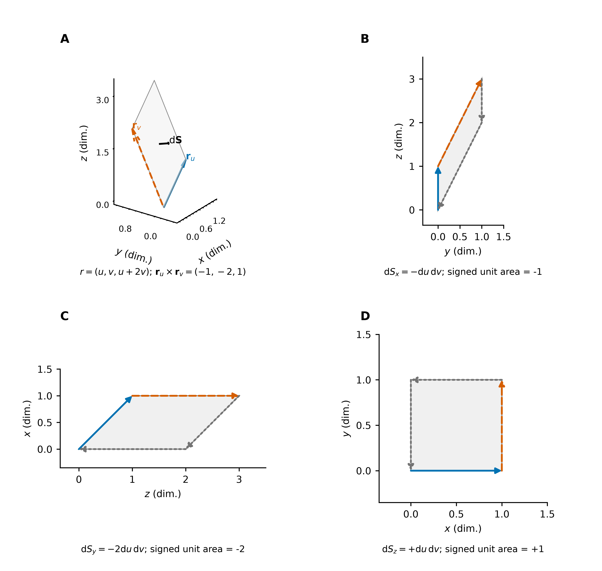
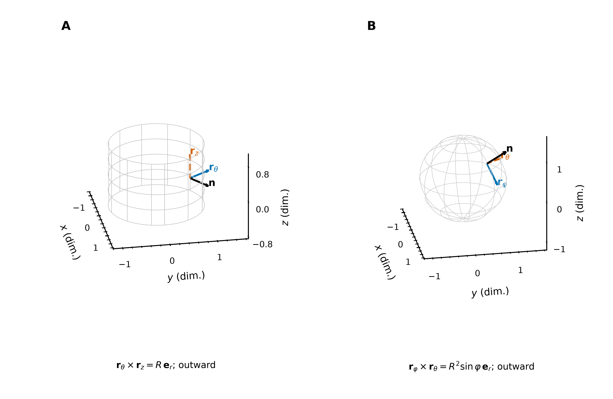

# 积分元素

从局部几何量到积分贡献：先确定长度、面积或体积，再根据问题保留切向或法向。

| 统一视角 | 标量积分元素 | 有向积分元素 |
| --- | --- | --- |
| 维度、坐标与局部线性映射 | 弧长 $\mathrm ds$、面积 $\mathrm dA,\mathrm dS$、体积 $\mathrm dV$ | 向量线元 $\mathrm d\mathbf r$、向量面积元 $\mathrm d\mathbf S$ |

> 微分算子的概念见 [多元微分学详解](../../02_多元微分学/02_微分与全微分/多元微分学详解.md)，整体边界关系见 [积分定理](../04_三大积分定理/积分定理：从内部微分到边界积分.md)。[配图与生成脚本](image/积分元素/README.md) 提供矢量 PDF、SVG 和高清 PNG。

## 1. 统一视角

### 1.1 积分元素与维度

积分通过分割、局部加权求和与取极限，将局部量累积为整体量。积分元素描述每个局部几何块的大小；有向积分元素进一步保留选定的取向。

| 对象自身的维数 | 几何对象 | 标量元素 | 常见有向元素 |
| --- | --- | --- | --- |
| 一维 | 平面或空间曲线 | 弧长 $\mathrm ds$ | $\mathrm d\mathbf r=\mathbf T\,\mathrm ds$ |
| 二维 | 平面区域或空间曲面 | 面积 $\mathrm dA$ 或 $\mathrm dS$ | 在三维空间中为 $\mathrm d\mathbf S=\mathbf n\,\mathrm dS$ |
| 三维 | 空间区域 | 体积 $\mathrm dV$ | 有向体积由标量混合积或三阶形式描述 |

对象的维数与所在空间的维数不同：空间曲线是一维对象，空间曲面是二维对象。体积元不会因为位于三维空间就成为三分量向量。本文主要讨论 $\mathbb R^2,\mathbb R^3$；一般维数中的有向元素不一定能表示为普通向量。

$\mathrm ds,\mathrm dA,\mathrm dS,\mathrm dV$ 是非负几何测度的微元；$\mathbf T,\mathbf n$ 分别为选定的单位切向量、单位法向量。反转取向使相应有向元素变号，几何大小与同一点的场值不变。

全文默认曲线、曲面分片 $C^1$，在正则片上满足 $\mathbf r'\ne0$ 或 $\mathbf r_u\times\mathbf r_v\ne0$。参数积分中的 $\mathrm dt,\mathrm du\,\mathrm dv,\mathrm du\,\mathrm dv\,\mathrm dw$ 作为正测度；沿路径的坐标微分 $\mathrm dx,\mathrm dy,\mathrm dz$ 则可以带符号。

### 1.2 坐标系与参数化

坐标把参数网格映到实际空间。**几何量不依赖坐标选择，但微元的坐标表达与伸缩因子会改变**。例如，同一平面面积元在直角坐标中为 $\mathrm dx\,\mathrm dy$，在极坐标中为 $r\,\mathrm dr\,\mathrm d\theta$；参数矩形 $\mathrm dr\,\mathrm d\theta$ 本身并不是实际面积。

**图 1**：直角、极、柱、球坐标的空间视图。角坐标改变时，点沿圆周运动；同一角增量对应的实际长度取决于该圆的半径。

| 坐标系 | 到直角坐标的映射 | 参数及约定 |
| --- | --- | --- |
| 直角坐标 | $(x,y,z)$ | 三个固定的正交方向 |
| 极坐标 | $x=r\cos\theta,\ y=r\sin\theta$ | $r\ge0$，$\theta$ 为自 $+x$ 轴逆时针量起的方位角 |
| 柱坐标 | $x=r\cos\theta,\ y=r\sin\theta,\ z=z$ | $r$ 为到 $z$ 轴的距离 |
| 球坐标 | $x=r\sin\varphi\cos\theta,\ y=r\sin\varphi\sin\theta,\ z=r\cos\varphi$ | $r$ 为到原点的距离；$\varphi\in[0,\pi]$ 自 $+z$ 轴量起 |

方位角通常取 $\theta\in[0,2\pi)$。反算时，柱坐标径向量为 $\sqrt{x^2+y^2}$，球坐标径向量为 $\sqrt{x^2+y^2+z^2}$；方位角用 $\operatorname{atan2}(y,x)$ 判断象限，球坐标极角可写为 $\operatorname{atan2}(\sqrt{x^2+y^2},z)$。在轴线、原点或球面两极，相应角坐标可能无定义，所用坐标图也可能退化；这不意味着几何对象本身消失。

一般曲线写为 $\mathbf r(t)$，一般曲面写为 $\mathbf r(u,v)$。参数化的作用相同：用一维或二维参数网格描述几何对象，随后计算网格在空间中的实际伸缩。整体积分须检查覆盖次数；曲面分片参数化时，应避免重复计数。

### 1.3 几何方法与坐标变换

几何方法先构造切向线段、平行四边形和小盒子，再量出长度、面积或体积。坐标变换方法将参数化在一点附近线性化，系统地计算这些量。

设 $\mathbf x=\mathbf X(\mathbf u)$，$J=D\mathbf X$。局部有

$$
\mathbf X(\mathbf u+\Delta\mathbf u)-\mathbf X(\mathbf u)
=J(\mathbf u)\Delta\mathbf u+o(\|\Delta\mathbf u\|).
$$

$J$ 的列向量 $\mathbf b_i=\partial\mathbf X/\partial u_i$ 是各参数方向的切向量，不一定是单位向量。它们决定线性近似块的边及夹角。由内积得到度量矩阵

$$
G=J^{\mathsf T}J,\qquad g_{ij}=\mathbf b_i\cdot\mathbf b_j,
\qquad \mathrm ds^2=\mathrm d\mathbf u^{\mathsf T}G\,\mathrm d\mathbf u.
$$

对于满列秩的 $n\times k$ 参数 Jacobian，$k$ 维大小的伸缩因子统一为 $\sqrt{\det(J^{\mathsf T}J)}$。正方形 Jacobian 的情形退化为 $|\det J|$；具体应用见第 2 节。

若坐标基两两正交，记尺度因子 $h_i=\|\mathbf b_i\|$，则沿单条坐标线的长度为 $h_i|\mathrm du_i|$。常用坐标系的尺度因子如下：

| 坐标顺序 | 尺度因子 |
| --- | --- |
| $(x,y,z)$ | $(1,1,1)$ |
| $(r,\theta)$，极坐标 | $(1,r)$ |
| $(r,\theta,z)$，柱坐标 | $(1,r,1)$ |
| $(r,\theta,\varphi)$，球坐标 | $(1,r\sin\varphi,r)$ |

例如球坐标中，极角方向沿半径 $r$ 的经线，长度为 $r|\mathrm d\varphi|$；方位角方向沿半径 $r\sin\varphi$ 的纬线，长度为 $r\sin\varphi|\mathrm d\theta|$。

因此，两种方法的对应关系是：**参数方向给出切向边，内积确定长度与夹角，叉积确定面积及法向，混合积确定体积**。正交时可以直接相乘棱长；非正交时必须保留夹角。

微元公式给出精确的积分密度；用某点密度乘以有限参数步长估计曲边小块时，才产生近似误差。下文的几何图用有限箭长显示微元，不应将箭头与原曲线上的有限弧混同。

## 2. 标量积分元素

### 2.1 弧长元素 $\mathrm ds$

**几何直观。** 在一点附近用切向线段近似曲线，弧长元素就是该线段的长度。直角坐标中由勾股定理得到；曲线坐标中，先把每个坐标增量换算为实际位移，再合成长度。

**图 2**：A 的直角坐标位移沿三条正交棱；B 的极坐标位移沿径向与圆周切向；C 的球坐标位移沿径向、经线与纬线切向。合成位移的长度均由正交分量的平方和给出；彩色棱同时标注坐标，灰度下可辨识。

| 坐标系 | 弧长的坐标表达 | 几何分量 |
| --- | --- | --- |
| 直角坐标 | $\mathrm ds^2=\mathrm dx^2+\mathrm dy^2+\mathrm dz^2$ | 三个固定正交方向；平面情形删去 $\mathrm dz$ |
| 极坐标 | $\mathrm ds^2=\mathrm dr^2+r^2\mathrm d\theta^2$ | 径向位移与半径为 $r$ 的圆周切向位移 |
| 柱坐标 | $\mathrm ds^2=\mathrm dr^2+r^2\mathrm d\theta^2+\mathrm dz^2$ | 极坐标的两项加轴向位移 |
| 球坐标 | $\mathrm ds^2=\mathrm dr^2+r^2\mathrm d\varphi^2+r^2\sin^2\varphi\,\mathrm d\theta^2$ | 径向、经线切向、纬线切向 |

**坐标变换。** 对参数递增的曲线 $\mathbf r(t)=(x(t),y(t),z(t))^T$，

$$
\boxed{\mathrm ds=\|\mathbf r'(t)\|\,\mathrm dt
=\sqrt{x'^2+y'^2+z'^2}\,\mathrm dt}.
$$

若曲线先在坐标域写为 $\mathbf u=\mathbf q(t)$，则 $\mathbf r'=J\mathbf q'$，故

$$
\mathrm ds=\sqrt{\mathbf q'^{\mathsf T}G\mathbf q'}\,\mathrm dt.
$$

这说明上表的勾股关系来自正交坐标下的对角度量；一般非正交坐标中还会出现交叉项。

例如极坐标曲线 $r=r(\theta)$ 满足

$$
\mathrm ds=\sqrt{r'(\theta)^2+r(\theta)^2}\,\mathrm d\theta,\qquad
L=\int_{\theta_1}^{\theta_2}\sqrt{r'^2+r^2}\,\mathrm d\theta.
$$

对标量线密度 $f$，第一类曲线积分为 $\int_C f\,\mathrm ds=\int_a^b f(\mathbf r(t))\|\mathbf r'(t)\|\,\mathrm dt$。反向走同一条曲线不改变此积分；若有意重复行走，则按实际行程累计。

### 2.2 面积元素 $\mathrm dA,\mathrm dS$

**几何直观。** 平面区域与空间曲面都是二维对象。两条切向边张成的平行四边形面积为“边长乘积 × 夹角的正弦”；正交时才可直接相乘边长。

极坐标小块近似为边长 $\mathrm dr,r\,\mathrm d\theta$ 的矩形；柱面小块的边长为 $R\,\mathrm d\theta,\mathrm dz$；球面小块的边长为 $R\,\mathrm d\varphi,R\sin\varphi\,\mathrm d\theta$。

**图 3**：A 为极坐标环形扇区及其切向矩形近似；B、C 分别为球面与柱面微块。几何因子来自实际弧长，不能把角增量本身当作长度。

一般参数曲面的小块由切平行四边形近似：

**图 4**：A 为参数域小矩形；B 的两条切向边为 $\mathbf r_u\,\mathrm du,\mathbf r_v\,\mathrm dv$；C 展示图像曲面向 $xy$ 平面的投影。曲面面积的伸缩由切平行四边形的面积决定。

**坐标变换。** 平面映射 $(u,v)\mapsto(x,y)$ 与空间参数曲面 $\mathbf r(u,v)$ 分别满足

$$
\boxed{\mathrm dA=\left|\frac{\partial(x,y)}{\partial(u,v)}\right|\mathrm du\,\mathrm dv},
\qquad
\boxed{\mathrm dS=\|\mathbf r_u\times\mathbf r_v\|\,\mathrm du\,\mathrm dv}.
$$

前者的二维行列式与后者的叉积模均为面积伸缩因子。例如极坐标映射的 Jacobian 为

$$
J_{\text{极}}=
\begin{pmatrix}\cos\theta&-r\sin\theta\\
\sin\theta&r\cos\theta\end{pmatrix},\qquad
\det J_{\text{极}}=r,
$$

因而 $\mathrm dA=r\,\mathrm dr\,\mathrm d\theta$，与环形扇区的几何构造一致。对参数曲面，记第一基本形式的系数

$$
E=\mathbf r_u\cdot\mathbf r_u,\quad
F=\mathbf r_u\cdot\mathbf r_v,\quad
G_s=\mathbf r_v\cdot\mathbf r_v,
$$

则由拉格朗日恒等式得到

$$
\|\mathbf r_u\times\mathbf r_v\|
=\sqrt{EG_s-F^2}
=\sqrt{\det\bigl((D\mathbf r)^{\mathsf T}D\mathbf r\bigr)}.
$$

这里 $F$ 为标量系数，与后文的向量场 $\mathbf F$ 不同。

| 对象与参数 | 标量面积元 |
| --- | --- |
| 平面直角坐标 $(x,y)$ | $\mathrm dA=\mathrm dx\,\mathrm dy$ |
| 平面极坐标 $(r,\theta)$ | $\mathrm dA=r\,\mathrm dr\,\mathrm d\theta$ |
| 图像曲面 $z=g(x,y)$ | $\mathrm dS=\sqrt{1+g_x^2+g_y^2}\,\mathrm dx\,\mathrm dy$ |
| 图像曲面 $x=g(y,z)$ | $\mathrm dS=\sqrt{1+g_y^2+g_z^2}\,\mathrm dy\,\mathrm dz$ |
| 图像曲面 $y=g(x,z)$ | $\mathrm dS=\sqrt{1+g_x^2+g_z^2}\,\mathrm dx\,\mathrm dz$ |
| 柱面 $r=R$，参数 $(\theta,z)$ | $\mathrm dS=R\,\mathrm d\theta\,\mathrm dz$ |
| 球面 $r=R$，参数 $(\varphi,\theta)$ | $\mathrm dS=R^2\sin\varphi\,\mathrm d\varphi\,\mathrm d\theta$ |

例如 $z=g(x,y)$ 的切向量为 $(1,0,g_x)^T,(0,1,g_y)^T$，叉积为 $(-g_x,-g_y,1)^T$，取模即得到上表。倾斜使实际面积大于水平投影面积。

极坐标有限小块的精确面积为
$\tfrac12[(r+\Delta r)^2-r^2]\Delta\theta
=r\Delta r\Delta\theta+\tfrac12(\Delta r)^2\Delta\theta$；
微元对应首项，后项比首项高一阶。球面微块的两条纬线边长度也略有不同，面积元使用当前点的切向尺度。

对标量面密度 $f$，第一类曲面积分为

$$
\iint_S f\,\mathrm dS
=\iint_U f(\mathbf r(u,v))\|\mathbf r_u\times\mathbf r_v\|\,\mathrm du\,\mathrm dv.
$$

选相反法向不改变面积或第一类曲面积分；被积密度为负时，积分仍可为负。

### 2.3 体积元素 $\mathrm dV$

**几何直观。** 三条局部坐标边张成平行六面体。正交时是长方体，体积为三条棱长的乘积；一般情形用底面积乘垂直高度。

**图 5**：A 为直角坐标长方体；B 为柱坐标扇形柱体；C 为球壳微块，其两面为球面、两面为圆锥面、两面为过轴半平面。三条局部棱长分别来自对应坐标方向的尺度因子。

对三条独立小边 $\mathbf a,\mathbf b,\mathbf c$，令
$\mathbf n=(\mathbf a\times\mathbf b)/\|\mathbf a\times\mathbf b\|$，则

$$
V=\underbrace{\|\mathbf a\times\mathbf b\|}_{\text{底面积}}\,
\underbrace{|\mathbf c\cdot\mathbf n|}_{\text{垂直高度}}
=|(\mathbf a\times\mathbf b)\cdot\mathbf c|.
$$

**图 6**：A 展示斜平行六面体；B 是第三条边与底面法向构成的截面。第三条边的平行分量不贡献高度。图取 $\mathbf a=(1.3,0,0)^T,\mathbf b=(0.4,1,0)^T,\mathbf c=(0.5,0.3,1.2)^T$，底面积 $1.3$、高度 $1.2$、体积 $1.56$。

**坐标变换。** 对正则 $C^1$ 映射 $\mathbf x=\mathbf X(u,v,w)$，三条切向边代入混合积，得到

$$
\boxed{\mathrm dV=
\left|\mathbf X_u\cdot(\mathbf X_v\times\mathbf X_w)\right|\mathrm du\,\mathrm dv\,\mathrm dw
=|\det J|\,\mathrm du\,\mathrm dv\,\mathrm dw}.
$$

正交时 $|\det J|=h_uh_vh_w$。例如柱坐标与球坐标的 Jacobian 分别为

$$
J_{\text{柱}}=
\begin{pmatrix}
\cos\theta&-r\sin\theta&0\\
\sin\theta&r\cos\theta&0\\
0&0&1
\end{pmatrix},
$$

$$
J_{\text{球}}=
\begin{pmatrix}
\sin\varphi\cos\theta&-r\sin\varphi\sin\theta&r\cos\varphi\cos\theta\\
\sin\varphi\sin\theta&r\sin\varphi\cos\theta&r\cos\varphi\sin\theta\\
\cos\varphi&0&-r\sin\varphi
\end{pmatrix},
$$

其列顺序分别为 $(r,\theta,z)$ 与 $(r,\theta,\varphi)$。因此

| 坐标 | 有向 Jacobian 行列式 | 非负体积元 |
| --- | --- | --- |
| 直角坐标 | $1$ | $\mathrm dx\,\mathrm dy\,\mathrm dz$ |
| 柱坐标 $(r,\theta,z)$ | $r$ | $r\,\mathrm dr\,\mathrm d\theta\,\mathrm dz$ |
| 球坐标 $(r,\theta,\varphi)$ | $-r^2\sin\varphi$ | $r^2\sin\varphi\,\mathrm dr\,\mathrm d\theta\,\mathrm d\varphi$ |

球坐标若改按 $(r,\varphi,\theta)$ 排列，行列式变为正；标量体积元始终使用绝对值。参数取向与普通累次积分的 Fubini 换序不同，后者本身不使体积变号。

有限柱坐标微块与球坐标微块的精确体积分别为

$$
V_{\text{柱}}=\tfrac12[(r+\Delta r)^2-r^2]\Delta\theta\Delta z,
$$

$$
V_{\text{球}}=\tfrac13[(r+\Delta r)^3-r^3]
[\cos\varphi-\cos(\varphi+\Delta\varphi)]\Delta\theta.
$$

若三条局部棱长均按 $h$ 缩小，则各体积主项为 $O(h^3)$，误差通常为 $O(h^4)$，相对误差为 $O(h)$。例如 $r=1,\varphi=0.8$，柱坐标取 $\Delta r=\Delta z=h,\Delta\theta=h/r$，球坐标取 $\Delta r=h,\Delta\varphi=h/r,\Delta\theta=h/(r\sin\varphi)$：

| 相对误差 $|V_{\rm exact}-V_0|/V_{\rm exact}$ | $h=0.02$ | $h=0.01$ | $h=0.005$ |
| --- | --- | --- | --- |
| 柱坐标微块 | $9.90\times10^{-3}$ | $4.98\times10^{-3}$ | $2.49\times10^{-3}$ |
| 球坐标微块 | $2.91\times10^{-2}$ | $1.47\times10^{-2}$ | $7.39\times10^{-3}$ |

误差随步长减半而约减半。对标量体密度 $f$，合法的一一换元给出
$\iiint_\Omega f\,\mathrm dV=\iiint_U f(\mathbf X(\mathbf u))|\det J|\,\mathrm d\mathbf u$。

至此，标量元素可统一为：一条边取长度，两条边取面积，三条边取体积；正交时分别使用尺度因子的平方和或乘积，非正交时使用度量、叉积或混合积。

## 3. 矢量积分元素

本节摘取[《切矢量、弧长元素与面积元素》](../../01_几何与代数基础/切矢量、弧长元素与面积元素.md)中的构造关系，保留计算所需的简短推导。位置矢量如何导出切矢量、弧长和面积元素，详见该文第 1–3 章；这里着重说明这些微元在不同坐标系中如何表达，以及几何构造与代数计算如何对应。

### 3.1 矢量弧长元素 $\mathrm d\mathbf s=\mathrm d\mathbf r$

对沿取向递增的正则参数 $t$，位置矢量的导数即切矢量，归一化后得到单位方向，其模长给出长度变化率：

$$
\mathbf r'(t),\qquad
\mathbf T=\frac{\mathbf r'(t)}{\|\mathbf r'(t)\|},\qquad
\mathrm ds=\|\mathbf r'(t)\|\,\mathrm dt.
$$

两者相乘，归一化因子相消：

$$
\boxed{\mathrm d\mathbf s=\mathbf T\,\mathrm ds
=\mathbf r'(t)\,\mathrm dt
=\mathrm d\mathbf r}.
$$

**几何方法**是给弧长元素配上切方向；**代数方法**是对位置矢量逐分量求微分。直角坐标中，

$$
\mathrm d\mathbf s
=\mathrm dx\,\mathbf i+\mathrm dy\,\mathbf j+\mathrm dz\,\mathbf k
=(\mathrm dx,\mathrm dy,\mathrm dz)^T.
$$

**图 7**：A 用单位切向 $\mathbf T$ 与弧长元素 $\mathrm ds$ 构造矢量线元；B 将同一线元分解到坐标方向，再首尾相接合成原矢量。图中的 $\mathrm d\mathbf r$ 与 $\mathrm d\mathbf s$ 相同，箭长仅作微元的放大示意。

在第 1.3 节的正交坐标中，对 $\mathbf r=\mathbf r(u_1,u_2,u_3)$，有
$\mathbf r_{u_i}=h_i\mathbf e_i$，故

$$
\boxed{\mathrm d\mathbf s
=\sum_i\mathbf r_{u_i}\,\mathrm du_i
=\sum_i h_i\mathbf e_i\,\mathrm du_i}.
$$

| 坐标系 | 矢量弧长元素 |
| --- | --- |
| 平面直角坐标 | $\mathrm d\mathbf s=\mathbf i\,\mathrm dx+\mathbf j\,\mathrm dy$ |
| 空间直角坐标 | $\mathrm d\mathbf s=\mathbf i\,\mathrm dx+\mathbf j\,\mathrm dy+\mathbf k\,\mathrm dz$ |
| 极坐标 | $\mathrm d\mathbf s=\mathbf e_r\,\mathrm dr+\mathbf e_\theta r\,\mathrm d\theta$ |
| 柱坐标 | $\mathrm d\mathbf s=\mathbf e_r\,\mathrm dr+\mathbf e_\theta r\,\mathrm d\theta+\mathbf k\,\mathrm dz$ |
| 球坐标 | $\mathrm d\mathbf s=\mathbf e_r\,\mathrm dr+\mathbf e_\theta r\sin\varphi\,\mathrm d\theta+\mathbf e_\varphi r\,\mathrm d\varphi$ |

这里 $r$ 为标量半径，$\mathbf r$ 为位置矢量；$\mathbf e_r,\mathbf e_\theta,\mathbf e_\varphi$ 是当前点对应坐标方向的单位矢量。球坐标的角度约定沿用第 1.2 节。取模得到第 2.1 节的标量弧长公式，保留方向则得到上述矢量公式。

切矢量的极限构造、二维显式曲线与三维参数曲线的详细推导，见[《切矢量、弧长元素与面积元素》第 1、2 章](../../01_几何与代数基础/切矢量、弧长元素与面积元素.md)。

### 3.2 矢量面积元素 $\mathrm d\mathbf S$

对正则参数曲面 $\mathbf r(u,v)$，取法方向与有序叉积同向。由两个参数方向的切矢量，

$$
\mathbf n=\frac{\mathbf r_u\times\mathbf r_v}{\|\mathbf r_u\times\mathbf r_v\|},\qquad
\mathrm dS=\|\mathbf r_u\times\mathbf r_v\|\,\mathrm du\,\mathrm dv.
$$

与矢量弧长元素相同，单位方向乘标量大小，归一化因子相消：

$$
\boxed{\mathrm d\mathbf S=\mathbf n\,\mathrm dS
=(\mathbf r_u\times\mathbf r_v)\,\mathrm du\,\mathrm dv}.
$$

**几何方法**是用两个切向位移构造微小平行四边形：叉积的模给出面积，叉积的方向给出法方向。**代数方法**是将同一叉积按坐标展开，得到三个有向投影 Jacobian：

$$
\mathrm d\mathbf S=
\begin{pmatrix}
\dfrac{\partial(y,z)}{\partial(u,v)}\\[2pt]
\dfrac{\partial(z,x)}{\partial(u,v)}\\[2pt]
\dfrac{\partial(x,y)}{\partial(u,v)}
\end{pmatrix}\mathrm du\,\mathrm dv
=
\begin{pmatrix}
\mathrm dS_x\\
\mathrm dS_y\\
\mathrm dS_z
\end{pmatrix}.
$$

三个分量对应 $yz,zx,xy$ 平面的有向投影：
$\mathrm dS_i=n_i\,\mathrm dS$，其绝对值才是投影面积大小。反转法方向使 $\mathrm d\mathbf S$ 变号，实际面积 $\mathrm dS$ 不变。

**图 8**：对 $\mathbf r(u,v)=(u,v,u+2v)^T$，叉积为 $(-1,-2,1)^T$。三个有向投影面积依次为 $-\mathrm du\,\mathrm dv,-2\mathrm du\,\mathrm dv,+\mathrm du\,\mathrm dv$，实际面积元素为 $\sqrt6\,\mathrm du\,\mathrm dv$。这三个投影属于同一曲面片，符号由取向决定。

将第 2.2 节的标量面积元素配上指定单位法向量，即得常用坐标表达：

| 曲面及指定取向 | 矢量面积元素 |
| --- | --- |
| $z=g(x,y)$，向上 | $\mathrm d\mathbf S=(-g_x,-g_y,1)^T\,\mathrm dx\,\mathrm dy$ |
| $x=g(y,z)$，朝 $+x$ | $\mathrm d\mathbf S=(1,-g_y,-g_z)^T\,\mathrm dy\,\mathrm dz$ |
| $y=g(x,z)$，朝 $+y$ | $\mathrm d\mathbf S=(-g_x,1,-g_z)^T\,\mathrm dx\,\mathrm dz$ |
| 柱面 $r=R$，向外 | $\mathrm d\mathbf S=\mathbf e_r R\,\mathrm d\theta\,\mathrm dz$ |
| 球面 $r=R$，向外 | $\mathrm d\mathbf S=\mathbf e_r R^2\sin\varphi\,\mathrm d\varphi\,\mathrm d\theta$ |

柱面中 $\mathbf e_r=(\cos\theta,\sin\theta,0)^T$；球面中
$\mathbf e_r=(\sin\varphi\cos\theta,\sin\varphi\sin\theta,\cos\varphi)^T$。柱面按 $(\theta,z)$、球面按 $(\varphi,\theta)$ 求叉积时向外，交换参数顺序则向内。

**图 9**：柱面的 $\mathbf r_\theta\times\mathbf r_z$ 与球面的 $\mathbf r_\varphi\times\mathbf r_\theta$ 均沿径向向外。两个有序切矢量既确定面积因子，也确定法方向。

一般正交坐标的坐标面 $u_i=\mathrm{const}$ 上，指定法向为 $\pm\mathbf e_i$ 时，

$$
\mathrm d\mathbf S=\pm\mathbf e_i h_jh_k\,\mathrm du_j\,\mathrm du_k.
$$

其中 $j,k$ 是其余两个坐标方向。几何上，面积来自两条实际切向边；代数上，尺度因子与叉积给出同一结果。使用叉积时须核对参数顺序是否符合指定取向。

显式曲面、一般参数曲面、隐式曲面与正交投影的详细推导，见[《切矢量、弧长元素与面积元素》第 3 章](../../01_几何与代数基础/切矢量、弧长元素与面积元素.md)。

### 3.3 从微元到积分

本文的落脚点是：**先由坐标系确定实际尺度，再由几何构造或代数运算确定微元；有向微元还要保留取向。**

| 微元 | 几何构造 | 代数表达 |
| --- | --- | --- |
| $\mathrm d\mathbf s$ | 单位切方向乘弧长 | $\mathbf T\,\mathrm ds=\mathbf r'(t)\,\mathrm dt$ |
| $\mathrm d\mathbf S$ | 单位法方向乘面积 | $\mathbf n\,\mathrm dS=(\mathbf r_u\times\mathbf r_v)\,\mathrm du\,\mathrm dv$ |

微元确定以后，向量场分别与 $\mathrm d\mathbf s$、$\mathrm d\mathbf S$ 点积，得到切向作用与法向通量的局部贡献。具体积分与物理算例分别见[曲线积分](../02_曲线积分/曲线积分.md)、[曲面积分](../03_曲面积分/曲面积分：曲面累积与穿面通量.md)；切矢量、单位方向与微元的量纲区别，见[《切矢量、弧长元素与面积元素》第 2.3、3.2 节](../../01_几何与代数基础/切矢量、弧长元素与面积元素.md)。

计算应用：[重积分](重积分：区域、累次积分与换元.md) 使用面积、体积权重；[曲线积分](../02_曲线积分/曲线积分.md) 使用弧长或有向位移；[曲面积分](../03_曲面积分/曲面积分：曲面累积与穿面通量.md) 使用面积或有向面积。

[返回重积分目录](README.md) · [多元微分学详解](../../02_多元微分学/02_微分与全微分/多元微分学详解.md) · [积分定理](../04_三大积分定理/README.md)
