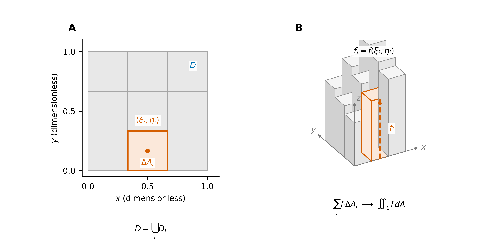
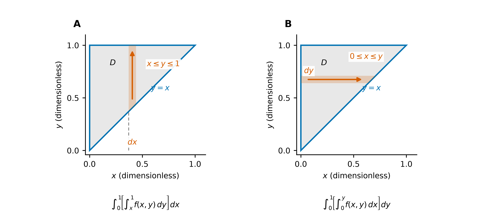
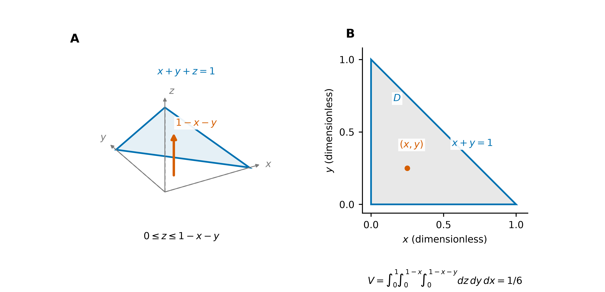
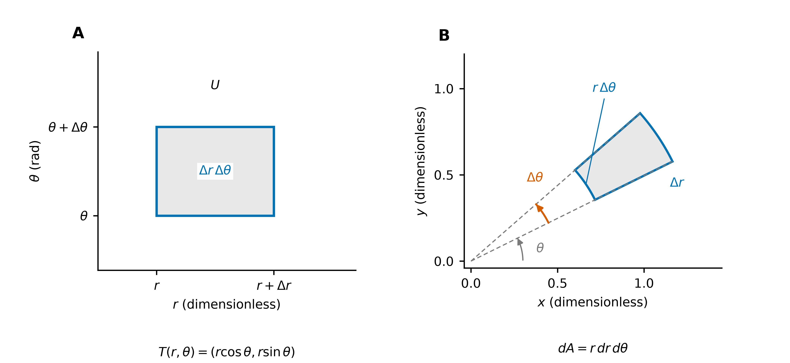
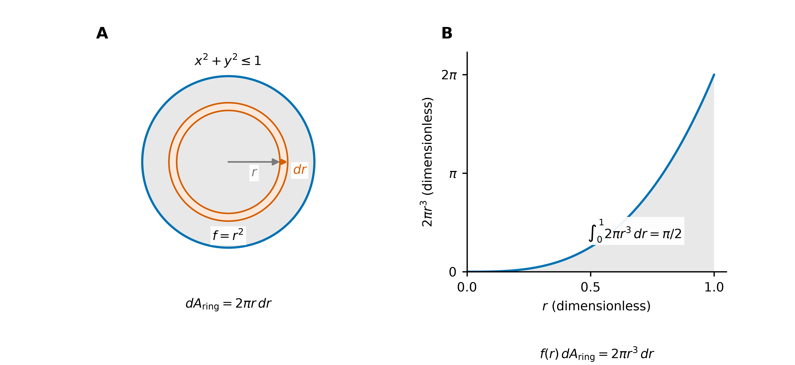

# 重积分：区域、累次积分与换元

> **核心概念**：重积分是标量函数相对于面积或体积的加权累积，其定义由区域分割与黎曼和的极限给出。

## 1. 重积分的定义与几何意义

二重积分定义为面积加权黎曼和的极限：

$$
\iint_D f\,dA
=\lim_{\max_i\operatorname{diam}(D_i)\to0}
\sum_i f(\xi_i,\eta_i)\,\Delta A_i,
\qquad (\xi_i,\eta_i)\in D_i.
$$

若该极限存在且与分割方式及取样点无关，则称 $f$ 在 $D$ 上可积。以下主要讨论有界、边界分片光滑的区域及连续函数。

| 被积函数 | 二重积分的含义 | 三重积分的含义 |
| --- | --- | --- |
| $1$ | 区域面积 | 区域体积 |
| 非负密度 $\rho$ | 薄片质量 | 物体质量 |
| 高度 $f\ge0$ | 曲面下方、区域上方的体积 | — |
| 可正可负的 $f$ | 正负贡献相抵后的累积量 | 同左 |

**积分区域规定累积的范围，积分微元规定局部贡献的权重。** 二重积分的定义是二维区域上的累积；累次积分是其计算表示。

**图 1（原理图）**：A 为区域分割与取样点，橙色表示一个子区域 $D_i$；B 将各取样值 $f_i$ 作为柱高，以 $\Delta A_i$ 为底面积。对非负函数，$f_i\Delta A_i$ 是近似柱体体积，分割加细后，其和趋于曲面下方的体积。

重积分具有线性性、区域可加性与保序性。例如，若 $m\le f\le M$，则

$$
m\,\operatorname{Area}(D)\le\iint_D f\,dA\le M\,\operatorname{Area}(D).
$$

## 2. 累次积分与切片表示

若区域能写成

$$
D=\{(x,y):a\le x\le b,\ g_1(x)\le y\le g_2(x)\},
$$

则

$$
\iint_D f(x,y)\,dA
=\int_a^b\left[\int_{g_1(x)}^{g_2(x)}f(x,y)\,dy\right]dx.
$$

**几何解释**：固定 $x$ 后，内层积分累积竖直切片上的贡献；外层积分再沿 $x$ 方向累积各切片的贡献。

内层上下限可以依赖外层变量，外层上下限不能依赖尚未确定的内层变量。水平切片则先 $dx$ 后 $dy$；一条切片若穿过多个分离区间，应分段累加。

**Fubini 与 Tonelli 定理的适用条件**：连续函数在上述紧区域上可表示为累次积分；更一般地，绝对可积函数可由 Fubini 定理交换积分次序。非负可测函数适用 Tonelli 定理，积分值允许为 $+\infty$。对含奇点或无界区域的积分，交换次序前须核验相应条件。

### 例题 1：通过交换次序计算积分

$$
I=\int_0^1\int_x^1 e^{y^2}\,dy\,dx.
$$

内层被积函数没有初等原函数。将区域 $0\le x\le y\le1$ 改写为水平切片表示，得

$$
I=\int_0^1\int_0^y e^{y^2}\,dx\,dy
=\int_0^1 y e^{y^2}\,dy=\frac{e-1}{2}.
$$

**计算依据**：交换积分次序须重新描述同一区域，并据此确定新的积分限。

**图 2（例题 1）**：A 固定 $x$，沿竖直切片从 $y=x$ 积到 $y=1$；B 固定 $y$，沿水平切片从 $x=0$ 积到 $x=y$。灰色区域相同，橙色条带表示内层积分的切片方向。

## 3. 三重积分的投影与截面表示

若空间区域为

$$
\Omega=\{(x,y,z):(x,y)\in D,\ h_1(x,y)\le z\le h_2(x,y)\},
$$

则

$$
\iiint_\Omega f\,dV
=\iint_D\left[\int_{h_1(x,y)}^{h_2(x,y)}f(x,y,z)\,dz\right]dA.
$$

几何上，内层积分沿竖直线段累积，外层积分在投影区域 $D$ 上累积。也可固定 $z$，先在水平截面 $D_z$ 上积分，再对 $z$ 积分。积分次序通常根据边界表示与内层积分的计算难度确定。

### 例题 2：四面体的体积

取 $\Omega=\{x,y,z\ge0:\ x+y+z\le1\}$。其 $xy$ 平面投影为 $D=\{x,y\ge0:\ x+y\le1\}$，固定 $(x,y)$ 时，竖直线段长度为 $1-x-y$，故

$$
V=\int_0^1\int_0^{1-x}\int_0^{1-x-y}1\,dz\,dy\,dx
=\int_0^1\frac{(1-x)^2}{2}\,dx=\frac16.
$$

**图 3（例题 2）**：A 为四面体及其中一条竖直线段，顶点位于平面 $x+y+z=1$；B 为投影三角形 $D$。内层积分给出线段长度，外层二重积分在投影上累积这些长度。

## 4. 变量代换与局部面积伸缩

设 $(x,y)=T(u,v)$ 是区域内部一一的 $C^1$ 换元，Jacobian 不为零，则

$$
\iint_D f(x,y)\,dx\,dy
=\iint_U f(x(u,v),y(u,v))
\left|\frac{\partial(x,y)}{\partial(u,v)}\right|du\,dv,
$$

$$
\frac{\partial(x,y)}{\partial(u,v)}=x_u y_v-x_v y_u.
$$

三维情形对应体积伸缩率 $|\det DT|$。**Jacobian 的绝对值给出非负的面积或体积伸缩率**；此处的微元不包含定向信息。

常用坐标在原点、轴线或接缝处可能退化；可分块使用，边界等零测集不影响通常的积分值。参数范围仍应避免重复覆盖。

| 区域或函数的特点 | 常用选择 | 必须补上的因子 |
| --- | --- | --- |
| 圆盘、扇形；$x^2+y^2$ | 极坐标 | $r$ |
| 圆柱、绕 $z$ 轴旋转的物体 | 柱坐标 | $r$ |
| 球、球壳；$x^2+y^2+z^2$ | 球坐标 | $r^2\sin\varphi$ |

坐标变换与角度约定见 [积分元素](积分元素.md)：$\theta$ 是方位角，$\varphi$ 自 $+z$ 轴量起。

**图 4（原理图）**：A 为参数域中的矩形，面积为 $\Delta r\,\Delta\theta$；B 为其对应的环形扇区，内圆弧长为 $r\Delta\theta$。有限宽扇区的精确面积为 $r\Delta r\Delta\theta+\tfrac12(\Delta r)^2\Delta\theta$；局部极限给出 $dA=r\,dr\,d\theta$。

### 例题 3：单位圆盘上的径向函数积分

对 $D=\{x^2+y^2\le1\}$，

$$
\iint_D(x^2+y^2)\,dA
=\int_0^{2\pi}\int_0^1 r^2\cdot r\,dr\,d\theta
=\frac{\pi}{2}.
$$

其中 $r^2$ 来自被积函数，因子 $r$ 来自面积元。在径向宽度与角宽相同时，微元面积随半径增大。

**图 5（例题 3）**：A 用同心薄环表示径向切片，环面积元为 $2\pi r\,dr$；B 为加权函数 $2\pi r^3$，曲线下方面积即积分值 $\pi/2$。函数权重 $r^2$ 与几何权重 $2\pi r$ 分别对应柱高与薄环面积。

## 5. 对称性与应用

若区域关于 $y$ 轴对称，$f(-x,y)=-f(x,y)$，且 $f$ 可积，则 $\iint_D f\,dA=0$。其他坐标反射同理。**区域和函数必须一起满足对称条件。**

以空间物体为例，密度 $\rho\ge0$，总质量 $M>0$：

$$
M=\iiint_\Omega\rho\,dV,\qquad
\bar x=\frac{1}{M}\iiint_\Omega x\rho\,dV,
$$

$$
\bar y=\frac{1}{M}\iiint_\Omega y\rho\,dV,\qquad
\bar z=\frac{1}{M}\iiint_\Omega z\rho\,dV,\qquad
I_z=\iiint_\Omega(x^2+y^2)\rho\,dV.
$$

质心是位置的质量加权平均；转动惯量是到转轴距离平方的质量加权积分。薄片的相应公式以 $dA$ 代替 $dV$。

## 6. 计算中的注意事项

- **积分区域的变换**：变量代换后，积分限须由新坐标下的区域描述确定。
- **Jacobian 因子**：被积函数的替换与面积、体积微元的替换缺一不可。
- **平面面积与曲面面积的区别**：$\iint_D1\,dA$ 给出平面区域面积；图像曲面的面积需包含因子 $\sqrt{1+f_x^2+f_y^2}$，见 [曲面积分](../03_曲面积分/曲面积分：曲面累积与穿面通量.md)。
