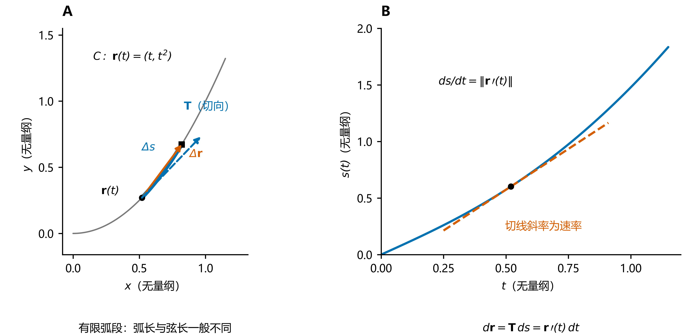
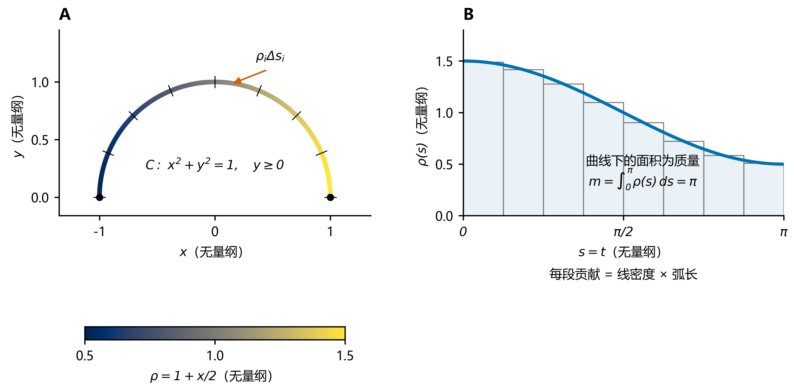
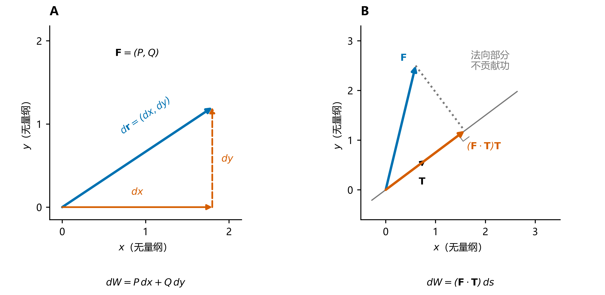
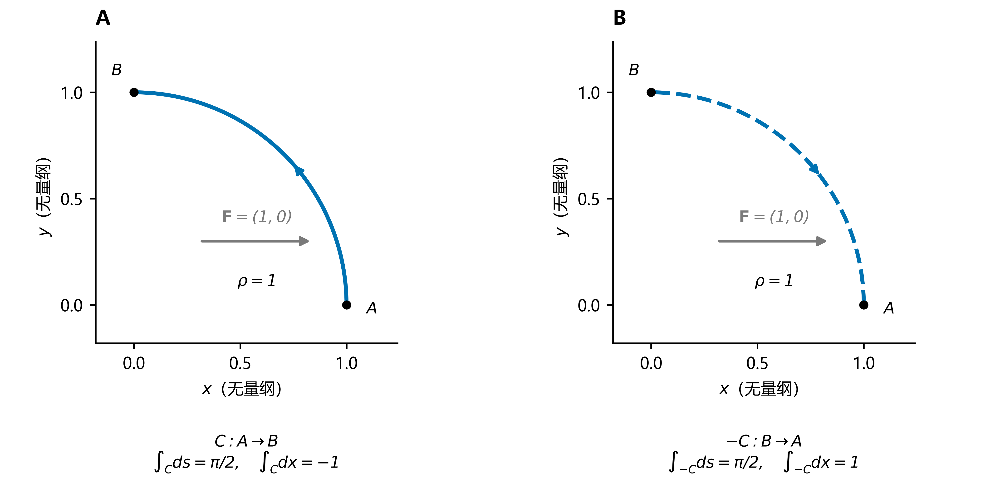
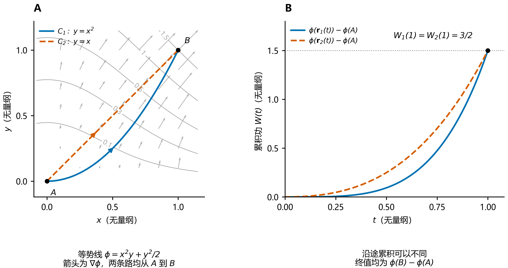
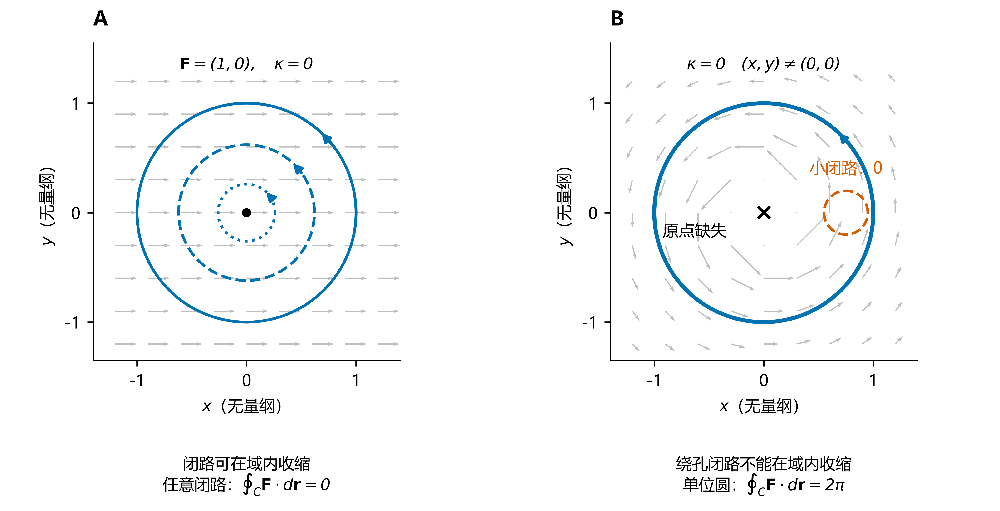
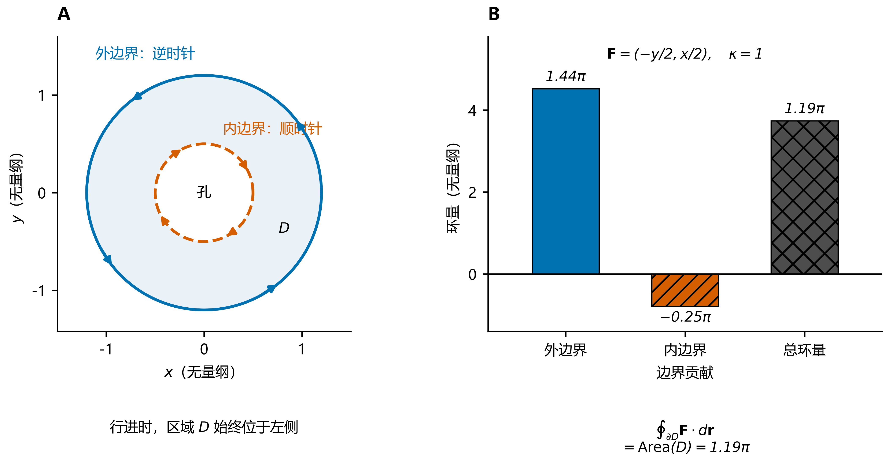
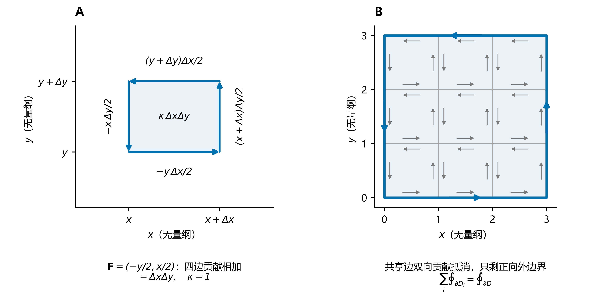
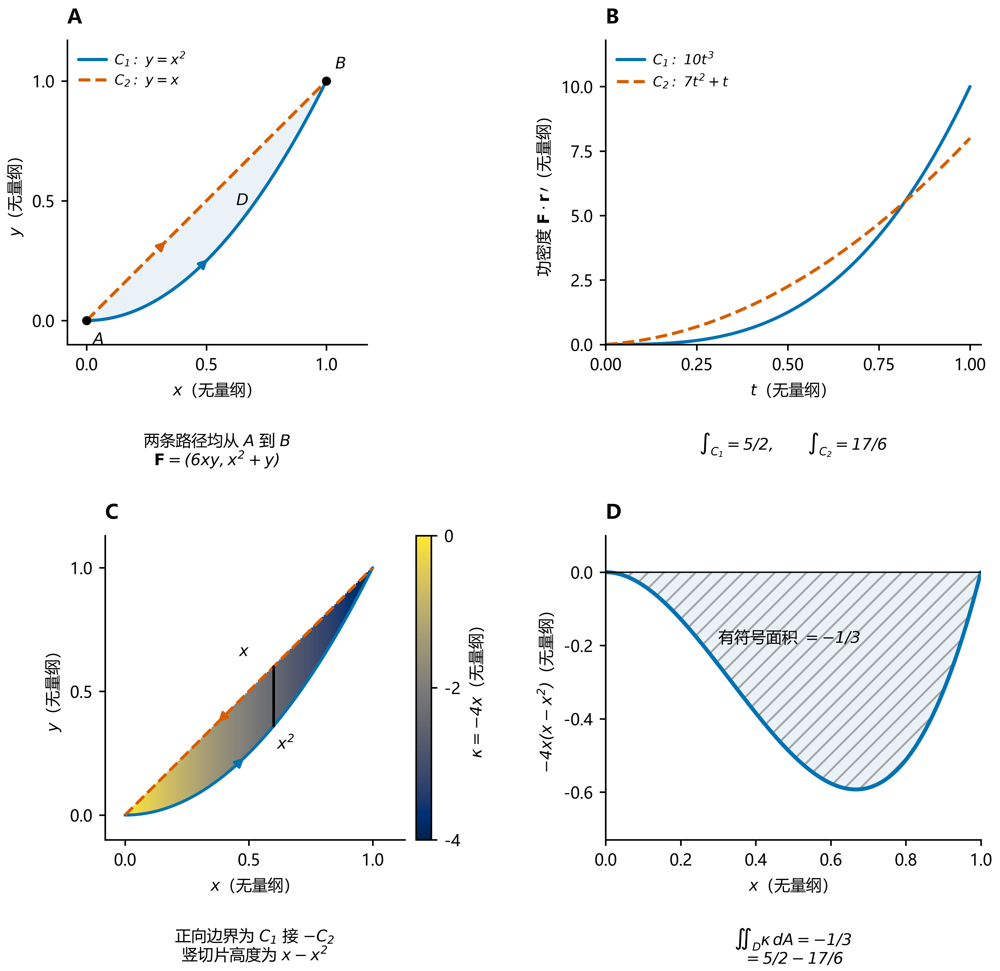

# 曲线积分

第一类与第二类曲线积分、路径无关性及 Green 公式。

**第一类沿弧长累积标量；第二类沿有向位移累积向量场的切向作用。** 后者有两种重要的化简：保守场的积分化为端点势差，平面闭路的环量由 Green 公式化为区域上的旋度积分。

各图采用无量纲示例；配色辅以线型、方向箭头和文字标识，灰度阅读时仍可辨认。[配图与重现脚本](image/曲线积分/README.md) 提供全部矢量 PDF 与 600 dpi PNG。

## 1. 弧长元与有向线元

设曲线 $C$ 分段光滑，各光滑段正则，由参数增大的方向定向：

$$
\mathbf r(t)=(x(t),y(t),z(t)),\qquad a\le t\le b.
$$

在各正则段上，

$$
\boxed{
ds=\lVert\mathbf r'(t)\rVert\,dt,\qquad
\mathbf T=\frac{\mathbf r'(t)}{\lVert\mathbf r'(t)\rVert},\qquad
d\mathbf r=\mathbf r'(t)\,dt=\mathbf T\,ds.
}
$$

$ds$ 是标量长度，$d\mathbf r$ 是有向位移，$\mathbf T$ 是沿所选方向的单位切向量。分段曲线的积分按各段相加；平面情形省去 $z$ 分量。

$\mathbf T$ 不是另设的方向：它来自割向量 $\Delta\mathbf r=\mathbf r(t+\Delta t)-\mathbf r(t)$，先除以参数增量再取极限，才得到非零的切向量。割向量的缩放与极限过程见 [切向量与切空间](../../01_几何与代数基础/切向量与切空间.md)。因此 $d\mathbf r=\mathbf T\,ds$ 把线元拆成“方向 × 长度”：$ds$ 负责长度，$\mathbf T$ 负责 $ds$ 的方向。

**图 1｜线元的几何。** A：在 $\mathbf r(t)=(t,t^2)$ 上，蓝色弧段的长度为 $\Delta s$，橙色弦向量为 $\Delta\mathbf r$，蓝色虚线箭头示意切向方向；有限弧段的弧长一般大于弦长。B：$s(t)=\int_0^t\|\mathbf r'(u)\|\,du$ 的切线斜率是速率。因此在微分层面，位移分解为“单位方向 $\mathbf T$ × 长度 $ds$”；A 中切向箭头仅示方向，长度作示意缩放。

## 2. 两类积分：定义、计算与联系

### 2.1 第一类：对弧长的积分

把曲线分成小弧段，每段取“函数值 $\times$ 弧长”并求和，取极限得到

$$
\boxed{
\int_C f\,ds
=\int_a^b f(\mathbf r(t))\,\lVert\mathbf r'(t)\rVert\,dt.
}
$$

它以长度为权重累积标量。特别地，$\int_C ds$ 是曲线长度；若 $\rho\ge0$ 为线密度，则 $\int_C\rho\,ds$ 是细线质量。一般的 $f$ 可以取负值，积分也可以为负。

**图 2｜第一类积分是弧长加权。** A：上半单位圆取线密度 $\rho=1+x/2$，短刻线划分等弧长段，色带表示密度。B：取 $\mathbf r(t)=(\cos t,\sin t)$，$0\le t\le\pi$，则 $s=t$，$\rho(s)=1+\frac12\cos s$；矩形面积为各段的近似贡献 $\rho_i\Delta s_i$，极限为阴影面积，即质量 $m=\pi$。曲线弯曲不改变“密度乘长度”的累积规则。

### 2.2 第二类：对坐标的积分

把每小段的贡献取为“向量场 $\cdot$ 位移”，求和取极限得到

$$
\boxed{
\int_C\mathbf F\cdot d\mathbf r
=\int_a^b\mathbf F(\mathbf r(t))\cdot\mathbf r'(t)\,dt.
}
$$

若 $\mathbf F$ 是力场，该积分表示沿 $C$ 做的功；沿闭路的积分 $\oint_C\mathbf F\cdot d\mathbf r$ 称为**环量**。两类积分的结果均为标量。

第二类积分有两个等价视角，都在计算同一个微元 $\mathbf F\cdot d\mathbf r$：

| 视角 | 微元展开 | 本质 |
| --- | --- | --- |
| 坐标分解 | $\mathbf F\cdot d\mathbf r=P\,dx+Q\,dy+R\,dz$ | 将各坐标方向的贡献相加 |
| 切向投影 | $\mathbf F\cdot d\mathbf r=(\mathbf F\cdot\mathbf T)\,ds$ | 将切向分量沿弧长累积 |

其中 $\mathbf F=(P,Q,R)$。坐标分解给出常用计算式

$$
\int_C P\,dx+Q\,dy+R\,dz
=\int_a^b\bigl[P(\mathbf r(t))x'(t)+Q(\mathbf r(t))y'(t)+R(\mathbf r(t))z'(t)\bigr]dt.
$$

切向投影则说明：**只有沿曲线切向的分量贡献功**。令 $F_{\parallel}=\mathbf F\cdot\mathbf T$，则

$$
\boxed{
\int_C\mathbf F\cdot d\mathbf r=\int_C F_{\parallel}\,ds,
\qquad
(\mathbf F\cdot\mathbf T)\,ds
=\mathbf F\cdot\frac{\mathbf r'}{\lVert\mathbf r'\rVert}
\lVert\mathbf r'\rVert\,dt
=\mathbf F\cdot\mathbf r'\,dt.
}
$$

这把第二类积分写成了第一类的形式，但 $F_{\parallel}$ 随定向改变。计算时，$\mathbf T$ 配 $ds$，$\mathbf r'$ 配 $dt$；归一化因子已相消，无须再把 $\mathbf r'$ 单位化。

**图 3｜同一微功的两种分解。** A：将 $d\mathbf r$ 分解到坐标轴，分别与分力 $P,Q$ 配对，得到 $P\,dx+Q\,dy$。B：黑色箭头为单位切向量 $\mathbf T=(0.8,0.6)$；将 $\mathbf F=(0.6,2.5)$ 正交投影到切线，橙色箭头为 $(\mathbf F\cdot\mathbf T)\mathbf T$，其有向标量系数才是 $F_{\parallel}$。灰色虚线对应法向部分，点积时不贡献功。A 的微元向量按示意比例放大，B 保留所列向量的长度比例。

### 2.3 方向与路径

记 $-C$ 为同一曲线的反向路径，则

$$
\int_{-C}f\,ds=\int_C f\,ds,\qquad
\int_{-C}\mathbf F\cdot d\mathbf r=-\int_C\mathbf F\cdot d\mathbf r.
$$

| 比较项 | 第一类 | 第二类 |
| --- | --- | --- |
| 参数化后的因子 | 速率 $\lVert\mathbf r'\rVert$ | 与速度的点积 $\mathbf F\cdot\mathbf r'$ |
| 反向行进 | 积分不变 | 积分变号 |
| 典型含义 | 长度、质量、加权累积 | 功、环量 |

两者都不依赖保持方向的正则重参数化，但一般依赖所走的曲线。**与方向无关不等于与路径无关**；重复走过的弧段按遍历次数计入。

**图 4｜反向改变位移，不改变长度。** 取第一象限四分之一单位圆，$A=(1,0)$、$B=(0,1)$，$\rho=1$，$\mathbf F=(1,0)$。A：从 $A$ 到 $B$，弧长为 $\pi/2$，功为 $\int_C dx=0-1=-1$。B：原路反向，弧长仍为 $\pi/2$，功变为 $1$；灰色恒力箭头始终向右，改变的是行进方向。

## 3. 路径无关：从沿路累积到端点差

设 $\Omega\subset\mathbb R^n$（$n=2,3$）为连通开集，$\mathbf F\in C^1(\Omega)$，以下路径均位于 $\Omega$ 内。

### 3.1 保守场与曲线积分基本定理

若存在单值标量函数 $\phi$，使

$$
\mathbf F=\nabla\phi,
$$

则称 $\mathbf F$ 为**保守场**，$\phi$ 为其势函数。由链式法则，

$$
\mathbf F(\mathbf r(t))\cdot\mathbf r'(t)
=\frac{d}{dt}\phi(\mathbf r(t)),
$$

因而对任意从 $A$ 到 $B$ 的路径 $C$，

$$
\boxed{
\int_C\mathbf F\cdot d\mathbf r
=\int_C d\phi
=\phi(B)-\phi(A).
}
$$

沿路的局部变化由一个全局函数描述，累积后只留下端点差。在上述条件下，以下三者等价：

$$
\boxed{
\mathbf F=\nabla\phi
\quad\Longleftrightarrow\quad
\text{同起终点的路径积分相等}
\quad\Longleftrightarrow\quad
\text{任意闭路上的积分为零}.
}
$$

反向构造势函数时，固定 $A_0\in\Omega$，定义 $\phi(X)=\int_{A_0}^{X}\mathbf F\cdot d\mathbf r$；路径无关保证它单值，且 $\nabla\phi=\mathbf F$。势函数相差一个常数。

这里采用 $\mathbf F=\nabla\phi$ 的约定；若物理中用势能 $U$ 写成 $\mathbf F=-\nabla U$，则功为 $U(A)-U(B)$。

**图 5｜端点差的几何。** A：取 $\phi=x^2y+y^2/2$，灰色等势线标出势函数值，灰箭头为按统一比例缩放的梯度场；蓝色抛物线与橙色虚线均连接 $A=(0,0)$、$B=(1,1)$。B：用 $\mathbf r_1(t)=(t,t^2)$、$\mathbf r_2(t)=(t,t)$ 参数化，累积功为 $W_1(t)=\frac32t^4$、$W_2(t)=t^3+\frac12t^2$。中间取值不同，终点都等于 $\phi(B)-\phi(A)=3/2$；第 3.3 节给出对应势函数的求法。

### 3.2 无旋条件：何时足以判定保守

对三维场 $\mathbf F=(P,Q,R)$，无旋条件为

$$
\nabla\times\mathbf F=\mathbf0
\quad\Longleftrightarrow\quad
R_y=Q_z,\quad P_z=R_x,\quad Q_x=P_y.
$$

对平面场 $\mathbf F=(P,Q)$，把它嵌入三维为 $(P,Q,0)$，其旋度只有垂直于平面的分量。记

$$
\kappa=Q_x-P_y;
\qquad\text{平面无旋条件为 }\kappa=0.
$$

保守场必无旋，因为势函数的混合偏导相等。反过来，**若 $\Omega$ 还单连通，则无旋足以推出保守**：

$$
\boxed{
\text{在单连通开集上， }\mathbf F\in C^1:
\qquad\text{无旋}\ \Longleftrightarrow\ \text{保守}\ \Longleftrightarrow\ \text{路径无关}.
}
$$

单连通意味着域内任意闭路都能在域内连续收缩为一点；它是保证上述逆推的充分条件，并非一个场保守的必要条件。

**反例：局部无旋，全局仍可能有环量。** 在穿孔平面 $\Omega=\mathbb R^2\setminus\{(0,0)\}$ 上，

$$
\mathbf F=\left(-\frac{y}{x^2+y^2},\frac{x}{x^2+y^2}\right)
$$

处处满足 $Q_x-P_y=0$，但沿逆时针单位圆有 $\oint_C\mathbf F\cdot d\mathbf r=2\pi$。绕孔的闭路不能在域内收缩，因而不存在全域单值势函数。

**图 6｜无旋条件为何需要定义域。** A：$\mathbb R^2$ 上的恒场 $\mathbf F=(1,0)$ 无旋，各级闭路都能收缩，环量均为零。B：上述穿孔场在每个有定义的点都无旋；橙色小闭路不包围原点，环量为零，蓝色单位圆绕原点一周，环量为 $2\pi$。叉号仅标记缺失的原点；灰色场箭头在各面板内按统一比例缩放，原点附近未采样。

### 3.3 求势函数的操作

平面上解 $\phi_x=P,\ \phi_y=Q$：先对 $x$ 积分，写成 $\phi=\int P\,dx+g(y)$，再由 $\phi_y=Q$ 确定 $g$。积分产生的“常数”是其余变量的函数。

例如 $\mathbf F=(2xy,x^2+y)$ 在 $\mathbb R^2$ 上无旋，且

$$
\phi=x^2y+\frac12y^2,\qquad
\int_{(0,0)}^{(1,1)}\mathbf F\cdot d\mathbf r=\frac32,
$$

其中积分可沿任意连接这两个端点的分段光滑路径取值。

此例的等势线、路径和累积功见图 5；路径无关指终值相等，并不要求沿途的累积功曲线重合。

## 4. Green 公式：从边界环量到区域旋度

### 4.1 公式与方向

设 $D$ 为有界平面区域，边界由有限条分段光滑简单闭曲线组成，$P,Q$ 在 $\overline D$ 的某个开邻域内具有连续一阶偏导。边界取**正向**：沿边界行进时，区域始终在左侧，即外边界逆时针、内孔边界顺时针。则

$$
\boxed{
\oint_{\partial D}\mathbf F\cdot d\mathbf r
=\oint_{\partial D}P\,dx+Q\,dy
=\iint_D\left(\frac{\partial Q}{\partial x}-\frac{\partial P}{\partial y}\right)dA
=\iint_D\kappa\,dA.
}
$$

左端是沿区域全部边界的环量；右端是区域内部的平面旋度积分。$D$ 可以有孔，但必须计入所有内边界，且场在整个积分区域及其边界附近满足光滑性条件。

**图 7｜孔边界也必须计入。** A：环域 $D=\{0.5<\sqrt{x^2+y^2}<1.2\}$ 的外边界逆时针、内边界顺时针，均使区域留在左侧。B：对处处光滑的场 $\mathbf F=(-y/2,x/2)$，$\kappa=1$；两条边界的环量分别为 $1.44\pi$、$-0.25\pi$，总和 $1.19\pi$ 恰等于环域面积。此处的孔是积分区域的孔，场在孔内也有定义，与图 6 的奇点不同。

### 4.2 本质：局部旋转的累积留下边界环量

对一点附近的正向微小矩形 $D_h$，有

$$
\kappa(x,y)
=\lim_{D_h\to(x,y)}
\frac{1}{\operatorname{Area}(D_h)}
\oint_{\partial D_h}\mathbf F\cdot d\mathbf r.
$$

因此 $\kappa$ 表示**单位面积的局部环量密度**。把区域分成小块，各块环量相加时，共享边的方向相反、贡献抵消，最终只剩外露边界；内部的局部环量密度则累积为 $\iint_D\kappa\,dA$。

**图 8｜从局部到整体。** A：对 $\mathbf F=(-y/2,x/2)$，四边标注的功沿逆时针相加，恰为 $\Delta x\Delta y=\kappa\,\Delta A$，展示“单位面积环量”的含义；一般光滑场在小矩形上具有相应的一阶近似。B：各小方块均正向绕行，共享边上的两次行进方向相反；灰色箭头略微错开以便辨认，实际对应同一条边。相消后只剩蓝色外边界。

这也解释了它与路径无关的联系：若两条从 $A$ 到 $B$ 的路径 $C_1,C_2$ 围成区域 $D$，且 $C_1$ 接 $-C_2$ 构成正向边界，则

$$
\boxed{
\int_{C_1}\mathbf F\cdot d\mathbf r
-\int_{C_2}\mathbf F\cdot d\mathbf r
=\iint_D\kappa\,dA.
}
$$

**两条路径的功之差，等于其间区域的旋度积分。** 无旋且该区域内没有奇点时，两条路径的积分相等。穿孔场的反例不能直接在整个圆盘上套用 Green 公式，因为场在原点无定义。

### 4.3 同一例子：直接积分与 Green 公式

取平面场 $\mathbf F=(6xy,x^2+y)$。令 $C_1$ 沿抛物线 $y=x^2$ 从 $(0,0)$ 到 $(1,1)$，$C_2$ 沿直线 $y=x$ 连接同样的端点。

直接参数化给出

$$
\begin{aligned}
\int_{C_1}\mathbf F\cdot d\mathbf r
&=\int_0^1(6x^3+4x^3)\,dx=\frac52,\\
\int_{C_2}\mathbf F\cdot d\mathbf r
&=\int_0^1(7x^2+x)\,dx=\frac{17}{6}.
\end{aligned}
$$

该场的 $\kappa=2x-6x=-4x$。路径 $C_1$ 接 $-C_2$ 正向围成 $D=\{0\le x\le1,\ x^2\le y\le x\}$，故

$$
\frac52-\frac{17}{6}
=\oint_{\partial D}\mathbf F\cdot d\mathbf r
=\int_0^1\int_{x^2}^{x}(-4x)\,dy\,dx
=-\frac13.
$$

这个例子同时展示了坐标分量计算、路径依赖，以及边界环量与区域旋度的对应。

**图 9｜例题的四个几何环节。** A：两条路径均从 $A$ 到 $B$，阴影为其间区域 $D$。B：取 $\mathbf r_1(t)=(t,t^2)$、$\mathbf r_2(t)=(t,t)$，功密度分别为 $10t^3$、$7t^2+t$，各自曲线下的面积给出 $5/2$、$17/6$。C：闭合时沿 $C_1$ 前进、沿 $C_2$ 返回，得到正向边界；色带表示 $\kappa=-4x$，黑色竖切片高为 $x-x^2$。D：将旋度乘切片高度，得到 $-4x(x-x^2)$；其有符号面积为 $-1/3$，正是两条路径的功之差。

## 5. 方法选择

| 积分结构 | 优先方法 | 关键检查 |
| --- | --- | --- |
| $\int_C f\,ds$ | 参数化，代入 $ds=\lVert\mathbf r'\rVert dt$ | 弧长因子取模；反向不变 |
| $\int_C\mathbf F\cdot d\mathbf r$，已知保守 | 求势函数，取 $\phi(B)-\phi(A)$ | 若用无旋判定，须检查定义域条件 |
| 平面正向闭路，区域积分更简单 | Green 公式 | 边界方向、内孔边界、区域内奇点 |
| 平面开路径，便于补成闭路 | 补线后用 Green，再减去补线积分 | 若 $C:A\to B$，补线须从 $B\to A$ |
| 一般路径 | 参数化，代入 $\mathbf F(\mathbf r(t))\cdot\mathbf r'(t)$ | 参数方向与指定路径一致 |

补线的几何可直接参照图 9C：若要求 $C_1$ 上的积分，取补线 $-C_2$，则 $\int_{C_1}=\iint_D\kappa\,dA-\int_{-C_2}=\iint_D\kappa\,dA+\int_{C_2}$。

前置：[积分元素](../01_重积分/积分元素.md)。对照：[曲面积分](../03_曲面积分/曲面积分：曲面累积与穿面通量.md) 将切向作用换为法向通量。延伸：[保守场与势函数](../05_场论与应用/保守场与势函数：路径无关的本质.md)、[三大积分定理](../04_三大积分定理/积分定理：从内部微分到边界积分.md)。

[返回曲线积分](README.md)

