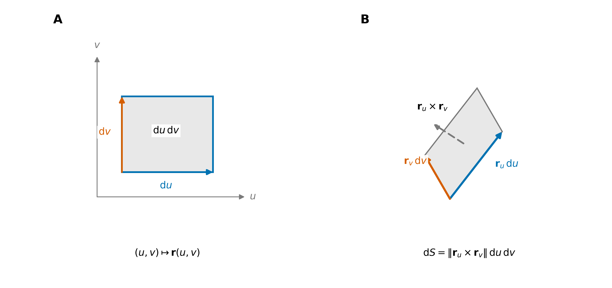
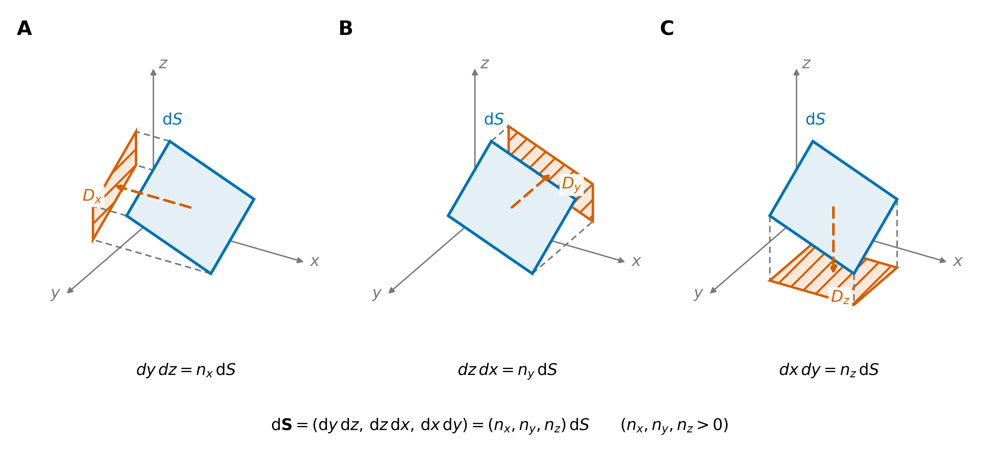
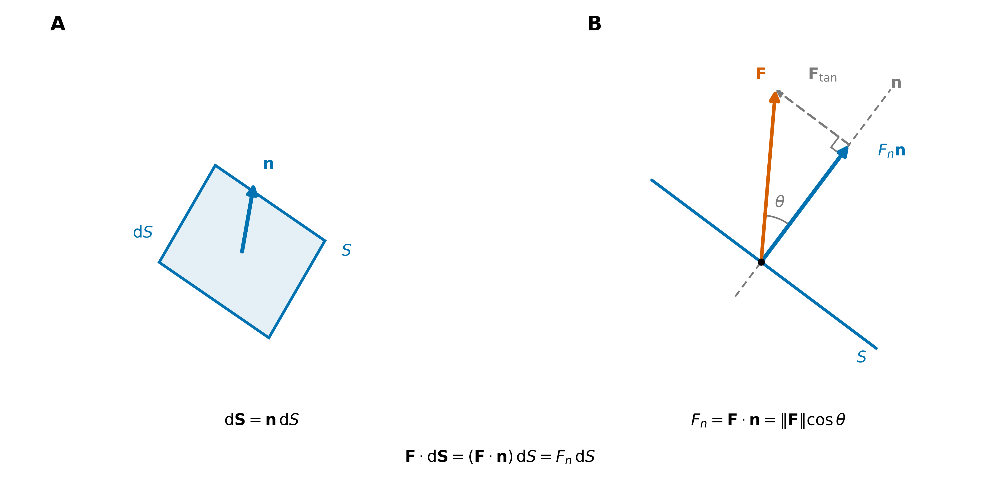
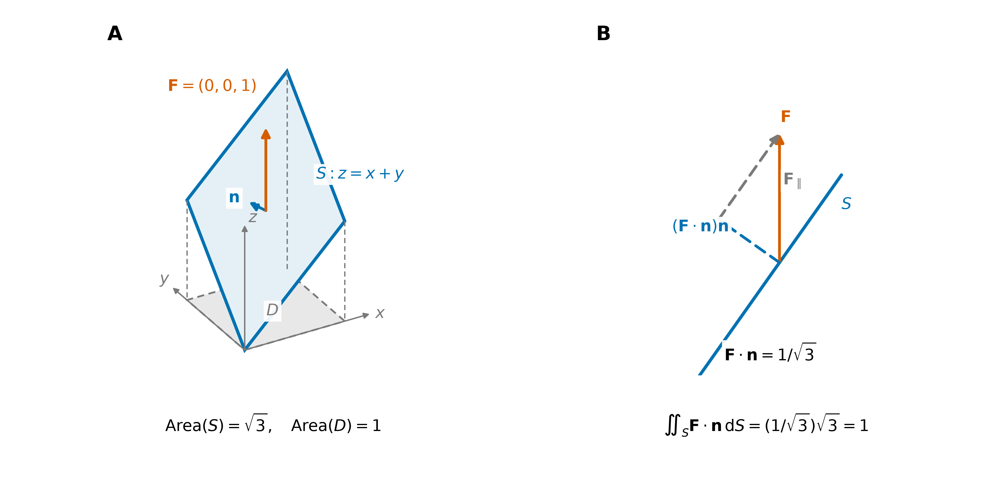
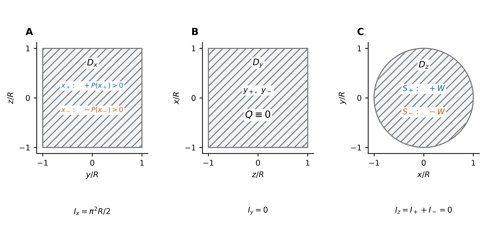
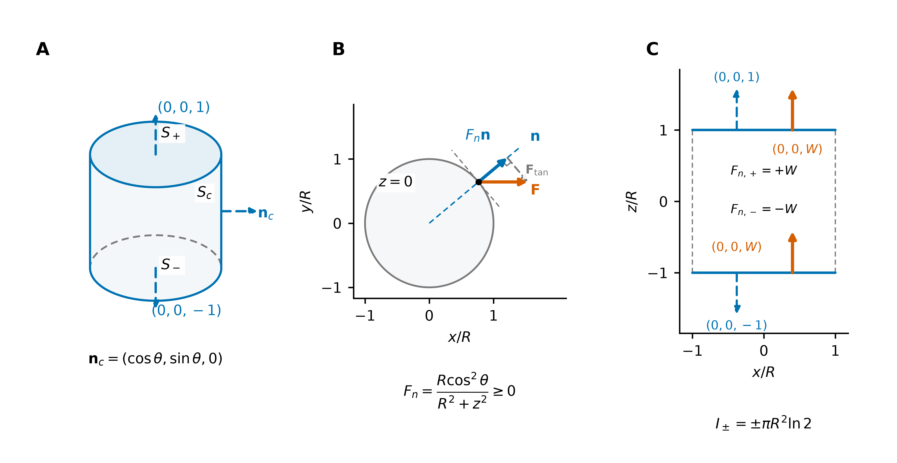
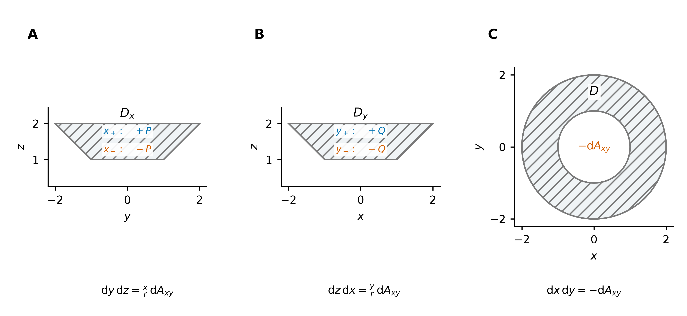
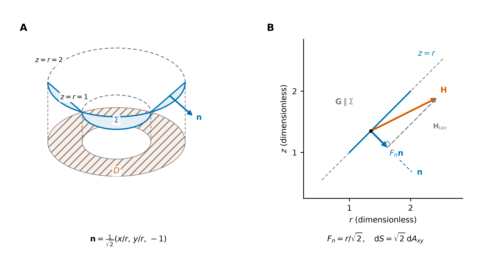
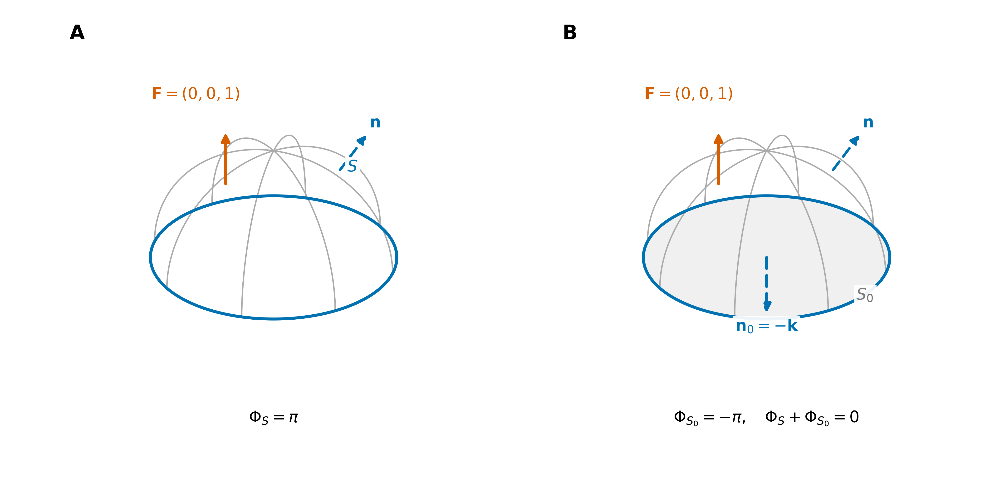

# 曲面积分：标量累积与通量积分

第一类与第二类曲面积分、曲面定向及通量计算。

**第一类以面积为权重累积标量；第二类以有向面积累积向量场的法向作用。** 与曲线积分对应，线元沿切向定向，面元沿法向定向。

## 1. 面积元与有向面积元

设曲面 $S$ 分片光滑，各光滑片正则，由参数 $\mathbf r(u,v)$ 给出，参数域为 $U$。取与 $\mathbf r_u\times\mathbf r_v$ 一致的定向，则

$$
\boxed{
\begin{aligned}
\mathrm dS&=\lVert\mathbf r_u\times\mathbf r_v\rVert\,\mathrm du\,\mathrm dv,\\
\mathbf n&=\frac{\mathbf r_u\times\mathbf r_v}{\lVert\mathbf r_u\times\mathbf r_v\rVert},\\
\mathrm d\mathbf S&=\mathbf n\,\mathrm dS=(\mathbf r_u\times\mathbf r_v)\,\mathrm du\,\mathrm dv.
\end{aligned}
}
$$

$\mathrm dS$ 是标量面积，$\mathrm d\mathbf S$ 是有向面积元，$\mathbf n$ 是所选方向的单位法向量。$\mathbf n\,\mathrm dS$ 将面元拆成“方向 × 面积”：$\mathrm dS$ 负责大小，$\mathbf n$ 负责方向；取相反定向时，$\mathrm d\mathbf S$ 整体变号。

固定一个参数、改变另一个参数，得到两条参数曲线，其切向量分别为 $\mathbf r_u,\mathbf r_v$。参数小矩形在曲面上近似为以 $\mathbf r_u\,\mathrm du,\mathbf r_v\,\mathrm dv$ 为邻边的平行四边形；**叉积的模给出面积，叉积的方向给出法向**。切向量的来源见 [切矢量、弧长元素与面积元素](../../01_几何与代数基础/切矢量、弧长元素与面积元素.md)。

**图 1｜面元的几何。** A：参数域中的小矩形。B：它在曲面上的切平行四边形近似，边向量为 $\mathbf r_u\,\mathrm du$ 与 $\mathbf r_v\,\mathrm dv$。$\mathrm dS$ 记录面积，$\mathrm d\mathbf S$ 同时记录面积与法向。

## 2. 两类积分：定义、计算与联系

### 2.1 第一类：对面积的积分

把曲面分成小块，每块取“函数值 $\times$ 面积”并求和，取极限得到

$$
\boxed{
\iint_S f\,\mathrm dS
=\iint_U f(\mathbf r(u,v))\,\lVert\mathbf r_u\times\mathbf r_v\rVert\,\mathrm du\,\mathrm dv.
}
$$

它以面积为权重累积标量。特别地，$\iint_S \mathrm dS$ 是曲面面积；若 $\rho\ge0$ 为面密度，则 $\iint_S\rho\,\mathrm dS$ 是薄壳质量。一般的 $f$ 可以取负值，积分也可以为负。

对图像曲面 $z=g(x,y)$，投影区域为 $D\subset xy$ 平面，取 $\mathbf r(x,y)=(x,y,g(x,y))$，则

$$
\mathbf r_x\times\mathbf r_y=(-g_x,-g_y,1),\qquad
\boxed{\iint_S f\,\mathrm dS
=\iint_D f(x,y,g(x,y))\sqrt{1+g_x^2+g_y^2}\,\mathrm dx\,\mathrm dy.}
$$

因子 $\sqrt{1+g_x^2+g_y^2}$ 是实际面积相对于投影面积的伸缩率。第一类积分使用实际面积，与法向选择无关。

### 2.2 第二类：对坐标的积分

把每小块的贡献取为“向量场 $\cdot$ 有向面积”，求和取极限得到

$$
\boxed{
\iint_S\mathbf F\cdot \mathrm d\mathbf S
=\iint_U\mathbf F(\mathbf r(u,v))\cdot(\mathbf r_u\times\mathbf r_v)\,\mathrm du\,\mathrm dv.
}
$$

该积分称为向量场穿过 $S$ 的**通量**。若 $\mathbf F$ 是流体速度，它表示单位时间内的有向体积穿过量；若 $\mathbf F=\rho\mathbf v$ 是质量流密度，则表示有向质量流率。两类积分的结果均为标量。

第二类积分有两个等价视角，都在计算同一个微元 $\mathbf F\cdot \mathrm d\mathbf S$：

| 视角 | 微元展开 | 本质 |
| --- | --- | --- |
| 坐标投影 | $\mathbf F\cdot \mathrm d\mathbf S=P\,\mathrm dy\,\mathrm dz+Q\,\mathrm dz\,\mathrm dx+R\,\mathrm dx\,\mathrm dy$ | 各坐标方向的场分量乘以对应的有向投影面积，再相加 |
| 法向投影 | $\mathbf F\cdot \mathrm d\mathbf S=(\mathbf F\cdot\mathbf n)\,\mathrm dS$ | 将法向分量按实际面积累积 |

#### 坐标投影：投影面积与各方向的贡献

设 $\mathbf F=(P,Q,R)$，$\mathbf n=(n_x,n_y,n_z)$。沿三个坐标轴投影，有

| 投影方向 | 投影区域 | 有向投影面积元 |
| --- | --- | --- |
| 沿 $x$ 轴 | $D_x\subset yz$ 平面 | $\mathrm dy\,\mathrm dz=n_x\,\mathrm dS$ |
| 沿 $y$ 轴 | $D_y\subset zx$ 平面 | $\mathrm dz\,\mathrm dx=n_y\,\mathrm dS$ |
| 沿 $z$ 轴 | $D_z\subset xy$ 平面 | $\mathrm dx\,\mathrm dy=n_z\,\mathrm dS$ |

$n_x,n_y,n_z$ 是法向的方向余弦；**投影面积的大小为 $|n_i|\,\mathrm dS$，有向投影面积为 $n_i\,\mathrm dS$**。$D_x,D_y,D_z$ 是投影区域，不是面积元；投影有重叠时须分片计算。

因此，三个有向投影面积元恰好组成 $\mathrm d\mathbf S$ 的三个分量：

$$
\mathrm d\mathbf S=(\mathrm dy\,\mathrm dz,\,\mathrm dz\,\mathrm dx,\,\mathrm dx\,\mathrm dy),\qquad
\iint_S\mathbf F\cdot \mathrm d\mathbf S
=\iint_S P\,\mathrm dy\,\mathrm dz+Q\,\mathrm dz\,\mathrm dx+R\,\mathrm dx\,\mathrm dy.
$$

**图 2｜面元的坐标投影。** A、B、C 分别沿 $x,y,z$ 轴投影；蓝色为同一面元 $\mathrm dS$，橙色阴影为它在 $D_x,D_y,D_z$ 中的投影，虚线连接对应点。图取 $n_x,n_y,n_z>0$，因此投影面积与有向投影面积相同。

#### 法向投影：有向面积与场的法向分量

$\mathrm d\mathbf S=\mathbf n\,\mathrm dS$ 是 $\mathrm dS$ 的有向形式；将场投影到法向，令 $F_n=\mathbf F\cdot\mathbf n$，则

$$
\boxed{
\iint_S\mathbf F\cdot \mathrm d\mathbf S
=\iint_S F_n\,\mathrm dS,
\qquad
P\,\mathrm dy\,\mathrm dz+Q\,\mathrm dz\,\mathrm dx+R\,\mathrm dx\,\mathrm dy
=(\mathbf F\cdot\mathbf n)\,\mathrm dS.
}
$$

这把第二类积分写成了第一类的形式，但 $F_n$ 随定向改变。**只有法向分量贡献通量，切向分量不贡献通量。** 与 [曲线积分](../02_曲线积分/曲线积分.md) 中 $\mathrm d\mathbf r=\mathbf T\,\mathrm ds$ 对照，曲线累积切向作用，曲面累积法向作用。

**图 3｜场的法向投影。** A：给 $\mathrm dS$ 配上单位法向 $\mathbf n$，得到 $\mathrm d\mathbf S$，箭头长度仅作示意。B：在场与法向所在截面中，将 $\mathbf F$ 分解为 $F_n\mathbf n$ 与切向部分；$F_n=\mathbf F\cdot\mathbf n$ 是有向标量，乘以 $\mathrm dS$ 才得到通量微元。

计算时，$\mathbf n$ 配 $\mathrm dS$，$\mathbf r_u\times\mathbf r_v$ 配 $\mathrm du\,\mathrm dv$；归一化因子已相消，无须再把叉积单位化。对图像曲面 $z=g(x,y)$，取向上定向，就有

$$
\mathrm d\mathbf S=(-g_x,-g_y,1)\,\mathrm dx\,\mathrm dy,\qquad
\boxed{\iint_S\mathbf F\cdot \mathrm d\mathbf S
=\iint_D(-Pg_x-Qg_y+R)\big|_{z=g(x,y)}\,\mathrm dx\,\mathrm dy.}
$$

向下定向时整体取负号。该式已包含面积因子，不应再乘 $\sqrt{1+g_x^2+g_y^2}$。

### 2.3 方向与定向

记 $-S$ 为同一曲面取相反定向，则

$$
\iint_{-S}f\,\mathrm dS=\iint_S f\,\mathrm dS,\qquad
\iint_{-S}\mathbf F\cdot \mathrm d\mathbf S=-\iint_S\mathbf F\cdot \mathrm d\mathbf S.
$$

| 比较项 | 第一类 | 第二类 |
| --- | --- | --- |
| 参数化后的因子 | 叉积的模 $\lVert\mathbf r_u\times\mathbf r_v\rVert$ | 与叉积的点积 $\mathbf F\cdot(\mathbf r_u\times\mathbf r_v)$ |
| 反转法向 | 积分不变 | 积分变号 |
| 典型含义 | 面积、质量、加权累积 | 流量、电通量 |

通量积分要求曲面可定向，即能连续选取法向；分片曲面在光滑片之间保持定向一致。常见约定为：

- **图像曲面**：“向上”指法向的 $z$ 分量为正，“向下”相反。
- **封闭曲面**：“外侧”指法向从物体内部指向外部，是 Gauss 定理的约定。
- **Stokes 中的曲面**：法向与边界走向按右手定则配合；拇指指向法向，四指弯曲方向为边界正向。

两类积分都不依赖保持定向的正则重参数化；多块曲面分块计算后相加，避免重复覆盖。零通量可能来自正负贡献抵消，也可能来自场处处与曲面相切，并不意味着场处处为零。

## 3. 同一例子：斜面的面积与通量

取 $S:z=x+y$，$0\le x,y\le1$，向上定向；令 $\mathbf F=(0,0,1)$。

第一类积分给出实际面积：

$$
\operatorname{Area}(S)=\int_0^1\int_0^1\sqrt3\,\mathrm dx\,\mathrm dy=\sqrt3.
$$

第二类积分可从两个视角计算。按坐标投影，只有 $z$ 方向的场分量非零，故通量等于水平投影面积：

$$
\Phi=\iint_S \mathrm dx\,\mathrm dy=\int_0^1\int_0^1 \mathrm dx\,\mathrm dy=1.
$$

按法向投影，$\mathbf n=(-1,-1,1)/\sqrt3$，故

$$
\Phi=\iint_S(\mathbf F\cdot\mathbf n)\,\mathrm dS
=\frac1{\sqrt3}\operatorname{Area}(S)=1.
$$

实际面积为 $\sqrt3$，两种视角都得到通量 $1$。改为向下定向时，面积不变，通量变为 $-1$。

**图 4｜同一通量的两种分解。** A：斜面 $S$ 的面积为 $\sqrt3$，水平投影 $D$ 的面积为 $1$。B：在场与法向所在的竖直截面中，法向分量 $\mathbf F\cdot\mathbf n=1/\sqrt3$；乘以实际面积 $\sqrt3$，同样得到通量 $1$。

## 4. 例题：封闭圆柱面的通量——两个投影视角

**题目。** 计算曲面积分

$$
I=\iint_S\frac{x\,\mathrm dy\,\mathrm dz+z^2\,\mathrm dx\,\mathrm dy}{x^2+y^2+z^2},
$$

其中 $S$ 是由柱面 $x^2+y^2=R^2$ 与平面 $z=\pm R$（$R>0$）围成的立体表面，取外侧。

记

$$
\mathbf F=(P,Q,W)
=\left(\frac{x}{x^2+y^2+z^2},\ 0,\ \frac{z^2}{x^2+y^2+z^2}\right),
\qquad I=\iint_S\mathbf F\cdot \mathrm d\mathbf S.
$$

这里用 $W$ 记第三个场分量，避免与圆柱半径 $R$ 混淆。将表面分成侧面 $S_c$、上底 $S_+$ 与下底 $S_-$：

$$
\begin{aligned}
S_c&:\ x^2+y^2=R^2,\quad -R\le z\le R,\\
S_+&:\ z=R,\quad x^2+y^2\le R^2,\\
S_-&:\ z=-R,\quad x^2+y^2\le R^2.
\end{aligned}
$$

### 4.1 坐标投影：沿三个正交方向分别计算

按场的三个分量拆分，令

$$
I=I_x+I_y+I_z,
\qquad
I_x=\iint_S P\,\mathrm dy\,\mathrm dz,\quad
I_y=\iint_S Q\,\mathrm dz\,\mathrm dx,\quad
I_z=\iint_S W\,\mathrm dx\,\mathrm dy.
$$

**图 5｜分别沿坐标轴投影。** 坐标以 $R$ 归一化。A：侧面的左右两片投到同一矩形 $D_x$，$x_+$ 片取正号，$x_-$ 片取负号；两片的 $P$ 也异号，因此贡献相加。B：沿 $y$ 轴投到 $D_y$，但 $Q\equiv0$。C：上下底投到同一圆盘 $D_z$，$W$ 相同而有向投影符号相反，贡献相消。

**（1）沿 $x$ 轴投到 $yz$ 平面。** 上下底的 $n_x=0$，对 $I_x$ 没有贡献。侧面须拆成两片：

$$
x_+(y,z)=\sqrt{R^2-y^2},\qquad
x_-(y,z)=-\sqrt{R^2-y^2}.
$$

两片的投影区域均为

$$
D_x=\{(y,z):-R\le y\le R,\ -R\le z\le R\}.
$$

**先确定有向投影面积的符号，再代入场分量。** 侧面的外单位法向量为

$$
\mathbf n=\left(\frac{x}{R},\frac{y}{R},0\right),\qquad n_x=\frac{x}{R}.
$$

将 $yz$ 投影平面上的普通正面积元记作 $\mathrm dA_{yz}$。它只记录面积大小，与有向投影面积元 $\mathrm dy\,\mathrm dz$ 的关系是

$$
\mathrm dA_{yz}=|n_x|\,\mathrm dS,\qquad
\mathrm dy\,\mathrm dz=n_x\,\mathrm dS
=\frac{n_x}{|n_x|}\,\mathrm dA_{yz}\quad(n_x\ne0).
$$

因此，在右半柱面 $x_+$ 上，$n_x>0$，取 $\mathrm dy\,\mathrm dz=+\mathrm dA_{yz}$；在左半柱面 $x_-$ 上，$n_x<0$，取 $\mathrm dy\,\mathrm dz=-\mathrm dA_{yz}$。**这里的负号来自外法向的方向，与投影区域的积分上下限无关；两片都在同一个 $D_x$ 上按普通正面积积分。**

再看场分量。在两片上均有 $x^2+y^2=R^2$，故

$$
P(x_+,y,z)=+\frac{\sqrt{R^2-y^2}}{R^2+z^2},\qquad
P(x_-,y,z)=-\frac{\sqrt{R^2-y^2}}{R^2+z^2}.
$$

两个符号的来源可以分开看：

| 曲面片 | 外法向分量 $n_x$ | 有向投影面积 $\mathrm dy\,\mathrm dz$ | 场分量 $P$ | 乘积 $P\,\mathrm dy\,\mathrm dz$ |
| --- | --- | --- | --- | --- |
| 右片 $x_+$ | 正 | $+\mathrm dA_{yz}$ | 正 | 正 |
| 左片 $x_-$ | 负 | $-\mathrm dA_{yz}$ | 负 | 正 |

表中符号指 $|y|<R$ 的位置；两片交界处 $|y|=R$ 为零面积集合，不影响积分。于是逐片代入，得到

$$
\begin{aligned}
I_x
&=\iint_{D_x}P(x_+,y,z)\,(+\mathrm dA_{yz})
+\iint_{D_x}P(x_-,y,z)\,(-\mathrm dA_{yz})\\
&=\iint_{D_x}P(x_+,y,z)\,\mathrm dA_{yz}
-\iint_{D_x}P(x_-,y,z)\,\mathrm dA_{yz}\\
&=\iint_{D_x}\left[
\frac{\sqrt{R^2-y^2}}{R^2+z^2}
-\left(-\frac{\sqrt{R^2-y^2}}{R^2+z^2}\right)
\right]\mathrm dA_{yz}\\
&=2\int_{-R}^{R}\int_{-R}^{R}
\frac{\sqrt{R^2-y^2}}{R^2+z^2}\,\mathrm dy\,\mathrm dz\\
&=2\left(\int_{-R}^{R}\sqrt{R^2-y^2}\,\mathrm dy\right)
\left(\int_{-R}^{R}\frac{\mathrm dz}{R^2+z^2}\right)\\
&=2\cdot\frac{\pi R^2}{2}\cdot\frac{\pi}{2R}
=\frac{\pi^2R}{2}.
\end{aligned}
$$

其中第一个一维积分为半圆面积，第二个一维积分为 $\frac1R[\arctan(z/R)]_{-R}^{R}=\frac{\pi}{2R}$。**左片的场分量变号、投影面积也变号，两负相乘仍为正，所以两片贡献相加，产生系数 $2$。**

**（2）沿 $y$ 轴投到 $zx$ 平面。** 侧面可拆为 $y=\pm\sqrt{R^2-x^2}$，两片均投到矩形

$$
D_y=\{(z,x):-R\le z\le R,\ -R\le x\le R\}.
$$

对应的有向投影面积分别取正、负号，但 $Q\equiv0$，故 $I_y=0$。

**（3）沿 $z$ 轴投到 $xy$ 平面。** 侧面的 $n_z=0$，对 $I_z$ 没有贡献。上下底均投到

$$
D_z=\{(x,y):x^2+y^2\le R^2\},
$$

上底外法向朝上，取正号；下底朝下，取负号。两底上的 $z^2=R^2$，故

$$
I_z
=\iint_{D_z}\frac{R^2}{x^2+y^2+R^2}\,\mathrm dx\,\mathrm dy
-\iint_{D_z}\frac{R^2}{x^2+y^2+R^2}\,\mathrm dx\,\mathrm dy
=0.
$$

于是

$$
\boxed{I=I_x+I_y+I_z=\frac{\pi^2R}{2}.}
$$

### 4.2 法向投影：先求 $\mathbf F\cdot\mathbf n$，再按实际面积积分

这次按曲面分块计算

$$
I=I_c+I_++I_-,\qquad
I_j=\iint_{S_j}(\mathbf F\cdot\mathbf n)\,\mathrm dS.
$$

**图 6｜将场投到各片的外法向。** A：侧面法向沿径向，上下底的外单位法向量分别为 $(0,0,1)$、$(0,0,-1)$。B：取 $R=1,z=0$ 的侧面截面，将实际向量场分解为法向与切向两部分；法向通量密度非负。C：只画出两底的竖直场分量 $(0,0,W)$；它均向上，与上底法向同向、与下底法向反向。法向箭头仅示方向。

**（1）侧面。** 参数化为

$$
\mathbf r(\theta,z)=(R\cos\theta,R\sin\theta,z),
\qquad 0\le\theta\le2\pi,\quad -R\le z\le R.
$$

由 $\mathbf r_\theta\times\mathbf r_z=(R\cos\theta,R\sin\theta,0)$，得到外单位法向与面积元

$$
\mathbf n=(\cos\theta,\sin\theta,0),\qquad \mathrm dS=R\,\mathrm d\theta\,\mathrm dz.
$$

在侧面上，$x^2+y^2+z^2=R^2+z^2$，所以

$$
\mathbf F\cdot\mathbf n
=\left(\frac{R\cos\theta}{R^2+z^2},0,
\frac{z^2}{R^2+z^2}\right)\cdot(\cos\theta,\sin\theta,0)
=\frac{R\cos^2\theta}{R^2+z^2}.
$$

竖直分量与侧面相切，不贡献通量。因此

$$
\begin{aligned}
I_c
&=\int_{-R}^{R}\int_0^{2\pi}
\frac{R\cos^2\theta}{R^2+z^2}\,R\,\mathrm d\theta\,\mathrm dz\\
&=R^2\left(\int_0^{2\pi}\cos^2\theta\,\mathrm d\theta\right)
\left(\int_{-R}^{R}\frac{\mathrm dz}{R^2+z^2}\right)\\
&=R^2\cdot\pi\cdot\frac{\pi}{2R}
=\frac{\pi^2R}{2}.
\end{aligned}
$$

**（2）上下底。** 上底外侧朝上，下底外侧朝下，故外单位法向量分别为 $\mathbf n_+=(0,0,1)$、$\mathbf n_-=(0,0,-1)$，二者长度均为 $1$。法向量只负责方向，面积大小由 $\mathrm dS$ 负责，不需要再乘半径 $R$。分别有

$$
\begin{array}{c|c|c}
\text{曲面}&\mathbf n&\mathbf F\cdot\mathbf n\\\hline
S_+&(0,0,1)&\displaystyle\frac{R^2}{x^2+y^2+R^2}\\[6pt]
S_-&(0,0,-1)&\displaystyle-\frac{R^2}{x^2+y^2+R^2}
\end{array}
$$

两底的实际面积元均为 $\mathrm dS=\mathrm dx\,\mathrm dy$。在圆盘上取极坐标 $x=\rho\cos\varphi,y=\rho\sin\varphi$，则

$$
\begin{aligned}
I_+
&=\int_0^{2\pi}\int_0^R
\frac{R^2\rho}{\rho^2+R^2}\,\mathrm d\rho\,\mathrm d\varphi
=\pi R^2\left[\ln(\rho^2+R^2)\right]_0^R
=\pi R^2\ln2,\\
I_-&=-\pi R^2\ln2.
\end{aligned}
$$

故

$$
\boxed{I=I_c+I_++I_-=\frac{\pi^2R}{2}.}
$$

两种方法对应 §2.2 的两个视角：坐标投影把通量拆成 $P\,\mathrm dy\,\mathrm dz$、$Q\,\mathrm dz\,\mathrm dx$、$W\,\mathrm dx\,\mathrm dy$；法向投影把每片上的 $\mathbf F\cdot\mathbf n$ 按实际面积累积。**前者把定向符号放在投影面积中，后者把它放在法向分量中。** 本题恰有 $I_x=I_c$、$I_z=I_++I_-$，因为侧面法向水平、底面法向竖直。

注意：场在原点无定义，但原点不在积分曲面上，故上述直接计算成立；若改用 Gauss 定理，则不能未经处理就对整个圆柱体套用要求场在区域内光滑的版本。

## 5. 例题：圆锥面下侧的通量——连续函数为何消失

**题目。** 设 $\Sigma$ 为曲面 $z=\sqrt{x^2+y^2}$（$1\le x^2+y^2\le4$）的下侧，$f$ 为连续函数，计算

$$
\begin{aligned}
I=\iint_\Sigma
&\left[xf(xy)+2x-y\right]\,\mathrm dy\,\mathrm dz\\
&+\left[yf(xy)+2y+x\right]\,\mathrm dz\,\mathrm dx
+\left[zf(xy)+z\right]\,\mathrm dx\,\mathrm dy.
\end{aligned}
$$

记 $r=\sqrt{x^2+y^2}$，则曲面上 $z=r$、$1\le r\le2$；其水平投影为圆环

$$
D=\{(x,y):1\le x^2+y^2\le4\}.
$$

令 $\mathbf F=(P,Q,W)=(xf(xy)+2x-y,\ yf(xy)+2y+x,\ zf(xy)+z)$。**“下侧”指单位法向量的 $z$ 分量为负**，并非给曲面补上底面。本题只积圆锥侧面，上下两条边界圆都不附加圆盘。

### 5.1 坐标投影：三个方向的符号与贡献

圆锥面可写成 $z=g(x,y)=r$，有 $g_x=x/r$、$g_y=y/r$。向上的法方向为 $(-x/r,-y/r,1)$，故下侧取相反方向

$$
\left(\frac{x}{r},\frac{y}{r},-1\right).
$$

它尚未单位化。以水平投影的普通正面积元 $\mathrm dA_{xy}$ 为基准，下侧的有向面积元为

$$
\mathrm d\mathbf S=\left(\frac{x}{r},\frac{y}{r},-1\right)\mathrm dA_{xy}.
$$

三个坐标投影的有向面积因此分别为

$$
\boxed{
\mathrm dy\,\mathrm dz=\frac{x}{r}\,\mathrm dA_{xy},\qquad
\mathrm dz\,\mathrm dx=\frac{y}{r}\,\mathrm dA_{xy},\qquad
\mathrm dx\,\mathrm dy=-\mathrm dA_{xy}.
}
$$

**最后一个负号来自“下侧”。** $\mathrm dA_{xy}$ 始终记录正面积，而原第二类积分中的 $\mathrm dx\,\mathrm dy$ 记录有向投影面积；二者的含义须区分。前两个投影的符号分别随 $x$、$y$ 改变，不能把三个投影都取负号。

**图 7｜圆锥面沿三个坐标轴的投影。** 坐标无量纲。A：左右两片均投到 $D_x$，有向投影分别取正、负号。B：$y>0$ 与 $y<0$ 两片均投到 $D_y$，也分别取正、负号。C：沿 $z$ 轴一一投到圆环 $D$，因取下侧，有向投影面积为 $-\mathrm dA_{xy}$。图中 $\pm P$、$\pm Q$ 仅表示投影定向造成的系数，场分量本身的正负不能预先确定。

**（1）沿 $x$ 轴投到 $yz$ 平面。** 投影区域与两片分别为

$$
D_x=\{(y,z):1\le z\le2,\ -z\le y\le z\},\qquad
x_\pm=\pm\sqrt{z^2-y^2}.
$$

右片的 $n_x>0$，左片的 $n_x<0$，故用正面积元 $\mathrm dA_{yz}$ 写成

$$
I_x=\iint_{D_x}\left[P(x_+,y,z)-P(x_-,y,z)\right]\mathrm dA_{yz}.
$$

为与另外两项在同一区域相加，将两片各自换回水平投影。两片上均有 $\mathrm dA_{yz}=\frac{|x|}{r}\,\mathrm dA_{xy}$：右片取正号，给出 $x/r$；左片取负号，给出 $-|x|/r=x/r$。于是

$$
\begin{aligned}
I_x
&=\iint_D\frac{x}{r}P(x,y,r)\,\mathrm dA_{xy}\\
&=\iint_D\left[\frac{x^2}{r}f(xy)+\frac{2x^2-xy}{r}\right]\mathrm dA_{xy}.
\end{aligned}
$$

**（2）沿 $y$ 轴投到 $zx$ 平面。** 同理，

$$
D_y=\{(z,x):1\le z\le2,\ -z\le x\le z\},\qquad
y_\pm=\pm\sqrt{z^2-x^2}.
$$

在 $y_+$ 片上取正投影，在 $y_-$ 片上取负投影，故

$$
\begin{aligned}
I_y
&=\iint_{D_y}\left[Q(x,y_+,z)-Q(x,y_-,z)\right]\mathrm dA_{zx}\\
&=\iint_D\frac{y}{r}Q(x,y,r)\,\mathrm dA_{xy}\\
&=\iint_D\left[\frac{y^2}{r}f(xy)+\frac{2y^2+xy}{r}\right]\mathrm dA_{xy}.
\end{aligned}
$$

这里同样使用 $\mathrm dA_{zx}=\frac{|y|}{r}\,\mathrm dA_{xy}$，再按两片定向赋予正、负号。两次分片的交界处均为零面积集合，不影响积分。

**（3）沿 $z$ 轴投到 $xy$ 平面。** 下侧的 $n_z<0$，投影一一对应，无须分片：

$$
I_z=-\iint_D W(x,y,r)\,\mathrm dA_{xy}
=-\iint_D\left[rf(xy)+r\right]\mathrm dA_{xy}.
$$

将三项相加，先在同一点合并被积函数：

$$
\begin{aligned}
I
&=\iint_D\left[
\left(\frac{x^2+y^2}{r}-r\right)f(xy)
+\frac{2x^2-xy+2y^2+xy}{r}-r
\right]\mathrm dA_{xy}\\
&=\iint_D r\,\mathrm dA_{xy}
=\int_0^{2\pi}\int_1^2 r^2\,\mathrm dr\,\mathrm d\theta
=\boxed{\frac{14\pi}{3}}.
\end{aligned}
$$

由于 $x^2+y^2=r^2$，$f(xy)$ 的系数逐点为零；$-xy$ 与 $+xy$ 也逐点抵消。**这里没有使用 $f$ 的奇偶性，也没有对 $f$ 求导。**

### 5.2 法向投影：切向项不贡献通量

把上一方法中的法方向单位化。由于 $\left\|\left(\frac{x}{r},\frac{y}{r},-1\right)\right\|=\sqrt2$，下侧的单位法向量与实际面积元为

$$
\boxed{
\mathbf n=\frac1{\sqrt2}\left(\frac{x}{r},\frac{y}{r},-1\right),\qquad
\mathrm dS=\sqrt2\,\mathrm dA_{xy}=\sqrt2\,r\,\mathrm dr\,\mathrm d\theta.
}
$$

其中 $1/\sqrt2$ 保证 $\|\mathbf n\|=1$；$\mathrm dS$ 中的 $\sqrt2$ 表示斜面实际面积相对水平投影面积的伸缩。

**图 8｜圆锥面上的法向与切向。** A：仅取 $1\le r=z\le2$ 的圆锥侧面，虚线连到水平圆环投影；蓝色箭头为下侧法向，朝径向外方且向下。B：在 $y=0,x>0$ 的母线截面中，$(x,y,z)$ 沿母线，与法向垂直；橙色为 $\mathbf H=(2x,2y,z)$ 的示例箭头，蓝色为其法向投影，灰色虚线为切向余量。向量箭头采用统一比例，法向虚线只示方向。

将场按几何作用拆成三项：

$$
\mathbf F
=f(xy)\underbrace{(x,y,z)}_{\mathbf G}
+\underbrace{(-y,x,0)}_{\mathbf w}
+\underbrace{(2x,2y,z)}_{\mathbf H}.
$$

在圆锥面 $z=r$ 上，分别计算法向分量：

$$
\begin{aligned}
\mathbf G\cdot\mathbf n
&=\frac1{\sqrt2}\left(\frac{x^2+y^2}{r}-z\right)=0,\\
\mathbf w\cdot\mathbf n
&=\frac1{\sqrt2}\left(-\frac{xy}{r}+\frac{xy}{r}\right)=0,\\
\mathbf H\cdot\mathbf n
&=\frac1{\sqrt2}\left(\frac{2x^2+2y^2}{r}-z\right)
=\frac{r}{\sqrt2}.
\end{aligned}
$$

向量 $\mathbf G$ 沿圆锥母线，旋转场 $\mathbf w=(-y,x,0)$ 沿水平圆周的切向，二者都与曲面相切。无论 $f(xy)$ 如何改变前一项的大小与方向，其法向分量始终为零。因此

$$
\begin{aligned}
I
&=\iint_\Sigma(\mathbf F\cdot\mathbf n)\,\mathrm dS
=\iint_\Sigma\frac{r}{\sqrt2}\,\mathrm dS\\
&=\int_0^{2\pi}\int_1^2
\frac{r}{\sqrt2}\cdot\sqrt2\,r\,\mathrm dr\,\mathrm d\theta
=2\pi\left[\frac{r^3}{3}\right]_1^2
=\boxed{\frac{14\pi}{3}}.
\end{aligned}
$$

两种方法计算的是同一微元：坐标投影中 $f(xy)$ 项的代数抵消，对应法向投影中 $f(xy)\mathbf G$ 与曲面相切；交叉项 $-xy,+xy$ 的抵消，对应旋转项 $\mathbf w$ 相切。改取上侧时，三项有向投影面积及单位法向量同时反向，结果变为 $-14\pi/3$。

## 6. 方法选择

| 积分结构 | 优先方法 | 关键检查 |
| --- | --- | --- |
| $\iint_S f\,\mathrm dS$ | 参数化，代入 $\mathrm dS=\lVert\mathbf r_u\times\mathbf r_v\rVert\,\mathrm du\,\mathrm dv$ | 面积因子取模；反转法向不变 |
| 图像曲面 $z=g(x,y)$ 上的通量 | 化为 $\iint_D(-Pg_x-Qg_y+R)\,\mathrm dx\,\mathrm dy$ | 此式取向上定向；向下取负号 |
| 一般曲面的通量 | 参数化，代入 $\mathbf F(\mathbf r)\cdot(\mathbf r_u\times\mathbf r_v)$ | 叉积方向与指定法向一致 |
| 封闭曲面的外向通量 | 检查 [Gauss 定理](../04_三大积分定理/积分定理：从内部微分到边界积分.md) 的条件 | 包含区域全部边界；场在区域内满足条件 |
| 开曲面便于补面 | 补成封闭曲面，用总通量减去补面通量 | 补面取封闭曲面的外法向 |

### 例：利用补面法计算上半球通量

设 $S:x^2+y^2+z^2=1,\ z\ge0$，取外法向，$\mathbf F=(0,0,1)$。补入底面 $S_0:z=0,\ x^2+y^2\le1$，其外法向为 $-\mathbf k$，故 $\mathrm d\mathbf S=-\mathbf k\,\mathrm dS$。由于 $\nabla\cdot\mathbf F=0$，封闭曲面的总通量为零，而

$$
\Phi_{S_0}=\iint_{S_0}\mathbf F\cdot \mathrm d\mathbf S=-\pi,
\qquad
\Phi_S=0-\Phi_{S_0}=\pi.
$$

**图 9｜补面与通量符号。** A：原开曲面。B：补入底面后的封闭边界。橙色箭头为向上的恒定场，蓝色虚线为外法向；底面法向向下，通量为负，因此从总通量中扣除底面通量后得到 $\pi$。

前置：[积分元素](../01_重积分/积分元素.md)、[切矢量、弧长元素与面积元素](../../01_几何与代数基础/切矢量、弧长元素与面积元素.md)。对照：[曲线积分](../02_曲线积分/曲线积分.md)。延伸：[三大积分定理](../04_三大积分定理/积分定理：从内部微分到边界积分.md)。

[返回曲面积分](README.md)
