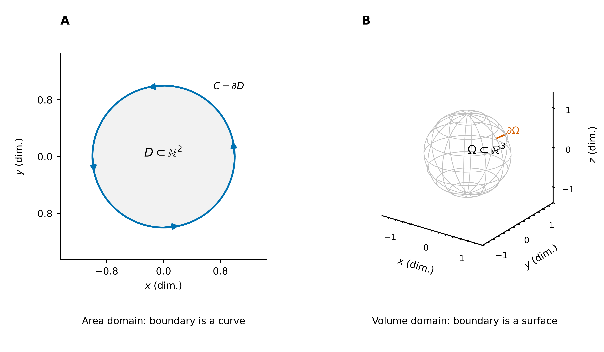
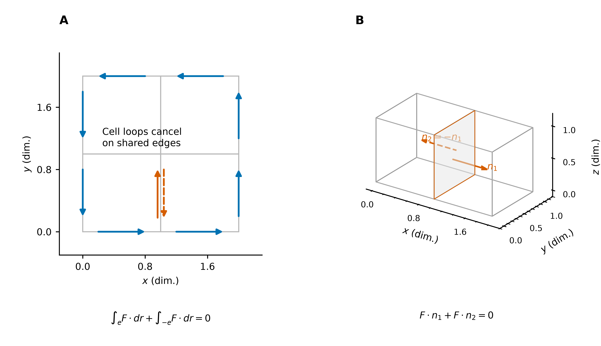
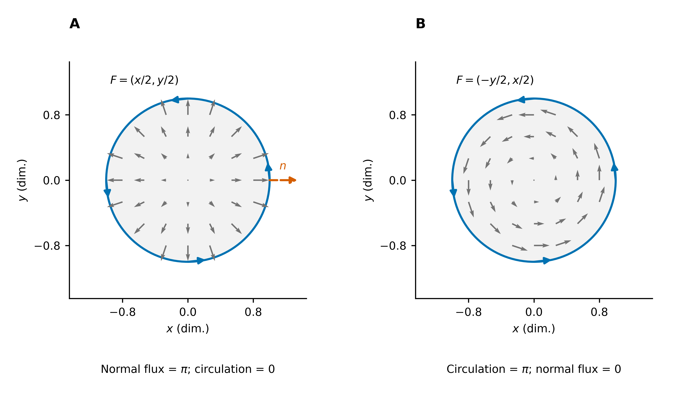
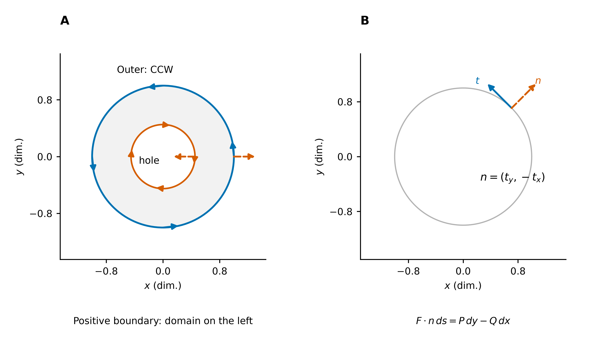
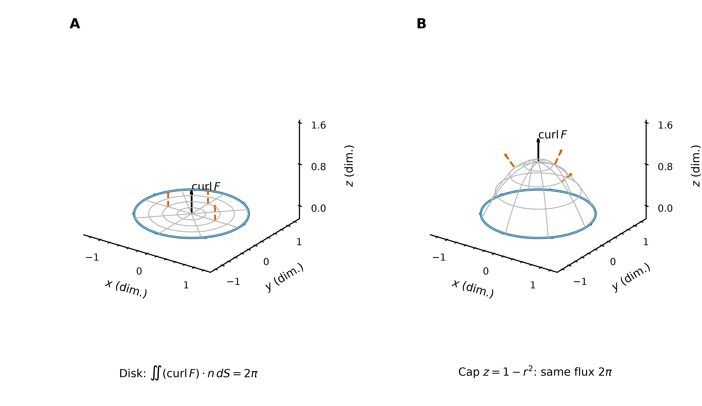
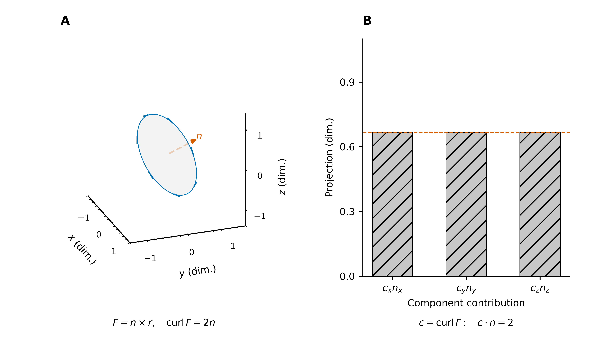
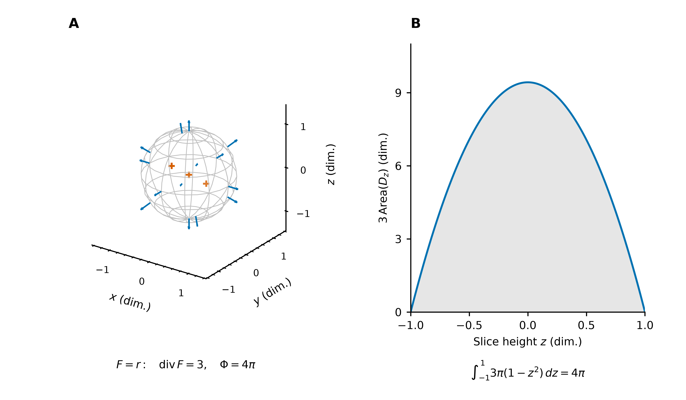
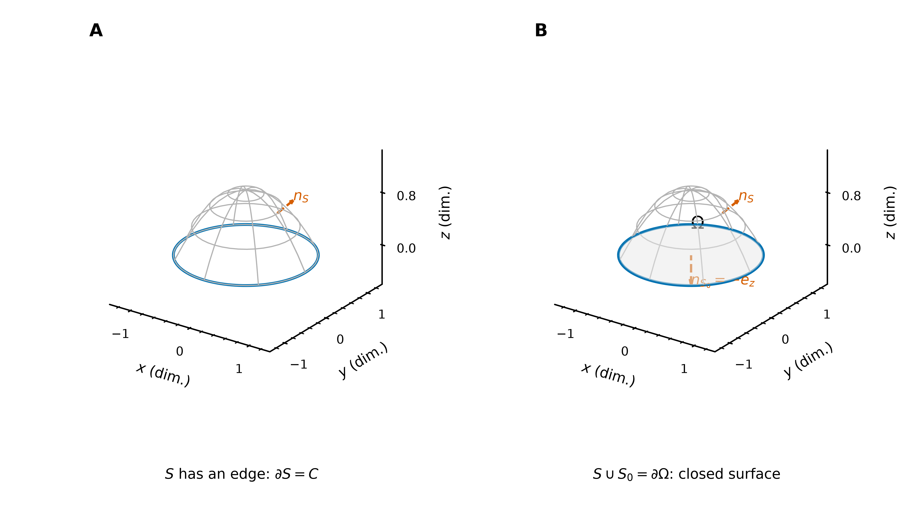
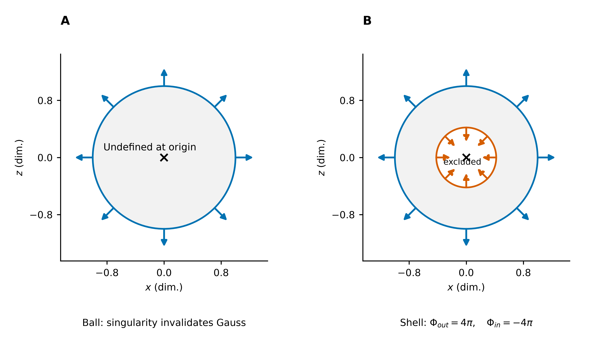

# 积分定理：从内部微分到边界积分

区域、定向与局部密度：Green、Stokes 和 Gauss 定理的几何解释。

> 前置：[多元微分学详解](../../02_多元微分学/02_微分与全微分/多元微分学详解.md) 第 5–6 节给出散度、旋度的向量代数来源及二维、三维场实例。本文解释其局部密度如何累积为边界积分；公式索引见 [多元积分学速查](../多元积分学速查.md)。
> 本文采用右手直角坐标系。各例与图的坐标、场值均无量纲；[配图与生成脚本](image/积分定理/README.md) 提供 9 组新图。

## 0. 区域与边界：先确定维数

### 0.1 平面区域、体积区域与曲面

本文以“区域”表示开且连通的集合，以闭包表示其连同边界。积分时，分片光滑边界不影响同维面积或体积积分的值。

以下讨论有界、边界由有限个分片光滑部分组成的对象；一般无界区域的边界未必是闭合曲线或封闭曲面。

| 对象 | 准确记法与名称 | 维数 | 边界 |
| --- | --- | --- | --- |
| 平面区域 | $D\subset\mathbb R^2$ | $2$ | $\partial D$ 是一条或多条闭合曲线 |
| 闭平面区域 | $\overline D=D\cup\partial D$ | $2$ | 同上 |
| 空间体积区域 | $\Omega\subset\mathbb R^3$ | $3$ | $\partial\Omega$ 是二维曲面 |
| 闭空间区域 | $\overline\Omega=\Omega\cup\partial\Omega$ | $3$ | 同上，可含内外多个边界分量 |
| 有边界曲面 | $S\subset\mathbb R^3$，如圆盘、曲面帽 | $2$ | $\partial S=C$ 为边缘曲线 |
| 封闭曲面 | 无边缘的紧致曲面，如球面 | $2$ | 作为曲面的边界为空：$\partial S=\varnothing$ |

“闭区域”与“封闭曲面”不同：前者包含内部，后者是一张二维曲面。在 Gauss 定理中，通常先指定体积区域 $\Omega$，再令封闭曲面 $S=\partial\Omega$。球体有体积，球面有面积。

“曲面无边缘”也不同于点集意义上的“闭集”：包含圆周的圆盘是闭集，但仍有边缘，属于有边界曲面。空间闭合曲线通常不直接确定一个体积区域；Stokes 为它选择跨接曲面，Gauss 则研究体积区域的完整边界。

**图 1**：A 的 $D$ 是二维面积区域，$C=\partial D$ 是一维曲线；B 的 $\Omega$ 是三维体积区域，$\partial\Omega$ 是二维封闭曲面。灰色球面网格表示体积区域的边界，不是将球体当成二维区域。

### 0.2 环流、功与通量

对向量场 $\mathbf F$，两种边界积分分别取切向、法向分量：

$$
\Gamma_C=\oint_C\mathbf F\cdot d\mathbf r
=\oint_C\mathbf F\cdot\mathbf t\,ds,
\qquad
\Phi_S=\iint_S\mathbf F\cdot\mathbf n\,dS.
$$

$\mathbf t$ 是单位切向量，$\mathbf n$ 是选定的单位法向量。$\Gamma_C$ 称为**环流**；当 $\mathbf F$ 表示力时，它才具有沿闭路做功的含义。速度场的环流通常不称为功。

$\Phi_S$ 是**原向量场穿过曲面的通量**。散度是标量，Gauss 右侧是散度的体积分，不称“散度的通量”。旋度是向量，Stokes 右侧则确实可以称为**旋度场穿过曲面的通量**，但它不同于原场的通量。

### 0.3 每一侧究竟使用什么微元

统一微元主文见 [积分元素](../01_重积分/积分元素.md)。令 $d\mathbf S=\mathbf n\,dS$、$d\boldsymbol\ell_n=\mathbf n\,ds$，有

| 积分所在对象 | 微元与坐标展开 | 用在何处 |
| --- | --- | --- |
| 空间曲线 $C$ | $d\mathbf r=(dx,dy,dz)^T$；$\mathbf F\cdot d\mathbf r=Pdx+Qdy+Rdz$ | Green 环流式、Stokes 的边界项 |
| 正向平面边界 $\partial D$ | $d\boldsymbol\ell_n=(dy,-dx)^T$；$\mathbf F\cdot d\boldsymbol\ell_n=Pdy-Qdx$ | Green 通量式的边界项 |
| 定向曲面 $S$ | $d\mathbf S=(dS_x,dS_y,dS_z)^T=(\mathbf r_u\times\mathbf r_v)du\,dv$ | Gauss 的原场通量；Stokes 的旋度通量 |
| 三维体积 $\Omega$ | 标量 $dV$；局部加权为 $(P_x+Q_y+R_z)dV$ | Gauss 的内部项 |

在曲面参数化中，

$$
dS_x=\frac{\partial(y,z)}{\partial(u,v)}du\,dv,\quad
dS_y=\frac{\partial(z,x)}{\partial(u,v)}du\,dv,\quad
dS_z=\frac{\partial(x,y)}{\partial(u,v)}du\,dv.
$$

传统曲面积分记法中的 $dy\,dz,dz\,dx,dx\,dy$ 指这些有向投影，而非三个可独立任取的无符号面积。所有 $P,Q,R$ 及其导数均在实际曲线或曲面点取值。

Stokes 的右侧因此实际展开为

$$
(\nabla\times\mathbf F)\cdot d\mathbf S
=(R_y-Q_z)dS_x+(P_z-R_x)dS_y+(Q_x-P_y)dS_z,
$$

Gauss 的边界项则展开为 $\mathbf F\cdot d\mathbf S=P\,dS_x+Q\,dS_y+R\,dS_z$。微元相同，配对的场分别是旋度场与原场；不能将二者混淆。第一类曲线、曲面积分使用标量 $ds,dS$ 累积密度，不是这两个边界项。

## 1. 共同原理：内部边界相消

对相邻的两个体积小块，共享面的外法向相反，因此同一场的法向通量互为相反数。对定向一致的两个曲面小块，共享边的诱导走向相反，因此沿边的线积分互为相反数：

$$
\mathbf F\cdot\mathbf n+\mathbf F\cdot(-\mathbf n)=0,
\qquad
\int_e\mathbf F\cdot d\mathbf r+\int_{-e}\mathbf F\cdot d\mathbf r=0.
$$

各小块的边界积分相加，内部公共边界抵消，只剩整体边界。其一维原型是 $\int_a^b f'(x)\,dx=f(b)-f(a)$：中间分点的端点值相消。

**图 2**：A 中相邻正向回路在共享边上走向相反；B 中相邻三维小盒子在共享面上的外法向相反。红色表示待抵消的内部贡献，蓝色表示可保留的外边界走向。图示是机制说明；完整区域须将全部小块相加。

## 2. Green 公式：二维面积与边界曲线

设 $D$ 为有界平面区域，边界由有限条分片光滑简单闭曲线组成，$P,Q$ 在包含 $\overline D$ 的开集上为 $C^1$。令 $\mathbf F=(P,Q)^T$。

### 2.1 环流形式：平面旋度的面积积分

边界取正向，即沿边界行进时区域位于左侧：

$$
\boxed{\oint_{\partial D}P\,dx+Q\,dy
=\iint_D(Q_x-P_y)\,dA}.
$$

右侧将每个小块的**有向环流密度**乘以面积后累加，左侧保留整个边界上的原场环流。累加的不是区域内任意闭曲线的所有环流，而是一次分割中各小块的相容边界积分。

在矩形 $[a,b]\times[c,d]$ 上，一元基本定理给出

$$
\iint_D Q_x\,dA=\int_c^d[Q(b,y)-Q(a,y)]\,dy,
$$

$$
-\iint_D P_y\,dA=\int_a^b[P(x,c)-P(x,d)]\,dx.
$$

两式分别是右边减左边、下边减上边，合起来恰好按逆时针绕行。对一般分片光滑区域作适当分割，内部边积分相消，得到 Green 公式。

### 2.2 通量形式：二维散度的面积积分

正向单位切向量为 $\mathbf t=(t_x,t_y)^T$ 时，平面内的外单位法向为 $\mathbf n=(t_y,-t_x)^T$，故

$$
\mathbf F\cdot\mathbf n\,ds=P\,dy-Q\,dx.
$$

对 $( -Q,P)^T$ 使用环流形式，即得

$$
\boxed{\oint_{\partial D}\mathbf F\cdot\mathbf n\,ds
=\oint_{\partial D}P\,dy-Q\,dx
=\iint_D(P_x+Q_y)\,dA}.
$$

这是二维散度定理。边界仍是一维曲线，但积分取的是**平面内法向分量**，不是沿曲线的切向分量。

**图 3**：A 取 $\mathbf F=(x/2,y/2)^T$，散度为 $1$、平面旋度为 $0$，单位圆周的向外通量为 $\pi$、环流为 $0$。B 取 $\mathbf F=(-y/2,x/2)^T$，两者交换：环流为 $\pi$、通量为 $0$。箭头场与边界走向分别表示场值和积分方向；两种积分不能仅凭“都是闭曲线积分”而混用。

### 2.3 有孔区域的定向

外边界逆时针，内边界顺时针；内边界的区域外法向指向孔洞。两条规则都以整个区域为参照。

**图 4**：A 中行进方向始终使有效区域位于左侧；孔洞不属于区域。B 给出正向切向量及其右侧外法向，解释通量形式中 $P\,dy-Q\,dx$ 的符号。

### 2.4 例：椭圆面积

取 $\mathbf F=(-y/2,x/2)^T$，其平面旋度为 $1$。对正向椭圆 $x=2\cos t,y=\sin t$，

$$
\operatorname{Area}(D)=\frac12\oint_{\partial D}(x\,dy-y\,dx)
=\frac12\int_0^{2\pi}2\,dt=2\pi.
$$

这是以原场的边界环流计算面积；若不赋予场力学单位，无须称为做功。

## 3. Stokes 公式：曲面上的旋度累积与边界环流

### 3.1 对象与公式

设 $S$ 为紧致、可定向、分片光滑的有边界曲面，$\mathbf F$ 在包含 $S$ 的开集上为 $C^1$。曲面法向与边界方向满足右手规则：

$$
\boxed{\oint_{\partial S}\mathbf F\cdot d\mathbf r
=\iint_S(\nabla\times\mathbf F)\cdot\mathbf n\,dS}.
$$

右侧只累积旋度在曲面法向上的分量。切于曲面的旋度分量不贡献该曲面的有向环流密度；直接积 $|\nabla\times\mathbf F|$ 一般错误，因为它丢失方向与符号。

**准确表述**：曲面上原场的局部有向环流密度，经面积加权累积，等于原场沿曲面边界的环流。若原场为力场，该边界环流可解释为沿闭路的总功。

### 3.2 为何能从平面推广到曲面

对定向一致的光滑参数片 $\mathbf r(u,v)$，有

$$
\mathbf n\,dS=(\mathbf r_u\times\mathbf r_v)\,du\,dv.
$$

令 $A(u,v)=\mathbf F(\mathbf r)\cdot\mathbf r_u$、$B(u,v)=\mathbf F(\mathbf r)\cdot\mathbf r_v$。链式法则及混合偏导相消给出

$$
B_u-A_v=(\nabla\times\mathbf F)\cdot(\mathbf r_u\times\mathbf r_v).
$$

因此，参数域上的 Green 公式恰好变为曲面片上的 Stokes 公式。将参数片拼合，共享边的线积分相消，只剩 $\partial S$。上述求导说明可在 $C^2$ 参数片上进行；一般分片光滑情形按相应极限处理。

### 3.3 例：同一边界的圆盘与曲面帽

取 $\mathbf F=(-y,x,0)^T$，旋度为 $2\mathbf e_z$。边界为单位圆 $C:z=0,x^2+y^2=1$，从 $+z$ 看逆时针。

- 圆盘 $S_1$ 取向上法向，旋度通量为 $2\pi$。
- 曲面帽 $S_2:z=1-x^2-y^2$ 取向上法向。在 $xy$ 参数化下，有向面积元为 $(2x,2y,1)^T\,dx\,dy$，与 $2\mathbf e_z$ 点积后仍为 $2\,dx\,dy$，积分也为 $2\pi$。

**图 5**：蓝色边界箭头表示原场沿单位圆的切向作用，红色虚线箭头表示两张曲面的选定法向，黑色箭头表示旋度。曲面帽面积更大，但其法向倾斜，面积与法向投影共同决定旋度通量；两者均等于同一边界环流 $2\pi$。

### 3.4 例：三个旋度分量共同贡献

沿用前篇的斜轴旋转场

$$
\mathbf n=\frac1{\sqrt3}(1,1,1)^T,\qquad
\mathbf F=\mathbf n\times\mathbf r,\qquad \nabla\times\mathbf F=2\mathbf n.
$$

取法向为 $\mathbf n$ 的单位圆盘，则

$$
(\nabla\times\mathbf F)\cdot\mathbf n
=\frac23+\frac23+\frac23=2,\qquad
\iint_S(\nabla\times\mathbf F)\cdot\mathbf n\,dS=2\pi.
$$

边界正向圆周上，$\mathbf F$ 是单位切向量，故环流也为 $2\pi$。三维旋度无需平行某个坐标轴，任意曲面的局部贡献由点积统一确定。

**图 6**：A 的边界方向与法向 $\mathbf n$ 相容。B 的三柱分别为 $(\nabla\times\mathbf F)_i n_i$，各为 $2/3$，相加得到单位面积环流密度 $2$；柱高不是三个分量本身的大小。

**曲面选择条件**：改用其他跨接曲面时，原场须在所选曲面及其邻域光滑，且边界定向一致。不能让新曲面穿过原场奇点。若 $S$ 本身为封闭曲面，则 $\partial S=\varnothing$，在适用条件下旋度通量为零；这并不要求原场通量为零。

## 4. Gauss 公式：体积散度累积与边界净通量

### 4.1 对象、外法向与公式

设 $\Omega$ 为有界空间体积区域，边界分片光滑，$\mathbf F$ 在包含 $\overline\Omega$ 的开集上为 $C^1$。所有边界分量均采用区域外单位法向：

$$
\boxed{\oiint_{\partial\Omega}\mathbf F\cdot\mathbf n\,dS
=\iiint_\Omega\nabla\cdot\mathbf F\,dV}.
$$

左侧是**原场穿过整个封闭边界的净向外通量**；右侧是**散度的体积累积**。若有空腔，空腔壁属于 $\partial\Omega$，其区域外法向指向空腔，不能只积外壳而遗漏内壁。

### 4.2 为何体积累积只剩边界通量

对微小体积块 $K$，局部通量关系给出

$$
\oiint_{\partial K}\mathbf F\cdot\mathbf n_K\,dS
=(\nabla\cdot\mathbf F)(\mathbf a_K)|K|+o(|K|).
$$

相邻体积块在共享面上的法向相反。对全部小块求和，内部通量相消，留下外边界通量；右侧的加权和在规则分割加细时趋于散度的三重积分。一般光滑边界需同时处理边界逼近，上述关系说明其几何机制。

### 4.3 “源/汇强度”应如何理解

数学上，正散度表示局部净流出，负散度表示局部净流入，通常称为**源/汇结构**。散度是每单位体积的局部密度，体积分给出整个区域的代数净量；不同位置的正负贡献可以抵消。

若 $\mathbf j$ 是某守恒量的通量密度，$\rho$ 为存量密度，$s$ 为单位体积的真实源项，则固定控制体上的收支为

$$
\partial_t\rho+\nabla\cdot\mathbf j=s,
$$

$$
\boxed{\oiint_{\partial\Omega}\mathbf j\cdot\mathbf n\,dS
=\iiint_\Omega s\,dV-\frac d{dt}\iiint_\Omega\rho\,dV}.
$$

因此，**净流出 = 内部净产生 − 内部存量增长率**。仅在稳态等无存量变化条件下，边界净通量才等于真实源汇的总强度。无真实源时，正净流出也可由内部存量下降供给。若 $\mathbf F$ 为速度场而非通量密度，其散度表示微元相对膨胀率，不能直接解释成产生质量。

### 4.4 例：三维径向场的球面通量

取 $\mathbf F=(x,y,z)^T$、半径为 $R$ 的球体 $\Omega$。有 $\nabla\cdot\mathbf F=3$，故

$$
\oiint_{\partial\Omega}\mathbf F\cdot\mathbf n\,dS
=3\operatorname{Vol}(\Omega)=3\frac{4\pi R^3}{3}=4\pi R^3.
$$

直接检验：球面上 $\mathbf F=R\mathbf n$，法向分量为 $R$，乘球面积 $4\pi R^2$ 得到相同结果。该场在整个体积内都有散度 $3$，不是只在原点有点源。

**图 7**：取 $R=1$。A 展示真实三维球面上的原场向外通量，内部加号仅提示源密度遍布体积。B 将常散度 $3$ 按高度 $z$ 的截面面积 $\pi(1-z^2)$ 加权，曲线下面积为 $4\pi$；它是三重积分的切片表示。

### 4.5 有边缘的曲面须补成完整边界

曲面帽 $S:z=1-x^2-y^2$ 本身有边缘，不能直接当作 Gauss 的 $\partial\Omega$。补上底盘 $S_0:z=0,x^2+y^2\le1$ 后，才有

$$
S\cup S_0=\partial\Omega,\qquad
\Omega={x^2+y^2<1, 0<z<1-x^2-y^2}.
$$

顶部法向朝上，底盘外法向朝下。若原题求顶部原场通量，则

$$
\iint_S\mathbf F\cdot\mathbf n\,dS
=\iiint_\Omega\nabla\cdot\mathbf F\,dV
-\iint_{S_0}\mathbf F\cdot\mathbf n\,dS.
$$

取 $\mathbf F=(x,y,z)^T$ 时，$\operatorname{Vol}(\Omega)=\pi/2$，底盘通量为零，顶部通量为 $3\pi/2$。这与第 3 节同形曲面上的旋度通量 $2\pi$ 不同，因为被积的向量场不同。

**图 8**：A 只有曲面帽及其边缘；B 补底盘形成整个体积的边界，顶部、底部法向均指向 $\Omega$ 外。Stokes 可以直接使用 A 的有边界曲面；Gauss 使用 B 的完整封闭边界。

## 5. 孔洞与奇点：检查整个积分对象

取 $\mathbf F(\mathbf r)=\mathbf r/\|\mathbf r\|^3$，在原点以外有 $\nabla\cdot\mathbf F=0$；但半径 $R$ 的球面上，$\mathbf F\cdot\mathbf n=1/R^2$，向外通量为 $4\pi$。

这不违反 Gauss 定理：球体包含原点，而场在该点无定义，不满足光滑性条件。挖去小球后，对球壳 $a<\|\mathbf r\|<R$，外球面通量为 $4\pi$，内球面的区域外法向指向原点，通量为 $-4\pi$，总和为零。

**图 9**：两图是三维球体或球壳的 $xz$ 截面，不是改算二维通量。箭头表示区域外法向；球壳内壁法向指向空腔。积分必须包括整张内外球面，不能将截面圆周代替球面。

同理，Green 检查整个闭平面区域的邻域，Stokes 检查整张所选曲面的邻域；仅边界上的光滑性不足以应用定理。

## 6. 三大定理的比较与计算顺序

| 形式 | 积分对象的维数 | 局部累积 | 整体边界量 | 定向 |
| --- | --- | --- | --- | --- |
| Green 环流式 | 平面 $2\to1$ | $(Q_x-P_y)\,dA$ | 原场沿边界的环流 | 区域在左侧 |
| Green 通量式 | 平面 $2\to1$ | $(P_x+Q_y)\,dA$ | 原场穿过边界曲线的平面内通量 | 外法向 |
| Stokes | 曲面 $2\to1$，置于三维空间 | $(\nabla\times\mathbf F)\cdot\mathbf n\,dS$ | 原场沿曲面边缘的环流 | 右手定向 |
| Gauss | 体积 $3\to2$ | $(\nabla\cdot\mathbf F)\,dV$ | 原场穿过完整边界曲面的净通量 | 区域外法向 |

先确定原场、积分对象及其边界，再明确切向或法向；随后检查光滑性、孔洞和定向，最后选择便于计算的一侧。Green 是 Stokes 的平面情形；Green 通量式则是二维散度定理。

## 附：广义 Stokes 定理

在紧致、有向的光滑 $k$ 维流形 $M$ 上，对适当光滑的 $(k-1)$ 阶微分形式 $\omega$，边界取诱导定向：

$$
\int_{\partial M}\omega=\int_M d\omega.
$$

Green/Stokes 使用一阶形式 $\omega=P\,dx+Q\,dy+R\,dz$，其外微分对应旋度；Gauss 使用通量二阶形式 $\omega=P\,dy\wedge dz+Q\,dz\wedge dx+R\,dx\wedge dy$，其外微分为 $(\nabla\cdot\mathbf F)\,dx\wedge dy\wedge dz$。相同的边界结构作用于不同维度、不同阶数的对象，因此不能将通量与环流混为同一积分。

前置：[曲线积分](../02_曲线积分/曲线积分.md) 的环量与 [曲面积分](../03_曲面积分/曲面积分：曲面累积与穿面通量.md) 的通量。应用：[保守场与势函数](../05_场论与应用/保守场与势函数：路径无关的本质.md) 中的路径无关、无旋条件与守恒关系。

[返回本节目录](README.md) · [局部微分概念](../../02_多元微分学/02_微分与全微分/多元微分学详解.md) · [配图与脚本](image/积分定理/README.md)
