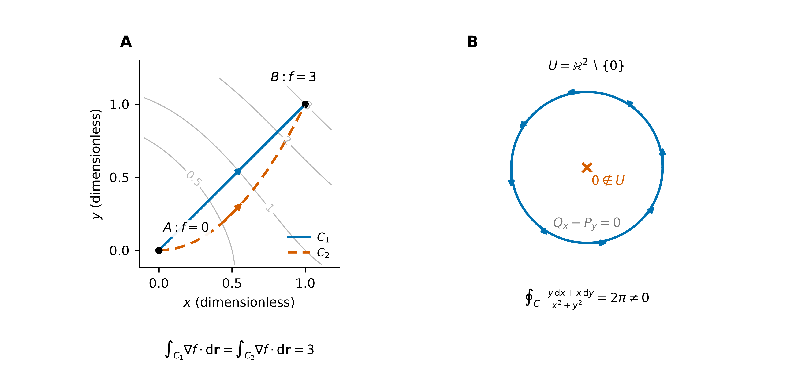
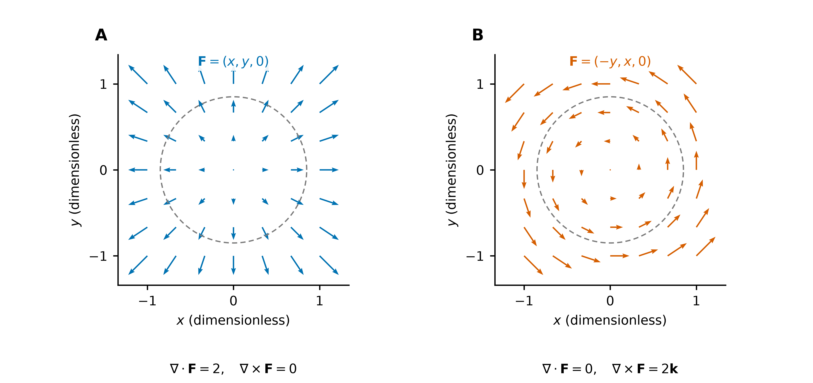
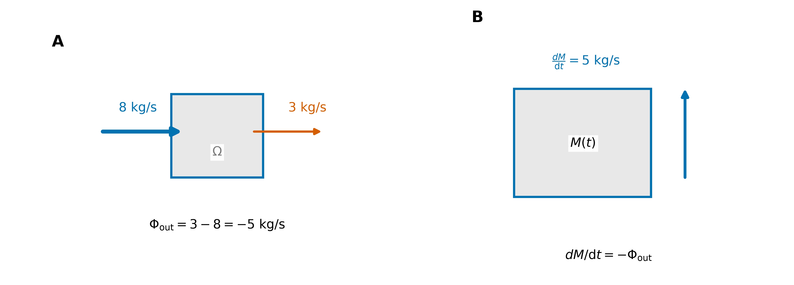

# 保守场与势函数：路径无关的本质

> **核心概念**：保守场可表示为标量势函数的梯度，其曲线积分由端点势差决定。

## 1. 保守场的等价刻画

设 $U\subset\mathbb R^n$ 为路径连通的开集，$\mathbf F$ 为连续向量场；路径取 $U$ 内的分段光滑曲线。以下三条等价：

1. 存在 $f\in C^1(U)$，使 $\mathbf F=\nabla f$，即有势函数 / 保守场。
2. 曲线积分只取决于起终点，即路径无关。
3. 对 $U$ 内**每一条**闭曲线，$\oint_C\mathbf F\cdot \mathrm d\mathbf r=0$。

第一条推出第二条来自曲线积分基本定理；第二条推出第三条来自起终点重合。

反向的关键构造是：固定基点 $A$，定义

$$
f(X)=\int_A^X\mathbf F\cdot \mathrm d\mathbf r.
$$

如果所有闭路积分为零，选不同路径得到相同值；再考察终点沿坐标方向的小位移，就得到 $\nabla f=\mathbf F$。

**几何意义**：势函数将向量场的局部变化信息表示为定义域上的标量函数。在连通区域上，同一场的势函数相差一个常数。

## 2. 无旋条件与全局势函数的存在性

若 $\mathbf F\in C^1(U)$ 是梯度场，则必有

$$
\nabla\times\mathbf F=\mathbf0.
$$

在二维，这写成 $P_y=Q_x$。反向的常用充分条件是：

$$
\boxed{U\text{ 单连通，}\ \mathbf F\in C^1(U),\ \nabla\times\mathbf F=\mathbf0
\ \Longrightarrow\ \mathbf F\text{ 有势函数}}.
$$

单连通指每条闭路都能在区域内连续收缩为一点。在通常的平面区域中，这对应无孔的几何直觉；三维情形仍须依据闭路的可收缩性判断，空腔的存在本身不等价于非单连通。

**单连通性是充分条件，并非保守场存在的必要条件**。某些有孔区域上的场仍具有全局势函数。无旋场在足够小的球内存在局部势，但局部势未必能延拓为全局单值函数。

### 反例 1：穿孔平面上的无旋非保守场

在 $U=\mathbb R^2\setminus\{(0,0)\}$ 上取

$$
\mathbf F=\left(-\frac{y}{x^2+y^2},\frac{x}{x^2+y^2}\right).
$$

处处有 $Q_x-P_y=0$，但沿单位圆逆时针一圈：

$$
\oint_C\mathbf F\cdot \mathrm d\mathbf r
=\int_0^{2\pi}1\,\mathrm dt=2\pi.
$$

因此不存在全局单值势函数。局部势可取极角 $\theta$，但绕一圈角度增加 $2\pi$，无法在整个穿孔平面上连续、单值地选取。

由于场在盘内原点处无定义，Green 公式不能直接应用于整个圆盘。

## 3. 势函数的求解

对平面场 $\mathbf F=(P,Q)$，要解

$$
f_x=P,\qquad f_y=Q.
$$

先对 $x$ 积分，将积分常数写为另一变量的函数：

$$
f(x,y)=\int P(x,y)\,\mathrm dx+g(y).
$$

再对 $y$ 求偏导，通过与 $Q$ 比较确定 $g'(y)$。所得 $g'(y)$ 应与 $x$ 无关；若仍依赖 $x$，须核验无旋条件或计算过程。

### 例题 1：由偏导条件求势函数

$$
\mathbf F=(2xy+1,\ x^2+2y).
$$

先有 $P_y=2x=Q_x$；定义域为 $\mathbb R^2$，可用无旋判据。由 $f_x=2xy+1$ 得

$$
f=x^2y+x+g(y).
$$

代入 $f_y=x^2+g'(y)=x^2+2y$，得到

$$
f=x^2y+x+y^2+C.
$$

从 $(0,0)$ 到 $(1,1)$ 的积分为 $f(1,1)-f(0,0)=3$。三维同理，先积分得到 $g(y,z)$，再依次匹配剩余偏导。

**图 1（例题 1与反例 1）**：A 中路径 $y=x$ 与 $y=x^2$ 连接相同端点，积分均为势差 $3$，灰线表示 $f=x^2y+x+y^2$ 的等值线；B 中穿孔平面上的无旋场沿圆切向分布，闭路环流为 $2\pi$，因此不存在全局单值势函数。

**物理记号提醒**：本笔记取 $\mathbf F=\nabla f$；力学中的势能常定义为 $\mathbf F=-\nabla U$，所以力做功为 $U(A)-U(B)$。

## 4. 无旋场、无散场与保守场的比较

| 性质 | 判据或定义 | 积分含义 |
| --- | --- | --- |
| 无旋 | $\nabla\times\mathbf F=0$ | 局部没有环流密度；满足定义域条件后可推出全局路径无关 |
| 无散 | $\nabla\cdot\mathbf F=0$ | 对场在整个内部光滑的封闭区域，净流出通量为零 |
| 保守 | $\mathbf F=\nabla f$ | 每条闭路积分为零；开路积分为端点势差 |

### 例题 2：无旋性与无散性的独立性

- $\mathbf F=(x,y,0)$ 无旋且保守，势为 $(x^2+y^2)/2$，但散度为 $2$。
- $\mathbf F=(-y,x,0)$ 散度为 $0$，但旋度为 $(0,0,2)$，不是保守场。

无散性与无旋性分别约束不同的局部微分量，二者互不蕴含。封闭曲面的通量为零也不蕴含场处处为零。

**图 2（例题 2）**：A 为场 $(x,y,0)$ 在 $xy$ 平面上的径向分布，散度为 $2$、旋度为零；B 为旋转场 $(-y,x,0)$，散度为零、旋度为 $2\mathbf k$。箭长按相同尺度缩放，虚线圆用于比较径向与切向分量。

## 5. 质量守恒与连续性方程

令 $\rho$ 为质量密度，$\mathbf v$ 为速度。对固定空间区域 $\Omega$，若没有内部质量生成，质量守恒写成

$$
\frac{\mathrm d}{\mathrm dt}\iiint_\Omega\rho\,\mathrm dV
=-\oiint_{\partial\Omega}\rho\mathbf v\cdot\mathbf n\,\mathrm dS.
$$

左边是区域内质量的变化率，右边是负的净流出量。密度与速度足够光滑时，用 Gauss 转换，并要求等式对任意区域成立，得到

$$
\boxed{\partial_t\rho+\nabla\cdot(\rho\mathbf v)=0}.
$$

特别地，密度为正的时空常数时，$\nabla\cdot\mathbf v=0$。连续性方程表明：**局部质量密度的变化率与局部净流出率互为相反数**。

**图 3（原理图）**：控制体无内部质量源。设流入率为 $8\,\mathrm{kg/s}$、流出率为 $3\,\mathrm{kg/s}$，其余边界无通量，则向外净通量为 $-5\,\mathrm{kg/s}$，质量变化率为 $5\,\mathrm{kg/s}$。图中流率为说明守恒关系而设定，非实验数据；箭头表示流向。

## 6. 保守场的判定与积分计算流程

1. 明确场的定义域，并确认积分路径位于该域内。
2. 计算旋度并检验单连通性；充分条件不满足时，可通过非零闭路积分否定全局势函数的存在。
3. 若已确定势函数存在，则利用端点势差计算；否则采用参数化或满足适用条件的积分定理。

通量与环流量的转换条件见 [积分定理](../04_三大积分定理/积分定理：从内部微分到边界积分.md)。

前置：[多元微分学详解](../../02_多元微分学/02_微分与全微分/多元微分学详解.md) 中的梯度、散度与旋度；计算对照：[曲线积分](../02_曲线积分/曲线积分.md) 的端点势差与 [曲面积分](../03_曲面积分/曲面积分：曲面累积与穿面通量.md) 的穿面通量。

[返回场论与应用](README.md)
