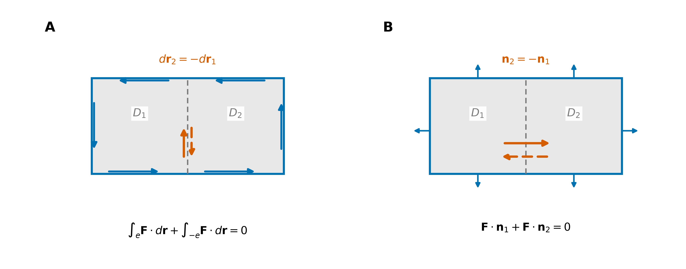

# 多元积分学速查

累积、方向与边界：多元积分公式和方法索引。

> 接续 [多元微分学速查](../02_多元微分学/02_微分与全微分/多元微分学速查.md)。
> 偏导数、方向导数、梯度、散度与旋度的详细推导、可视化及物理含义见 [多元微分学详解](../02_多元微分学/02_微分与全微分/多元微分学详解.md)。本文负责积分环节的速查。
> **主线**：积分将局部量累积为整体量；积分定理建立区域内部的微分信息与边界积分之间的联系。

## 1. 积分对象、微元与定向

积分由分割、局部加权求和及极限过程定义。不同积分的区别在于积分对象的维度、微元的几何意义，以及定向是否参与计算。

| 类型 | 积分对象 | 微元 | 本质 | 反向后的结果 |
| --- | --- | --- | --- | --- |
| 二重积分 $\iint_D f\,dA$ | 平面区域 | 面积 $dA$ | 面密度的累积 | 无须定向 |
| 三重积分 $\iiint_\Omega f\,dV$ | 空间区域 | 体积 $dV$ | 体密度的累积 | 无须定向 |
| 第一类曲线积分 $\int_C f\,ds$ | 曲线 | 弧长 $ds$ | 线密度的累积 | 不变 |
| 第二类曲线积分 $\int_C\mathbf F\cdot d\mathbf r$ | 有向曲线 | 位移 $d\mathbf r$ | 切向作用的累积，如功 | 变号 |
| 第一类曲面积分 $\iint_S f\,dS$ | 曲面 | 面积 $dS$ | 曲面密度的累积 | 不变 |
| 第二类曲面积分 $\iint_S\mathbf F\cdot\mathbf n\,dS$ | 有向曲面 | 有向面积 $\mathbf n\,dS$ | 法向穿过量的累积，即通量 | 变号 |

其中 $\mathbf n$ 为选定的**单位法向量**。第一类积分与定向无关，但被积函数为负时，积分仍可为负。

**统一解释**：标量密度分别按长度、面积或体积加权；向量场的曲线积分取切向分量，通量积分取法向分量。

**图 1（累积原理）**：A 给出区域分割与取样点；B 将非负取样值表示为柱高。局部贡献为“函数值 × 微元大小”，各柱体体积之和在分割加细时趋于积分。

## 2. 参数化与变量代换

### 重积分的变量代换与 Jacobian

若 $\mathbf x=T(\mathbf u)$ 是合法的一一光滑换元，则

$$
\int_{T(U)}f(\mathbf x)\,dV
=\int_U f(T(\mathbf u))\,|\det DT(\mathbf u)|\,d\mathbf u.
$$

二维情形以 $dA$ 代替 $dV$。**变量代换须同时变换被积函数、积分区域与积分微元**。

| 坐标 | 变换 | 面积元 / 体积元 |
| --- | --- | --- |
| 极坐标 | $x=r\cos\theta,\ y=r\sin\theta$ | $dA=r\,dr\,d\theta$ |
| 柱坐标 | 上式加 $z=z$ | $dV=r\,dr\,d\theta\,dz$ |
| 球坐标 | $x=r\sin\varphi\cos\theta,\ y=r\sin\varphi\sin\theta,\ z=r\cos\varphi$ | $dV=r^2\sin\varphi\,dr\,d\varphi\,d\theta$ |

统一约定：$r\ge0$，$\theta$ 为方位角，$\varphi\in[0,\pi]$ 自 $+z$ 轴量起。标量与有向微元的几何构造、坐标展开及场的作用见 [积分元素](01_重积分/积分元素.md)。

### 曲线积分的参数表示

对分段光滑曲线 $\mathbf r(t)$，$a\le t\le b$，参数递增给出方向：

$$
\int_C f\,ds=\int_a^b f(\mathbf r(t))\,\|\mathbf r'(t)\|\,dt,
\qquad
\int_C\mathbf F\cdot d\mathbf r=\int_a^b\mathbf F(\mathbf r(t))\cdot\mathbf r'(t)\,dt.
$$

### 曲面积分的参数表示

对正则参数曲面 $\mathbf r(u,v)$，参数域为 $U$，选法向与 $\mathbf r_u\times\mathbf r_v$ 同向：

$$
\iint_S f\,dS=\iint_U f(\mathbf r)\,\|\mathbf r_u\times\mathbf r_v\|\,du\,dv,
$$

$$
\iint_S\mathbf F\cdot\mathbf n\,dS
=\iint_U\mathbf F(\mathbf r)\cdot(\mathbf r_u\times\mathbf r_v)\,du\,dv.
$$

选相反法向时，后一式加负号。参数化应覆盖一次；重复覆盖会重复计数。

## 3. 梯度、旋度与散度的积分关系

| 微分信息 | 整体积分关系 | 核心理解 |
| --- | --- | --- |
| 梯度 $\nabla f$ | $\displaystyle\int_A^B\nabla f\cdot d\mathbf r=f(B)-f(A)$ | 沿途变化相加，只剩端点差 |
| 旋度 $\nabla\times\mathbf F$ | $\displaystyle\oint_{\partial S}\mathbf F\cdot d\mathbf r=\iint_S(\nabla\times\mathbf F)\cdot\mathbf n\,dS$ | 内部环流相消，只剩边界环流 |
| 散度 $\nabla\cdot\mathbf F$ | $\displaystyle\oiint_{\partial\Omega}\mathbf F\cdot\mathbf n\,dS=\iiint_\Omega\nabla\cdot\mathbf F\,dV$ | 内部通量相消，只剩边界净流出 |

前提：势函数 $f\in C^1$；Stokes、Gauss 中的场在相应曲面或闭区域的邻域内为 $C^1$，几何对象分片光滑并满足相应定向条件。Gauss 的法向必须朝外。

平面上的 Green 公式是 Stokes 的平面情形，$\mathbf F=(P,Q)$ 时：

$$
\oint_{\partial D}P\,dx+Q\,dy
=\iint_D(Q_x-P_y)\,dA.
$$

边界按“区域在行进方向左侧”定向；有孔区域的内边界顺时针。$P,Q$ 须在包含整个闭区域的开集上为 $C^1$。

**图 2（边界原理）**：A 中公共边的走向相反，环流贡献相消；B 中公共面的外法向相反，通量贡献相消（截面示意）。内部边界抵消后，保留整体边界上的积分。

## 4. 积分方法的选择

1. **确定积分类型**：区分标量累积、功积分与通量积分。
2. **确定区域与定向**：明确边界及投影；有向曲线指定行进方向，有向曲面指定法向。
3. **分析积分结构**：检验对称性、势函数或积分定理的适用条件。
4. **实施参数化或变量代换**：完整写出被积函数、积分范围与微元，并核对符号和量纲。

| 题目特征 | 优先考虑 |
| --- | --- |
| 圆、圆柱、球或径向函数 | 极、柱、球坐标 |
| 累次积分内层不好积 | 画区域后交换次序 |
| 起终点已知，场有势函数 | 直接算势函数之差 |
| 平面闭曲线上的功 / 环流量 | Green |
| 空间闭曲线上的环流量 | Stokes，选便于计算的跨接曲面 |
| 封闭曲面上的通量 | Gauss |
| 开曲面上的通量 | 直接计算，或补面后用 Gauss 再扣除补面通量 |

**适用条件**：无旋性不必然蕴含全局势函数的存在；区域内的奇点可能使积分定理的光滑性条件失效。

## 5. 专题索引

- [积分元素](01_重积分/积分元素.md)：标量与有向微元、投影面积、点积与叉积。

- [重积分：区域、累次积分与换元](01_重积分/重积分：区域、累次积分与换元.md)
- [曲线积分](02_曲线积分/曲线积分.md)
- [曲面积分：曲面累积与穿面通量](03_曲面积分/曲面积分：曲面累积与穿面通量.md)
- [积分定理：从内部微分到边界积分](04_三大积分定理/积分定理：从内部微分到边界积分.md)
- [保守场与势函数：路径无关的本质](05_场论与应用/保守场与势函数：路径无关的本质.md)
