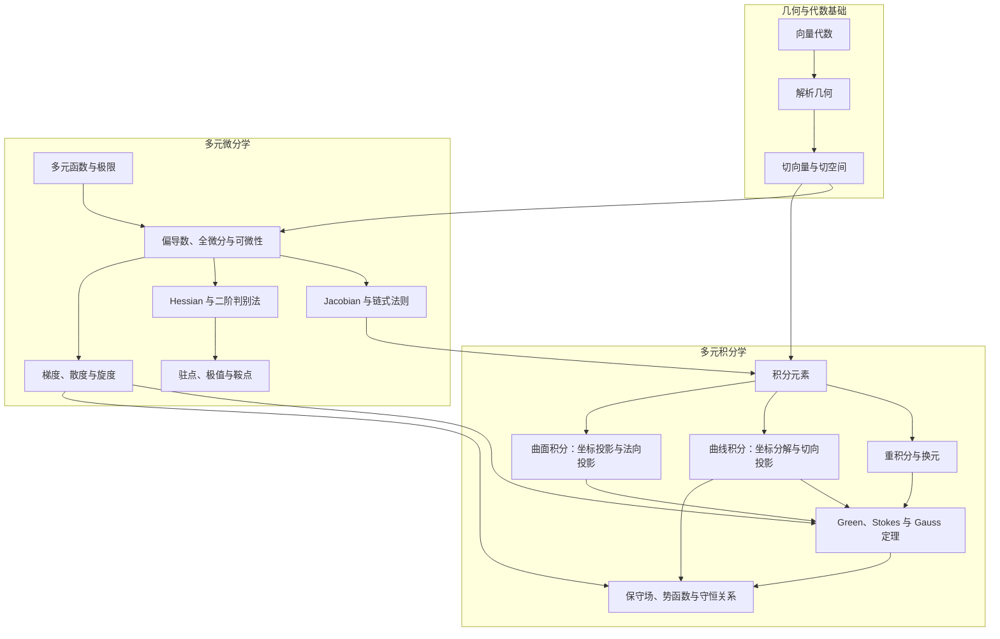

# 关系图谱

主线图表示知识依赖；下方索引根据正文中的 Markdown 链接生成，列出每篇文档的引用与反向引用。章节入口、习题、配图说明及导出转写稿均纳入索引；图片文件由链接检查脚本单独核对。

## 知识主线



## 阅读入口与引用约定

- [几何与代数基础](01_几何与代数基础/README.md)：从点积、叉积与参数化进入切空间。
- [多元微分学](02_多元微分学/README.md)：[详解](02_多元微分学/02_微分与全微分/多元微分学详解.md) 负责推导，[速查](02_多元微分学/02_微分与全微分/多元微分学速查.md) 负责公式与条件。
- [多元积分学](03_多元积分学/README.md)：由 [积分元素](03_多元积分学/01_重积分/积分元素.md) 进入各类积分，用 [速查](03_多元积分学/多元积分学速查.md) 选择方法。

库内统一使用标准 Markdown 相对链接与 `/` 分隔符，目录链接指向 `README.md`。正文在概念衔接处说明前置或后续主题，速查回链详解；改名时同步更新正文、目录和绘图校验脚本。引用优先指向整篇文档，避免章节标题变化使锚点失效。

## 完整引用与反向索引

### 01_几何与代数基础

| 文档 | 引用的文档 | 被哪些文档引用 |
| --- | --- | --- |
| [切向量与切空间：配图说明](01_几何与代数基础/image/切向量与切空间/README.md) | [切向量与切线：配图说明](01_几何与代数基础/image/切向量与切线/README.md)、[切向量与切空间](01_几何与代数基础/切向量与切空间.md) | [几何与代数基础](01_几何与代数基础/README.md)、[切向量与切空间](01_几何与代数基础/切向量与切空间.md) |
| [切向量与切线：配图说明](01_几何与代数基础/image/切向量与切线/README.md) | [切向量与切空间](01_几何与代数基础/切向量与切空间.md) | [切向量与切空间：配图说明](01_几何与代数基础/image/切向量与切空间/README.md) |
| [几何与代数基础](01_几何与代数基础/README.md) | [切向量与切空间：配图说明](01_几何与代数基础/image/切向量与切空间/README.md)、[切向量与切空间](01_几何与代数基础/切向量与切空间.md)、[向量代数：核心知识笔记](01_几何与代数基础/向量代数.md)、[解析几何基础：直线、平面、曲线与曲面](01_几何与代数基础/解析几何基础：直线、平面、曲线与曲面.md)、[多元微分学详解](02_多元微分学/02_微分与全微分/多元微分学详解.md) | [切向量与切空间](01_几何与代数基础/切向量与切空间.md)、[向量代数：核心知识笔记](01_几何与代数基础/向量代数.md)、[多元微积分](README.md) |
| [切向量与切空间](01_几何与代数基础/切向量与切空间.md) | [切向量与切空间：配图说明](01_几何与代数基础/image/切向量与切空间/README.md)、[几何与代数基础](01_几何与代数基础/README.md)、[向量代数：核心知识笔记](01_几何与代数基础/向量代数.md)、[解析几何基础：直线、平面、曲线与曲面](01_几何与代数基础/解析几何基础：直线、平面、曲线与曲面.md)、[多元微分学详解](02_多元微分学/02_微分与全微分/多元微分学详解.md)、[积分元素](03_多元积分学/01_重积分/积分元素.md) | [切向量与切空间：配图说明](01_几何与代数基础/image/切向量与切空间/README.md)、[切向量与切线：配图说明](01_几何与代数基础/image/切向量与切线/README.md)、[几何与代数基础](01_几何与代数基础/README.md)、[向量代数：核心知识笔记](01_几何与代数基础/向量代数.md)、[曲线积分](03_多元积分学/02_曲线积分/README.md)、[曲线积分](03_多元积分学/02_曲线积分/曲线积分.md)、[曲面积分：标量累积与通量积分](03_多元积分学/03_曲面积分/曲面积分：曲面累积与穿面通量.md)、[多元微积分](README.md) |
| [向量代数：核心知识笔记](01_几何与代数基础/向量代数.md) | [几何与代数基础](01_几何与代数基础/README.md)、[切向量与切空间](01_几何与代数基础/切向量与切空间.md)、[解析几何基础：直线、平面、曲线与曲面](01_几何与代数基础/解析几何基础：直线、平面、曲线与曲面.md)、[多元微分学详解](02_多元微分学/02_微分与全微分/多元微分学详解.md) | [几何与代数基础](01_几何与代数基础/README.md)、[切向量与切空间](01_几何与代数基础/切向量与切空间.md)、[解析几何基础：直线、平面、曲线与曲面](01_几何与代数基础/解析几何基础：直线、平面、曲线与曲面.md)、[多元微分学详解](02_多元微分学/02_微分与全微分/多元微分学详解.md) |
| [解析几何基础：直线、平面、曲线与曲面](01_几何与代数基础/解析几何基础：直线、平面、曲线与曲面.md) | [向量代数：核心知识笔记](01_几何与代数基础/向量代数.md)、[多元微分学详解](02_多元微分学/02_微分与全微分/多元微分学详解.md) | [几何与代数基础](01_几何与代数基础/README.md)、[切向量与切空间](01_几何与代数基础/切向量与切空间.md)、[向量代数：核心知识笔记](01_几何与代数基础/向量代数.md)、[多元微分学详解](02_多元微分学/02_微分与全微分/多元微分学详解.md) |

### 02_多元微分学

| 文档 | 引用的文档 | 被哪些文档引用 |
| --- | --- | --- |
| [多元函数与极限](02_多元微分学/01_多元函数与极限/README.md) | [微分与全微分](02_多元微分学/02_微分与全微分/README.md)、[多元微分学](02_多元微分学/README.md) | [多元微分学](02_多元微分学/README.md) |
| [多元微分学详解配图](02_多元微分学/02_微分与全微分/image/多元微分学详解/README.md) | [多元微分学详解](02_多元微分学/02_微分与全微分/多元微分学详解.md)、[符号规范](02_多元微分学/符号规范.md)、[积分元素配图](03_多元积分学/01_重积分/image/积分元素/README.md) | [微分与全微分](02_多元微分学/02_微分与全微分/README.md)、[多元微分学详解](02_多元微分学/02_微分与全微分/多元微分学详解.md) |
| [微分与全微分](02_多元微分学/02_微分与全微分/README.md) | [微分](../01_微积分/02_微分/README.md)、[微分与局部线性映射](../01_微积分/02_微分/微分与局部线性映射.md)、[多元微分学详解配图](02_多元微分学/02_微分与全微分/image/多元微分学详解/README.md)、[关于可微性的一些题目](02_多元微分学/02_微分与全微分/例题/可微性的一些题目.md)、[多元函数一些重要概念](02_多元微分学/02_微分与全微分/例题/多元函数一些重要概念.md)、[多元微分学详解](02_多元微分学/02_微分与全微分/多元微分学详解.md)、[多元微分学速查](02_多元微分学/02_微分与全微分/多元微分学速查.md)、[极值理论](02_多元微分学/03_极值理论/README.md)、[多元微分学](02_多元微分学/README.md)、[符号规范](02_多元微分学/符号规范.md)、[场论与应用](03_多元积分学/05_场论与应用/README.md) | [多元函数与极限](02_多元微分学/01_多元函数与极限/README.md)、[多元微分学详解](02_多元微分学/02_微分与全微分/多元微分学详解.md)、[多元微分学速查](02_多元微分学/02_微分与全微分/多元微分学速查.md)、[极值理论](02_多元微分学/03_极值理论/README.md)、[多元微分学](02_多元微分学/README.md) |
| [关于可微性的一些题目](02_多元微分学/02_微分与全微分/例题/可微性的一些题目.md) | — | [微分与全微分](02_多元微分学/02_微分与全微分/README.md) |
| [多元函数一些重要概念](02_多元微分学/02_微分与全微分/例题/多元函数一些重要概念.md) | — | [微分与全微分](02_多元微分学/02_微分与全微分/README.md) |
| [多元微分学详解](02_多元微分学/02_微分与全微分/多元微分学详解.md) | [微分与局部线性映射](../01_微积分/02_微分/微分与局部线性映射.md)、[向量代数：核心知识笔记](01_几何与代数基础/向量代数.md)、[解析几何基础：直线、平面、曲线与曲面](01_几何与代数基础/解析几何基础：直线、平面、曲线与曲面.md)、[多元微分学详解配图](02_多元微分学/02_微分与全微分/image/多元微分学详解/README.md)、[微分与全微分](02_多元微分学/02_微分与全微分/README.md)、[多元微分学速查](02_多元微分学/02_微分与全微分/多元微分学速查.md)、[极值理论](02_多元微分学/03_极值理论/README.md)、[符号规范](02_多元微分学/符号规范.md)、[积分元素](03_多元积分学/01_重积分/积分元素.md)、[积分定理：从内部微分到边界积分](03_多元积分学/04_三大积分定理/积分定理：从内部微分到边界积分.md)、[保守场与势函数：路径无关的本质](03_多元积分学/05_场论与应用/保守场与势函数：路径无关的本质.md)、[多元积分学速查](03_多元积分学/多元积分学速查.md) | [几何与代数基础](01_几何与代数基础/README.md)、[切向量与切空间](01_几何与代数基础/切向量与切空间.md)、[向量代数：核心知识笔记](01_几何与代数基础/向量代数.md)、[解析几何基础：直线、平面、曲线与曲面](01_几何与代数基础/解析几何基础：直线、平面、曲线与曲面.md)、[多元微分学详解配图](02_多元微分学/02_微分与全微分/image/多元微分学详解/README.md)、[微分与全微分](02_多元微分学/02_微分与全微分/README.md)、[多元微分学速查](02_多元微分学/02_微分与全微分/多元微分学速查.md)、[多元微分学](02_多元微分学/README.md)、[符号规范](02_多元微分学/符号规范.md)、[积分元素配图](03_多元积分学/01_重积分/image/积分元素/README.md)、[积分元素](03_多元积分学/01_重积分/积分元素.md)、[积分定理的统一视角](03_多元积分学/04_三大积分定理/README.md)、[积分定理：从内部微分到边界积分](03_多元积分学/04_三大积分定理/积分定理：从内部微分到边界积分.md)、[场论与应用](03_多元积分学/05_场论与应用/README.md)、[保守场与势函数：路径无关的本质](03_多元积分学/05_场论与应用/保守场与势函数：路径无关的本质.md)、[多元积分学](03_多元积分学/README.md)、[多元积分学速查](03_多元积分学/多元积分学速查.md)、[多元微积分](README.md) |
| [多元微分学速查](02_多元微分学/02_微分与全微分/多元微分学速查.md) | [微分与局部线性映射](../01_微积分/02_微分/微分与局部线性映射.md)、[微分与全微分](02_多元微分学/02_微分与全微分/README.md)、[多元微分学详解](02_多元微分学/02_微分与全微分/多元微分学详解.md)、[符号规范](02_多元微分学/符号规范.md)、[多元积分学速查](03_多元积分学/多元积分学速查.md) | [微分与全微分](02_多元微分学/02_微分与全微分/README.md)、[多元微分学详解](02_多元微分学/02_微分与全微分/多元微分学详解.md)、[多元微分学](02_多元微分学/README.md)、[符号规范](02_多元微分学/符号规范.md)、[多元积分学](03_多元积分学/README.md)、[多元积分学速查](03_多元积分学/多元积分学速查.md)、[多元微积分](README.md) |
| [极值理论](02_多元微分学/03_极值理论/README.md) | [微分与全微分](02_多元微分学/02_微分与全微分/README.md)、[二阶判别法（导出转写稿）](02_多元微分学/03_极值理论/二阶判别法.converted.md)、[二阶判别法](02_多元微分学/03_极值理论/二阶判别法.md)、[极值点、拐点与驻点的本质定义（多元函数版）](02_多元微分学/03_极值理论/极值点、拐点与驻点的本质定义（多元函数版）.md)、[用 Hessian 矩阵求二元函数无条件极值——方法笔记](02_多元微分学/03_极值理论/用Hessian矩阵求二元函数无条件极值.md)、[多元微分学](02_多元微分学/README.md)、[符号规范](02_多元微分学/符号规范.md) | [微分与全微分](02_多元微分学/02_微分与全微分/README.md)、[多元微分学详解](02_多元微分学/02_微分与全微分/多元微分学详解.md)、[多元微分学](02_多元微分学/README.md) |
| [二阶判别法（导出转写稿）](02_多元微分学/03_极值理论/二阶判别法.converted.md) | [二次型的正定性与惯性定理](../../代数学/08_二次型与合同/二次型的正定性与惯性定理.md)、[极值点、拐点与驻点的本质定义（多元函数版）](02_多元微分学/03_极值理论/极值点、拐点与驻点的本质定义（多元函数版）.md)、[用 Hessian 矩阵求二元函数无条件极值——方法笔记](02_多元微分学/03_极值理论/用Hessian矩阵求二元函数无条件极值.md) | [极值理论](02_多元微分学/03_极值理论/README.md) |
| [二阶判别法](02_多元微分学/03_极值理论/二阶判别法.md) | [二次型的正定性与惯性定理](../../代数学/08_二次型与合同/二次型的正定性与惯性定理.md)、[极值点、拐点与驻点的本质定义（多元函数版）](02_多元微分学/03_极值理论/极值点、拐点与驻点的本质定义（多元函数版）.md)、[用 Hessian 矩阵求二元函数无条件极值——方法笔记](02_多元微分学/03_极值理论/用Hessian矩阵求二元函数无条件极值.md) | [极值理论](02_多元微分学/03_极值理论/README.md)、[极值点、拐点与驻点的本质定义（多元函数版）](02_多元微分学/03_极值理论/极值点、拐点与驻点的本质定义（多元函数版）.md)、[用 Hessian 矩阵求二元函数无条件极值——方法笔记](02_多元微分学/03_极值理论/用Hessian矩阵求二元函数无条件极值.md) |
| [极值点、拐点与驻点的本质定义（多元函数版）](02_多元微分学/03_极值理论/极值点、拐点与驻点的本质定义（多元函数版）.md) | [极值点、拐点与驻点的本质定义](../01_微积分/02_微分/极值点、拐点与驻点的本质定义.md)、[二阶判别法](02_多元微分学/03_极值理论/二阶判别法.md)、[用 Hessian 矩阵求二元函数无条件极值——方法笔记](02_多元微分学/03_极值理论/用Hessian矩阵求二元函数无条件极值.md)、[符号规范](02_多元微分学/符号规范.md) | [极值理论](02_多元微分学/03_极值理论/README.md)、[二阶判别法（导出转写稿）](02_多元微分学/03_极值理论/二阶判别法.converted.md)、[二阶判别法](02_多元微分学/03_极值理论/二阶判别法.md)、[符号规范](02_多元微分学/符号规范.md) |
| [用 Hessian 矩阵求二元函数无条件极值——方法笔记](02_多元微分学/03_极值理论/用Hessian矩阵求二元函数无条件极值.md) | [微分与局部线性映射](../01_微积分/02_微分/微分与局部线性映射.md)、[二阶判别法](02_多元微分学/03_极值理论/二阶判别法.md)、[符号规范](02_多元微分学/符号规范.md) | [极值理论](02_多元微分学/03_极值理论/README.md)、[二阶判别法（导出转写稿）](02_多元微分学/03_极值理论/二阶判别法.converted.md)、[二阶判别法](02_多元微分学/03_极值理论/二阶判别法.md)、[极值点、拐点与驻点的本质定义（多元函数版）](02_多元微分学/03_极值理论/极值点、拐点与驻点的本质定义（多元函数版）.md) |
| [多元微分学](02_多元微分学/README.md) | [微分与局部线性映射](../01_微积分/02_微分/微分与局部线性映射.md)、[多元函数与极限](02_多元微分学/01_多元函数与极限/README.md)、[微分与全微分](02_多元微分学/02_微分与全微分/README.md)、[多元微分学详解](02_多元微分学/02_微分与全微分/多元微分学详解.md)、[多元微分学速查](02_多元微分学/02_微分与全微分/多元微分学速查.md)、[极值理论](02_多元微分学/03_极值理论/README.md)、[符号规范](02_多元微分学/符号规范.md)、[多元积分学](03_多元积分学/README.md)、[多元积分学速查](03_多元积分学/多元积分学速查.md) | [多元函数与极限](02_多元微分学/01_多元函数与极限/README.md)、[微分与全微分](02_多元微分学/02_微分与全微分/README.md)、[极值理论](02_多元微分学/03_极值理论/README.md)、[符号规范](02_多元微分学/符号规范.md)、[多元积分学](03_多元积分学/README.md)、[多元微积分](README.md) |
| [符号规范](02_多元微分学/符号规范.md) | [符号体系](../../代数学/00_总览/符号体系.md)、[多元微分学详解](02_多元微分学/02_微分与全微分/多元微分学详解.md)、[多元微分学速查](02_多元微分学/02_微分与全微分/多元微分学速查.md)、[极值点、拐点与驻点的本质定义（多元函数版）](02_多元微分学/03_极值理论/极值点、拐点与驻点的本质定义（多元函数版）.md)、[多元微分学](02_多元微分学/README.md)、[多元积分学](03_多元积分学/README.md)、[笔记命名与引用规范](../../笔记命名与引用规范.md) | [多元微分学详解配图](02_多元微分学/02_微分与全微分/image/多元微分学详解/README.md)、[微分与全微分](02_多元微分学/02_微分与全微分/README.md)、[多元微分学详解](02_多元微分学/02_微分与全微分/多元微分学详解.md)、[多元微分学速查](02_多元微分学/02_微分与全微分/多元微分学速查.md)、[极值理论](02_多元微分学/03_极值理论/README.md)、[极值点、拐点与驻点的本质定义（多元函数版）](02_多元微分学/03_极值理论/极值点、拐点与驻点的本质定义（多元函数版）.md)、[用 Hessian 矩阵求二元函数无条件极值——方法笔记](02_多元微分学/03_极值理论/用Hessian矩阵求二元函数无条件极值.md)、[多元微分学](02_多元微分学/README.md) |

### 03_多元积分学

| 文档 | 引用的文档 | 被哪些文档引用 |
| --- | --- | --- |
| [积分元素配图](03_多元积分学/01_重积分/image/积分元素/README.md) | [多元微分学详解](02_多元微分学/02_微分与全微分/多元微分学详解.md)、[积分元素](03_多元积分学/01_重积分/积分元素.md) | [多元微分学详解配图](02_多元微分学/02_微分与全微分/image/多元微分学详解/README.md)、[重积分](03_多元积分学/01_重积分/README.md)、[积分元素](03_多元积分学/01_重积分/积分元素.md) |
| [重积分](03_多元积分学/01_重积分/README.md) | [积分元素配图](03_多元积分学/01_重积分/image/积分元素/README.md)、[积分元素](03_多元积分学/01_重积分/积分元素.md)、[重积分：区域、累次积分与换元](03_多元积分学/01_重积分/重积分：区域、累次积分与换元.md) | [积分元素](03_多元积分学/01_重积分/积分元素.md)、[多元积分学](03_多元积分学/README.md) |
| [积分元素](03_多元积分学/01_重积分/积分元素.md) | [多元微分学详解](02_多元微分学/02_微分与全微分/多元微分学详解.md)、[积分元素配图](03_多元积分学/01_重积分/image/积分元素/README.md)、[重积分](03_多元积分学/01_重积分/README.md)、[重积分：区域、累次积分与换元](03_多元积分学/01_重积分/重积分：区域、累次积分与换元.md)、[曲线积分](03_多元积分学/02_曲线积分/曲线积分.md)、[曲面积分：标量累积与通量积分](03_多元积分学/03_曲面积分/曲面积分：曲面累积与穿面通量.md)、[积分定理的统一视角](03_多元积分学/04_三大积分定理/README.md)、[积分定理：从内部微分到边界积分](03_多元积分学/04_三大积分定理/积分定理：从内部微分到边界积分.md) | [切向量与切空间](01_几何与代数基础/切向量与切空间.md)、[多元微分学详解](02_多元微分学/02_微分与全微分/多元微分学详解.md)、[积分元素配图](03_多元积分学/01_重积分/image/积分元素/README.md)、[重积分](03_多元积分学/01_重积分/README.md)、[重积分：区域、累次积分与换元](03_多元积分学/01_重积分/重积分：区域、累次积分与换元.md)、[曲线积分](03_多元积分学/02_曲线积分/README.md)、[曲线积分](03_多元积分学/02_曲线积分/曲线积分.md)、[曲面积分](03_多元积分学/03_曲面积分/README.md)、[曲面积分：标量累积与通量积分](03_多元积分学/03_曲面积分/曲面积分：曲面累积与穿面通量.md)、[积分定理：从内部微分到边界积分](03_多元积分学/04_三大积分定理/积分定理：从内部微分到边界积分.md)、[多元积分学](03_多元积分学/README.md)、[多元积分学速查](03_多元积分学/多元积分学速查.md)、[多元微积分](README.md) |
| [重积分：区域、累次积分与换元](03_多元积分学/01_重积分/重积分：区域、累次积分与换元.md) | [积分元素](03_多元积分学/01_重积分/积分元素.md)、[曲面积分：标量累积与通量积分](03_多元积分学/03_曲面积分/曲面积分：曲面累积与穿面通量.md) | [重积分](03_多元积分学/01_重积分/README.md)、[积分元素](03_多元积分学/01_重积分/积分元素.md)、[多元积分学](03_多元积分学/README.md)、[多元积分学速查](03_多元积分学/多元积分学速查.md) |
| [曲线积分配图](03_多元积分学/02_曲线积分/image/曲线积分/README.md) | [曲线积分](03_多元积分学/02_曲线积分/曲线积分.md) | [曲线积分](03_多元积分学/02_曲线积分/README.md)、[曲线积分](03_多元积分学/02_曲线积分/曲线积分.md)、[多元积分学](03_多元积分学/README.md) |
| [曲线积分](03_多元积分学/02_曲线积分/README.md) | [切向量与切空间](01_几何与代数基础/切向量与切空间.md)、[积分元素](03_多元积分学/01_重积分/积分元素.md)、[曲线积分配图](03_多元积分学/02_曲线积分/image/曲线积分/README.md)、[曲线积分](03_多元积分学/02_曲线积分/曲线积分.md)、[多元积分学](03_多元积分学/README.md) | [曲线积分](03_多元积分学/02_曲线积分/曲线积分.md)、[多元积分学](03_多元积分学/README.md) |
| [曲线积分](03_多元积分学/02_曲线积分/曲线积分.md) | [切向量与切空间](01_几何与代数基础/切向量与切空间.md)、[积分元素](03_多元积分学/01_重积分/积分元素.md)、[曲线积分配图](03_多元积分学/02_曲线积分/image/曲线积分/README.md)、[曲线积分](03_多元积分学/02_曲线积分/README.md)、[曲面积分：标量累积与通量积分](03_多元积分学/03_曲面积分/曲面积分：曲面累积与穿面通量.md)、[积分定理：从内部微分到边界积分](03_多元积分学/04_三大积分定理/积分定理：从内部微分到边界积分.md)、[保守场与势函数：路径无关的本质](03_多元积分学/05_场论与应用/保守场与势函数：路径无关的本质.md) | [积分元素](03_多元积分学/01_重积分/积分元素.md)、[曲线积分配图](03_多元积分学/02_曲线积分/image/曲线积分/README.md)、[曲线积分](03_多元积分学/02_曲线积分/README.md)、[曲面积分：标量累积与通量积分](03_多元积分学/03_曲面积分/曲面积分：曲面累积与穿面通量.md)、[积分定理：从内部微分到边界积分](03_多元积分学/04_三大积分定理/积分定理：从内部微分到边界积分.md)、[保守场与势函数：路径无关的本质](03_多元积分学/05_场论与应用/保守场与势函数：路径无关的本质.md)、[多元积分学](03_多元积分学/README.md)、[多元积分学速查](03_多元积分学/多元积分学速查.md) |
| [曲面积分](03_多元积分学/03_曲面积分/README.md) | [积分元素](03_多元积分学/01_重积分/积分元素.md)、[曲面积分：标量累积与通量积分](03_多元积分学/03_曲面积分/曲面积分：曲面累积与穿面通量.md) | [曲面积分：标量累积与通量积分](03_多元积分学/03_曲面积分/曲面积分：曲面累积与穿面通量.md)、[多元积分学](03_多元积分学/README.md) |
| [曲面积分：标量累积与通量积分](03_多元积分学/03_曲面积分/曲面积分：曲面累积与穿面通量.md) | [切向量与切空间](01_几何与代数基础/切向量与切空间.md)、[积分元素](03_多元积分学/01_重积分/积分元素.md)、[曲线积分](03_多元积分学/02_曲线积分/曲线积分.md)、[曲面积分](03_多元积分学/03_曲面积分/README.md)、[积分定理：从内部微分到边界积分](03_多元积分学/04_三大积分定理/积分定理：从内部微分到边界积分.md) | [积分元素](03_多元积分学/01_重积分/积分元素.md)、[重积分：区域、累次积分与换元](03_多元积分学/01_重积分/重积分：区域、累次积分与换元.md)、[曲线积分](03_多元积分学/02_曲线积分/曲线积分.md)、[曲面积分](03_多元积分学/03_曲面积分/README.md)、[积分定理：从内部微分到边界积分](03_多元积分学/04_三大积分定理/积分定理：从内部微分到边界积分.md)、[保守场与势函数：路径无关的本质](03_多元积分学/05_场论与应用/保守场与势函数：路径无关的本质.md)、[多元积分学](03_多元积分学/README.md)、[多元积分学速查](03_多元积分学/多元积分学速查.md) |
| [积分定理配图](03_多元积分学/04_三大积分定理/image/积分定理/README.md) | [积分定理：从内部微分到边界积分](03_多元积分学/04_三大积分定理/积分定理：从内部微分到边界积分.md) | [积分定理的统一视角](03_多元积分学/04_三大积分定理/README.md)、[积分定理：从内部微分到边界积分](03_多元积分学/04_三大积分定理/积分定理：从内部微分到边界积分.md)、[积分学配图](03_多元积分学/image/积分学配图/README.md)、[多元积分学](03_多元积分学/README.md) |
| [积分定理的统一视角](03_多元积分学/04_三大积分定理/README.md) | [多元微分学详解](02_多元微分学/02_微分与全微分/多元微分学详解.md)、[积分定理配图](03_多元积分学/04_三大积分定理/image/积分定理/README.md)、[积分定理：从内部微分到边界积分](03_多元积分学/04_三大积分定理/积分定理：从内部微分到边界积分.md) | [积分元素](03_多元积分学/01_重积分/积分元素.md)、[积分定理：从内部微分到边界积分](03_多元积分学/04_三大积分定理/积分定理：从内部微分到边界积分.md)、[多元积分学](03_多元积分学/README.md) |
| [积分定理：从内部微分到边界积分](03_多元积分学/04_三大积分定理/积分定理：从内部微分到边界积分.md) | [多元微分学详解](02_多元微分学/02_微分与全微分/多元微分学详解.md)、[积分元素](03_多元积分学/01_重积分/积分元素.md)、[曲线积分](03_多元积分学/02_曲线积分/曲线积分.md)、[曲面积分：标量累积与通量积分](03_多元积分学/03_曲面积分/曲面积分：曲面累积与穿面通量.md)、[积分定理配图](03_多元积分学/04_三大积分定理/image/积分定理/README.md)、[积分定理的统一视角](03_多元积分学/04_三大积分定理/README.md)、[保守场与势函数：路径无关的本质](03_多元积分学/05_场论与应用/保守场与势函数：路径无关的本质.md)、[多元积分学速查](03_多元积分学/多元积分学速查.md) | [多元微分学详解](02_多元微分学/02_微分与全微分/多元微分学详解.md)、[积分元素](03_多元积分学/01_重积分/积分元素.md)、[曲线积分](03_多元积分学/02_曲线积分/曲线积分.md)、[曲面积分：标量累积与通量积分](03_多元积分学/03_曲面积分/曲面积分：曲面累积与穿面通量.md)、[积分定理配图](03_多元积分学/04_三大积分定理/image/积分定理/README.md)、[积分定理的统一视角](03_多元积分学/04_三大积分定理/README.md)、[保守场与势函数：路径无关的本质](03_多元积分学/05_场论与应用/保守场与势函数：路径无关的本质.md)、[多元积分学](03_多元积分学/README.md)、[多元积分学速查](03_多元积分学/多元积分学速查.md) |
| [场论与应用](03_多元积分学/05_场论与应用/README.md) | [多元微分学详解](02_多元微分学/02_微分与全微分/多元微分学详解.md)、[保守场与势函数：路径无关的本质](03_多元积分学/05_场论与应用/保守场与势函数：路径无关的本质.md) | [微分与全微分](02_多元微分学/02_微分与全微分/README.md)、[保守场与势函数：路径无关的本质](03_多元积分学/05_场论与应用/保守场与势函数：路径无关的本质.md)、[多元积分学](03_多元积分学/README.md) |
| [保守场与势函数：路径无关的本质](03_多元积分学/05_场论与应用/保守场与势函数：路径无关的本质.md) | [多元微分学详解](02_多元微分学/02_微分与全微分/多元微分学详解.md)、[曲线积分](03_多元积分学/02_曲线积分/曲线积分.md)、[曲面积分：标量累积与通量积分](03_多元积分学/03_曲面积分/曲面积分：曲面累积与穿面通量.md)、[积分定理：从内部微分到边界积分](03_多元积分学/04_三大积分定理/积分定理：从内部微分到边界积分.md)、[场论与应用](03_多元积分学/05_场论与应用/README.md) | [多元微分学详解](02_多元微分学/02_微分与全微分/多元微分学详解.md)、[曲线积分](03_多元积分学/02_曲线积分/曲线积分.md)、[积分定理：从内部微分到边界积分](03_多元积分学/04_三大积分定理/积分定理：从内部微分到边界积分.md)、[场论与应用](03_多元积分学/05_场论与应用/README.md)、[多元积分学](03_多元积分学/README.md)、[多元积分学速查](03_多元积分学/多元积分学速查.md) |
| [积分学配图](03_多元积分学/image/积分学配图/README.md) | [积分定理配图](03_多元积分学/04_三大积分定理/image/积分定理/README.md) | [多元积分学](03_多元积分学/README.md) |
| [多元积分学](03_多元积分学/README.md) | [多元微分学详解](02_多元微分学/02_微分与全微分/多元微分学详解.md)、[多元微分学速查](02_多元微分学/02_微分与全微分/多元微分学速查.md)、[多元微分学](02_多元微分学/README.md)、[重积分](03_多元积分学/01_重积分/README.md)、[积分元素](03_多元积分学/01_重积分/积分元素.md)、[重积分：区域、累次积分与换元](03_多元积分学/01_重积分/重积分：区域、累次积分与换元.md)、[曲线积分配图](03_多元积分学/02_曲线积分/image/曲线积分/README.md)、[曲线积分](03_多元积分学/02_曲线积分/README.md)、[曲线积分](03_多元积分学/02_曲线积分/曲线积分.md)、[曲面积分](03_多元积分学/03_曲面积分/README.md)、[曲面积分：标量累积与通量积分](03_多元积分学/03_曲面积分/曲面积分：曲面累积与穿面通量.md)、[积分定理配图](03_多元积分学/04_三大积分定理/image/积分定理/README.md)、[积分定理的统一视角](03_多元积分学/04_三大积分定理/README.md)、[积分定理：从内部微分到边界积分](03_多元积分学/04_三大积分定理/积分定理：从内部微分到边界积分.md)、[场论与应用](03_多元积分学/05_场论与应用/README.md)、[保守场与势函数：路径无关的本质](03_多元积分学/05_场论与应用/保守场与势函数：路径无关的本质.md)、[积分学配图](03_多元积分学/image/积分学配图/README.md)、[多元积分学速查](03_多元积分学/多元积分学速查.md) | [多元微分学](02_多元微分学/README.md)、[符号规范](02_多元微分学/符号规范.md)、[曲线积分](03_多元积分学/02_曲线积分/README.md)、[多元微积分](README.md) |
| [多元积分学速查](03_多元积分学/多元积分学速查.md) | [多元微分学详解](02_多元微分学/02_微分与全微分/多元微分学详解.md)、[多元微分学速查](02_多元微分学/02_微分与全微分/多元微分学速查.md)、[积分元素](03_多元积分学/01_重积分/积分元素.md)、[重积分：区域、累次积分与换元](03_多元积分学/01_重积分/重积分：区域、累次积分与换元.md)、[曲线积分](03_多元积分学/02_曲线积分/曲线积分.md)、[曲面积分：标量累积与通量积分](03_多元积分学/03_曲面积分/曲面积分：曲面累积与穿面通量.md)、[积分定理：从内部微分到边界积分](03_多元积分学/04_三大积分定理/积分定理：从内部微分到边界积分.md)、[保守场与势函数：路径无关的本质](03_多元积分学/05_场论与应用/保守场与势函数：路径无关的本质.md) | [多元微分学详解](02_多元微分学/02_微分与全微分/多元微分学详解.md)、[多元微分学速查](02_多元微分学/02_微分与全微分/多元微分学速查.md)、[多元微分学](02_多元微分学/README.md)、[积分定理：从内部微分到边界积分](03_多元积分学/04_三大积分定理/积分定理：从内部微分到边界积分.md)、[多元积分学](03_多元积分学/README.md)、[多元微积分](README.md) |

### README

| 文档 | 引用的文档 | 被哪些文档引用 |
| --- | --- | --- |
| [多元微积分](README.md) | [微分与局部线性映射](../01_微积分/02_微分/微分与局部线性映射.md)、[微积分](../01_微积分/README.md)、[几何与代数基础](01_几何与代数基础/README.md)、[切向量与切空间](01_几何与代数基础/切向量与切空间.md)、[多元微分学详解](02_多元微分学/02_微分与全微分/多元微分学详解.md)、[多元微分学速查](02_多元微分学/02_微分与全微分/多元微分学速查.md)、[多元微分学](02_多元微分学/README.md)、[积分元素](03_多元积分学/01_重积分/积分元素.md)、[多元积分学](03_多元积分学/README.md)、[多元积分学速查](03_多元积分学/多元积分学速查.md)、[复分析](../04_复分析/README.md)、[常微分方程](../07_常微分方程/README.md)、[分析学](../README.md) | — |

## 更新与检查

在本章目录运行：

```powershell
python tools/update_reference_map.py
python tools/check_references.py
python tools/check_references.py --git-ref HEAD
```

检查覆盖相对链接、图片目标及从总目录出发的文档可达性；`--git-ref HEAD` 直接读取提交内容，能够发现未纳入 Git 的依赖。关系图谱自身不参与反向索引统计，避免索引链接掩盖正文缺少交叉引用的问题。

[返回多元微积分](README.md)
