# 一维随机变量及其分布

> 核心主线：随机变量把试验结果变成数；分布描述这些数出现的概率；分布函数统一描述离散型与连续型随机变量。

## 1. 随机变量

### 1.1 从试验结果到数值

设随机试验的样本空间为 $\Omega$。**随机变量**（random variable）是定义在样本空间上的实值函数，通常记为 $X$：

$$
X:\Omega\to\mathbb R,\qquad \omega\mapsto X(\omega).
$$

严格地说，在概率空间 $(\Omega,\mathcal F,P)$ 上，$X$ 还必须满足可测性：对任意实数 $x$，事件 $\{\omega:X(\omega)\le x\}$ 都属于事件集合 $\mathcal F$。初等概率论中，这保证下面涉及 $X$ 的概率有定义。

这里应区分三个对象：

| 对象 | 含义 | 例子：投掷两次硬币 |
| --- | --- | --- |
| $\omega$ | 一次试验的具体结果 | 正反、反正等 |
| $X$ | 将试验结果映射为数值的规则 | 正面出现的次数 |
| $x$ | 随机变量的一个可能取值或比较阈值 | $0,1,2$ |

若两次投掷独立且硬币均匀，则

$$
\Omega=\{\text{正正},\text{正反},\text{反正},\text{反反}\},
$$

并且

$$
X(\text{正正})=2,\qquad
X(\text{正反})=X(\text{反正})=1,\qquad
X(\text{反反})=0.
$$

因此

$$
P(X=0)=\frac14,\qquad P(X=1)=\frac12,\qquad P(X=2)=\frac14.
$$

**随机的是试验结果，映射规则 $X$ 本身是确定的。** 不同试验结果可以对应同一个数值，所以 $X$ 一般不是一一映射。

### 1.2 随机变量的分布

**概率分布**（probability distribution）描述 $X$ 的取值如何分配概率。对实数集合 $B$，可写为

$$
P_X(B)=P(X\in B)=P\bigl(\{\omega:X(\omega)\in B\}\bigr).
$$

这里 $B$ 取使上述概率有定义的集合；通常取实数轴上的 Borel 集，例如区间。

若 $X$ 与 $Y$ 对所有这样的 $B$ 都满足 $P(X\in B)=P(Y\in B)$，就称它们**同分布**（identically distributed），记为 $X\overset d=Y$。同分布只说明概率规律相同，并不说明每次试验中 $X=Y$，也不说明它们独立。

## 2. 分布函数：统一的描述方法

### 2.1 定义与直观意义

**分布函数**（cumulative distribution function，CDF）定义为

$$
\boxed{F_X(x)=P(X\le x),\qquad x\in\mathbb R.}
$$

不致混淆时简记为 $F(x)$。它表示从负无穷到阈值 $x$ 为止，累计了多少概率。

分布函数对所有实数 $x$ 都有定义，即使 $x$ 不是 $X$ 的可能取值。例如掷骰子时，$F(2.5)=P(X\le2)=2/6$。

### 2.2 分布函数的基本性质

任何分布函数都满足：

1. **单调不减**：若 $x_1<x_2$，则 $F(x_1)\le F(x_2)$。
2. **取值范围**：$0\le F(x)\le1$。
3. **两端极限**：$\lim_{x\to-\infty}F(x)=0$，$\lim_{x\to+\infty}F(x)=1$。
4. **右连续**：$\lim_{h\downarrow0}F(x+h)=F(x)$。

单调性来自事件包含关系：

$$
\{X\le x_1\}\subseteq\{X\le x_2\}.
$$

右连续性则来自 $h\downarrow0$ 时，事件 $\{X\le x+h\}$ 递减到 $\{X\le x\}$，以及概率对递减事件列的连续性。

反过来，**单调不减、右连续、两端极限分别为 $0$ 与 $1$** 的实函数，必是某个概率分布的分布函数。

### 2.3 左极限、跳跃与单点概率

记左极限为

$$
F(x^-)=\lim_{t\uparrow x}F(t).
$$

由于 $F$ 单调且有界，这个极限总存在，且

$$
F(x^-)=P(X<x).
$$

于是

$$
\boxed{P(X=x)=F(x)-F(x^-).}
$$

也就是说，**分布函数在某点的跳跃高度，就是该点的概率**。它总是右连续，但可以不左连续。

### 2.4 用分布函数计算区间概率

对任意 $a<b$：

| 事件 | 概率 |
| --- | --- |
| $a<X\le b$ | $F(b)-F(a)$ |
| $a\le X\le b$ | $F(b)-F(a^-)$ |
| $a<X<b$ | $F(b^-)-F(a)$ |
| $a\le X<b$ | $F(b^-)-F(a^-)$ |
| $X>x$ | $1-F(x)$ |
| $X\ge x$ | $1-F(x^-)$ |

第一条公式可由不交分解得到：

$$
\{X\le b\}=\{X\le a\}\cup\{a<X\le b\}.
$$

若端点的单点概率为零，开闭端点不影响概率；若端点有正概率，就必须区分。

## 3. 离散型与连续型随机变量

### 3.1 离散型：用分布律描述

若 $X$ 以概率 $1$ 取值于有限或可数集合 $\{x_1,x_2,\ldots\}$，称 $X$ 为**离散型随机变量**（discrete random variable）。不同取值处的概率

$$
p_k=P(X=x_k)
$$

组成其**分布律**，也称**概率质量函数**（probability mass function，PMF）。合法的分布律满足

$$
\boxed{p_k\ge0,\qquad \sum_kp_k=1.}
$$

分布律与分布函数的关系为

$$
\boxed{F(x)=\sum_{x_k\le x}p_k.}
$$

对有限个取值，或没有有限聚点的可数个取值，$F$ 呈熟悉的阶梯形：每经过一个取值点，就向上跳跃该点的概率。

**例：两次独立公平投掷中正面的次数。**

$$
F(x)=
\begin{cases}
0,&x<0,\\
\frac14,&0\le x<1,\\
\frac34,&1\le x<2,\\
1,&x\ge2.
\end{cases}
$$

注意 $F(1)=3/4$，而 $F(1^-)=1/4$，所以 $P(X=1)=1/2$。

**数表：单点概率怎样累计成分布函数。**

| $k$ | $P(X=k)$ | $F(k^-)=P(X<k)$ | $F(k)=P(X\le k)$ |
| --- | --- | --- | --- |
| $0$ | $1/4$ | $0$ | $1/4$ |
| $1$ | $1/2$ | $1/4$ | $3/4$ |
| $2$ | $1/4$ | $3/4$ | $1$ |

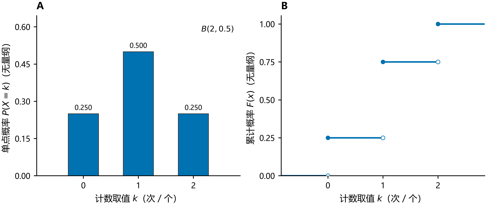

图 A 中每根柱子的高度是单点概率；图 B 中每次跳跃的高度就是同一个概率。实心点表示 $F(k)$，空心点表示左极限 $F(k^-)$，实际函数取实心点。阶梯的水平段表示该区间内没有新增概率。

例如 $P(0<X\le1)=F(1)-F(0)=1/2$，而 $P(0\le X\le1)=F(1)-F(0^-)=3/4$；差别恰好是端点 $0$ 的概率。

### 3.2 连续型：用概率密度描述

初等概率论中，若存在非负可积函数 $f_X$，使得

$$
\boxed{F_X(x)=\int_{-\infty}^{x}f_X(t)\,dt,}
$$

则称 $X$ 为**连续型随机变量**（continuous random variable），$f_X$ 为**概率密度函数**（probability density function，PDF）。严格说，这对应于**绝对连续分布**（absolutely continuous distribution）。

合法的密度满足

$$
\boxed{f_X(x)\ge0,\qquad \int_{-\infty}^{+\infty}f_X(x)\,dx=1.}
$$

密度在零测集上的改动不影响概率，因而可选取处处非负的代表。本文所有分段密度在未写出的区间上均为 $0$。

对 $a<b$，

$$
P(a<X\le b)=\int_a^bf_X(x)\,dx.
$$

连续型随机变量满足 $P(X=c)=0$，所以区间端点是否包含不影响概率。在密度的连续点，有 $F_X'(x)=f_X(x)$；一般情况下，这一等式几乎处处成立。

**密度值不是概率，曲线下的面积才是概率。**

- $f_X(x)$ 可以大于 $1$，但总面积必须是 $1$。
- 若 $f_X$ 在 $x$ 处连续，则小区间上 $P(x<X\le x+\Delta x)\approx f_X(x)\Delta x$。
- $P(X=c)=0$ 不等于事件 $\{X=c\}$ 不可能发生。例如连续均匀抽样总会得到某个具体数值。

**例：由密度求分布函数。** 设

$$
f(x)=
\begin{cases}
cx,&0<x<2,\\
0,&\text{其他}.
\end{cases}
$$

由归一化条件，$\int_0^2cx\,dx=2c=1$，得到 $c=1/2$。于是

$$
F(x)=
\begin{cases}
0,&x\le0,\\
x^2/4,&0<x<2,\\
1,&x\ge2.
\end{cases}
$$

例如 $P(1<X<2)=F(2)-F(1)=3/4$。

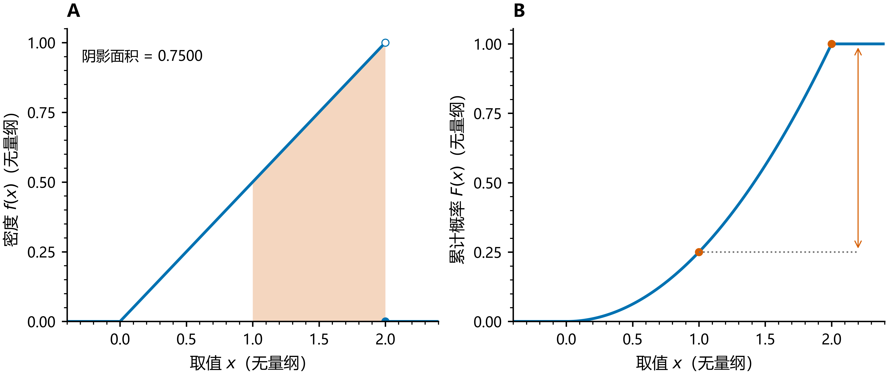

沿用上面的 $f(x)=x/2$（$0<x<2$）。图 A 中从 $1$ 到 $2$ 的阴影面积为 $3/4$，等于图 B 中 $F(2)-F(1)=1-1/4$。密度随 $x$ 增大，所以分布函数在区间内越来越陡。

| $x$ | $f(x)$ | $F(x)$ |
| --- | --- | --- |
| $0$ | — | 0.0000 |
| $0.5$ | 0.2500 | 0.0625 |
| $1$ | 0.5000 | 0.2500 |
| $1.5$ | 0.7500 | 0.5625 |
| $2$ | — | 1.0000 |

表中端点密度记为“—”：端点的密度值可任意指定，不影响积分和概率；端点处的累计概率则已确定。

### 3.3 两类并不穷尽所有分布

离散型与具有密度的连续型是最常见的两类，但还有**混合分布**（mixed distribution）。例如以概率 $1/2$ 令 $X=0$，以概率 $1/2$ 从 $(0,1)$ 均匀取值，则

$$
F(x)=
\begin{cases}
0,&x<0,\\
\frac12+\frac{x}{2},&0\le x<1,\\
1,&x\ge1.
\end{cases}
$$

它在 $0$ 处跳跃 $1/2$，随后连续增长，不能仅用一个普通密度函数完整描述。

更深入地，还有分布函数连续、却不存在上述密度表示的**奇异连续分布**（singular continuous distribution），如 Cantor 分布。因此“分布函数连续”与“存在概率密度”不是等价命题。分布函数则适用于所有这些情形。

### 3.4 看图理解：面积、增量与斜率

对具有密度的连续型随机变量，同一概率可以从两张图读取：

$$
\boxed{P(a<X\le b)=\int_a^b f(x)\,dx=F(b)-F(a).}
$$

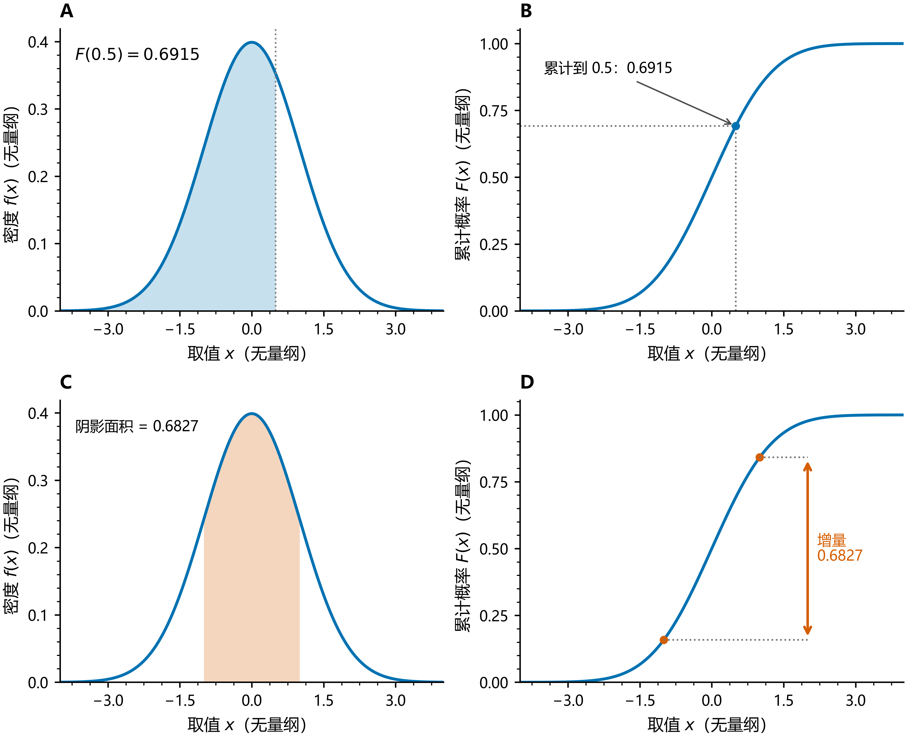

以标准正态分布为例（第 6 节详述）：A、B 对照“累计到 $0.5$”的概率 $F(0.5)\approx0.6915$；C、D 对照区间 $(-1,1)$ 的概率 $F(1)-F(-1)\approx0.6827$。正态图只显示 $[-4,4]$，A 中左侧未显示的极小尾部仍计入标注数值。

| 看哪个对象 | 从密度图读什么 | 从分布函数图读什么 |
| --- | --- | --- |
| $P(X\le b)$ | 从 $-\infty$ 到 $b$ 的累计面积 | 在 $b$ 处的高度 $F(b)$ |
| $P(a<X\le b)$ | $a$ 到 $b$ 的面积 | 两个高度之差 $F(b)-F(a)$ |
| $f(x)$（密度连续处） | 曲线的高度 | 曲线的斜率 $F'(x)$ |

因此，密度高的地方，$F$ 增长快；密度为零的区间，$F$ 保持水平；密度下降时，$F$ 仍可继续上升，只是增长变慢。**不要把“密度下降”误读成“累计概率下降”。**

离散型的对应关系则是第 3.1 节数表里的求和：把密度面积换成各点概率之和，把连续增长换成跳跃。离散柱形图的柱宽只用于显示，单点概率读柱高；不能把它当成连续密度图。

## 4. 常见离散分布

### 4.1 两点分布（伯努利分布）

**伯努利分布**（Bernoulli distribution）描述一次试验成功与否，记为 $X\sim\operatorname{Bernoulli}(p)$，其中 $0\le p\le1$：

$$
P(X=1)=p,\qquad P(X=0)=1-p.
$$

通常约定 $1$ 表示成功，$0$ 表示失败。任意事件 $A$ 的**示性随机变量**（indicator random variable）$\mathbf1_A$ 都服从参数 $P(A)$ 的伯努利分布。

**典型实例**：抛一枚硬币（正面记为 $1$）；一次投篮是否命中；一次抽检的样品是否合格。

**图与数表：取 $p=0.3$。**

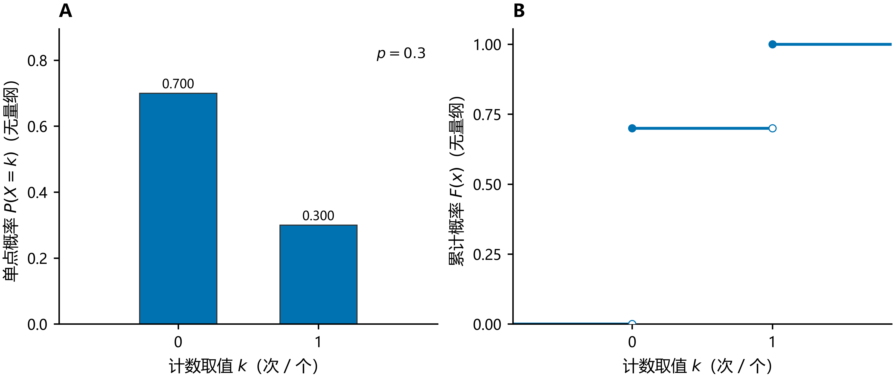

图 A 只有 $0$、$1$ 两个概率质量；图 B 分别跳跃 $0.7$、$0.3$，最终累计到 $1$。

| $k$ | $P(X=k)$ | $F(k)=P(X\le k)$ |
| --- | --- | --- |
| $0$ | 0.7000 | 0.7000 |
| $1$ | 0.3000 | 1.0000 |

### 4.2 二项分布

进行 $n$ 次相互独立、成功概率均为 $p$ 的伯努利试验，令 $X$ 为成功次数，则 $X$ 服从**二项分布**（binomial distribution），记为 $X\sim\operatorname{Binomial}(n,p)$，简记 $X\sim B(n,p)$：

$$
\boxed{P(X=k)=\binom nkp^k(1-p)^{n-k},\qquad k=0,1,\ldots,n.}
$$

其中 $n$ 为正整数，$0<p<1$；$p=0,1$ 时分别退化为恒等于 $0,n$ 的随机变量。

**典型实例**：抛 $10$ 次硬币中正面出现的次数；逐一抽检 $n$ 件产品时不合格品的件数；凭猜测答对 $10$ 道单选题的题数。

推导分两步：某一种恰有 $k$ 次成功的顺序，其概率为 $p^k(1-p)^{n-k}$；这样的顺序共有 $\binom nk$ 种，且对应事件互不相交。

判断二项模型时，检查**次数固定、每次两种结果、各次独立、成功概率相同**这四个条件。若 $X_i$ 为第 $i$ 次是否成功，则

$$
X=X_1+\cdots+X_n.
$$

例如 $X\sim B(5,0.2)$ 时，至少成功一次的概率为

$$
P(X\ge1)=1-P(X=0)=1-0.8^5=0.67232.
$$

**图与数表：沿用 $B(5,0.2)$。**

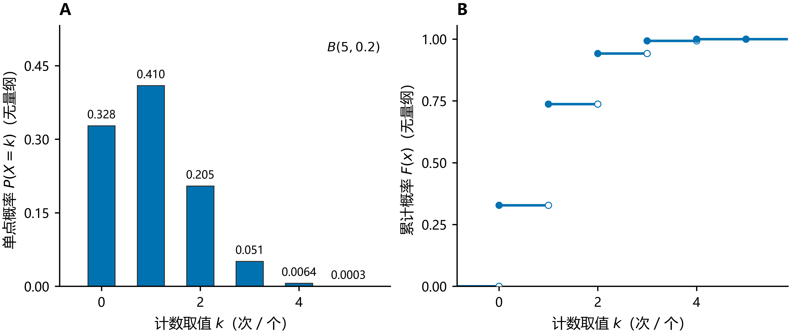

图 A 显示恰好成功各次数的概率，图 B 显示至多成功该次数的累计概率。表中 $F(0)=0.3277$，其补事件即上面的“至少成功一次”。

| $k$ | $P(X=k)$ | $F(k)=P(X\le k)$ |
| --- | --- | --- |
| $0$ | 0.3277 | 0.3277 |
| $1$ | 0.4096 | 0.7373 |
| $2$ | 0.2048 | 0.9421 |
| $3$ | 0.0512 | 0.9933 |
| $4$ | 0.0064 | 0.9997 |
| $5$ | 0.0003 | 1.0000 |

### 4.3 泊松分布

**泊松分布**（Poisson distribution）常用于描述固定时间或区域内事件的发生次数，记为 $X\sim\operatorname{Poisson}(\lambda)$，参数 $\lambda>0$：

$$
\boxed{P(X=k)=e^{-\lambda}\frac{\lambda^k}{k!},\qquad k=0,1,2,\ldots.}
$$

归一化来自指数函数展开：

$$
\sum_{k=0}^{\infty}e^{-\lambda}\frac{\lambda^k}{k!}
=e^{-\lambda}e^\lambda=1.
$$

**典型实例**：某交换台一小时内接到的呼叫次数；某路口一天内发生的交通事故数；定量体积液体中的细菌数。

若事件遵循速率为 $r$ 的齐次泊松过程，则长度为 $t$ 的时间段内发生次数服从 $\operatorname{Poisson}(rt)$。仅仅是“计数问题”并不足以保证泊松模型成立。

它与二项分布的联系是：若 $n\to\infty$、$p_n\to0$ 且 $np_n\to\lambda$，则对每个固定的非负整数 $k$，

$$
\binom nkp_n^k(1-p_n)^{n-k}
\longrightarrow e^{-\lambda}\frac{\lambda^k}{k!}.
$$

因此 $n$ 大、$p$ 小时，常用参数 $\lambda=np$ 的泊松分布近似二项分布。

**图与数表：取 $\lambda=2$。**

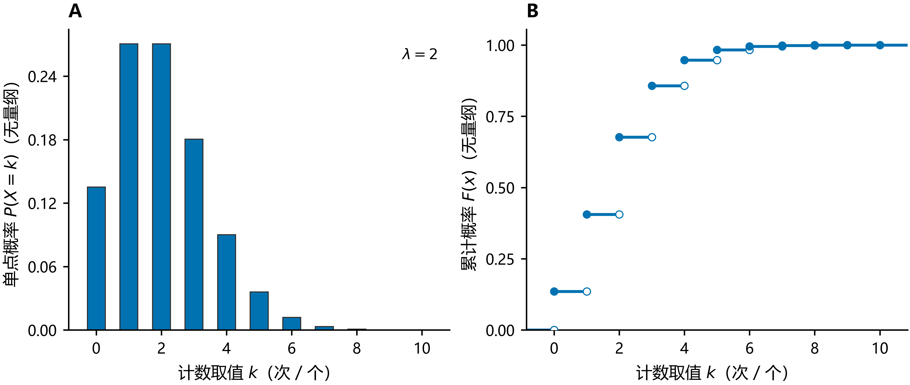

概率质量集中在较小的非负整数附近，随后衰减。图只画 $0$ 到 $10$，取值还可继续增大；最后一段并未被强行归一化到 $1$。

| $k$ | $P(X=k)$ | $F(k)=P(X\le k)$ |
| --- | --- | --- |
| $0$ | 0.1353 | 0.1353 |
| $1$ | 0.2707 | 0.4060 |
| $2$ | 0.2707 | 0.6767 |
| $3$ | 0.1804 | 0.8571 |
| $4$ | 0.0902 | 0.9473 |
| $5$ | 0.0361 | 0.9834 |
| $6$ | 0.0120 | 0.9955 |
| $k\ge7$（合计） | 0.0045 | — |

表的最后一行是未逐项列出的尾部概率 $P(X\ge7)=1-F(6)$，不是某个单点的概率。

### 4.4 几何分布

独立重复成功概率为 $p$ 的伯努利试验，直到第一次成功。若 $X$ 表示包含成功那次在内的总试验次数（取值集合 $\{1,2,\ldots\}$），则服从**几何分布**（geometric distribution），记为 $X\sim\operatorname{Geom}(p)$，$0<p<1$：

$$
P(X=k)=(1-p)^{k-1}p,\qquad k=1,2,\ldots.
$$

若计数的是成功前的失败次数 $Y=X-1$，则

$$
P(Y=k)=(1-p)^kp,\qquad k=0,1,\ldots.
$$

两种约定都常见，必须先检查起点。$p=1$ 时 $X=1$；$p=0$ 时不会成功，不能得到这里的有限实值几何随机变量。上文第一种约定（支持集 $\{1,2,\ldots\}$）的期望为 $1/p$；第二种约定（支持集 $\{0,1,\ldots\}$）的期望为 $(1-p)/p$，两者的方差相同，均为 $(1-p)/p^2$。

**典型实例**：反复掷一枚骰子直到首次掷出 $6$ 点所需的次数；逐个抽检产品直到首次发现次品所需的抽检次数。

几何分布具有**无记忆性**（memorylessness）：对非负整数 $m,n$，

$$
P(X>m+n\mid X>m)=P(X>n).
$$

因为 $P(X>k)=(1-p)^k$，条件概率中的比值恰为 $(1-p)^n$。

**图与数表：取 $p=0.5$，计数包含成功那次。**

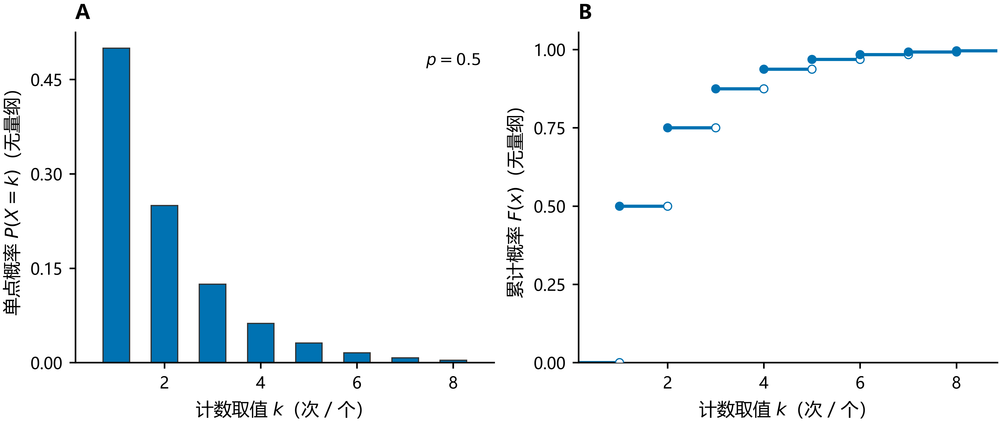

图 A 的概率质量逐次减半，图 B 的累计概率逐渐趋近 $1$。图只显示前 $8$ 个取值；第 $8$ 次以后仍有概率。

| $k$ | $P(X=k)$ | $F(k)=P(X\le k)$ |
| --- | --- | --- |
| $1$ | 0.5000 | 0.5000 |
| $2$ | 0.2500 | 0.7500 |
| $3$ | 0.1250 | 0.8750 |
| $4$ | 0.0625 | 0.9375 |
| $5$ | 0.0312 | 0.9688 |
| $6$ | 0.0156 | 0.9844 |
| $k\ge7$（合计） | 0.0156 | — |

例如 $F(3)=0.8750$ 表示“三次以内首次成功”的概率；$P(X>3)=1-F(3)=0.1250$。

### 4.5 超几何分布

总体有 $N$ 个对象，其中 $K$ 个属于某一类；从中等概率、不放回地抽取 $n$ 个，令 $X$ 为抽到该类对象的数量。$X$ 服从**超几何分布**（hypergeometric distribution），记为 $X\sim\operatorname{Hypergeometric}(N,K,n)$，简记 $X\sim H(N,K,n)$：

$$
P(X=k)=\frac{\binom Kk\binom{N-K}{n-k}}{\binom Nn},
$$

其中 $N\ge1$，$0\le K,n\le N$ 均为整数，$k$ 的范围为

$$
\max(0,n-(N-K))\le k\le\min(n,K).
$$

分子分别选择 $k$ 个该类对象和 $n-k$ 个其余对象，分母是全部抽样组合数。不放回抽样通常使各次结果不独立；与二项分布相比，这正是超几何模型的关键区别。

**典型实例**：从 $52$ 张牌中不放回抽 $5$ 张时黑桃的张数；从含 $K$ 件次品的 $N$ 件产品中不放回抽取 $n$ 件时的次品数。

**图与数表：取 $N=10$、$K=4$、$n=3$。**

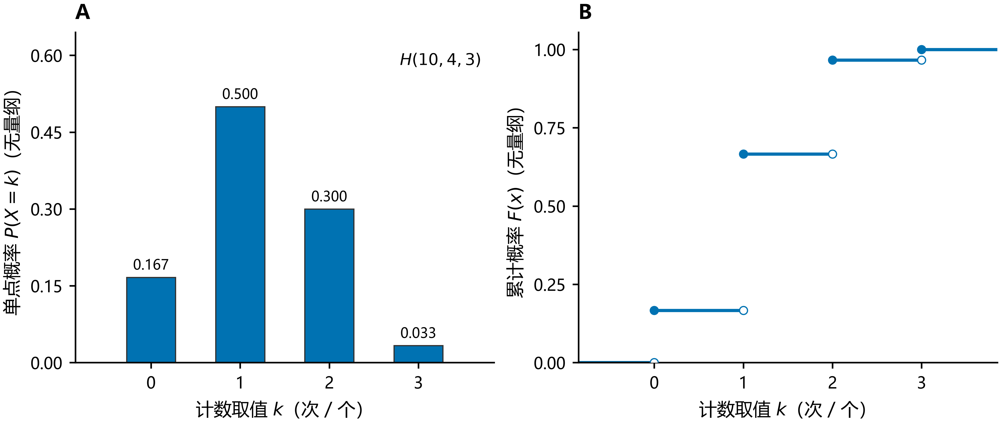

从 $10$ 个对象中不放回抽 $3$ 个，目标类有 $4$ 个。横轴是抽到目标类的数量；全部可能取值为 $0,1,2,3$，表中已列全。

| $k$ | $P(X=k)$ | $F(k)=P(X\le k)$ |
| --- | --- | --- |
| $0$ | 0.1667 | 0.1667 |
| $1$ | 0.5000 | 0.6667 |
| $2$ | 0.3000 | 0.9667 |
| $3$ | 0.0333 | 1.0000 |

## 5. 常见连续分布

### 5.1 均匀分布

**均匀分布**（uniform distribution）记为 $X\sim U(a,b)$（也写作 $\operatorname{Unif}(a,b)$），其中 $a<b$：

$$
f_X(x)=
\begin{cases}
\dfrac1{b-a},&a<x<b,\\
0,&\text{其他}.
\end{cases}
$$

其分布函数为

$$
F_X(x)=
\begin{cases}
0,&x\le a,\\
\dfrac{x-a}{b-a},&a<x<b,\\
1,&x\ge b.
\end{cases}
$$

对 $a\le c<d\le b$，

$$
P(c<X<d)=\frac{d-c}{b-a}.
$$

“均匀”表示**等长区间具有相同概率**。例如 $U(0,1/2)$ 的密度为 $2$，但总面积仍为 $1$。

**典型实例**：随机数发生器在 $(0,1)$ 上产生的随机数；发车间隔固定时乘客随机到达的候车时间。

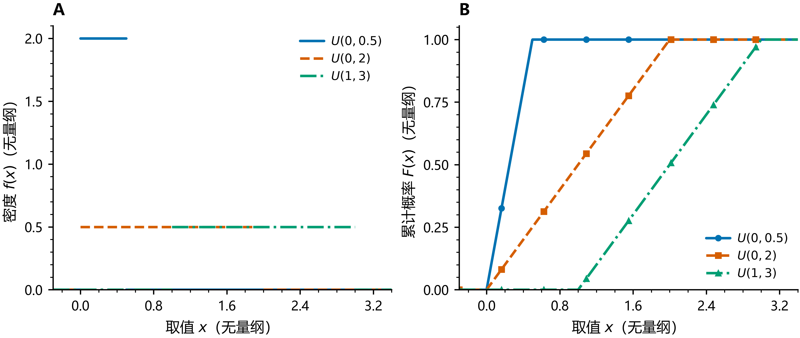

A、B 用相同线型对应同一分布：区间越短，密度越高，分布函数上升越陡；区间移动，累计增长的位置随之移动。$U(0,0.5)$ 的密度为 $2$，再次说明密度可以大于 $1$。

**数表：取图中的 $U(0,2)$。**

| $x$ | $f(x)$ | $F(x)$ |
| --- | --- | --- |
| $0$ | — | 0.0000 |
| $0.5$ | 0.5000 | 0.2500 |
| $1$ | 0.5000 | 0.5000 |
| $1.5$ | 0.5000 | 0.7500 |
| $2$ | — | 1.0000 |

例如 $P(0.5<X<1.5)=F(1.5)-F(0.5)=0.7500-0.2500=0.5000$。密度在整个内部区间恒为 $0.5$，不是说每个单点都有概率 $0.5$。端点密度不列值。

### 5.2 指数分布

**指数分布**（exponential distribution）常用于描述等待时间，记为 $X\sim\operatorname{Exp}(\lambda)$，$\lambda>0$：

$$
f_X(x)=
\begin{cases}
\lambda e^{-\lambda x},&x\ge0,\\
0,&x<0.
\end{cases}
$$

其分布函数及尾概率为

$$
F_X(x)=
\begin{cases}
0,&x<0,\\
1-e^{-\lambda x},&x\ge0,
\end{cases}
\qquad P(X>t)=e^{-\lambda t}\quad(t\ge0).
$$

本文采用**速率参数** $\lambda$；有些教材采用**尺度参数** $\theta=1/\lambda$，此时密度写成 $\theta^{-1}e^{-x/\theta}$。使用公式前应检查参数约定。

**典型实例**：相邻两次呼叫之间的等待时间；失效率恒定时期电子元件的寿命。

指数分布也具有无记忆性。对 $s,t\ge0$，

$$
P(X>s+t\mid X>s)
=\frac{e^{-\lambda(s+t)}}{e^{-\lambda s}}
=e^{-\lambda t}=P(X>t).
$$

在速率为 $\lambda$ 的齐次泊松过程中，固定时段的发生次数服从泊松分布，相邻事件间的等待时间服从指数分布。这两个模型分别描述“次数”和“时间”。

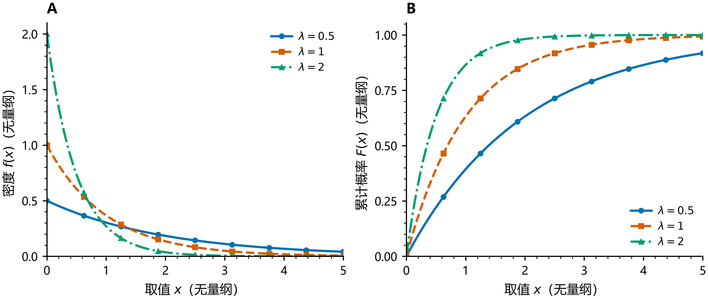

A、B 对照速率 $\lambda=0.5,1,2$。速率越大，密度越集中在零附近，$F$ 越快接近 $1$，对应较短的等待时间。密度虽然下降，累计概率始终上升；有限位置的 $F$ 仍小于 $1$。横轴采用无量纲时间坐标。

**数表：取 $\lambda=1$。**

| $x$ | $f(x)$ | $F(x)$ |
| --- | --- | --- |
| $0$ | 1.0000 | 0.0000 |
| $0.5$ | 0.6065 | 0.3935 |
| $1$ | 0.3679 | 0.6321 |
| $2$ | 0.1353 | 0.8647 |
| $3$ | 0.0498 | 0.9502 |

例如 $P(1<X\le2)=F(2)-F(1)\approx0.2325$；$P(X>2)=1-F(2)\approx0.1353$。

## 6. 正态分布：重点

### 6.1 定义与参数

**正态分布**（normal distribution，也称 Gaussian distribution）记为

$$
X\sim N(\mu,\sigma^2),\qquad \mu\in\mathbb R,\quad\sigma>0,
$$

其密度为

$$
\boxed{f_X(x)=\frac1{\sigma\sqrt{2\pi}}
\exp\left[-\frac{(x-\mu)^2}{2\sigma^2}\right],\qquad x\in\mathbb R.}
$$

$\mu$ 是均值（mean），决定中心位置；$\sigma^2$ 是方差（variance），$\sigma$ 是标准差（standard deviation），决定分散程度。**$N(\mu,\sigma^2)$ 的第二个参数是方差。**

**典型实例**：同性别成年人的身高或体重；同一批零件的测量误差；大量独立微小因素叠加的结果（如考试成绩）。

密度曲线关于 $x=\mu$ 对称，且在 $\mu$ 处取得最大值 $1/(\sigma\sqrt{2\pi})$。$\sigma$ 越大，曲线越宽、峰值越低，但面积始终为 $1$。

求导得到

$$
f_X'(x)=-\frac{x-\mu}{\sigma^2}f_X(x),\qquad
f_X''(x)=\frac{(x-\mu)^2-\sigma^2}{\sigma^4}f_X(x).
$$

所以密度在 $(-\infty,\mu)$ 上递增，在 $(\mu,+\infty)$ 上递减，拐点位于 $\mu\pm\sigma$。

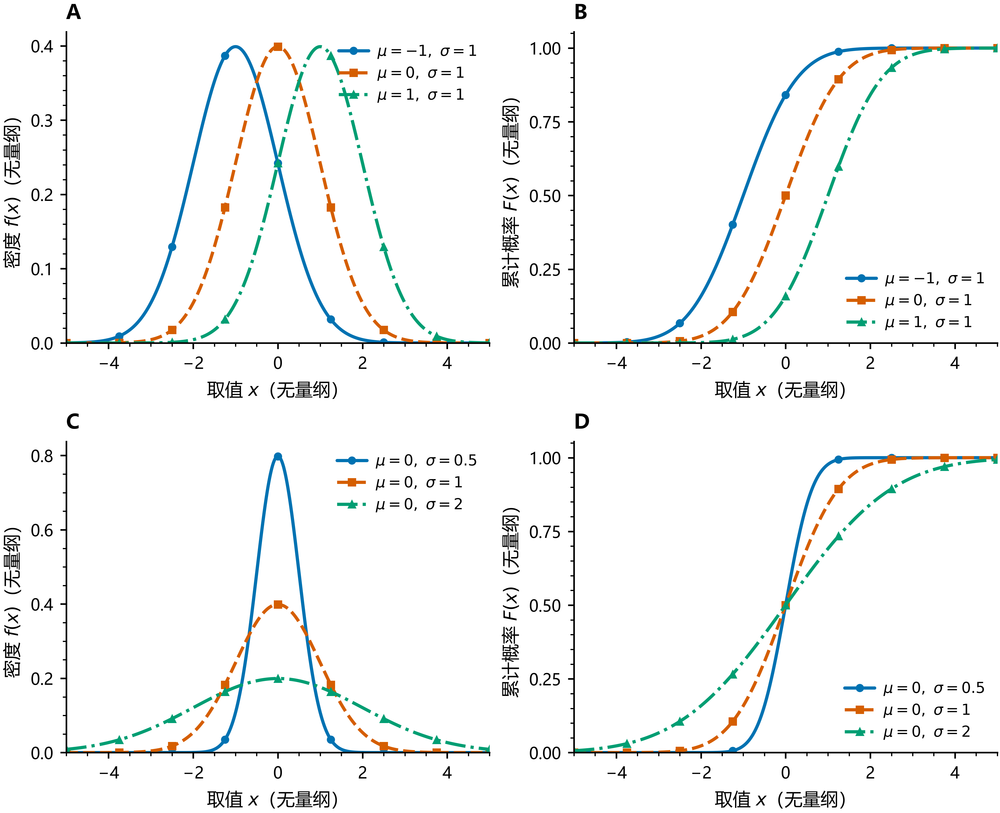

A、B 固定 $\sigma=1$，改变 $\mu$：两种曲线均水平移动。C、D 固定 $\mu=0$，改变 $\sigma$：标准差小的密度更窄、更高，分布函数在中心处上升更陡。所有正态分布均满足 $F(\mu)=1/2$。图例写的是标准差 $\sigma$；分布记号的第二个参数仍是 $\sigma^2$。

### 6.2 标准正态分布与标准化

**标准正态分布**（standard normal distribution）为 $N(0,1)$，通常记 $Z\sim N(0,1)$。密度和分布函数分别记作

$$
\varphi(z)=\frac1{\sqrt{2\pi}}e^{-z^2/2},\qquad
\Phi(z)=\int_{-\infty}^{z}\varphi(t)\,dt.
$$

若 $X\sim N(\mu,\sigma^2)$，则通过**标准化**（standardization）得到

$$
\boxed{Z=\frac{X-\mu}{\sigma}\sim N(0,1).}
$$

其中“减去 $\mu$”把中心移到 $0$，“除以 $\sigma$”把尺度调整为标准差 $1$。代入 $t=\mu+\sigma z$，便得到

$$
F_X(x)=\int_{-\infty}^{x}f_X(t)\,dt
=\Phi\left(\frac{x-\mu}{\sigma}\right).
$$
正态密度的原函数不能用初等函数表示，实际计算一般使用标准正态分布表或数值函数。

注意：对其他具有有限、非零方差的随机变量做同样的标准化，只能保证均值为 $0$、方差为 $1$，**不能保证得到正态分布**。

### 6.3 概率计算与对称性

对 $a<b$，

$$
\boxed{P(a<X\le b)
=\Phi\left(\frac{b-\mu}{\sigma}\right)
-\Phi\left(\frac{a-\mu}{\sigma}\right).}
$$

由 $\varphi(-z)=\varphi(z)$，可得

$$
\boxed{\Phi(-z)=1-\Phi(z),\qquad \Phi(0)=\frac12.}
$$

因此对 $c\ge0$，

$$
P(|Z|\le c)=2\Phi(c)-1,\qquad
P(|Z|>c)=2[1-\Phi(c)].
$$

对应于一般正态变量：

$$
P(|X-\mu|\le c\sigma)=2\Phi(c)-1.
$$

查表时先确认表中给的是 $\Phi(z)=P(Z\le z)$，还是 $P(0<Z\le z)$，或上尾概率 $P(Z>z)$。对 $z\ge0$，它们分别是 $\Phi(z)$、$\Phi(z)-1/2$、$1-\Phi(z)$。

**标准正态数表：区分密度高度与累计概率。**

| $z$ | $\varphi(z)$ | $\Phi(z)$ |
| --- | --- | --- |
| $-2$ | 0.0540 | 0.0228 |
| $-1$ | 0.2420 | 0.1587 |
| $0$ | 0.3989 | 0.5000 |
| $1$ | 0.2420 | 0.8413 |
| $2$ | 0.0540 | 0.9772 |
| $3$ | 0.0044 | 0.9987 |

例如 $\varphi(0)\approx0.3989$ 是密度高度，$\Phi(0)=0.5$ 是累计概率，而 $P(Z=0)=0$。表中密度关于零对称，累计概率则满足 $\Phi(-z)=1-\Phi(z)$。

### 6.4 三西格玛范围与常用分位点

由上式得到：

| 区间 | 概率（近似值） |
| --- | --- |
| $\mu-\sigma<X<\mu+\sigma$ | $0.6827$ |
| $\mu-2\sigma<X<\mu+2\sigma$ | $0.9545$ |
| $\mu-3\sigma<X<\mu+3\sigma$ | $0.9973$ |

这就是常用的三西格玛规律。区间外仍有概率，并非绝不出现；这些数值依赖正态分布假设。

**分位数**（quantile）$q_p$ 满足 $\Phi(q_p)=p$，$0<p<1$。例如

$$
q_{0.95}\approx1.6449,\qquad
q_{0.975}\approx1.9600,
$$

因此 $P(Z\le1.6449)\approx0.95$，而 $P(|Z|\le1.96)\approx0.95$。单侧 $95\%$ 与中央双侧 $95\%$ 使用的阈值不同。

对一般正态变量，$p$ 分位数为

$$
x_p=\mu+\sigma q_p.
$$

### 6.5 正态分布的线性变换

若 $X\sim N(\mu,\sigma^2)$，$Y=aX+b$ 且 $a\ne0$，则

$$
\boxed{Y\sim N(a\mu+b,a^2\sigma^2).}
$$

新标准差为 $|a|\sigma$；$a=0$ 时 $Y$ 是恒等于 $b$ 的退化随机变量。

进一步，若 $X_1,\ldots,X_n$ **相互独立**，且 $X_i\sim N(\mu_i,\sigma_i^2)$，则非退化线性组合满足

$$
\sum_{i=1}^na_iX_i+b
\sim N\left(\sum_{i=1}^na_i\mu_i+b,\ \sum_{i=1}^na_i^2\sigma_i^2\right).
$$

独立性是这里可直接使用该结论的条件；仅知道每个变量各自服从正态分布，不足以保证它们的和仍服从正态分布。

### 6.6 例题：区间概率与反求阈值

设 $X\sim N(100,15^2)$。

**求 $P(85<X<130)$。** 标准差为 $15$，两个端点标准化后分别为 $-1$ 与 $2$，因此

$$
\begin{aligned}
P(85<X<130)
&=\Phi(2)-\Phi(-1)\\
&=\Phi(2)+\Phi(1)-1\\
&\approx0.97725+0.84134-1\\
&=0.81859.
\end{aligned}
$$

**求使 $P(X\le c)=0.95$ 的阈值 $c$。**

$$
\Phi\left(\frac{c-100}{15}\right)=0.95
\quad\Longrightarrow\quad
c=100+15q_{0.95}\approx124.67.
$$

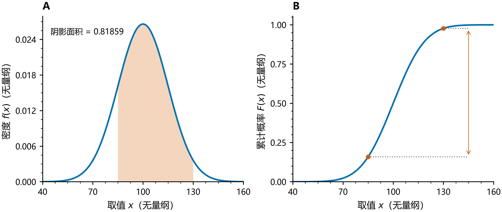

沿用 $X\sim N(100,15^2)$：图 A 的阴影面积对应 $P(85<X<130)$；图 B 标出两个累计概率，二者之差约为 $0.81859$。

| $x$ | $f(x)$ | $F(x)$ |
| --- | --- | --- |
| $85$ | 0.0161 | 0.1587 |
| $100$ | 0.0266 | 0.5000 |
| $115$ | 0.0161 | 0.8413 |
| $130$ | 0.0036 | 0.9772 |

上表可与标准化对应：$85,100,115,130$ 分别变为 $z=-1,0,1,2$。

### 6.7 二项分布的正态近似与连续性修正

当 $X\sim\operatorname{Binomial}(n,p)$（简记 $B(n,p)$），$0<p<1$，且 $np$ 与 $n(1-p)$ 均足够大时，可用

$$
Y\sim N\bigl(np,np(1-p)\bigr)
$$

近似 $X$。例如二者均不小于 $5$ 是常见经验判断，但不保证所有尾部概率的精度。

用连续分布近似整数取值时，通常加入**连续性修正**（continuity correction）：把整数 $k$ 的概率质量对应到区间 $(k-1/2,k+1/2)$。因此对整数 $r\le s$，

$$
\begin{aligned}
P(r\le X\le s)
&\approx P(r-0.5<Y<s+0.5)\\
&=\Phi\left(\frac{s+0.5-np}{\sqrt{np(1-p)}}\right)
-\Phi\left(\frac{r-0.5-np}{\sqrt{np(1-p)}}\right).
\end{aligned}
$$

同理，$P(X\le k)$ 对应上界 $k+0.5$，$P(X\ge k)$ 对应下界 $k-0.5$。

## 7. 随机变量函数的分布

### 7.1 通用方法：先求分布函数

给定 $Y=g(X)$，先把事件转回 $X$：

$$
\boxed{F_Y(y)=P(g(X)\le y).}
$$

然后依据 $X$ 的分布求概率；若 $Y$ 具有密度，再对 $F_Y$ 求导。$g$ 不必单调，但应使 $Y$ 仍是可测随机变量。

若 $X$ 离散，则对 $Y$ 的每个取值 $y$，

$$
P(Y=y)=\sum_{x_k:g(x_k)=y}P(X=x_k).
$$

不同的 $X$ 取值可能映射到同一 $y$，所以对应概率要相加。

### 7.2 单调变换的密度公式

若 $X$ 有密度，$g$ 在取值区间上严格单调、可微，且导数不为零，则在 $Y$ 的相应取值区间上，

$$
\boxed{f_Y(y)=f_X\bigl(g^{-1}(y)\bigr)
\left|\frac{d}{dy}g^{-1}(y)\right|.}
$$

绝对值处理了递增与递减两种情形。区间外密度为 $0$。

特别地，若 $Y=aX+b$、$a\ne0$，

$$
f_Y(y)=\frac1{|a|}f_X\left(\frac{y-b}{a}\right).
$$

### 7.3 非单调变换：平方的例子

设 $X\sim U(-1,1)$，$Y=X^2$。$Y$ 的取值范围为 $[0,1]$。对 $0<y<1$，

$$
F_Y(y)=P(-\sqrt y\le X\le\sqrt y)
=\frac{2\sqrt y}{2}=\sqrt y.
$$

所以

$$
F_Y(y)=
\begin{cases}
0,&y\le0,\\
\sqrt y,&0<y<1,\\
1,&y\ge1,
\end{cases}
\qquad
f_Y(y)=
\begin{cases}
\dfrac1{2\sqrt y},&0<y<1,\\
0,&\text{其他}.
\end{cases}
$$

这里 $g(x)=x^2$ 在 $(-1,1)$ 上不单调；若只考虑正根 $\sqrt y$，会漏掉负根对应的概率。密度在 $0$ 附近无界，但积分仍为 $1$，并不矛盾。

## 8. 常见分布速查与易错点

### 8.1 参数与数字特征速查

以下以 $\mathbb{E}[X]$ 表示数学期望（expectation），以 $\operatorname{Var}(X)$ 表示方差。此处列出常见结果；定义、存在条件与计算方法见 [随机变量的数字特征](04_随机变量的数字特征.md#expectation)。

| 分布 | 取值范围 | $\mathbb{E}[X]$ | $\operatorname{Var}(X)$ |
| --- | --- | --- | --- |
| $\operatorname{Bernoulli}(p)$ | $0,1$ | $p$ | $p(1-p)$ |
| $\operatorname{Binomial}(n,p)$，简记 $B(n,p)$ | $0,1,\ldots,n$ | $np$ | $np(1-p)$ |
| $\operatorname{Poisson}(\lambda)$ | $0,1,2,\ldots$ | $\lambda$ | $\lambda$ |
| $\operatorname{Geom}(p)$（总次数） | $1,2,\ldots$ | $1/p$ | $(1-p)/p^2$ |
| $\operatorname{Hypergeometric}(N,K,n)$，简记 $H(N,K,n)$（$N>1$） | 见第 4.5 节 | $nK/N$ | $n\dfrac KN\left(1-\dfrac KN\right)\dfrac{N-n}{N-1}$ |
| $U(a,b)$ | $[a,b]$ | $(a+b)/2$ | $(b-a)^2/12$ |
| $\operatorname{Exp}(\lambda)$（速率参数） | $[0,+\infty)$ | $1/\lambda$ | $1/\lambda^2$ |
| $N(\mu,\sigma^2)$ | $\mathbb R$ | $\mu$ | $\sigma^2$ |

超几何分布的方差中，$(N-n)/(N-1)$ 是不放回抽样相对于独立抽样的修正因子。$N=1$ 时按合法抽样参数直接判断，$X$ 为常量、方差为 $0$。

几何分布的“总次数”约定对应支持集 $\{1,2,\ldots\}$，均值 $1/p$；若约定为成功前的失败次数（支持集 $\{0,1,\ldots\}$），均值改为 $(1-p)/p$，方差仍为 $(1-p)/p^2$。

### 8.2 常用解题顺序

1. **明确取值范围与模型条件**：计数还是时间？独立重复还是不放回？
2. **检查分布是否合法**：离散概率之和或连续密度积分必须为 $1$。
3. **将目标事件写清楚**：特别注意 $<$、$\le$ 与补事件。
4. **选择计算方法**：离散求和、密度积分、分布函数作差；正态分布先标准化。
5. **检查结果**：概率应在 $[0,1]$ 内，分布函数应单调、右连续，并有正确的两端极限。

### 8.3 易错点

- 把 $F(x)=P(X\le x)$ 错写成 $P(X<x)$，在有跳跃的点会出错。
- 认为分布函数处处可导，或直接对混合分布的 $F$ 求导来恢复全部概率；跳跃处的概率会被漏掉。
- 将密度 $f(x)$ 当作单点概率，或要求 $f(x)\le1$。
- 求分段 $F$ 时只写取值区间内部，遗漏左侧的 $0$、右侧的 $1$。
- 忽略几何分布从 $0$ 还是从 $1$ 起算，或混淆指数分布的速率与尺度参数。
- 正态标准化时除以方差 $\sigma^2$；正确的是除以标准差 $\sigma$。
- 将“各自正态”误当成“任意线性组合都正态”，遗漏独立性或联合正态条件。

> 记忆主线：**分布律是单点概率，密度是单位长度上的概率强度，分布函数是累计概率。** 它们是描述同一概率规律的不同方式，其中分布函数最通用。

### 8.4 图表说明与复现

图表使用分布的解析公式计算，不是抽样直方图。数表保留四位小数，求和或作差时可能有舍入误差；计算例题时应保留足够的中间精度。

配图采用中文标注，名义宽度 $178\,\mathrm{mm}$，实际导出宽度约 $176.9\,\mathrm{mm}$；笔记嵌入 600 dpi PNG，同目录保留矢量 PDF。多条曲线同时使用颜色、线型或标记区分。

绘图源代码：[plot_distributions.py](image/一维随机变量及其分布/plot_distributions.py)。原始计算数值：[numerical_tables.csv](image/一维随机变量及其分布/numerical_tables.csv)。
