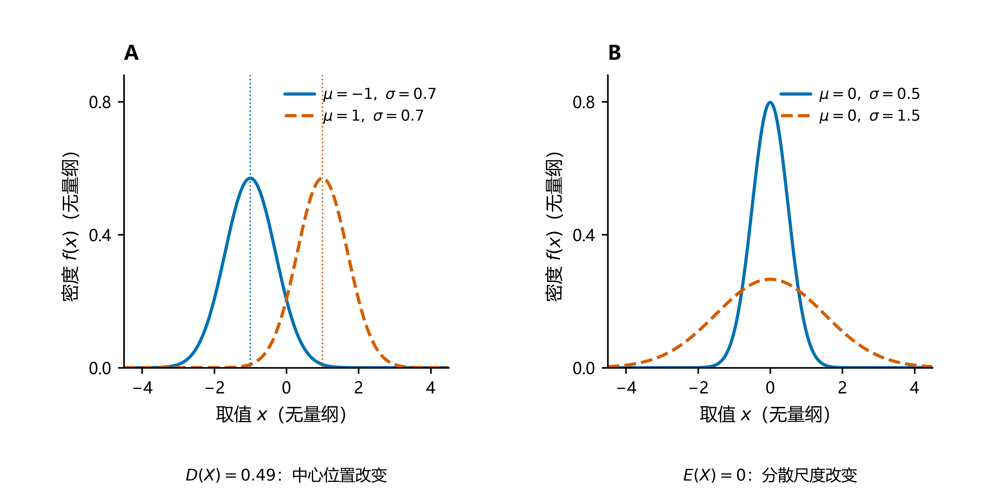
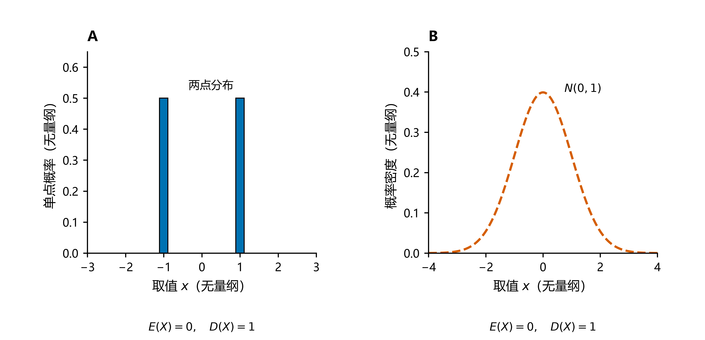
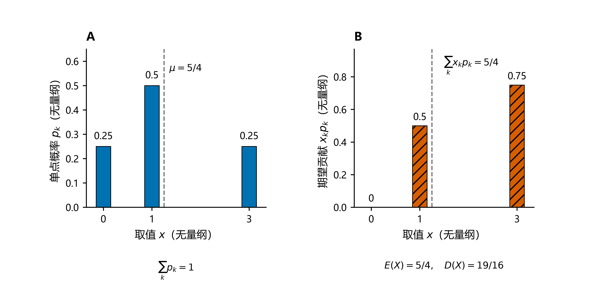
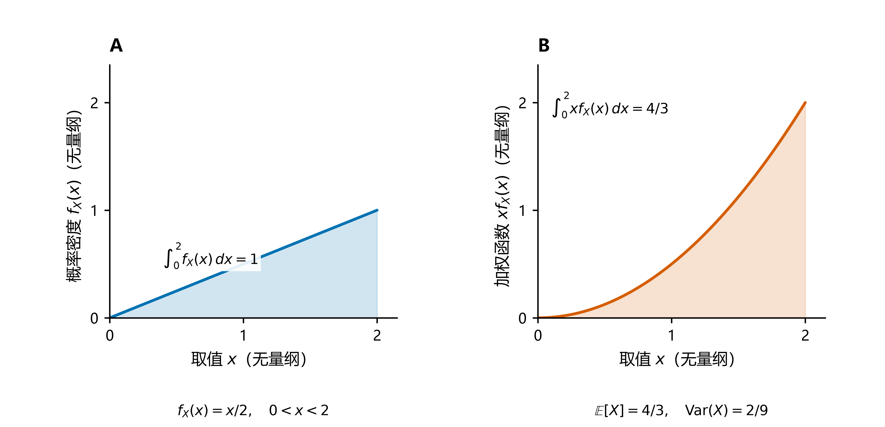
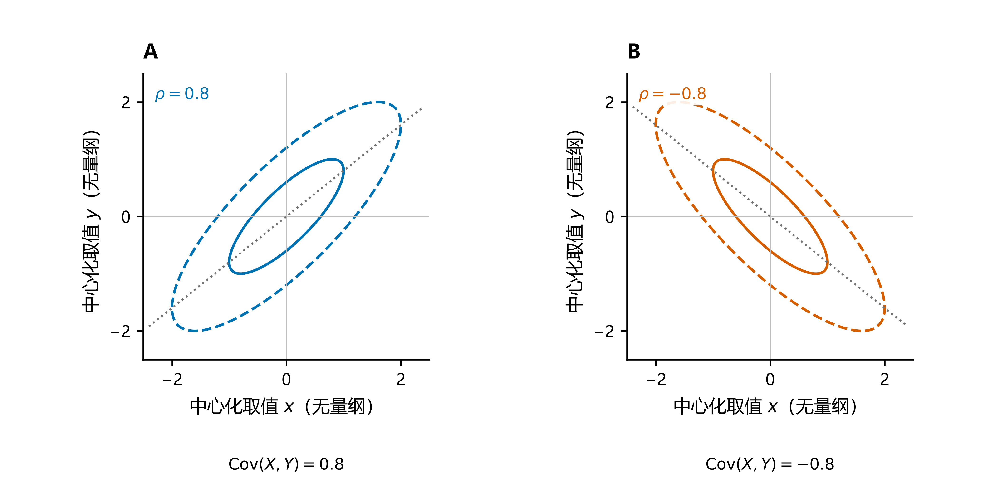
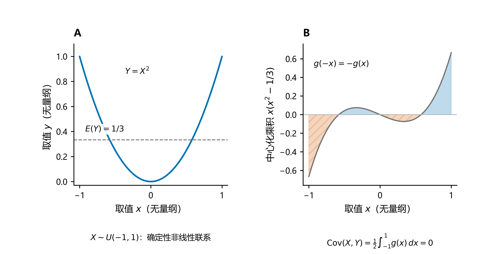
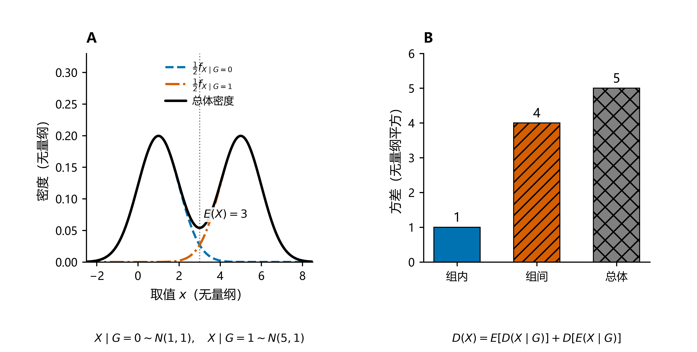

# 随机变量的数字特征

> **核心主线**：概率分布给出完整的概率规律；数字特征以少量数值概括中心位置、分散程度与变量间的联系。
> 前置内容：[一维随机变量及其分布](02_一维随机变量及其分布.md#1-随机变量)、[二维随机变量及其分布](03_二维随机变量及其分布.md#joint-cdf)。

## 1. 数字特征与存在条件

**数字特征**（numerical characteristics）是由概率分布计算得到的数值。记号沿用 [区级符号约定](../README.md#符号约定)，本文统一使用：

| 特征 | 推荐记号 | 描述对象 | 有限性条件 |
| --- | --- | --- | --- |
| 数学期望（expectation） | $\mathbb{E}[X]=\mu_X$ | 概率加权的中心位置 | $\mathbb{E}[\lvert X\rvert]<\infty$ |
| 方差（variance） | $\operatorname{Var}(X)=\sigma_X^2$ | 相对于均值的平方偏离 | $\mathbb{E}[X^2]<\infty$ |
| 标准差（standard deviation） | $\sigma_X=\sqrt{\operatorname{Var}(X)}$ | 与原变量同量纲的离散尺度 | 同上 |
| 协方差（covariance） | $\operatorname{Cov}(X,Y)$ | 两个变量的共同线性变化 | 本文假设两个二阶矩有限 |
| 相关系数（correlation coefficient） | $\rho_{X,Y}$ | 标准化后的线性联系 | 两个方差有限且均为正 |

二阶矩有限蕴含一阶绝对矩有限，例如由 Cauchy–Schwarz 不等式有 $\mathbb{E}[\lvert X\rvert]\le\sqrt{\mathbb{E}[X^2]}$。反向不成立。

数字特征是分布的概括，**相同的均值和方差不意味着同分布**；不同特征也不能替代其各自的存在条件。

## 2. 数学期望

### 2.1 定义与概率加权平均

若 $X$ 为离散型随机变量，取值为 $x_k$，对应概率为 $p_k$，则

$$
\boxed{\mathbb{E}[X]=\sum_kx_kp_k,\qquad\sum_k\lvert x_k\rvert p_k<\infty.}
$$

若 $X$ 具有密度 $f_X$，则

$$
\boxed{\mathbb{E}[X]=\int_{-\infty}^{+\infty}x f_X(x)\,dx,\qquad
\int_{-\infty}^{+\infty}\lvert x\rvert f_X(x)\,dx<\infty.}
$$

一般情形写为 $\mathbb{E}[X]=\int_\Omega X\,dP$，或 $\int_{\mathbb R}x\,dF_X(x)$；该定义同时适用于离散、连续与混合分布。

期望是以概率为权重的平均，而非取值的等权平均。它不一定是最可能的取值，也不一定属于随机变量的取值集合。

### 2.2 随机变量函数的期望

对可测函数 $g$，若 $\mathbb{E}[\lvert g(X)\rvert]<\infty$，则

$$
\boxed{\mathbb{E}[g(X)]=\sum_k g(x_k)p_k}
\quad\text{或}\quad
\boxed{\mathbb{E}[g(X)]=\int_{-\infty}^{+\infty}g(x)f_X(x)\,dx}.
$$

因此，计算 $\mathbb{E}[g(X)]$ 通常不必先求 $g(X)$ 的分布。对两个变量，在相应期望存在时：

$$
\mathbb{E}[g(X,Y)]=\sum_{i,j}g(x_i,y_j)p_{ij},
$$

$$
\mathbb{E}[g(X,Y)]=\iint_{\mathbb R^2}g(x,y)f_{X,Y}(x,y)\,dx\,dy.
$$

$\mathbb{E}[X]$ 与 $\mathbb{E}[Y]$ 只需边缘分布；$\mathbb{E}[XY]$ 一般需要联合分布。

### 2.3 基本性质

以下假设涉及的期望均有限：

| 性质 | 结论 | 条件说明 |
| --- | --- | --- |
| 常数 | $\mathbb{E}[c]=c$ | $c$ 为常数 |
| 线性性 | $\mathbb{E}[aX+bY+c]=a\mathbb{E}[X]+b\mathbb{E}[Y]+c$ | 不要求独立 |
| 保序性 | $X\le Y$ 几乎处处 $\Rightarrow \mathbb{E}[X]\le \mathbb{E}[Y]$ | 按同一概率空间比较 |
| 绝对值不等式 | $\lvert \mathbb{E}[X]\rvert\le \mathbb{E}[\lvert X\rvert]$ | 三角不等式 |
| 独立乘积 | $\mathbb{E}[XY]=\mathbb{E}[X]\mathbb{E}[Y]$ | 独立且一阶绝对矩有限 |
| 示性变量 | $\mathbb{E}[\mathbf1_A]=P(A)$ | $\mathbf1_A$ 在 $A$ 上取 $1$，其余取 $0$ |

线性性来自求和或积分的线性性。独立性用于乘积的分解，并非期望可加性的前提。

**存在性反例**：标准 Cauchy 分布的密度为 $f(x)=1/[\pi(1+x^2)]$，但 $\mathbb{E}[\lvert X\rvert]=\infty$，故其有限期望不存在。对称截断积分 $\int_{-R}^Rxf(x)\,dx=0$ 仅给出主值，不能作为 $\mathbb{E}[X]=0$ 的依据。

## 3. 方差与标准差

### 3.1 定义与计算公式

设 $\mu=\mathbb{E}[X]$ 且 $\mathbb{E}[X^2]<\infty$。方差定义为

$$
\boxed{\operatorname{Var}(X)=\mathbb{E}[(X-\mu)^2].}
$$

展开平方并使用期望的线性性，得

$$
\operatorname{Var}(X)=\mathbb{E}[X^2]-2\mu \mathbb{E}[X]+\mu^2
=\boxed{\mathbb{E}[X^2]-(\mathbb{E}[X])^2}.
$$

均值描述中心位置；方差描述围绕该中心的平方偏离。若 $X$ 的单位为长度，则方差的单位为长度平方，标准差与 $X$ 同单位。

### 3.2 基本性质与最小平方误差

$$
\boxed{\operatorname{Var}(X)\ge0,\qquad \operatorname{Var}(aX+b)=a^2\operatorname{Var}(X).}
$$

$\operatorname{Var}(X)=0$ 当且仅当 $P(X=\mathbb{E}[X])=1$，即 $X$ 几乎处处为常量。平移不改变方差，尺度变换按平方改变方差。

对任意常数 $c$，

$$
\boxed{\mathbb{E}[(X-c)^2]=\operatorname{Var}(X)+(\mathbb{E}[X]-c)^2.}
$$

故 $c=\mathbb{E}[X]$ 是使平均平方误差最小的常数，最小值为 $\operatorname{Var}(X)$。这给出均值作为中心位置的平方误差解释。

**图 1（原理图）**：A 保持标准差不变并改变均值；B 保持均值为零并改变标准差。密度的高低与宽窄共同变化，但每条密度的总面积均为 $1$。图中的标准差反映分布本身的离散尺度。

### 3.3 标准化与信息压缩

若 $0<\sigma^2=\operatorname{Var}(X)<\infty$，令

$$
Z=\frac{X-\mu}{\sigma},
\qquad \mathbb{E}[Z]=0,\qquad \operatorname{Var}(Z)=1.
$$

**标准化**（standardization）只改变位置与尺度，不保证变量服从正态分布。

**图 2（信息压缩）**：A 中 $P(X=-1)=P(X=1)=1/2$；B 为标准正态分布。二者均值均为 $0$、方差均为 $1$，但前者仅在两个点分配概率，后者具有连续密度。均值与方差不能完整确定一般分布。

### 3.4 例题 1：由离散分布计算期望与方差

设 $X$ 的分布为

| $x$ | $0$ | $1$ | $3$ |
| --- | --- | --- | --- |
| $P(X=x)$ | $1/4$ | $1/2$ | $1/4$ |

则

$$
\mathbb{E}[X]=0\cdot\frac14+1\cdot\frac12+3\cdot\frac14=\frac54,
$$

$$
\mathbb{E}[X^2]=0+1\cdot\frac12+9\cdot\frac14=\frac{11}{4},
\qquad
\operatorname{Var}(X)=\frac{11}{4}-\left(\frac54\right)^2=\frac{19}{16}.
$$

这里 $\mathbb{E}[X]=5/4$ 并非可能取值，且不同于最大概率对应的取值 $1$。

**图 3（例题 1）**：A 的柱高为单点概率；B 的柱高为各项 $x_kp_k$，其和为期望 $5/4$。虚线标均值在原取值轴上的位置，柱宽仅用于显示，不参与求和。

### 3.5 例题 2：由连续密度计算数字特征

沿用一维分布笔记的密度 $f_X(x)=x/2$（$0<x<2$，其余为零）：

$$
\mathbb{E}[X]=\int_0^2x\frac{x}{2}\,dx=\frac43,
\qquad
\mathbb{E}[X^2]=\int_0^2x^2\frac{x}{2}\,dx=2,
$$

$$
\operatorname{Var}(X)=2-\left(\frac43\right)^2=\frac29.
$$

**图 4（例题 2）**：A 的密度面积为 $1$；B 的加权函数 $xf_X(x)$ 的积分为 $4/3$。后者不是概率密度，其积分可以大于 $1$。

## 4. 协方差与相关系数

### 4.1 协方差的定义与性质

设 $X,Y$ 的二阶矩有限，记 $\mu_X=\mathbb{E}[X]$、$\mu_Y=\mathbb{E}[Y]$。协方差定义为

$$
\boxed{\operatorname{Cov}(X,Y)
=\mathbb{E}[(X-\mu_X)(Y-\mu_Y)]
=\mathbb{E}[XY]-\mathbb{E}[X]\mathbb{E}[Y].}
$$

当两个中心化偏差同号时，其乘积为正；异号时为负。协方差是这些乘积的概率加权平均，符号描述总体线性变化方向。

$$
\operatorname{Cov}(X,Y)=\operatorname{Cov}(Y,X),\qquad
\operatorname{Cov}(X,X)=\operatorname{Var}(X),
$$

$$
\operatorname{Cov}(aX+b,cY+d)=ac\operatorname{Cov}(X,Y),
$$

$$
\operatorname{Cov}(X,Y+Z)=\operatorname{Cov}(X,Y)+\operatorname{Cov}(X,Z).
$$

协方差具有两个变量单位的乘积；其数值随变量尺度变化，不宜直接比较不同量纲下联系的强弱。

### 4.2 相关系数与完全线性关系

若 $\sigma_X,\sigma_Y>0$，则

$$
\boxed{\rho_{X,Y}=\frac{\operatorname{Cov}(X,Y)}{\sigma_X\sigma_Y}
=\mathbb{E}\left[\frac{X-\mu_X}{\sigma_X}\frac{Y-\mu_Y}{\sigma_Y}\right].}
$$

由 Cauchy–Schwarz 不等式，$\lvert\operatorname{Cov}(X,Y)\rvert\le\sigma_X\sigma_Y$，故 $-1\le\rho_{X,Y}\le1$。

- $\rho>0$ 表示正线性相关，$\rho<0$ 表示负线性相关。
- $\rho=0$ 表示**不相关**（uncorrelated），并不排除非线性联系。
- $\lvert\rho\rvert=1$ 当且仅当存在 $a\ne0,b$，使 $P(Y=aX+b)=1$；此时 $\rho$ 的符号与 $a$ 相同。
- 若任一变量方差为零，则上述相关系数无定义，不能直接记为零。

**图 5（原理图）**：两图均取零均值、单位边缘方差，相关系数分别为 $0.8$ 与 $-0.8$。椭圆为联合密度等高线，虚线为条件均值 $\mathbb{E}[Y\mid X=x]=\rho x$，并非观测样本或置信区间。正相关偏向两个偏差同号的方向，负相关偏向异号方向。

### 4.3 例题 3：三角形联合分布的相关系数

设 $f_{X,Y}(x,y)=2$ 在 $0<x<y<1$ 上成立，其余为零。由联合密度积分可得

$$
\mathbb{E}[X]=\frac13,\quad \mathbb{E}[Y]=\frac23,\quad
\mathbb{E}[X^2]=\frac16,\quad \mathbb{E}[Y^2]=\frac12,
$$

$$
\mathbb{E}[XY]=\int_0^1\int_0^y2xy\,dx\,dy=\frac14.
$$

因此

$$
\operatorname{Var}(X)=\operatorname{Var}(Y)=\frac1{18},\quad
\operatorname{Cov}(X,Y)=\frac14-\frac29=\frac1{36},\quad
\rho_{X,Y}=\frac{1/36}{1/18}=\frac12.
$$

积分区域及边缘分布见 [三角形联合密度](03_二维随机变量及其分布.md#joint-density)。

### 4.4 独立与不相关

二阶矩有限时，独立蕴含不相关，因为 $\mathbb{E}[XY]=\mathbb{E}[X]\mathbb{E}[Y]$；反向一般不成立。若 $(X,Y)$ **联合正态**，则不相关与独立等价；仅两个边缘各自正态不足以使用这一结论。

### 4.5 例题 4：不相关但相依的平方关系

取 $X\sim U(-1,1)$、$Y=X^2$。由对称性，

$$
\mathbb{E}[X]=\mathbb{E}[X^3]=0,\quad \mathbb{E}[Y]=\frac13,\quad
\operatorname{Var}(X)=\frac13,\quad \operatorname{Var}(Y)=\frac15-\frac19=\frac4{45}.
$$

故 $\operatorname{Cov}(X,Y)=\mathbb{E}[X^3]-\mathbb{E}[X]\mathbb{E}[Y]=0$，$\rho_{X,Y}=0$。

二者并不独立。例如 $A=\{\lvert X\rvert\le1/2\}$ 与 $B=\{Y\le1/4\}$ 是同一事件，$P(A)=P(B)=1/2$，但 $P(A\cap B)=1/2\ne1/4$。

**图 6（例题 4）**：A 的联合概率集中于抛物线 $y=x^2$，给定 $X$ 后 $Y$ 即确定；B 的中心化乘积 $x(x^2-1/3)$ 是奇函数，在对称均匀分布下积分为零。零协方差源于正负贡献抵消，而非不存在联系。

## 5. 和、差与线性组合

### 5.1 期望与方差公式

对二阶矩有限的随机变量 $X_1,\ldots,X_n$：

$$
\mathbb{E}\left[\sum_i a_iX_i\right]=\sum_i a_i\mathbb{E}[X_i],
$$

$$
\boxed{\operatorname{Var}\left(\sum_i a_iX_i\right)
=\sum_i a_i^2\operatorname{Var}(X_i)+2\sum_{i<j}a_ia_j\operatorname{Cov}(X_i,X_j).}
$$

特别地，

$$
\operatorname{Var}(X\pm Y)=\operatorname{Var}(X)+\operatorname{Var}(Y)\pm2\operatorname{Cov}(X,Y).
$$

若变量两两不相关，则协方差项为零。相互独立是更强的充分条件，但不是方差可加的必要条件。

### 5.2 独立重复试验与平均值

若 $X_1,\ldots,X_n$ 独立同分布，均值为 $\mu$、方差为 $\sigma^2$，令 $\overline X_n=n^{-1}\sum_iX_i$，则

$$
\mathbb{E}[\overline X_n]=\mu,\qquad \operatorname{Var}(\overline X_n)=\frac{\sigma^2}{n}.
$$

平均值的标准差为 $\sigma/\sqrt n$。该公式描述独立重复抽样下的平均值波动；存在相关性时须保留协方差项。

### 5.3 协方差矩阵

对随机向量 $\mathbf X=(X_1,\ldots,X_n)^{\mathsf T}$，定义**协方差矩阵**（covariance matrix）

$$
\Sigma=\mathbb{E}\left[(\mathbf X-\mathbb{E}[\mathbf X])(\mathbf X-\mathbb{E}[\mathbf X])^{\mathsf T}\right],
\qquad \Sigma_{ij}=\operatorname{Cov}(X_i,X_j).
$$

矩阵 $\Sigma$ 对称且半正定，因为对任意常向量 $\mathbf a$，

$$
\boxed{\mathbf a^{\mathsf T}\Sigma\mathbf a=\operatorname{Var}(\mathbf a^{\mathsf T}\mathbf X)\ge0.}
$$

这将线性组合的方差统一为二次型，并连接多元统计与线性代数。

## 6. 矩与高阶数字特征

### 6.1 原点矩与中心矩

若 $\mathbb{E}[\lvert X\rvert^k]<\infty$，定义 **$k$ 阶原点矩**（raw moment）$m_k=\mathbb{E}[X^k]$ 与 **$k$ 阶中心矩**（central moment）$\mu_k=\mathbb{E}[(X-\mathbb{E}[X])^k]$。

$$
m_1=\mathbb{E}[X],\qquad \mu_1=0,\qquad \mu_2=\operatorname{Var}(X).
$$

矩的阶数越高，对尾部取值的权重通常越大，因此高阶矩的存在性需分别核验。

### 6.2 偏度与峰度

在 $\sigma>0$ 且相应矩有限时，定义**偏度**（skewness）与**峰度**（kurtosis）：

$$
\gamma_1=\frac{\mu_3}{\sigma^3},\qquad
\beta_2=\frac{\mu_4}{\sigma^4},\qquad
\gamma_2=\beta_2-3.
$$

$\gamma_2$ 称为**超额峰度**（excess kurtosis）。正态分布有 $\gamma_1=0$、$\beta_2=3$、$\gamma_2=0$。

偏度由标准化三阶中心矩描述不对称性，但零偏度不必然意味着对称。峰度反映标准化四阶偏离，不能仅以密度峰的高度解释。

## 7. 常用公式与使用条件速查

本节汇总第 2–6 节的计算式及其成立条件，供对照与快速查用。记号沿用第 1 节：$\mu=\mathbb{E}[X]$、$\sigma_X^2=\operatorname{Var}(X)$、$m_k=\mathbb{E}[X^k]$、$\mu_k=\mathbb{E}[(X-\mu)^k]$。表中离散型写求和、连续型写积分，混合型按 $\mathbb{E}[g(X)]=\int g\,dF_X$ 分段处理。**存在条件是公式的一部分**，条件不满足时表达式无意义。

### 7.1 一维基本公式

| 名称 | 表达式 | 使用条件 |
| --- | --- | --- |
| 数学期望 | $\mathbb{E}[X]=\sum_k x_kp_k$ 或 $\int_{-\infty}^{+\infty}x f_X(x)\,dx$ | $\mathbb{E}[\lvert X\rvert]<\infty$ |
| 函数的期望 | $\mathbb{E}[g(X)]=\sum_k g(x_k)p_k$ 或 $\int_{-\infty}^{+\infty}g(x)f_X(x)\,dx$ | $\mathbb{E}[\lvert g(X)\rvert]<\infty$；不必先求 $g(X)$ 的分布 |
| 二阶原点矩 | $\mathbb{E}[X^2]=\sum_k x_k^2p_k$ 或 $\int_{-\infty}^{+\infty}x^2f_X(x)\,dx$ | $\mathbb{E}[X^2]<\infty$ |
| 方差 | $\operatorname{Var}(X)=\mathbb{E}[(X-\mu)^2]=\mathbb{E}[X^2]-(\mathbb{E}[X])^2$ | $\mathbb{E}[X^2]<\infty$ |
| 标准差 | $\sigma_X=\sqrt{\operatorname{Var}(X)}\ge0$ | 同上 |
| 标准化 | $Z=\dfrac{X-\mu}{\sigma_X}$，$\mathbb{E}[Z]=0$，$\operatorname{Var}(Z)=1$ | $0<\sigma_X^2<\infty$ |
| 最小平方误差 | $\mathbb{E}[(X-c)^2]=\operatorname{Var}(X)+(\mathbb{E}[X]-c)^2$，在 $c=\mu$ 处最小 | $\mathbb{E}[X^2]<\infty$ |
| 线性变换 | $\mathbb{E}[aX+b]=a\mathbb{E}[X]+b$，$\operatorname{Var}(aX+b)=a^2\operatorname{Var}(X)$ | 期望式需 $\mathbb{E}[\lvert X\rvert]<\infty$，方差式需 $\mathbb{E}[X^2]<\infty$ |

### 7.2 二维与线性组合公式

| 名称 | 表达式 | 使用条件 |
| --- | --- | --- |
| 联合函数的期望 | $\mathbb{E}[g(X,Y)]=\sum_{i,j}g(x_i,y_j)p_{ij}$ 或 $\iint_{\mathbb R^2}g f_{X,Y}\,dx\,dy$ | $\mathbb{E}[\lvert g(X,Y)\rvert]<\infty$ |
| 乘积的期望 | $\mathbb{E}[XY]=\sum_{i,j}x_iy_jp_{ij}$ 或 $\iint_{\mathbb R^2}xy f_{X,Y}\,dx\,dy$ | $\mathbb{E}[\lvert XY\rvert]<\infty$；一般需联合分布 |
| 协方差 | $\operatorname{Cov}(X,Y)=\mathbb{E}[XY]-\mathbb{E}[X]\mathbb{E}[Y]$ | $\mathbb{E}[X^2]<\infty$ 且 $\mathbb{E}[Y^2]<\infty$ |
| 相关系数 | $\rho_{X,Y}=\dfrac{\operatorname{Cov}(X,Y)}{\sigma_X\sigma_Y}$，$\lvert\rho_{X,Y}\rvert\le1$ | $\sigma_X>0$ 且 $\sigma_Y>0$ |
| 独立可乘 | $\mathbb{E}[XY]=\mathbb{E}[X]\mathbb{E}[Y]$ | $X,Y$ 独立且 $\mathbb{E}[\lvert XY\rvert]<\infty$；反之不成立 |
| 和的方差 | $\operatorname{Var}(X\pm Y)=\operatorname{Var}(X)+\operatorname{Var}(Y)\pm2\operatorname{Cov}(X,Y)$ | 各二阶矩有限 |
| 线性组合的方差 | $\operatorname{Var}\left(\sum_i a_iX_i\right)=\sum_i a_i^2\operatorname{Var}(X_i)+2\sum_{i<j}a_ia_j\operatorname{Cov}(X_i,X_j)$ | 各二阶矩有限 |
| 不相关简化 | 两两不相关时 $\operatorname{Var}\left(\sum_i a_iX_i\right)=\sum_i a_i^2\operatorname{Var}(X_i)$ | 协方差全为零；独立是更强的充分条件 |
| 样本均值 | $\mathbb{E}[\overline X_n]=\mu$，$\operatorname{Var}(\overline X_n)=\dfrac{\sigma^2}{n}$ | $X_1,\ldots,X_n$ 独立同分布且 $\sigma^2<\infty$ |
| 协方差矩阵 | $\Sigma=\mathbb{E}\left[(\mathbf X-\mathbb{E}[\mathbf X])(\mathbf X-\mathbb{E}[\mathbf X])^{\mathsf T}\right]$，$\mathbf a^{\mathsf T}\Sigma\mathbf a=\operatorname{Var}(\mathbf a^{\mathsf T}\mathbf X)\ge0$ | 各二阶矩有限 |

### 7.3 矩的公式

| 名称 | 表达式 | 使用条件 |
| --- | --- | --- |
| $k$ 阶原点矩 | $m_k=\mathbb{E}[X^k]$ | $\mathbb{E}[\lvert X\rvert^k]<\infty$ |
| $k$ 阶中心矩 | $\mu_k=\mathbb{E}[(X-\mathbb{E}[X])^k]$ | $\mathbb{E}[\lvert X\rvert^k]<\infty$ |
| 基本对应 | $m_1=\mu$，$\mu_1=0$，$\mu_2=\sigma_X^2=\operatorname{Var}(X)$ | $\mathbb{E}[X^2]<\infty$ |
| 中心矩用原点矩表出 | $\mu_k=\sum_{j=0}^{k}\binom{k}{j}(-m_1)^{k-j}m_j$，其中 $m_0=1$ | 各阶矩有限 |
| 原点矩用中心矩表出 | $m_k=\sum_{j=0}^{k}\binom{k}{j}\mu_jm_1^{k-j}$，其中 $\mu_0=1$ | 各阶矩有限 |
| 低阶展开 | $\mu_2=m_2-m_1^2$；$\mu_3=m_3-3m_1m_2+2m_1^3$；$\mu_4=m_4-4m_1m_3+6m_1^2m_2-3m_1^4$ | 相应阶矩有限 |
| 偏度 | $\gamma_1=\dfrac{\mu_3}{\sigma_X^3}$ | $\sigma_X>0$ 且 $\mathbb{E}[\lvert X\rvert^3]<\infty$ |
| 峰度 | $\beta_2=\dfrac{\mu_4}{\sigma_X^4}$，$\gamma_2=\beta_2-3$ | $\sigma_X>0$ 且 $\mathbb{E}[X^4]<\infty$ |

### 7.4 使用条件提醒

- **存在性**：$\mathbb{E}[X^2]<\infty$ 蕴含 $\mathbb{E}[\lvert X\rvert]<\infty$（由 $\mathbb{E}[\lvert X\rvert]\le\sqrt{\mathbb{E}[X^2]}$），反之不成立；高阶矩须逐阶核验，重尾分布可能只保留低阶矩。
- **函数的期望**：$\mathbb{E}[g(X)]$ 一般不等于 $g(\mathbb{E}[X])$；例如 $\mu_2=\mathbb{E}[X^2]-(\mathbb{E}[X])^2\ge0$，故 $\mathbb{E}[X^2]$ 通常大于 $(\mathbb{E}[X])^2$。
- **求和与积分**：离散用求和、连续用积分，混合分布须分段，统一写法为 $\mathbb{E}[g(X)]=\int g\,dF_X$。
- **联合矩**：$\mathbb{E}[XY]$、$\operatorname{Cov}(X,Y)$、$\rho_{X,Y}$ 需要联合分布；仅有两个边缘分布无法确定 $\mathbb{E}[XY]$。
- **独立与不相关**：独立蕴含 $\mathbb{E}[XY]=\mathbb{E}[X]\mathbb{E}[Y]$，从而 $\rho_{X,Y}=0$；反向一般不成立，除非附加联合正态等分布族假设。
- **相关系数**：任一方差为零时 $\rho_{X,Y}$ **无定义**（不是 $0$）；$\lvert\rho_{X,Y}\rvert=1$ 当且仅当 $Y$ 与 $X$ 几乎处处成线性关系。
- **方差可加性**：$\operatorname{Var}\left(\sum_iX_i\right)=\sum_i\operatorname{Var}(X_i)$ 只需两两不相关；删除协方差项前须有明确依据。
- **其余常用公式**：条件期望与全方差公式见第 8 节；Markov 与 Chebyshev 不等式见第 10 节，二者都不要求具体分布，但分别要求 $X\ge0$ 且 $\mathbb{E}[X]<\infty$、$\sigma^2<\infty$。

## 8. 条件期望与全方差公式

### 8.1 条件期望

**条件期望**（conditional expectation）描述给定信息后的加权平均。离散型情形中，对 $P(Y=y)>0$ 的取值：

$$
\mathbb{E}[X\mid Y=y]=\sum_x xP(X=x\mid Y=y).
$$

存在条件密度时，

$$
\mathbb{E}[X\mid Y=y]=\int_{-\infty}^{+\infty}x f_{X\mid Y}(x\mid y)\,dx.
$$

$\mathbb{E}[X\mid Y=y]$ 是固定 $y$ 后的数值；$\mathbb{E}[X\mid Y]$ 是随 $Y$ 变化的随机变量。前者的密度表示在相应条件密度有定义时适用，一般由 $Y$ 的分布几乎处处确定。

### 8.2 全期望与全方差

若 $\mathbb{E}[\lvert X\rvert]<\infty$，**全期望公式**（law of total expectation）为

$$
\boxed{\mathbb{E}[X]=\mathbb{E}[\mathbb{E}[X\mid Y]].}
$$

若 $\mathbb{E}[X^2]<\infty$，定义条件方差 $\operatorname{Var}(X\mid Y)=\mathbb{E}[(X-\mathbb{E}[X\mid Y])^2\mid Y]$，则**全方差公式**（law of total variance）为

$$
\boxed{\operatorname{Var}(X)=\mathbb{E}[\operatorname{Var}(X\mid Y)]+\operatorname{Var}[\mathbb{E}[X\mid Y]].}
$$

推导基于分解

$$
X-\mathbb{E}[X]=[X-\mathbb{E}[X\mid Y]]+[\mathbb{E}[X\mid Y]-\mathbb{E}[X]].
$$

第一项在给定 $Y$ 后均值为零，故两项的交叉乘积期望为零。前一方差项描述条件内部的平均波动，后一项描述不同条件均值之间的波动。

### 8.3 例题 5：两个条件组的总体方差

设 $P(G=0)=P(G=1)=1/2$，且

$$
X\mid G=0\sim N(1,1),\qquad X\mid G=1\sim N(5,1).
$$

由全期望公式，$\mathbb{E}[X]=(1+5)/2=3$。进一步有

$$
\mathbb{E}[\operatorname{Var}(X\mid G)]=1,\qquad
\operatorname{Var}[\mathbb{E}[X\mid G]]=\frac12(1-3)^2+\frac12(5-3)^2=4,
$$

$$
\boxed{\operatorname{Var}(X)=1+4=5.}
$$

**图 7（例题 5）**：A 的两条虚线为各组条件密度乘组概率 $1/2$，实线为其和，即总体密度；B 将总体方差分为组内平均方差 $1$ 与组间均值方差 $4$。只对条件方差取平均会遗漏第二项。

## 9. 常见分布的数字特征

分布定义与参数约定沿用 [一维分布](02_一维随机变量及其分布.md#4-常见离散分布)；表中第一列可直接跳转到对应分布的具体定义。

| 分布 | $\mathbb{E}[X]$ | $\operatorname{Var}(X)$ | 参数与约定 |
| --- | --- | --- | --- |
| [$\operatorname{Bernoulli}(p)$](02_一维随机变量及其分布.md#bernoulli) | $p$ | $p(1-p)$ | 取值 $0,1$ |
| [$\operatorname{Binomial}(n,p)$](02_一维随机变量及其分布.md#binomial) | $np$ | $np(1-p)$ | $n$ 次独立同参数试验，简记 $B(n,p)$ |
| [$\operatorname{Poisson}(\lambda)$](02_一维随机变量及其分布.md#poisson) | $\lambda$ | $\lambda$ | $\lambda>0$ |
| [$\operatorname{Geom}(p)$](02_一维随机变量及其分布.md#geometric) | $1/p$ | $(1-p)/p^2$ | 计数包含首次成功（支持集 $\{1,2,\ldots\}$），$0<p\le1$ |
| [$\operatorname{Hypergeometric}(N,K,n)$](02_一维随机变量及其分布.md#hypergeometric) | $nK/N$ | $n\dfrac KN(1-\dfrac KN)\dfrac{N-n}{N-1}$ | 合法抽样参数，$N>1$，简记 $H(N,K,n)$ |
| [$U(a,b)$](02_一维随机变量及其分布.md#uniform) | $(a+b)/2$ | $(b-a)^2/12$ | $a<b$ |
| [$\operatorname{Exp}(\lambda)$](02_一维随机变量及其分布.md#exponential) | $1/\lambda$ | $1/\lambda^2$ | $\lambda>0$ 为速率参数 |
| [$N(\mu,\sigma^2)$](02_一维随机变量及其分布.md#normal) | $\mu$ | $\sigma^2$ | 第二参数为方差，$\sigma>0$ |

几何分布若计数成功前的失败次数，期望减 $1$，方差不变。超几何分布的 $(N-n)/(N-1)$ 为不放回抽样的有限总体修正；$N=1$ 时按合法参数直接判断，变量为常量、方差为零。

**推导示例**：伯努利变量满足 $X^2=X$，故 $\operatorname{Var}(X)=p-p^2$。二项变量可写为 $n$ 个独立伯努利变量之和，期望与方差分别相加，得到 $np$ 与 $np(1-p)$。

## 10. 由数字特征控制偏离概率

### 10.1 Markov 不等式

若 $X\ge0$、$\mathbb{E}[X]<\infty$，则对 $a>0$，

$$
\boxed{P(X\ge a)\le\frac{\mathbb{E}[X]}{a}.}
$$

因为 $X\ge a\mathbf1_{\{X\ge a\}}$，对两边取期望即可得到结论。

### 10.2 Chebyshev 不等式

若 $\mu=\mathbb{E}[X]$、$\sigma^2=\operatorname{Var}(X)<\infty$，对 $\varepsilon>0$，将 Markov 不等式用于 $(X-\mu)^2$，得

$$
\boxed{P(\lvert X-\mu\rvert\ge\varepsilon)\le\frac{\sigma^2}{\varepsilon^2}.}
$$

该界不要求正态分布，因而通常较保守。结合第 5.2 节可得 $P(\lvert\overline X_n-\mu\rvert\ge\varepsilon)\le\sigma^2/(n\varepsilon^2)$，从而连接有限方差情形下的大数定律。

## 11. 计算流程与注意事项

1. 明确分布、取值范围及所需矩的存在条件。
2. 按概率权重计算 $\mathbb{E}[X]$、$\mathbb{E}[X^2]$；函数期望直接代入相应函数。
3. 涉及两个变量时，区分边缘矩与联合矩，先计算 $\mathbb{E}[XY]$ 再求协方差。
4. 线性组合保留协方差项，仅在已知不相关或独立时消去。
5. 核对方差非负、相关系数范围、量纲与参数约定。

| 常见混淆 | 正确结论 |
| --- | --- |
| $\mathbb{E}[g(X)]=g(\mathbb{E}[X])$ | 一般不成立；例如 $\mathbb{E}[X^2]=\operatorname{Var}(X)+(\mathbb{E}[X])^2$ |
| 期望可加需要独立 | 有限期望下，线性性不要求独立 |
| $\operatorname{Var}(X-Y)=\operatorname{Var}(X)-\operatorname{Var}(Y)$ | 应为 $\operatorname{Var}(X)+\operatorname{Var}(Y)-2\operatorname{Cov}(X,Y)$ |
| 不相关等于独立 | 一般仅有独立蕴含不相关 |
| 方差为零时相关系数为零 | 标准相关系数无定义 |
| 标准化后一定正态 | 只保证均值 $0$、方差 $1$ |
| 两个数字特征能确定分布 | 一般不能，须有额外的分布族假设 |
| 对称截断结果就是期望 | 须先核验一阶绝对可积性 |

配图按分布公式与解析数字特征生成；图中等高线与标准差均描述分布本身。复现代码：[plot_characteristics.py](image/随机变量的数字特征/plot_characteristics.py)，实际导出尺寸：[figure_manifest.json](image/随机变量的数字特征/figure_manifest.json)。

[返回概率论索引](README.md)
