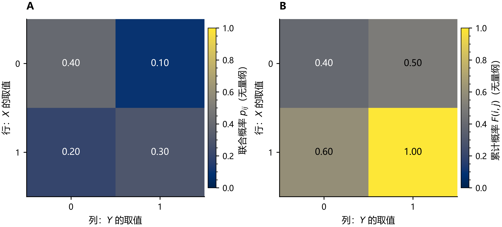
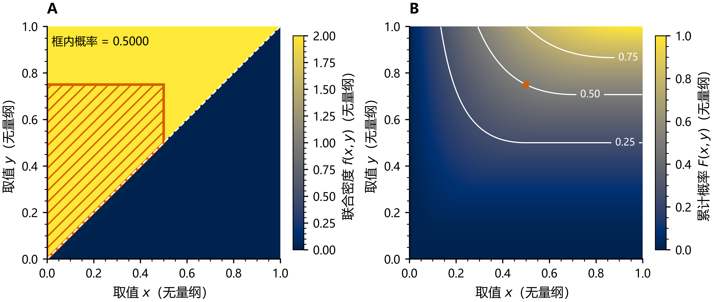
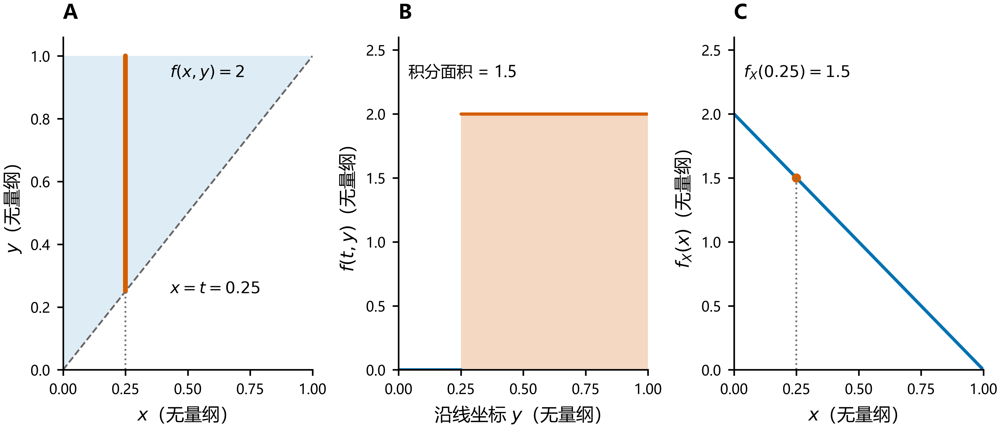
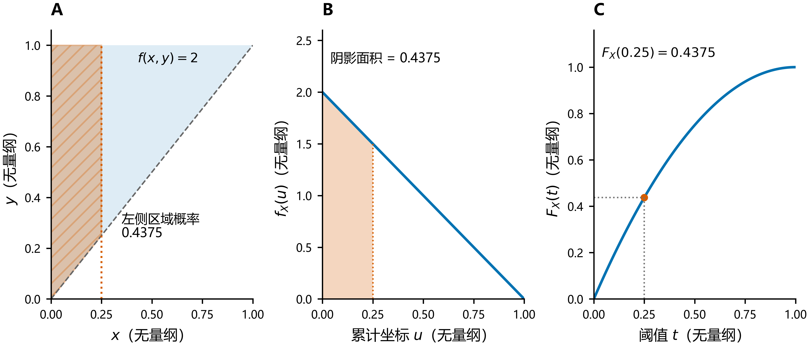
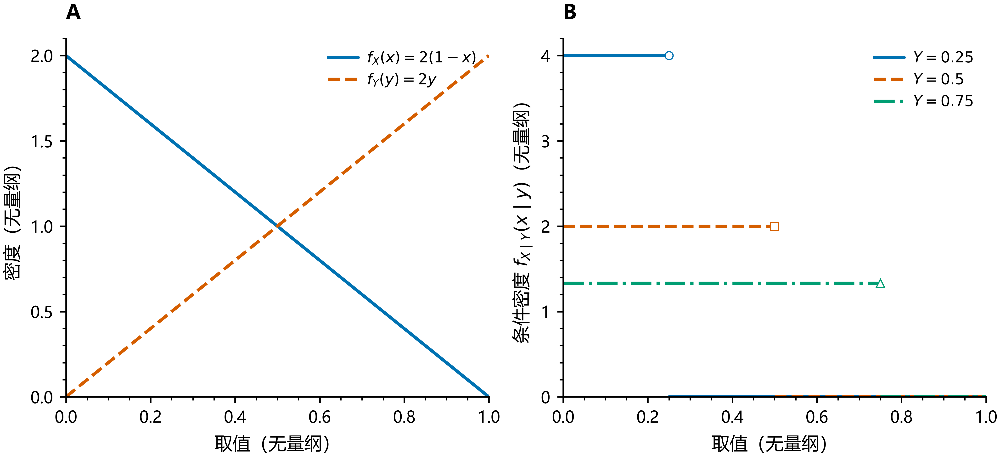
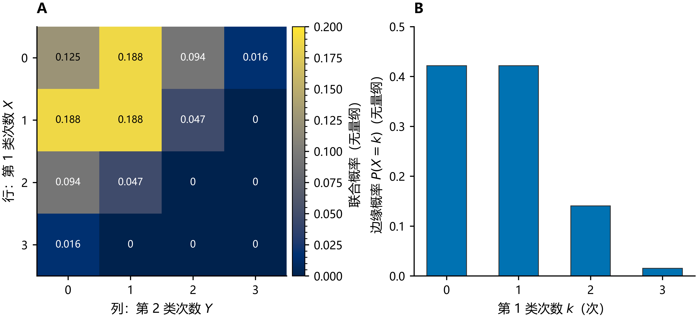
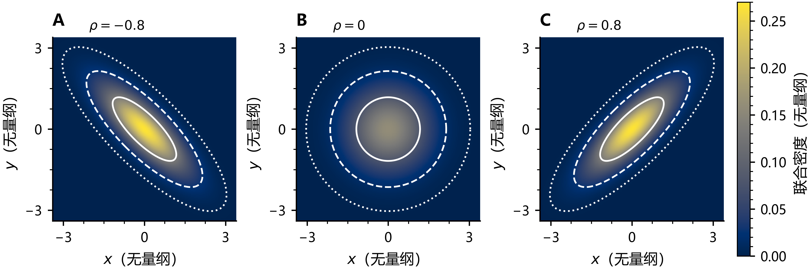
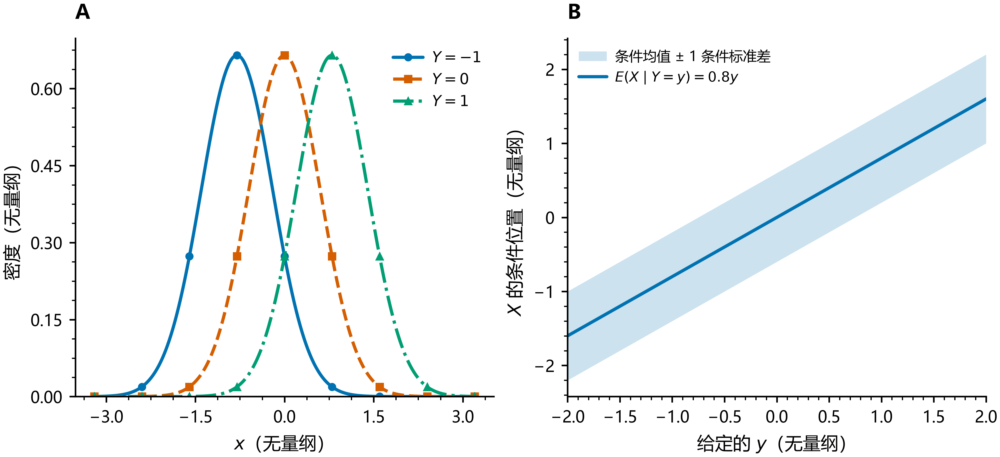
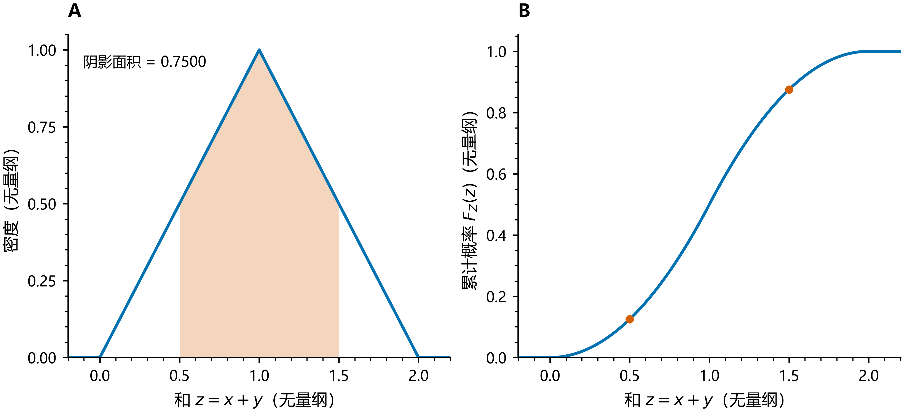
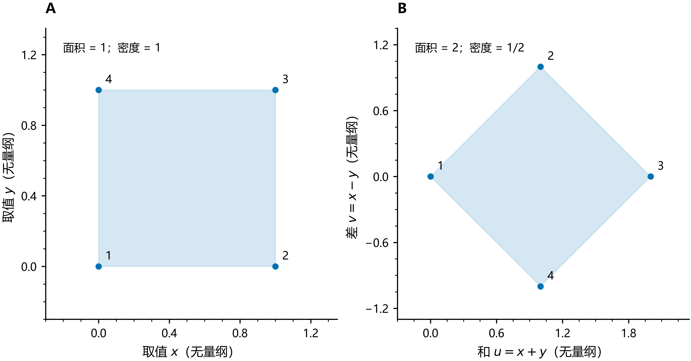

# 二维随机变量及其分布

> 核心主线：联合分布描述两个变量怎样一起取值；边缘分布只看其中一个；条件分布固定另一个变量后重新分配概率；独立性判断这两种信息是否相互影响。

本文承接[一维随机变量及其分布](一维随机变量及其分布.md#2-分布函数统一的描述方法)，将一维中的“求和、面积、累计概率”推广到二维。离散型主要使用联合数表，连续型主要使用区域图、密度图和等高线。

## 1. 二维随机变量

### 1.1 同一次试验中的两个数值

若 $X,Y$ 是定义在同一概率空间上的实值随机变量，则 $(X,Y)$ 称为**二维随机变量**（bivariate random variable），也称二维**随机向量**（random vector）：

$$
(X,Y):\Omega\to\mathbb R^2,\qquad
\omega\mapsto\bigl(X(\omega),Y(\omega)\bigr).
$$

例如同一天的温度与用电量、同一产品的长度与质量，或同一次抽样中两类对象的数量。每次试验产生的是一对数 $(x,y)$。

研究二维随机变量时，不能只知道 $X$ 和 $Y$ 各自的分布，还需要知道它们**共同取值的概率规律**。两个变量的边缘分布相同，并不意味着联合分布相同。

### 1.2 三种问题

| 问题 | 需要的分布 | 典型概率 |
| --- | --- | --- |
| 两个变量同时满足条件的概率 | 联合分布（joint distribution） | $P(X\le x,Y\le y)$ |
| 只关心其中一个变量 | 边缘分布（marginal distribution） | $P(X\le x)$ |
| 已知一个变量的信息后，另一个如何分布 | 条件分布（conditional distribution） | $P(X\le x\mid Y\in B)$ |

逗号表示事件的交集，例如 $P(X\le x,Y\le y)=P(\{X\le x\}\cap\{Y\le y\})$。

## 2. 联合分布函数

### 2.1 定义：累计左下方的概率

**联合分布函数**（joint cumulative distribution function，joint CDF）定义为

$$
\boxed{F_{X,Y}(x,y)=P(X\le x,Y\le y).}
$$

不致混淆时简记为 $F(x,y)$。它累计的是以 $(x,y)$ 为右上角的左下无限矩形

$$
(-\infty,x]\times(-\infty,y].
$$

一维分布函数累计到一个阈值；二维分布函数同时受两个阈值限制。$F(x,y)$ 表示累计概率，不是点 $(x,y)$ 的概率。

### 2.2 基本性质

联合分布函数满足：

1. $0\le F(x,y)\le1$，分别关于 $x$ 与 $y$ 单调不减。
2. 分别关于每个坐标右连续。
3. 固定另一坐标时，$F(-\infty,y)=F(x,-\infty)=0$；同时令两坐标趋于 $+\infty$，极限为 $1$。
4. **矩形增量非负**：若 $a<b$、$c<d$，则

$$
F(b,d)-F(a,d)-F(b,c)+F(a,c)\ge0.
$$

第四条有时称为二维递增性（2-increasing）。**分别单调还不够**：合法的二维分布函数还必须保证每个矩形对应的概率非负。

令一个阈值趋于 $+\infty$，得到另一个变量的边缘分布函数：

$$
\boxed{F_X(x)=\lim_{y\to+\infty}F(x,y),\qquad
F_Y(y)=\lim_{x\to+\infty}F(x,y).}
$$

注意 $F(x,0)$ 一般不是 $F_X(x)$，因为它额外限制了 $Y\le0$。

### 2.3 矩形概率：四个角作差

对 $a<b$、$c<d$，由容斥原理得到

$$
\boxed{P(a<X\le b,c<Y\le d)
=F(b,d)-F(a,d)-F(b,c)+F(a,c).}
$$

解释是：从累计到 $(b,d)$ 的概率中，扣掉左侧 $X\le a$ 的部分和下方 $Y\le c$ 的部分，再补回被扣掉两次的左下角。

若相关边界有正概率，必须区分开闭端点，使用相应坐标的左极限。例如

$$
\begin{aligned}
P(X=x,Y=y)
={}&F(x,y)-F(x^-,y)\\
&-F(x,y^-)+F(x^-,y^-).
\end{aligned}
$$

其中 $F(x^-,y)=P(X<x,Y\le y)$，$F(x^-,y^-)=P(X<x,Y<y)$。

## 3. 二维离散型随机变量：联合数表

### 3.1 联合分布律

若 $(X,Y)$ 以概率 $1$ 取值于有限或可数个点，则称其为**二维离散型随机变量**。设两个坐标的取值分别为 $x_i,y_j$，**联合分布律**（joint probability mass function，joint PMF）为

$$
p_{ij}=P(X=x_i,Y=y_j).
$$

合法的联合分布律满足

$$
\boxed{p_{ij}\ge0,\qquad \sum_i\sum_jp_{ij}=1.}
$$

没有实际概率质量的坐标组合取 $p_{ij}=0$。联合分布函数通过二维累计求和得到：

$$
F(x,y)=\sum_{x_i\le x}\sum_{y_j\le y}p_{ij}.
$$

### 3.2 典型数表：联合、边缘与累计

设 $X,Y$ 都取 $0,1$，联合分布如下。本文统一约定**行对应 $X$，列对应 $Y$**。

| $X\backslash Y$ | $Y=0$ | $Y=1$ | 行和 $P(X=x)$ |
| --- | --- | --- | --- |
| $X=0$ | $0.4$ | $0.1$ | $0.5$ |
| $X=1$ | $0.2$ | $0.3$ | $0.5$ |
| 列和 $P(Y=y)$ | $0.6$ | $0.4$ | $1$ |

由表可直接读出：

- 联合概率：$P(X=1,Y=1)=0.3$。
- 边缘概率：$P(X=1)=0.2+0.3=0.5$。
- 区域概率：$P(X+Y\le1)=0.4+0.1+0.2=0.7$。

相应的累计概率表为

| $F(x,y)$ | $y=0$ | $y=1$ |
| --- | --- | --- |
| $x=0$ | $0.4$ | $0.5$ |
| $x=1$ | $0.6$ | $1$ |

例如 $F(1,0)=P(X\le1,Y\le0)=0.4+0.2=0.6$。在所有取值之间，完整的 $F(x,y)$ 沿两个方向保持阶梯状。

图 A 将联合数表中的概率质量用颜色表示；图 B 将阈值 $x,y\in\{0,1\}$ 时的累计概率用颜色表示。图 B 是数表的热图，不表示在格子之间做连续插值。

### 3.3 离散条件分布：选行或列，再归一化

若 $P(Y=y_j)>0$，则

$$
\boxed{P(X=x_i\mid Y=y_j)
=\frac{p_{ij}}{\sum_kp_{kj}}.}
$$

若 $P(X=x_i)>0$，则

$$
P(Y=y_j\mid X=x_i)=\frac{p_{ij}}{\sum_kp_{ik}}.
$$

继续使用上面的联合表：

| 给定条件 | $P(Y=0\mid X=x)$ | $P(Y=1\mid X=x)$ | 合计 |
| --- | --- | --- | --- |
| $X=0$ | $0.4/0.5=0.8$ | $0.1/0.5=0.2$ | $1$ |
| $X=1$ | $0.2/0.5=0.4$ | $0.3/0.5=0.6$ | $1$ |

而沿列归一化得到

$$
P(X=1\mid Y=0)=\frac{0.2}{0.6}=\frac13,\qquad
P(X=1\mid Y=1)=\frac{0.3}{0.4}=\frac34.
$$

条件不同，得到的分布不同；它们也不同于无条件的 $P(X=1)=1/2$。

## 4. 二维连续型随机变量：联合密度与区域积分

### 4.1 定义与归一化

若存在非负可积函数 $f_{X,Y}(x,y)$，使得

$$
\boxed{F(x,y)=\int_{-\infty}^{x}\int_{-\infty}^{y}
f_{X,Y}(u,v)\,dv\,du,}
$$

则称 $(X,Y)$ 具有**联合概率密度函数**（joint probability density function，joint PDF），初等教材称其为二维连续型随机变量。严格说，这对应二维绝对连续分布。

合法联合密度满足

$$
f_{X,Y}(x,y)\ge0,\qquad
\iint_{\mathbb R^2}f_{X,Y}(x,y)\,dx\,dy=1.
$$

在密度连续处，可以通过混合偏导恢复密度：

$$
f_{X,Y}(x,y)=\frac{\partial^2F(x,y)}{\partial y\,\partial x}.
$$

对于区域 $A$，

$$
\boxed{P\bigl((X,Y)\in A\bigr)=\iint_Af_{X,Y}(x,y)\,dx\,dy.}
$$

二维密度的高度不是概率；“密度高度乘小面积”近似给出小区域概率。若 $X,Y$ 有物理单位，密度单位为两个坐标单位乘积的倒数，积分后的概率无量纲。

### 4.2 先确定区域，再写积分限

设密度只在 $D$ 上非零。计算事件区域 $A$ 的概率时，实际积分区域是 $A\cap D$。

若区域可以表示成

$$
a<x<b,\qquad \alpha(x)<y<\beta(x),
$$

就写成

$$
P((X,Y)\in A)=\int_a^b\int_{\alpha(x)}^{\beta(x)}f(x,y)\,dy\,dx.
$$

内层积分限可以依赖外层变量。换积分次序时，要重新描述同一个区域，不能只交换 $dx,dy$。

### 4.3 典型例子：三角形区域上的均匀分布

设

$$
f(x,y)=
\begin{cases}
c,&0<x<y<1,\\
0,&\text{其他}.
\end{cases}
$$

区域 $D=\{(x,y):0<x<y<1\}$ 的面积为 $1/2$，所以 $c=2$。也可以直接归一化：

$$
1=\int_0^1\int_0^y c\,dx\,dy=\frac c2.
$$

**求 $P(X\le1/2,Y\le3/4)$。** 事件区域与三角形相交后，需要分段：

$$
\begin{aligned}
P(X\le1/2,Y\le3/4)
&=\int_0^{1/2}\int_0^y2\,dx\,dy
+\int_{1/2}^{3/4}\int_0^{1/2}2\,dx\,dy\\
&=\frac14+\frac14=\frac12.
\end{aligned}
$$

如果先对 $y$ 积分，也可不分段：$\int_0^{1/2}\int_x^{3/4}2\,dy\,dx=1/2$。

图 A 的非零密度位于对角线上方；斜线框标出本题的积分区域，概率等于其面积乘密度 $2$。图 B 表示累计概率，标出的点是 $F(1/2,3/4)=1/2$。左图的对角线是区域边界，右图的白线是累计概率等值线。

**写出完整的联合分布函数。** 令

$$
u=\min\{\max\{x,0\},1\},\qquad
v=\min\{\max\{y,0\},1\},
$$

则对所有实数 $x,y$，

$$
\boxed{F(x,y)=
\begin{cases}
v^2,&u\ge v,\\
2uv-u^2,&u<v.
\end{cases}}
$$

在 $0<x<y<1$ 内，推导为

$$
F(x,y)=\int_0^x2t\,dt+\int_x^y2x\,dt=x^2+2x(y-x)=2xy-x^2.
$$

当 $0<y\le x<1$ 时，条件 $X\le x$ 不再额外限制已满足 $X<Y\le y$ 的点，所以 $F(x,y)=y^2$。

联合累计数表（行是 $x$ 阈值，列是 $y$ 阈值）：

| $F(x,y)$ | $y=0$ | $y=0.25$ | $y=0.5$ | $y=0.75$ | $y=1$ |
| --- | --- | --- | --- | --- | --- |
| $x=0$ | $0$ | $0$ | $0$ | $0$ | $0$ |
| $x=0.25$ | $0$ | $0.0625$ | $0.1875$ | $0.3125$ | $0.4375$ |
| $x=0.5$ | $0$ | $0.0625$ | $0.25$ | $0.5$ | $0.75$ |
| $x=0.75$ | $0$ | $0.0625$ | $0.25$ | $0.5625$ | $0.9375$ |
| $x=1$ | $0$ | $0.0625$ | $0.25$ | $0.5625$ | $1$ |

沿行向右、沿列向下，累计概率均不减。最后一列得到 $F_X(x)$，最后一行得到 $F_Y(y)$，因为本例两个坐标均不超过 $1$。

### 4.4 连续边缘不保证存在联合密度

具有二维密度时，单点、直线等面积为零的集合均有概率 $0$，区域边界为这些曲线时开闭端点不影响概率。

但**两个边缘均为连续型，不保证联合分布具有二维密度**。例如 $X\sim U(0,1)$、$Y=X$，两个边缘都均匀，而全部联合概率集中在直线 $y=x$ 上，$P(X=Y)=1$。这条直线的平面面积为零，所以无法用普通二维密度表示这种分布。

联合分布函数仍然存在，本例为

$$
F(x,y)=\min\{u,v\},
$$

其中 $u,v$ 按第 4.3 节截取到 $[0,1]$。因此不能根据“边缘连续”就对任意联合分布函数求混合偏导，认为得到了全部概率。

## 5. 边缘分布与条件分布

### 5.1 边缘分布：消去另一个坐标

离散型通过求和得到边缘分布律：

$$
\boxed{P(X=x_i)=\sum_jp_{ij},\qquad
P(Y=y_j)=\sum_ip_{ij}.}
$$

具有联合密度时，通过积分得到边缘密度：

$$
\boxed{f_X(x)=\int_{-\infty}^{+\infty}f(x,y)\,dy,\qquad
f_Y(y)=\int_{-\infty}^{+\infty}f(x,y)\,dx.}
$$

“边缘”是把另一个变量所有可能的情况加起来。**$f(x,0)$ 是密度的一条截面，通常不是 $f_X(x)$。**

### 5.2 三角形例子的边缘分布

对第 4.3 节的密度，在 $0<x<1$ 时，给定 $x$ 后 $y$ 必须从 $x$ 到 $1$：

$$
f_X(x)=\int_x^12\,dy=2(1-x).
$$

在 $0<y<1$ 时，给定 $y$ 后 $x$ 必须从 $0$ 到 $y$：

$$
f_Y(y)=\int_0^y2\,dx=2y.
$$

两种密度在区间外均为 $0$；对应的分布函数在 $0<t<1$ 时为

$$
F_X(t)=2t-t^2,\qquad F_Y(t)=t^2,
$$

在 $t\le0$ 时均为 $0$，在 $t\ge1$ 时均为 $1$。

| $t$ | $f_X(t)$ | $f_Y(t)$ | $F_X(t)$ | $F_Y(t)$ |
| --- | --- | --- | --- | --- |
| $0.25$ | $1.5$ | $0.5$ | $0.4375$ | $0.0625$ |
| $0.5$ | $1$ | $1$ | $0.75$ | $0.25$ |
| $0.75$ | $0.5$ | $1.5$ | $0.9375$ | $0.5625$ |

尽管联合密度在三角形上恒为 $2$，两个边缘却不均匀：纵向截面长度随 $x$ 减小，横向截面长度随 $y$ 增大。这是**联合均匀不等于边缘均匀**的典型例子。

**可视化：先沿一条线积分，再把左侧累计起来。**

这里需要区分两个对象：**对另一个变量积分，得到边缘密度 $f_X$；再对自身累计积分，得到边缘分布函数 $F_X$。** 两步都在累加，但第一步得到的是密度高度，第二步得到的才是概率。

$$
f(x,y)\ \xrightarrow{\text{固定 }x\text{，对 }y\text{ 积分}}\ f_X(x)
\ \xrightarrow{\text{对 }x\text{ 累计积分}}\ F_X(x).
$$

**第一步：固定 $x=t$，沿竖线把所有 $y$ 的密度累加。** 取 $t=1/4$，仍使用三角形 $0<x<y<1$ 上的联合密度 $2$。

- **图 A：找到线。** 固定 $x=1/4$，竖线与非零密度区域相交的部分是 $1/4<y<1$。
- **图 B：展开这条线上的密度。** 横轴改为沿线的 $y$，曲线高度为 $f(1/4,y)=2$，所以曲线下面积为 $2\times(1-1/4)=3/2$。
- **图 C：把积分结果放到边缘密度曲线上。** 得到 $f_X(1/4)=3/2$。让竖线随 $x$ 移动，就得到整条曲线 $f_X(x)=2(1-x)$。

$$
\boxed{f_X(t)=\int_{-\infty}^{+\infty}f(t,y)\,dy
=\int_t^12\,dy=2(1-t),\qquad 0<t<1.}
$$

这里的 $3/2$ 是**密度值**，可以大于 $1$。它不是 $P(X=1/4)$；本例中固定竖线本身的概率为 $0$。更直观地，宽度很小的竖条带才具有概率：

$$
P(t<X\le t+\Delta x)\approx f_X(t)\Delta x.
$$

图 B 也不是条件密度：它是原联合密度的截面，积分不必等于 $1$。若要得到 $Y\mid X=t$ 的条件密度，还须除以 $f_X(t)$，这正是下一节的归一化操作。

**第二步：从左向右，把边缘密度累计到 $t$。**

- **图 A：在联合平面中看区域。** 将所有 $x\le1/4$ 的竖线一起累计，得到三角形内左侧的斜线区域；其概率是联合密度在该区域上的二重积分。
- **图 B：在边缘密度图中看面积。** 对 $f_X(u)$ 从 $0$ 积分到 $1/4$，橙色曲线下面积为 $7/16=0.4375$。
- **图 C：在分布函数图中看高度。** 同一个数值就是 $F_X(1/4)=P(X\le1/4)=0.4375$。

用 $u$ 表示累计过程中不断变化的横坐标，用 $t$ 表示最后停下的阈值，两步可以写在同一式中：

$$
\boxed{F_X(t)=\int_{-\infty}^{t}f_X(u)\,du
=\int_{-\infty}^{t}\left[\int_{-\infty}^{+\infty}f(u,y)\,dy\right]du.}
$$

在本例中，

$$
F_X(t)=\int_0^t\int_u^12\,dy\,du
=\int_0^t2(1-u)\,du=2t-t^2,\qquad 0<t<1.
$$

因此 $F_X(1/4)=2\times1/4-(1/4)^2=7/16$。**一条竖线上的积分给出边缘密度的高度；把这些竖线从左到右累计，才给出左侧区域的概率。** 若改求 $Y$ 的边缘分布，只需交换方向：先固定 $y$ 沿横线对 $x$ 积分，再对 $y$ 从负无穷累计到阈值，得到该横线下方的区域概率。

### 5.3 连续条件密度：截面除以边缘密度

具有联合密度且 $f_Y(y)>0$ 时，**条件密度**（conditional probability density）可取为

$$
\boxed{f_{X\mid Y}(x\mid y)=\frac{f(x,y)}{f_Y(y)}.}
$$

类似地，$f_{Y\mid X}(y\mid x)=f(x,y)/f_X(x)$，要求 $f_X(x)>0$。

固定 $y$，先取联合密度的横向截面，再除以该截面的总积分，使其成为关于 $x$ 的合法密度：

$$
\int_{-\infty}^{+\infty}f_{X\mid Y}(x\mid y)\,dx=1.
$$

连续型通常有 $P(Y=y)=0$，所以这不是直接用事件概率算 $P(A\cap\{Y=y\})/P(Y=y)$。它是条件分布的密度表达，可理解为把条件 $Y\in(y,y+\Delta y)$ 缩小后的极限；严格意义下条件密度只需对几乎处处的 $y$ 定义一致。

### 5.4 三角形例子的条件分布

由 $f_Y(y)=2y$，当 $0<y<1$ 时，

$$
f_{X\mid Y}(x\mid y)=
\begin{cases}
1/y,&0<x<y,\\
0,&\text{其他}.
\end{cases}
$$

因此

$$
\boxed{X\mid Y=y\sim U(0,y).}
$$

反向条件为

$$
Y\mid X=x\sim U(x,1),\qquad 0<x<1.
$$

图 A 的两条曲线是边缘密度；图 B 固定 $Y=0.25,0.5,0.75$，每条条件密度的面积均为 $1$。条件区间越短，密度越高。图 B 只表示区间内部的常值，端点密度不影响概率。

| 给定的 $y$ | $X\mid Y=y$ | 条件密度（区间内） | $E(X\mid Y=y)$ |
| --- | --- | --- | --- |
| $0.25$ | $U(0,0.25)$ | $4$ | $0.125$ |
| $0.5$ | $U(0,0.5)$ | $2$ | $0.25$ |
| $0.75$ | $U(0,0.75)$ | $4/3$ | $0.375$ |

例如 $P(X<1/4\mid Y=1/2)=(1/4)/(1/2)=1/2$，而无条件概率 $P(X<1/4)=7/16$。

### 5.5 将条件分布平均，恢复边缘分布

将联合密度写成 $f(x,y)=f_{X\mid Y}(x\mid y)f_Y(y)$，得到

$$
\boxed{f_X(x)=\int_{-\infty}^{+\infty}f_{X\mid Y}(x\mid y)f_Y(y)\,dy.}
$$

对三角形例子，$0<x<1$ 时

$$
f_X(x)=\int_x^1\frac1y\cdot2y\,dy=2(1-x).
$$

这对应连续型的全概率公式：用 $Y$ 的边缘密度作为权重，对不同条件下的分布加权平均。

## 6. 随机变量的独立性

### 6.1 定义与三种等价判断

若对任意实数 $x,y$ 都有

$$
\boxed{F_{X,Y}(x,y)=F_X(x)F_Y(y),}
$$

则称 $X,Y$ **相互独立**（independent），记为 $X\perp Y$。等价地，对任意 Borel 集 $A,B$，

$$
P(X\in A,Y\in B)=P(X\in A)P(Y\in B).
$$

不同类型的判断方法如下：

| 类型 | 独立的充要条件 |
| --- | --- |
| 任意联合分布 | 对所有 $x,y$，$F(x,y)=F_X(x)F_Y(y)$ |
| 离散型 | 对所有 $i,j$，$p_{ij}=P(X=x_i)P(Y=y_j)$ |
| 具有联合密度 | 几乎处处 $f(x,y)=f_X(x)f_Y(y)$ |

在有意义的条件下，独立意味着条件分布等于原来的边缘分布：知道 $Y$ 的信息，不改变 $X$ 的概率规律。

### 6.2 用数表判断，不能只检查一个格子

第 3.2 节的联合表不满足独立性，因为

$$
P(X=1,Y=1)=0.3\ne0.5\times0.4=0.2.
$$

若保留同样的边缘分布，但要求独立，则联合表必须变成

| $X\backslash Y$ | $Y=0$ | $Y=1$ | 行和 |
| --- | --- | --- | --- |
| $X=0$ | $0.3$ | $0.2$ | $0.5$ |
| $X=1$ | $0.3$ | $0.2$ | $0.5$ |
| 列和 | $0.6$ | $0.4$ | $1$ |

两张联合表的边缘完全一样，联合规律却不同，说明**边缘分布一般不能反推联合分布**；加上独立性后，才可通过乘积恢复联合分布。

证明不独立只需找到一个不满足乘积关系的格子；证明独立要覆盖全部格子。

### 6.3 连续型判断要包含取值区域

三角形例子也不独立。例如在 $0<y<x<1$ 上，

$$
f(x,y)=0,\qquad f_X(x)f_Y(y)=4y(1-x)>0.
$$

也可用累计概率判断：

$$
F(1/2,1/2)=\frac14
\ne F_X(1/2)F_Y(1/2)=\frac34\cdot\frac14=\frac3{16}.
$$

不能仅在三角形内部把常数 $2$ 写成两个因子的乘积，就认定独立。联合密度还包含“区域外为零”的信息；检查乘积关系时必须覆盖整个平面。

如果 $X,Y$ 独立，则分别作用于它们的可测函数 $g(X),h(Y)$ 也独立。反过来一般不成立，例如常值函数会丢掉原变量的信息。

## 7. 常见二维分布

### 7.1 区域上的均匀分布

设平面区域 $D$ 的面积为有限正数 $|D|$。**二维均匀分布**（bivariate uniform distribution）的密度为

$$
f(x,y)=\frac1{|D|}\mathbf1_D(x,y),
$$

其中 $\mathbf1_D$ 是区域的示性函数。对区域 $A$，

$$
P((X,Y)\in A)=\frac{|A\cap D|}{|D|}.
$$

| 均匀区域 | 联合密度（区域内） | 边缘与独立性 |
| --- | --- | --- |
| 矩形 $(a,b)\times(c,d)$ | $1/[(b-a)(d-c)]$ | $X\sim U(a,b)$、$Y\sim U(c,d)$，且独立 |
| 三角形 $0<x<y<1$ | $2$ | $f_X(x)=2(1-x)$、$f_Y(y)=2y$，不独立 |

“均匀”只表示相同面积的子区域具有相同概率。区域形状会影响边缘分布与依赖关系。

### 7.2 三类试验的计数：二维多项分布

进行 $n$ 次相互独立的试验，每次结果属于第 $1,2,3$ 类的概率分别为 $p_1,p_2,p_3$，其中 $p_i>0$、$p_1+p_2+p_3=1$。令 $X,Y$ 分别为第 $1,2$ 类出现的次数，第 $3$ 类次数便为 $n-X-Y$。

这构成**多项分布**（multinomial distribution）的二维计数表示：

$$
\boxed{P(X=i,Y=j)=\frac{n!}{i!j!(n-i-j)!}
p_1^ip_2^jp_3^{n-i-j},}
$$

其中 $i,j$ 为非负整数，$i+j\le n$，其他位置概率为 $0$。边缘分布为

$$
X\sim B(n,p_1),\qquad Y\sim B(n,p_2).
$$

虽然每次试验相互独立，**不同类别的总次数通常不独立**：一类次数增加，会减少其他类别可用的次数。其协方差为 $\operatorname{Cov}(X,Y)=-np_1p_2$。

取 $n=3$、$p_1=p_2=1/4$、$p_3=1/2$，联合数表为

| $X\backslash Y$ | $Y=0$ | $Y=1$ | $Y=2$ | $Y=3$ | 行和 |
| --- | --- | --- | --- | --- | --- |
| $X=0$ | $0.125000$ | $0.187500$ | $0.093750$ | $0.015625$ | $0.421875$ |
| $X=1$ | $0.187500$ | $0.187500$ | $0.046875$ | $0$ | $0.421875$ |
| $X=2$ | $0.093750$ | $0.046875$ | $0$ | $0$ | $0.140625$ |
| $X=3$ | $0.015625$ | $0$ | $0$ | $0$ | $0.015625$ |
| 列和 | $0.421875$ | $0.421875$ | $0.140625$ | $0.015625$ | $1$ |

图 A 的零概率区域来自约束 $X+Y\le3$；图 B 将每行求和，得到 $X\sim B(3,1/4)$。两类次数的边缘都为二项分布，但联合分布不是它们的乘积。

### 7.3 二维正态分布：参数与密度

**二维正态分布**（bivariate normal distribution）用均值向量 $\boldsymbol\mu$ 与**协方差矩阵**（covariance matrix）$\Sigma$ 表示，记为

$$
\begin{pmatrix}X\\Y\end{pmatrix}\sim N_2(\boldsymbol\mu,\Sigma),\qquad
\boldsymbol\mu=\begin{pmatrix}\mu_X\\\mu_Y\end{pmatrix},
$$

$$
\Sigma=
\begin{pmatrix}
\sigma_X^2&\rho\sigma_X\sigma_Y\\
\rho\sigma_X\sigma_Y&\sigma_Y^2
\end{pmatrix}.
$$

这里 $\sigma_X,\sigma_Y>0$ 是两个边缘的标准差，$\rho$ 是**相关系数**（correlation coefficient）。非退化情形要求 $-1<\rho<1$，此时 $\Sigma$ 正定。

令 $u=(x-\mu_X)/\sigma_X$、$v=(y-\mu_Y)/\sigma_Y$，密度为

$$
\boxed{f(x,y)=\frac1{2\pi\sigma_X\sigma_Y\sqrt{1-\rho^2}}
\exp\left[-\frac{u^2-2\rho uv+v^2}{2(1-\rho^2)}\right].}
$$

其边缘分布为

$$
X\sim N(\mu_X,\sigma_X^2),\qquad
Y\sim N(\mu_Y,\sigma_Y^2).
$$

联合分布函数仍需对密度作左下区域积分，一般不能写成两个一维正态分布函数的乘积；只有独立情形才可这样分解。

图中固定 $\mu_X=\mu_Y=0$、$\sigma_X=\sigma_Y=1$，A、B、C 分别取 $\rho=-0.8,0,0.8$，三个面板共用密度色标。白色实线、虚线、点线分别围住 $50\%$、$90\%$、$99\%$ 的概率；它们是分布的概率区域，不是估计参数的置信区间。图只显示有限窗口，正态分布的取值范围仍为整个平面。

| $\rho$ | 密度形状（本图两个方差相等） | 依赖关系 |
| --- | --- | --- |
| $-0.8$ | 沿负斜率方向拉长 | 一个偏大时，另一个倾向偏小 |
| $0$ | 等密度线为圆 | 联合正态下相互独立 |
| $0.8$ | 沿正斜率方向拉长 | 两个变量倾向同向偏离均值 |

白线对应标准化二次型 $Q=(u^2-2\rho uv+v^2)/(1-\rho^2)$ 的等值线。$Q$ 服从自由度 $2$ 的卡方分布，对 $q\ge0$ 有 $P(Q\le q)=1-e^{-q/2}$，所以中央概率为 $p$ 的边界可取 $q=-2\ln(1-p)$。一般协方差下，等密度线为椭圆，其主轴由 $\Sigma$ 的特征向量决定。

在联合正态族中，

$$
\boxed{X\perp Y\iff\rho=0.}
$$

这里必须有**联合正态**的前提。仅知道两个边缘各自服从正态分布，不能推出联合正态，也不能直接使用这条独立性判断。

当 $|\rho|=1$ 时，属于退化的联合正态分布，概率集中在一条直线上，不能代入上面的非退化密度公式。

### 7.4 二维正态的条件分布

非退化二维正态分布有

$$
\boxed{X\mid Y=y\sim
N\left(\mu_X+\rho\frac{\sigma_X}{\sigma_Y}(y-\mu_Y),
\ \sigma_X^2(1-\rho^2)\right).}
$$

反向条件分布只需交换 $X,Y$。该结论可由联合密度除以边缘密度，再对指数中的 $x$ 配方得到。

条件均值随 $y$ 线性变化，条件方差不依赖 $y$。$\rho=0$ 时，条件分布等于边缘分布；$|\rho|$ 越接近 $1$，条件方差越小。

取图中的 $\rho=0.8$，其他参数均为标准化参数，则

$$
X\mid Y=y\sim N(0.8y,0.36),\qquad
\text{条件标准差}=0.6.
$$

| 给定的 $y$ | 条件均值 | 条件方差 | 条件标准差 |
| --- | --- | --- | --- |
| $-1$ | $-0.8$ | $0.36$ | $0.6$ |
| $0$ | $0$ | $0.36$ | $0.6$ |
| $1$ | $0.8$ | $0.36$ | $0.6$ |

图 A 的三个条件密度具有相同宽度，但中心随条件值移动；图 B 的阴影表示条件均值上下各一个条件标准差，对每个固定的 $y$，其中约包含 $68.27\%$ 的条件概率。

### 7.5 二维正态的线性组合

若 $(X,Y)$ 联合正态，则非退化线性组合仍为正态：

$$
\begin{aligned}
aX+bY+c\sim N\bigl(&a\mu_X+b\mu_Y+c,\\
&a^2\sigma_X^2+b^2\sigma_Y^2+2ab\rho\sigma_X\sigma_Y\bigr).
\end{aligned}
$$

它不要求 $X,Y$ 独立；相关性通过交叉项进入方差。若方差为零，结果是常量而非具有普通密度的正态变量。

特别地，图中 $X,Y$ 的均值为 $0$、方差为 $1$，则

| $\rho$ | $X+Y$ 的分布 | $X-Y$ 的分布 |
| --- | --- | --- |
| $-0.8$ | $N(0,0.4)$ | $N(0,3.6)$ |
| $0$ | $N(0,2)$ | $N(0,2)$ |
| $0.8$ | $N(0,3.6)$ | $N(0,0.4)$ |

同向变化会放大和的波动、减小差的波动；反向变化则相反。

## 8. 二维随机变量函数的分布

### 8.1 通用方法：把事件变成平面区域

若 $Z=g(X,Y)$，首先写出

$$
\boxed{F_Z(z)=P(g(X,Y)\le z).}
$$

离散型对满足 $g(x_i,y_j)\le z$ 的格子求和；有联合密度时，对区域 $\{(x,y):g(x,y)\le z\}$ 与非零密度区域的交集积分。若需要密度，再对 $F_Z$ 求导。

这样的方法对和、差、最大值、最小值都适用。特别地，

$$
F_{\max(X,Y)}(z)=F(z,z),
$$

$$
F_{\min(X,Y)}(z)=F_X(z)+F_Y(z)-F(z,z).
$$

这些公式不要求独立；独立时可进一步代入 $F(z,z)=F_X(z)F_Y(z)$。

### 8.2 和的分布与卷积

离散型若两个变量均为整数取值，则

$$
P(X+Y=k)=\sum_iP(X=i,Y=k-i).
$$

独立时变为 $\sum_iP(X=i)P(Y=k-i)$。

具有联合密度时，$Z=X+Y$ 的密度可写成

$$
\boxed{f_Z(z)=\int_{-\infty}^{+\infty}f_{X,Y}(x,z-x)\,dx.}
$$

若 $X,Y$ 独立，便得到**卷积**（convolution）公式：

$$
f_Z(z)=\int_{-\infty}^{+\infty}f_X(x)f_Y(z-x)\,dx.
$$

非独立时，不能擅自把联合密度替换为边缘密度的乘积。

**例：两个独立 $U(0,1)$ 随机变量之和。** 联合密度在单位正方形上为 $1$。固定 $z$ 后，积分范围需同时满足 $0<x<1$ 和 $0<z-x<1$，即

$$
\max(0,z-1)<x<\min(1,z).
$$

因此

$$
f_Z(z)=
\begin{cases}
z,&0<z\le1,\\
2-z,&1<z<2,\\
0,&\text{其他},
\end{cases}
$$

$$
F_Z(z)=
\begin{cases}
0,&z\le0,\\
z^2/2,&0<z\le1,\\
1-(2-z)^2/2,&1<z<2,\\
1,&z\ge2.
\end{cases}
$$

图 A 的阴影面积为 $P(0.5<Z<1.5)=0.75$，与图 B 中 $F_Z(1.5)-F_Z(0.5)=0.875-0.125$ 相同。和的密度在中心更高，因为可产生中间和值的坐标组合更多。

| $z$ | $f_Z(z)$ | $F_Z(z)$ |
| --- | --- | --- |
| $0$ | $0$ | $0$ |
| $0.5$ | $0.5$ | $0.125$ |
| $1$ | $1$ | $0.5$ |
| $1.5$ | $0.5$ | $0.875$ |
| $2$ | $0$ | $1$ |

### 8.3 二维到二维的变换：雅可比行列式

设 $U=g(X,Y)$、$V=h(X,Y)$，在有关区域上变换一一对应且可微，逆变换为 $x=x(u,v)$、$y=y(u,v)$，雅可比行列式非零。则变换后区域内的联合密度为

$$
\boxed{f_{U,V}(u,v)=f_{X,Y}(x(u,v),y(u,v))
\left|\frac{\partial(x,y)}{\partial(u,v)}\right|.}
$$

区域外密度为 $0$。这里使用的是**逆变换的雅可比行列式绝对值**，它补偿面积元素的变化：$dx\,dy=|J|\,du\,dv$。

若变换不是一一对应，需要将不同逆分支的贡献相加；不能只取其中一个分支。

继续使用独立的 $X,Y\sim U(0,1)$，令

$$
U=X+Y,\qquad V=X-Y.
$$

则

$$
X=\frac{U+V}{2},\qquad Y=\frac{U-V}{2},\qquad
\left|\frac{\partial(x,y)}{\partial(u,v)}\right|=\frac12.
$$

原区域 $0<x,y<1$ 变为

$$
0<u<2,\qquad |v|<\min(u,2-u),
$$

所以 $f_{U,V}(u,v)=1/2$ 在该菱形内成立，其他位置为 $0$。

图中的对应编号标出同一顶点的映射。新区域面积为 $2$，密度从 $1$ 变为 $1/2$，总概率仍为 $1$。对 $v$ 积分得到 $f_U(u)=\min(u,2-u)$，与上面的和的密度一致。

注意 $U,V$ 并不独立：例如 $P(U<1/4,V>1/2)=0$，而两个事件的边缘概率都大于零。分别涉及原来两个独立变量的和、差，不属于第 6.3 节“分别作用于单个变量”的情形。

## 9. 数字特征：协方差与相关系数

### 9.1 由联合分布计算期望

只要相应期望存在，对可测函数 $g$：

$$
E[g(X,Y)]=\sum_i\sum_jg(x_i,y_j)p_{ij}
$$

或在有联合密度时

$$
E[g(X,Y)]=\iint_{\mathbb R^2}g(x,y)f(x,y)\,dx\,dy.
$$

$E(X)$、$E(Y)$ 只需边缘分布；$E(XY)$ 一般需要联合分布。比如第 3.2 节中 $E(X)=0.5$、$E(Y)=0.4$，但 $E(XY)=0.3$。

### 9.2 协方差与相关系数

当二阶矩有限时，**协方差**（covariance）定义为

$$
\boxed{\operatorname{Cov}(X,Y)
=E[(X-E(X))(Y-E(Y))]=E(XY)-E(X)E(Y).}
$$

若两个方差还均为正，定义相关系数

$$
\rho_{X,Y}=\frac{\operatorname{Cov}(X,Y)}
{\sqrt{\operatorname{Var}(X)\operatorname{Var}(Y)}},\qquad -1\le\rho_{X,Y}\le1.
$$

它衡量线性联系的方向与强度。第 3.2 节的离散例子有

$$
\operatorname{Cov}(X,Y)=0.3-0.5\times0.4=0.1,\qquad
\rho_{X,Y}=\frac{0.1}{\sqrt{0.25\times0.24}}\approx0.4082.
$$

若 $\rho_{X,Y}=0$，称为**不相关**（uncorrelated）。独立且二阶矩有限时一定不相关；反过来一般不成立。

第 8.3 节的和差变量正好给出反例：

$$
\operatorname{Cov}(U,V)
=\operatorname{Cov}(X+Y,X-Y)
=\operatorname{Var}(X)-\operatorname{Var}(Y)=0,
$$

但菱形上的 $U,V$ 不独立。只有在联合正态等额外条件下，零相关才可用于判断独立。

### 9.3 和差方差与条件期望

二阶矩有限时，

$$
\operatorname{Var}(aX+bY)
=a^2\operatorname{Var}(X)+b^2\operatorname{Var}(Y)
+2ab\operatorname{Cov}(X,Y).
$$

独立时协方差项为零，但期望的线性性 $E(aX+bY)=aE(X)+bE(Y)$ 不要求独立，只要求相关期望存在。

**条件期望**（conditional expectation）在密度情形可写为

$$
E(X\mid Y=y)=\int_{-\infty}^{+\infty}x f_{X\mid Y}(x\mid y)\,dx.
$$

将它按 $Y$ 的分布加权平均，得到**全期望公式**（law of total expectation）：

$$
E(X)=E[E(X\mid Y)].
$$

对三角形例子，$E(X\mid Y=y)=y/2$、$f_Y(y)=2y$，所以 $E(X)=\int_0^1(y/2)2y\,dy=1/3$，而 $E(Y)=\int_0^1y\cdot2y\,dy=2/3$。

## 10. 速查与易错点

### 10.1 从一维到二维

| 内容 | 一维 | 二维 |
| --- | --- | --- |
| 分布函数 | $P(X\le x)$ | $P(X\le x,Y\le y)$ |
| 离散概率 | 对取值点求和 | 对联合数表中的格子求和 |
| 连续概率 | 对区间积分 | 对平面区域积分 |
| 由密度求分布函数 | 从 $-\infty$ 累计到 $x$ | 对左下矩形累计到 $(x,y)$ |
| 由分布函数求密度 | 一阶导数 | 混合二阶偏导数 |
| 消去坐标 | — | 求和或积分得到边缘分布 |
| 函数变换 | 逆函数导数绝对值 | 逆变换雅可比行列式绝对值 |

### 10.2 解题顺序

1. **确认类型与取值区域**：离散数表、普通二维密度，还是概率集中在曲线上的分布？
2. **检查归一化**：数表所有格子之和或密度全平面积分必须为 $1$。
3. **选择需要的分布**：同时限制两个变量用联合；只看一个用边缘；给定信息用条件。
4. **画出事件与非零密度区域的交集**：特别是三角形、和差与大小关系约束。
5. **判断是否能用独立性**：独立要由条件给出或证明，不能默认。
6. **计算并检查**：累计概率单调、矩形增量非负、条件分布归一化，结果在 $[0,1]$ 内。

### 10.3 易错点

- 把联合分布函数 $F(x,y)$ 当作点概率，或把密度高度当作区域概率。
- 求边缘分布时固定另一个坐标，而不是对它所有可能的取值求和或积分。
- 未画区域就把两个积分限都写成固定区间，漏掉坐标间的约束。
- 在密度非零区域内看到表达式可分离，就忽略区域外的零值并认定独立。
- 以为联合均匀就意味着边缘均匀，或边缘连续就意味着存在二维密度。
- 连续条件分布直接除以 $P(Y=y)=0$，而不使用条件密度或条件事件的极限。
- 将“各次试验独立”误认为“不同类别的计数独立”。
- 将不相关误认为独立，或把“边缘各自正态”误认为“联合正态”。
- 求和的密度时省略独立性条件，直接使用两个边缘密度的卷积。
- 变量变换中用错雅可比方向、忘记绝对值或遗漏新取值区域。

### 10.4 图表说明与复现

本文配图与数表按分布公式计算，未使用随机抽样。联合热图明确标注行列方向；连续联合分布用平面区域与等高线展示，颜色越亮表示数值越大。数表中的小数若经舍入，计算时应保留足够的中间精度。

配图名义宽度 $178\,\mathrm{mm}$，实际导出宽度在该尺寸的 $3\%$ 以内；笔记嵌入 600 dpi PNG，同目录保留矢量 PDF。概率椭圆和条件标准差带表示分布自身的概率范围。

绘图源代码：[plot_bivariate.py](image/二维随机变量及其分布/plot_bivariate.py)。计算数值：[numerical_tables.json](image/二维随机变量及其分布/numerical_tables.json)，联合表与累计表的 CSV：[numerical_tables.csv](image/二维随机变量及其分布/numerical_tables.csv)。

> 记忆主线：**联合看格子或区域，边缘消去一个变量，条件固定一个变量后归一化，独立检验联合是否等于边缘的乘积。**
