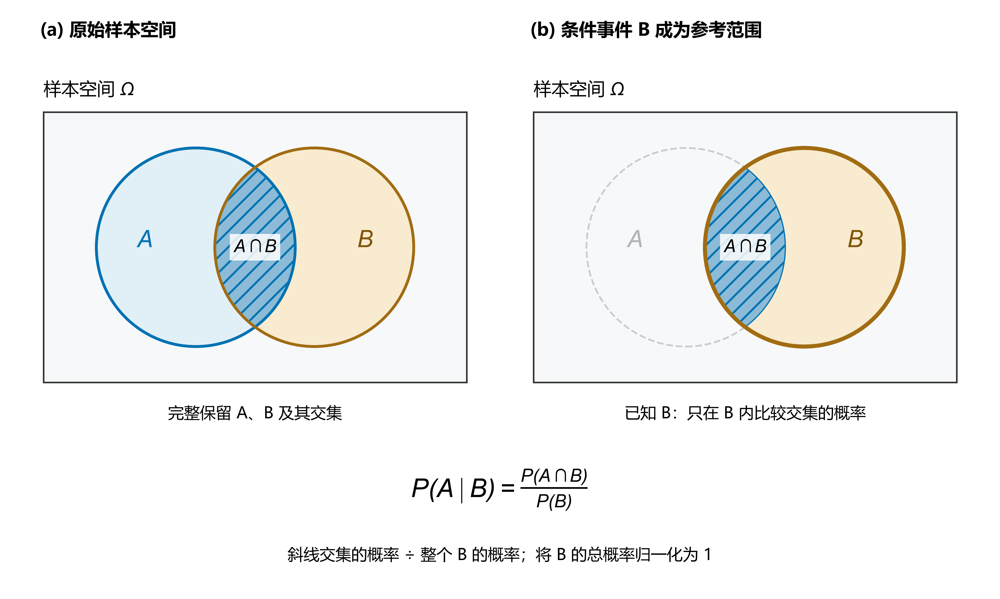
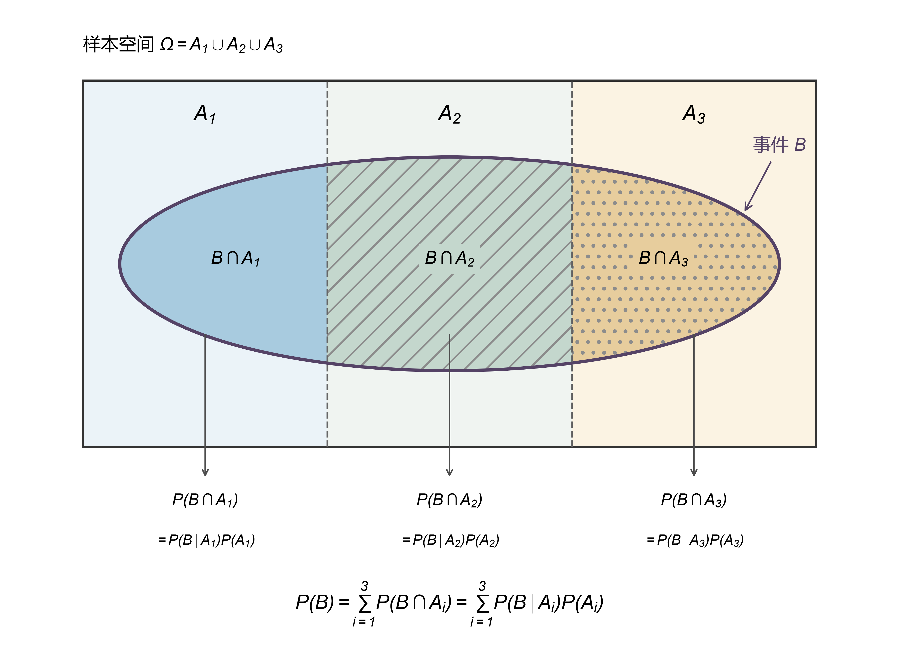
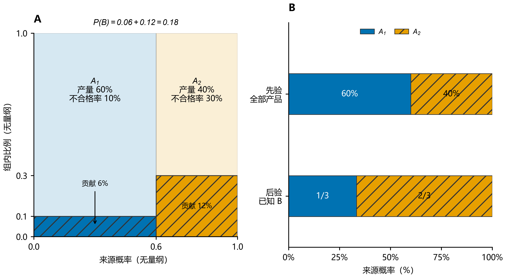
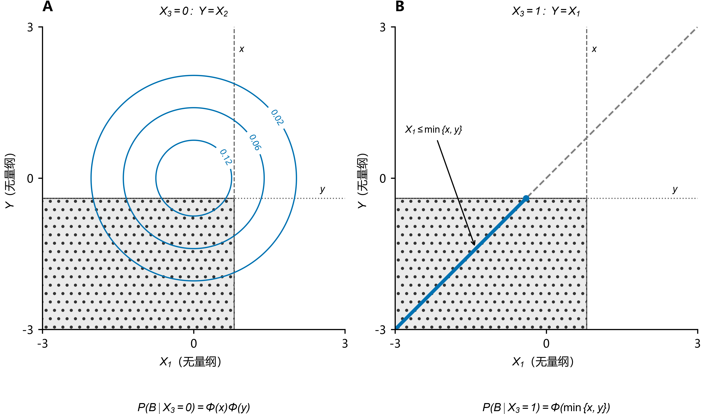

# 条件概率、全概率与贝叶斯

从样本空间出发：限制范围、互斥分解与重新归一化。

> 三者围绕同一个量 $P(A_i\cap B)$ 展开：条件概率把交集概率除以参考事件的概率；全概率把互斥的交集概率相加；贝叶斯在已知 $B$ 后，比较各交集占 $B$ 的比例。

前置概念见 [随机事件与概率](01_随机事件与概率.md)。本文集中说明集合推导，并用随机开关构造联合分布；联合分布的基础见 [二维随机变量及其分布](03_二维随机变量及其分布.md)。

## 1. 事件是集合，随机变量是函数

在概率空间 $(\Omega,\mathcal F,P)$ 中，样本点 $\omega\in\Omega$ 是一次试验的具体结果；事件 $A\in\mathcal F$ 是一组结果；实随机变量（random variable）$X:\Omega\to\mathbb R$ 是可测函数。

因此，$\{X\le x\}$ 不是一个数，而是事件的简写：

$$
\{X\le x\}=\{\omega\in\Omega:X(\omega)\le x\}.
$$

求分布函数仍是在求事件概率。后面的推导依赖事件的交、并、划分，概率的可加性，以及条件概率的定义。

## 2. 条件概率：限制到已知事件，再归一化

已知 $B$ 发生，实际结果只能落在 $B$ 中。若 $P(B)>0$，**条件概率**（conditional probability）定义为

$$
\boxed{P(A\mid B)=\frac{P(A\cap B)}{P(B)}.}
$$

分子保留“满足已知条件且目标发生”的概率；分母把保留范围 $B$ 的总概率重新归一化为 $1$。它保留原有的相对权重，并不把 $B$ 内的结果变成等可能。

图 1：外框是完整样本空间 $\Omega$，蓝色圆是事件 $A$，赭色圆是事件 $B$，斜线透镜形区域是交集 $A\cap B$。左图保留两个完整事件；右图弱化 $B$ 外的部分，强调分母是**整个 $B$ 的概率**，分子是**交集的概率**。圆形仅示意集合关系，面积不对应给定的概率数值。

例如 $P(B)=0.60$、$P(A\cap B)=0.24$ 时，$P(A\mid B)=0.24/0.60=0.40$。这个 $0.40$ 表示交集在条件概率中的占比，而不是交集在整个样本空间中的概率。

条件概率定义立即给出**乘法公式**（multiplication rule）：

$$
\boxed{P(A\cap B)=P(A\mid B)P(B)=P(B\mid A)P(A).}
$$

使用哪一侧条件概率，就要求它的条件事件具有正概率。$P(A\mid B)$ 与 $P(B\mid A)$ 的分子相同，分母分别为 $P(B)$ 和 $P(A)$，所以二者**一般不相等，也可能在特定情形下相等**。

## 3. 全概率：先作互斥分解，再加权求和

### 3.1 样本空间的划分怎样分解目标事件

若 $A_1,\ldots,A_n$ 满足

$$
\bigcup_{i=1}^nA_i=\Omega,\qquad A_i\cap A_j=\varnothing\quad(i\ne j),
$$

则称它们构成**完备事件组**，即样本空间的一个**划分**（partition）。对任意事件 $B$，由集合的分配律，

$$
B=B\cap\Omega
=B\cap\left(\bigcup_{i=1}^nA_i\right)
=\bigcup_{i=1}^n(B\cap A_i).
$$

这些交集两两互斥，因为

$$
(B\cap A_i)\cap(B\cap A_j)=B\cap(A_i\cap A_j)=\varnothing.
$$

于是由概率可加性，

$$
\boxed{P(B)=\sum_{i=1}^nP(B\cap A_i).}
$$

**这一步尚未使用条件概率。** 它是“把目标事件拆成互不重叠的部分，再把概率加回来”。

图 2：外框是 $\Omega$，虚线将它划分为互不重叠的 $A_1,A_2,A_3$；紫灰色椭圆轮廓表示同一个事件 $B$。椭圆被分区边界切成 $B\cap A_1$、$B\cap A_2$、$B\cap A_3$ 三块，它们互斥且恰好拼成整个 $B$。箭头将各块对应到其交集概率，再用乘法公式写成 $P(B\mid A_i)P(A_i)$；三项相加即得 $P(B)$。颜色、纹理与分区标签共同区分各块；图仅表示集合关系，不按概率大小绘制。

### 3.2 用乘法公式得到全概率公式

若各 $P(A_i)>0$，代入 $P(B\cap A_i)=P(B\mid A_i)P(A_i)$，得到**全概率公式**（law of total probability）：

$$
\boxed{P(B)=\sum_{i=1}^nP(B\mid A_i)P(A_i).}
$$

$P(A_i)$ 是权重，$P(B\mid A_i)$ 是各组内部发生 $B$ 的比例；二者相乘才是该组对总体事件 $B$ 的贡献。不能直接把各组的条件概率相加。

有限划分中若有 $P(A_i)=0$，对应交集概率也是零，可先略去该项，避免写未定义的条件概率。可列划分同样适用，可加性换成可列可加性。

## 4. 贝叶斯：在结果内部比较各来源

在上述划分下，若 $P(B)>0$，由条件概率和乘法公式，得到**贝叶斯公式**（Bayes' theorem）：

$$
\begin{aligned}
P(A_i\mid B)
&=\frac{P(A_i\cap B)}{P(B)}\\
&=\frac{P(B\mid A_i)P(A_i)}{P(B)}\\
&=\boxed{\frac{P(B\mid A_i)P(A_i)}{\displaystyle\sum_{j=1}^nP(B\mid A_j)P(A_j)}}.
\end{aligned}
$$

| 名称 | 数学量 | 含义 |
| --- | --- | --- |
| 先验概率（prior probability） | $P(A_i)$ | 观察 $B$ 前，各来源的概率 |
| 似然（likelihood） | $P(B\mid A_i)$ | 把已观察到的 $B$ 固定，比较各来源产生它的可能性 |
| 证据概率（evidence） | $P(B)$ | 各来源产生 $B$ 的总概率，是归一化因子 |
| 后验概率（posterior probability） | $P(A_i\mid B)$ | 观察 $B$ 后，各来源在 $B$ 中的占比 |

因此“后验 $\propto$ 先验 $\times$ 似然”，分母保证 $\sum_iP(A_i\mid B)=1$。“由结果反推来源”是常用解释；$A_i$ 也可以只是互斥类别，公式本身不要求因果关系。

## 5. 同一组设备数据，看清三个分母

从所有产品中等概率随机抽一件，令 $A_i$ 表示“来自设备 $i$”，$B$ 表示“不合格”。采用以下模型：

| 来源 | 产量占比 $P(A_i)$ | 组内不合格率 $P(B\mid A_i)$ | 总体不合格贡献 $P(A_i\cap B)$ |
| --- | --- | --- | --- |
| 设备 $A_1$ | $0.60$ | $0.10$ | $0.60\times0.10=0.06$ |
| 设备 $A_2$ | $0.40$ | $0.30$ | $0.40\times0.30=0.12$ |

先用全概率计算总体不合格概率：

$$
P(B)=0.06+0.12=0.18.
$$

再在“不合格”这个范围内计算来源：

$$
P(A_1\mid B)=\frac{0.06}{0.18}=\frac13,\qquad
P(A_2\mid B)=\frac{0.12}{0.18}=\frac23.
$$

图 3：A 中各列宽为产量占比，斜线区域高为组内不合格率，其面积分别是总体的 $6\%$ 和 $12\%$；两块斜线区域的并集就是 $B$。B 对比所有产品中的来源比例与已知不合格后的来源比例。蓝色实色表示 $A_1$，橙色与纹理表示 $A_2$；左图两组的不合格区域均带纹理。数值由模型精确计算，不是抽样统计量，无误差条。

三个容易混淆的量分别为：

- $P(B\mid A_1)=10\%$：**设备 1 的产品中**，不合格的占比。
- $P(A_1\cap B)=6\%$：**全部产品中**，来自设备 1 且不合格的占比。
- $P(A_1\mid B)=1/3$：**所有不合格产品中**，来自设备 1 的占比。

设备 1 虽占总产量的 $60\%$，但不合格率更低，因此在不合格品中的占比降为 $1/3$。

## 6. 应用：随机开关如何构造联合分布

### 6.1 完整假设与事件划分

设 $X_1,X_2,X_3$ **相互独立**，且

$$
X_1,X_2\sim N(0,1),\qquad X_3\sim\operatorname{Bernoulli}(1/2),
\qquad Y=X_3X_1+(1-X_3)X_2.
$$

记标准正态分布函数为 $\Phi$，求

$$
F_{X_1,Y}(x,y)=P(X_1\le x,Y\le y).
$$

对固定阈值 $x,y$，令

$$
C_0=\{X_3=0\},\quad C_1=\{X_3=1\},\quad
B=\{X_1\le x,Y\le y\}.
$$

$C_0,C_1$ 两两互斥、覆盖样本空间，故

$$
P(B)=P(B\cap C_0)+P(B\cap C_1)
=\frac12P(B\mid C_0)+\frac12P(B\mid C_1).
$$

### 6.2 两个分支分别化简目标事件

当 $X_3=0$ 时，$Y=X_2$。由于 $X_3$ 与 $(X_1,X_2)$ 独立，条件化不改变二者的联合分布，再由 $X_1,X_2$ 独立，

$$
P(B\mid C_0)=P(X_1\le x,X_2\le y)=\Phi(x)\Phi(y).
$$

当 $X_3=1$ 时，$Y=X_1$，两个不等式限制同一个变量，因而

$$
\begin{aligned}
P(B\mid C_1)
&=P(X_1\le x,X_1\le y)\\
&=P(X_1\le\min\{x,y\})=\Phi(\min\{x,y\}).
\end{aligned}
$$

最终得到

$$
\boxed{F_{X_1,Y}(x,y)
=\frac12\Phi(x)\Phi(y)+\frac12\Phi(\min\{x,y\}).}
$$

图 4：取 $x=0.8,y=-0.4$，点状阴影表示左下矩形事件 $B$。A 为 $X_3=0$ 分支，蓝线是条件联合密度 $\varphi(u)\varphi(v)$ 的等高线，数字是无量纲密度值；B 为 $X_3=1$ 分支，概率集中在 $Y=X_1$ 上，蓝色线段表示 $X_1\le\min\{x,y\}$。两分支各乘权重 $1/2$ 后相加。视窗仅展示 $[-3,3]^2$，公式包含整个实数范围；B 中线宽不代表二维密度。

### 6.3 哪些条件负责哪一步

| 条件或结构 | 作用 |
| --- | --- |
| $X_3$ 只取 $0,1$ | 构造两个互斥且完备的分支 |
| $P(X_3=1)=1/2$ | 给出两个分支的权重 |
| $X_3$ 与 $(X_1,X_2)$ 独立 | 条件化后仍可使用原有分布 |
| $X_1,X_2$ 独立 | 将第一分支的联合概率化为乘积 |
| 第二分支 $Y=X_1$ | 两个阈值合并为 $\min\{x,y\}$ |

仅由 $X_3$ 离散，不能推出分支内的乘积公式。若改为 $X_3\sim\operatorname{Bernoulli}(p)$ 且仍保持相互独立，则结果为

$$
F_{X_1,Y}(x,y)=(1-p)\Phi(x)\Phi(y)+p\Phi(\min\{x,y\}).
$$

本例还说明：$X_1$ 与 $Y$ 的边缘分布都为标准正态，但 $P(Y=X_1)=1/2$，一半概率集中于面积为零的对角线，因此**不存在覆盖全部概率的普通二维联合密度**。这时从事件出发计算联合分布函数最直接。

## 7. 统一的解题顺序

| 问题 | 对样本空间的操作 | 公式 |
| --- | --- | --- |
| 已知 $B$，求 $A$ 的概率 | 限制到 $B$ 并归一化 | $P(A\mid B)=P(A\cap B)/P(B)$ |
| 多种互斥情况产生 $B$，求总概率 | 分解 $B$ 后求和 | $P(B)=\sum_iP(B\mid A_i)P(A_i)$ |
| 已观察到 $B$，求各来源概率 | 在 $B$ 内比较交集占比 | $P(A_i\mid B)=P(B\mid A_i)P(A_i)/P(B)$ |

解题时依次写出目标事件、选取完备划分、化简各分支，再使用题目明确给出的独立性。最值得记住的集合关系是

$$
\boxed{B=\bigcup_i(B\cap A_i)
\quad\Longrightarrow\quad P(B)=\sum_iP(B\cap A_i).}
$$

全概率的依据是事件划分；是否用离散变量描述划分，是建模方式的选择。连续变量也能通过互斥区间构造有限划分，但连续变量的单点事件通常概率为零，不能直接套用这里的正概率事件条件公式。

[配图与复现说明](image/条件概率、全概率与贝叶斯/README.md) · [返回概率论索引](README.md)
