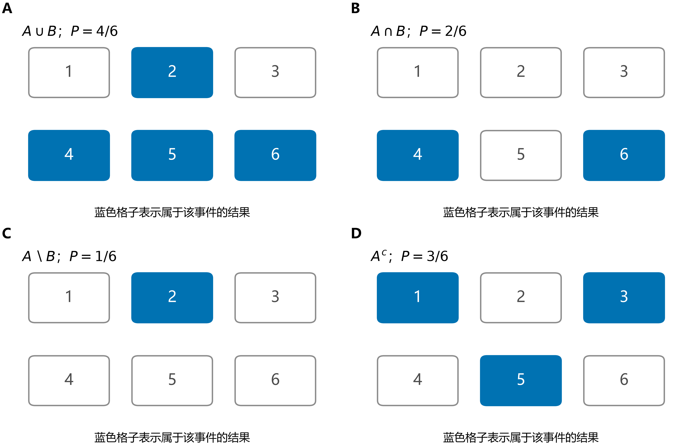
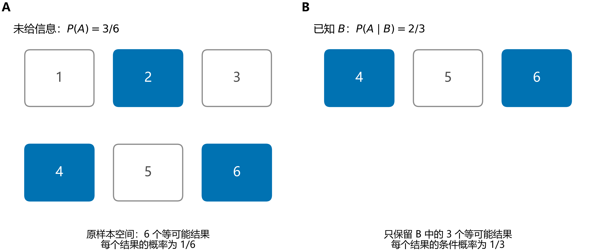
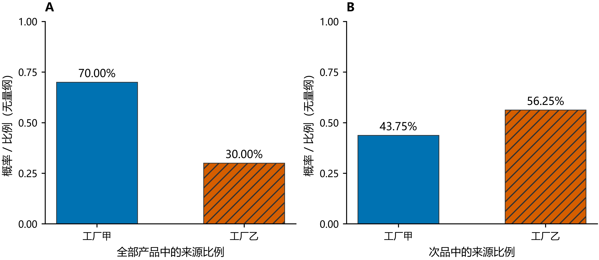

# 随机事件与概率

> 核心主线：**先说清可能出现哪些结果，再说清哪些结果算作目标事件，最后在明确的模型下计算它占多少概率。** 条件概率是收到信息后的重新归一化；独立性是不因这条信息而改变概率；贝叶斯公式是根据结果反推来源。

## 1. 随机试验、样本空间与事件

### 1.1 随机不等于毫无规律

**随机试验**（random experiment）是可以在规定条件下进行、事先能描述可能结果，却不能预先确定本次具体结果的试验。

例如掷一次骰子：知道点数在 $1$ 到 $6$ 之间，却不能预先确定这次是几。这里既有不确定性，也有可描述的结构。

“随机”本身不保证各结果等可能。只有明确假设骰子均匀、公平时，才采用每个点数概率为 $1/6$ 的模型。

### 1.2 样本点是结果，事件是一组结果

**样本空间**（sample space）记为 $\Omega$，是所有可能结果的集合；其中的一个元素 $\omega$ 称为**样本点**（sample point）。

掷一次骰子时，

$$
\Omega=\{1,2,3,4,5,6\}.
$$

**随机事件**（random event）是一组满足指定条件的结果，用集合 $A\subseteq\Omega$ 表示。例如

$$
A=\{2,4,6\}=\{\text{出现偶数点}\}.
$$

如果实际结果 $\omega$ 属于 $A$，就说事件 $A$ 发生。实际掷出 $4$ 时，“偶数点”“大于 $3$”“不是 $1$”这些事件可以同时发生，因为一个结果可以属于多个集合。

| 对象 | 在骰子例子中的含义 |
| --- | --- |
| 样本点 $\omega=4$ | 本次具体结果是 $4$ |
| 事件 $A=\{2,4,6\}$ | 所有关心的偶数结果 |
| 必然事件 $\Omega$（certain event） | 无论出现哪个结果，都属于它 |
| 不可能事件 $\varnothing$（impossible event） | 没有任何结果属于它 |

**事件不是“这次发生了什么”，而是“哪些结果出现时，我就认为条件成立”。**

### 1.3 样本空间要与试验规则对应

连续掷两次硬币，若记录每次的正反面，可取

$$
\Omega=\{\text{正正},\text{正反},\text{反正},\text{反反}\}.
$$

若两次独立且硬币公平，四个结果等可能。事件“恰好出现一次正面”为

$$
A=\{\text{正反},\text{反正}\}.
$$

也可以只记录正面的次数 $0,1,2$，但这三个数的概率分别是 $1/4,1/2,1/4$，**不是**各为 $1/3$。把多个结果合并成一种记录，并不会自动保留等可能性。

## 2. 事件运算：把日常语言翻译成集合

### 2.1 “或”“且”“不是”分别对应什么

继续使用骰子，令

$$
A=\{2,4,6\}\quad\text{（偶数）},\qquad
B=\{4,5,6\}\quad\text{（大于 3）}.
$$

| 日常说法 | 集合记号 | 含义 | 本例中的结果 |
| --- | --- | --- | --- |
| $A$ 或 $B$ 发生 | $A\cup B$ | 至少一个发生，也包含同时发生 | $\{2,4,5,6\}$ |
| $A$ 且 $B$ 发生 | $A\cap B$，也写 $AB$ | 两个同时发生 | $\{4,6\}$ |
| $A$ 发生，$B$ 不发生 | $A\setminus B=A\cap B^c$ | 属于 $A$，但排除 $B$ | $\{2\}$ |
| $A$ 不发生 | $A^c$，也写 $\overline A$ | 在 $\Omega$ 中而不在 $A$ 中 | $\{1,3,5\}$ |
| $A,B$ 恰好一个发生 | $A\triangle B$ | 两边都取，但去掉共同部分 | $\{2,5\}$ |

$\cup$、$\cap$、$A^c$、$\setminus$ 分别称为并集（union）、交集（intersection）、补集（complement）、差集（set difference）；$\triangle$ 称为对称差（symmetric difference）。

每个格子都是一个骰子结果，蓝色表示该结果属于目标事件。在公平骰子模型中，每个格子权重相同，所以可以直接按格子数算概率。图中没有改变样本空间，只改变了选中哪些结果。

### 2.2 包含、互斥与对立

如果 $A\subseteq B$，则 $A$ 一发生，$B$ 就一定发生。例如“点数是 $6$”包含于“点数是偶数”。

如果 $A\cap B=\varnothing$，称 $A,B$ **互斥**（mutually exclusive）：它们不能在同一次试验中同时发生。例如“点数是 $1$”与“点数是 $2$”。

如果还满足 $A\cup B=\Omega$，则 $A,B$ 是**对立事件**（complementary events），即 $B=A^c$。例如“偶数点”与“奇数点”。

互斥只要求“不能同时发生”，还可能两个都不发生；对立还要求“必有一个发生”。掷出 $3$ 时，“点数是 $1$”与“点数是 $2$”就都没有发生。

### 2.3 “至少一个”的反面是“一个也没有”

**德摩根律**（De Morgan's laws）为

$$
(A\cup B)^c=A^c\cap B^c,\qquad
(A\cap B)^c=A^c\cup B^c.
$$

它们对应两句自然语言：

- “至少一个发生”的反面，是“两个都不发生”。
- “两个都发生”的反面，是“至少一个不发生”。

若有 $n$ 个事件，

$$
\left(\bigcup_{i=1}^nA_i\right)^c=\bigcap_{i=1}^nA_i^c.
$$

因此遇到“至少一次”“至少一个”时，可以先考虑“零次”“一个也没有”，后者往往更容易计算。

## 3. 概率：给事件分配一致的权重

### 3.1 概率的三个公理

**概率**（probability）$P(A)$ 是模型赋予事件 $A$ 的数值。它不是任意打分，需要满足：

1. **非负性**：$P(A)\ge0$。
2. **归一性**：$P(\Omega)=1$。
3. **可列可加性**：若 $A_1,A_2,\ldots$ 两两互斥，则

$$
P\left(\bigcup_{i=1}^{\infty}A_i\right)=\sum_{i=1}^{\infty}P(A_i).
$$

第三条的直观含义是：把一个事件拆成互不重叠的部分，各部分概率可以直接相加。要求互斥，是为了避免重复计算同一结果。

严格的概率空间记为 $(\Omega,\mathcal F,P)$。$\mathcal F$ 是允许讨论概率的事件集合，需对取补集、可列并等操作封闭。有限样本空间中通常把所有子集都作为事件；这里的例子都在这样的明确模型中计算。

### 3.2 常用结论及其理由

| 结论 | 理由或直观解释 |
| --- | --- |
| $P(\varnothing)=0$ | 空事件不包含任何概率质量 |
| $0\le P(A)\le1$ | 非负，而且 $A$ 的概率不能超过整个样本空间 |
| $P(A^c)=1-P(A)$ | $A$ 与 $A^c$ 互斥，合起来是 $\Omega$ |
| 若 $A\subseteq B$，则 $P(A)\le P(B)$ | $B$ 至少包含了 $A$ 的全部结果 |
| $P(A\cup B)=P(A)+P(B)-P(A\cap B)$ | 共同部分被加了两次，要扣回一次 |
| $P(A\setminus B)=P(A)-P(A\cap B)$ | 从 $A$ 中扣掉同时属于 $B$ 的部分 |

以骰子例子为例，$P(A)=P(B)=1/2$，$P(A\cap B)=2/6$，所以

$$
P(A\cup B)=\frac12+\frac12-\frac26=\frac46.
$$

如果直接把 $1/2+1/2$ 当成答案，就把结果 $4,6$ 各算了两次。**“或”的概率可以直接相加，只限于两个事件互斥时。**

三个事件的加法公式为

$$
\begin{aligned}
P(A\cup B\cup C)
={}&P(A)+P(B)+P(C)\\
&-P(A\cap B)-P(A\cap C)-P(B\cap C)\\
&+P(A\cap B\cap C).
\end{aligned}
$$

三者共同部分先被加三次、再被减三次，所以最后要补回一次。

### 3.3 概率与频率不是同一个量

进行 $n$ 次试验，事件 $A$ 发生了 $n_A$ 次，则其**频率**（relative frequency）为

$$
\nu_n(A)=\frac{n_A}{n}.
$$

概率 $P(A)$ 属于所采用的模型；频率来自这一批实际记录。公平硬币正面概率为 $1/2$，但投 $10$ 次得到 $7$ 次正面，频率就是 $0.7$，两者不矛盾。

在独立、同分布等条件下，大数定律说明：试验次数很大时，频率会趋近概率。这不表示小样本必须均衡，也不表示“前面正面多了，下一次就该反面”。独立公平投掷中，下一次正面的概率仍为 $1/2$。

### 3.4 零概率不总等于不可能

若样本空间有限且每个样本点的概率都为正，那么 $P(A)=0$ 确实意味着 $A=\varnothing$。

一般模型中却不能反过来推断。例如在 $[0,1]$ 上按长度均匀取数，

$$
P(X=1/2)=0,
$$

但结果 $1/2$ 仍属于取值范围，事件并不是空集。类似地，$P(X\ne1/2)=1$，也不表示它包含全部样本点。概率为 $1$ 的事件称为**几乎必然**（almost sure）发生；它与事件恰好等于 $\Omega$ 在一般模型中需要区分。

## 4. 怎样得到具体的概率模型

### 4.1 古典概型：有限、等可能，才能数结果

**古典概型**（classical probability model）要求样本空间中只有有限个样本点，而且各点等可能。此时

$$
\boxed{P(A)=\frac{|A|}{|\Omega|}.}
$$

这里 $|A|$ 表示事件包含的样本点数量。它是概率计算的一个特殊方法，不是所有概率的定义。

两次独立公平投掷硬币，事件“恰好一次正面”包含两个有序结果，因此概率为 $2/4=1/2$。若只看正面次数 $0,1,2$，却把它们当成等可能，便会误算成 $1/3$。

### 4.2 抽球：先决定是否区分顺序

袋中有 $3$ 个红球、$2$ 个白球，球彼此可区分，每次从剩余球中等概率抽取。连续抽两个，**不放回**，求两球都红的概率。

按有序结果计数：总数 $5\times4=20$，有利结果 $3\times2=6$，所以

$$
P(\text{两球都红})=\frac6{20}=\frac3{10}.
$$

按无序组合计数：总数 $\binom52=10$，有利结果 $\binom32=3$，同样得到 $3/10$。

两种描述都可以，但分子与分母必须使用同一规则。不能分子用组合数、分母用排列数。

### 4.3 几何概型：数点换成量长度或面积

若在有限长度、面积或体积的区域 $D$ 中**均匀**取点，则**几何概型**（geometric probability model）给出

$$
P(A)=\frac{\text{事件区域的几何量}}{\text{整个取点区域的几何量}}.
$$

例如在长度为 $10$ 的线段上均匀选点，落在从 $3$ 到 $5$ 的部分的概率为 $(5-3)/10=0.2$。单个点的长度为零，因此概率为零；有长度的区间却能有正概率。

关键仍然是“均匀”。若取点更偏向某些位置，就需要用密度加权，不能直接取长度或面积的比例。

## 5. 条件概率：收到信息后，改变参照范围

### 5.1 为什么要除以 $P(B)$

已知事件 $B$ 发生，问 $A$ 的概率，这称为**条件概率**（conditional probability）。若 $P(B)>0$，定义

$$
\boxed{P(A\mid B)=\frac{P(A\cap B)}{P(B)}.}
$$

它有两个动作：

1. 只保留符合已知信息 $B$ 的结果。
2. 将剩下的总概率 $P(B)$ 重新归一化为 $1$。

在保留下来的范围内，目标是 $A\cap B$，所以用它的原概率除以保留部分的总概率。内部的相对权重不变，并不是强行把剩下的结果改成等可能。

### 5.2 骰子例子：分母从六个结果变成三个

仍令 $A$ 表示偶数点，$B$ 表示点数大于 $3$。原来 $P(A)=3/6$；已知 $B$ 后，只剩 $\{4,5,6\}$，其中偶数是 $\{4,6\}$，所以

$$
P(A\mid B)=\frac{2/6}{3/6}=\frac23.
$$

图左在六个结果中看偶数，图右在已知的大于 $3$ 的三个结果中看偶数。**同一个事件 $A$，面对不同的已知信息，概率可以不同。**

但 $P(A\cap B)=1/3$，它是在原来的全部结果中算“两个条件一起满足”；$P(A\mid B)=2/3$，是在 $B$ 内部算 $A$ 的比例。两者的参照范围不同。

### 5.3 乘法公式：先发生一部分，再接上条件

由条件概率定义直接得到

$$
\boxed{P(A\cap B)=P(B)P(A\mid B)=P(A)P(B\mid A),}
$$

其中使用条件概率的那一项，分母事件必须有正概率。对一串事件，可依次展开：

$$
P(A_1\cap\cdots\cap A_n)
=P(A_1)\prod_{k=2}^nP(A_k\mid A_1\cap\cdots\cap A_{k-1}),
$$

要求用到的条件事件均有正概率。

“先”在这里是分解计算的次序，不要求事件具有实际时间先后，也不表示因果关系。

### 5.4 抽球例子：第二次的概率为什么变了

令 $R_1,R_2$ 分别表示第一次、第二次抽到红球。不放回时

$$
P(R_1)=\frac35,\qquad P(R_2\mid R_1)=\frac24,
$$

因为已知第一次红球后，剩下的是 $2$ 红 $2$ 白。于是

$$
P(R_1\cap R_2)=\frac35\cdot\frac24=\frac3{10}.
$$

这与第 4.2 节计数得到的答案一致。若每次抽完放回、充分混匀再独立抽取，则第二次仍为 $3/5$，两次都红的概率改为 $9/25$。

| 抽样规则 | $P(R_2\mid R_1)$ | 两次都红 |
| --- | --- | --- |
| 不放回 | $2/4$ | $3/10$ |
| 放回后独立抽取 | $3/5$ | $9/25$ |

需要区分条件概率与边缘概率：不放回时，未告诉第一次结果，$P(R_2)$ 仍是 $3/5$；告诉第一次红球后，才变成条件概率 $1/2$。

### 5.5 条件概率不对称，也不直接表示因果

$P(A\mid B)$ 与 $P(B\mid A)$ 一般不同：两者共同部分相同，分母不同。后面的工厂例子会给出 $P(\text{次品}\mid\text{乙厂})=3\%$，但 $P(\text{乙厂}\mid\text{次品})=56.25\%$。

此外，已知一个事件后另一个更容易发生，不足以证明前者导致后者；二者可能受到共同因素影响。条件概率描述信息下的概率规律，因果解释还需要额外的模型和证据。

普通事件条件概率要求 $P(B)>0$。若要讨论连续变量恰好等于某个数时的条件分布，需要条件密度等方法，见[二维随机变量的条件分布](二维随机变量及其分布.md#marginal-conditional)。

## 6. 独立性：知道一个事件，不改变另一个的概率

### 6.1 定义与直观含义

若

$$
\boxed{P(A\cap B)=P(A)P(B),}
$$

则称事件 $A,B$ **相互独立**（independent）。这个定义即使有零概率事件也有意义。

若 $P(B)>0$，它等价于

$$
P(A\mid B)=P(A).
$$

因此，独立的本质是：**把“$B$ 已发生”这条信息告诉你，不改变你对 $A$ 的概率判断。**

放回后独立抽球时，第一次抽到红球不影响第二次的概率；不放回时却会改变，所以不能默认两次独立。

“发生在不同时间”“看起来没有联系”都不是数学证明。独立性应来自明确的模型假设，或通过概率乘积关系验证。

### 6.2 互斥与独立回答不同的问题

| 概念 | 问的是什么 | 数学条件 |
| --- | --- | --- |
| 互斥 | 能否在同一次试验中同时发生？ | $A\cap B=\varnothing$ |
| 独立 | 得知一个已发生，会不会改变另一个的概率？ | $P(A\cap B)=P(A)P(B)$ |

例如偶数点与奇数点互斥，且两者概率都为 $1/2$。已知出现奇数，偶数的条件概率立刻变成 $0$，显然不是原来的 $1/2$，因此它们不独立。

一般地，若两个互斥事件的概率都为正，就不可能独立，因为

$$
P(A\cap B)=0\ne P(A)P(B)>0.
$$

若其中一个概率为零，则互斥与独立可以同时成立。所以“互斥与独立永远不能同时成立”也不准确。

### 6.3 同一次掷骰子中的两个事件也可以独立

令 $A$ 为偶数点，$C$ 为点数能被 $3$ 整除，即 $C=\{3,6\}$。则

$$
P(A)=\frac12,\quad P(C)=\frac13,\quad
P(A\cap C)=P(\{6\})=\frac16=\frac12\cdot\frac13.
$$

所以 $A,C$ 独立。已知点数是 $3$ 或 $6$ 后，偶数在这两个结果中仍占一半。

与第 5 节的 $B=\{4,5,6\}$ 对比：$A,B$ 不独立，因为 $P(A\mid B)=2/3\ne1/2$。**独立性是指定事件之间的关系，不能仅凭“属于同一次试验”来否定或肯定。**

### 6.4 独立事件的补事件仍然独立

若 $A,B$ 独立，则 $A^c,B$，$A,B^c$，$A^c,B^c$ 也分别独立。例如

$$
\begin{aligned}
P(A^c\cap B)
&=P(B)-P(A\cap B)\\
&=P(B)[1-P(A)]=P(A^c)P(B).
\end{aligned}
$$

因此，在相互独立的 $n$ 次试验中，若每次成功概率都是 $p$，则

$$
\boxed{P(\text{至少成功一次})=1-(1-p)^n.}
$$

因为“至少一次”的补事件是“每次都失败”，后者可利用独立性连乘。例如 $n=5,p=0.2$ 时，概率为 $1-0.8^5=0.67232$。直接计算 $5\times0.2$ 会重复计算多次成功的结果。

### 6.5 两两独立不等于相互独立

多个事件**两两独立**（pairwise independent），只要求每一对满足乘积关系；**相互独立**（mutually independent），要求任意至少两个事件的交集概率都等于各自概率的乘积。

仍用两次独立公平投掷硬币，令

- $A$：第一次正面。
- $B$：第二次正面。
- $C$：两次结果相同。

| 等可能结果 | $A$ 是否发生 | $B$ 是否发生 | $C$ 是否发生 |
| --- | --- | --- | --- |
| 正正 | 是 | 是 | 是 |
| 正反 | 是 | 否 | 否 |
| 反正 | 否 | 是 | 否 |
| 反反 | 否 | 否 | 是 |

三者各有概率 $1/2$，任意一对同时发生的概率都是 $1/4$，所以两两独立。但是

$$
P(A\cap B\cap C)=\frac14\ne\left(\frac12\right)^3=\frac18.
$$

因为知道 $A,B$ 都发生后，$C$ 必然发生，故三者不相互独立。多个事件连乘时，不能只检查每一对。

## 7. 全概率与贝叶斯：同一张表的两个方向

### 7.1 用一个工厂例子讲清问题

设仓库产品来自甲、乙两厂，从全部产品中等概率随机取一件。采用以下模型：

| 来源 | 在全部产品中的比例 | 该厂产品中的次品率 |
| --- | --- | --- |
| 甲厂 $H_1$ | $70\%$ | $1\%$ |
| 乙厂 $H_2$ | $30\%$ | $3\%$ |

令 $D$ 表示“抽到次品”。现在有两个不同问题：

1. 还不知道质量，随机取一件，是次品的概率有多大？
2. 已经知道是次品，它来自乙厂的概率有多大？

第一个沿“来源 → 质量”计算，第二个沿“质量 → 来源”反推。

### 7.2 全概率：分来源算，再加起来

把次品拆成互斥的两部分：“甲厂且次品”“乙厂且次品”。于是

$$
\begin{aligned}
P(D)
&=P(H_1\cap D)+P(H_2\cap D)\\
&=P(H_1)P(D\mid H_1)+P(H_2)P(D\mid H_2)\\
&=0.7\times0.01+0.3\times0.03\\
&=0.016=1.6\%.
\end{aligned}
$$

这就是**全概率公式**（law of total probability）：不同来源各贡献多少，全部加起来。

若 $H_1,\ldots,H_n$ 两两互斥、并集为 $\Omega$，且每个 $P(H_i)>0$，称它们构成一个**完备事件组**（partition），则对任意事件 $A$，

$$
\boxed{P(A)=\sum_{i=1}^nP(H_i)P(A\mid H_i).}
$$

来源概率是权重，不能随意把条件概率取算术平均。本例 $(1\%+3\%)/2=2\%$ 不正确，因为两厂产品各占的比例不是一半。

### 7.3 贝叶斯：在结果内部比较各来源的贡献

知道产品是次品后，乙厂占这些次品的多少？直接使用条件概率：

$$
\begin{aligned}
P(H_2\mid D)
&=\frac{P(H_2\cap D)}{P(D)}\\
&=\frac{0.3\times0.03}{0.7\times0.01+0.3\times0.03}\\
&=\frac9{16}=56.25\%.
\end{aligned}
$$

这就是**贝叶斯公式**（Bayes' theorem）。在上述完备事件组下，若 $P(A)>0$，

$$
\boxed{P(H_k\mid A)=
\frac{P(H_k)P(A\mid H_k)}{\sum_iP(H_i)P(A\mid H_i)}.}
$$

分子是目标来源对这个结果的贡献；分母是所有来源对这个结果的总贡献。它没有额外神秘的计算规则，就是条件概率配上全概率公式。

### 7.4 用一万件产品的数表看懂两个分母

把上述比例换算成一万件产品的模型数表，可得到：

| 来源 | 次品 $D$ | 合格品 $D^c$ | 合计 |
| --- | --- | --- | --- |
| 甲厂 $H_1$ | $70$ | $6930$ | $7000$ |
| 乙厂 $H_2$ | $90$ | $2910$ | $3000$ |
| 合计 | $160$ | $9840$ | $10000$ |

这些是按给定比例换算的数值，用于解释模型，并非宣称一批独立随机样本必然精确出现这些数量。

- 问“全部产品中有多少次品”：$160/10000=1.6\%$。
- 问“乙厂产品中有多少次品”：$90/3000=3\%$。
- 问“次品中有多少来自乙厂”：$90/160=56.25\%$。

共同的数字 $90$ 没有变，**变的是拿谁作分母**。因此 $P(D\mid H_2)$ 与 $P(H_2\mid D)$ 可以相差很大。

图 A 是随机抽取前的来源比例；图 B 是只在次品中观察来源的比例。乙厂在全部产品中只占 $30\%$，但因为次品率较高，在次品中占了 $56.25\%$。

### 7.5 先验、似然与后验分别是什么

| 名称 | 数学量 | 工厂例子的含义 |
| --- | --- | --- |
| 先验概率（prior probability） | $P(H_i)$ | 尚未知道质量时，产品来自该厂的概率 |
| 似然（likelihood） | $P(D\mid H_i)$，作为来源 $H_i$ 的函数看待 | 若来自该厂，出现次品这一结果有多容易 |
| 后验概率（posterior probability） | $P(H_i\mid D)$ | 知道是次品后，重新判断来源的概率 |

可以把贝叶斯公式记成

$$
\text{后验}\ \propto\ \text{先验}\times\text{似然},
$$

再除以所有候选来源的贡献之和，保证后验概率相加为 $1$。

本例中，乙厂的次品率是甲厂的三倍，但它的总产品量较少。后验要同时考虑**原来有多少该来源的产品**和**该来源多容易产生次品**，不能只比较次品率。

### 7.6 回到抽球：条件变化，平均后边缘仍不变

第 5 节中，不放回抽球时，若第一球红，第二球红的概率为 $2/4$；若第一球白，第二球红的概率为 $3/4$。按第一球颜色分情况：

$$
P(R_2)=\frac35\cdot\frac24+\frac25\cdot\frac34=\frac35.
$$

这解释了为什么“第二次的边缘概率仍是 $3/5$”与“已知第一次红球后，第二次的条件概率是 $1/2$”并不矛盾：边缘概率是对不同条件情形加权平均后的结果。

## 8. 从事件走向随机变量

随机变量是把试验结果映射成数值的规则。它的分布仍然是用事件概率来定义的。

例如两次投掷中，令 $X$ 为正面次数。符号 $\{X=1\}$ 实际就是事件

$$
\{\text{正反},\text{反正}\},
$$

所以 $P(X=1)=1/2$。分布函数 $F_X(x)=P(X\le x)$，则是把“数值不超过 $x$”翻译成事件后求概率。

基础层次可以整理为

$$
\boxed{\text{试验结果}\ \longrightarrow\ \text{事件}\ \longrightarrow\ \text{概率};
\qquad \text{随机变量把结果转成数值}.}
$$

后续见[一维随机变量及其分布](一维随机变量及其分布.md#1-随机变量)；同时研究两个数值及其依赖关系，见[二维随机变量及其分布](二维随机变量及其分布.md#joint-cdf)。

## 9. 解题顺序与易错点

### 9.1 先写清三件事

1. **试验规则是什么？** 公平还是偏置？放回还是不放回？独立还是有关联？
2. **哪些结果算目标？** 把“或”“且”“至少”“恰好”“已知”翻译成事件。
3. **当前是在谁里面算比例？** 原样本空间、某个条件事件，还是已观察到的结果？

确认后再选择工具：

| 问题形式 | 优先考虑 |
| --- | --- |
| 有限、等可能的结果 | 古典概型与一致的计数规则 |
| 至少一次、至少一个 | 补事件 |
| 多个事件一起发生 | 条件概率的乘法公式；有独立性才可简化 |
| 给定某条信息 | 条件概率与归一化 |
| 不同来源都能产生目标结果 | 全概率公式 |
| 已知结果，反推来源 | 贝叶斯公式或对应数表 |

### 9.2 本章最常见的误解

- **“随机就等可能。”** 等可能是模型条件，不能从随机性自动推出。
- **“或就直接相加。”** 有重叠时必须扣除共同部分。
- **“且就直接相乘。”** 总能使用条件乘法；直接乘边缘概率需要独立性。
- **“互斥就是独立。”** 正概率的互斥事件一旦有一个发生，另一个就不可能发生。
- **“$P(A\mid B)=P(B\mid A)$。”** 分母与参照范围不同，一般不相等。
- **“发生概率小，就是不会发生。”** 小概率仍可发生；一般模型中零概率也未必是空事件。
- **“看到某个结果，就能忽略先验。”** 反推来源要同时考虑来源比例与产生该结果的概率。
- **“短期频率必须接近概率。”** 大数规律有相应条件，也不是对每个短期样本的硬性要求。
- **“过去偏离越大，下一次越该补回来。”** 独立试验不会因这种记录而改变下一次概率。
- **“每对都独立，就能把全部概率相乘。”** 多个事件连乘需要相互独立。

### 9.3 用三句话串起全章

**事件是筛选结果的条件；概率是在明确模型下给这些结果的总权重。**

**条件概率保留符合信息的结果并重新归一化；独立性意味着这条信息不改变目标事件的概率。**

**全概率把各来源的贡献加起来；贝叶斯在已观察到的结果中，比较各来源占多少。**

### 9.4 配图与复现

配图使用明确的有限概率模型计算。事件格子图中只有在等可能条件下才能按格子数求概率；工厂图表示模型比例，不附加抽样误差或置信区间。

图片采用 600 dpi PNG，另存矢量 PDF，实际宽度约 $176.9\,\mathrm{mm}$。绘图源代码：[plot_events.py](image/随机事件与概率/plot_events.py)。

返回本区索引：[概率论与数理统计](../README.md#概率论与数理统计)。
